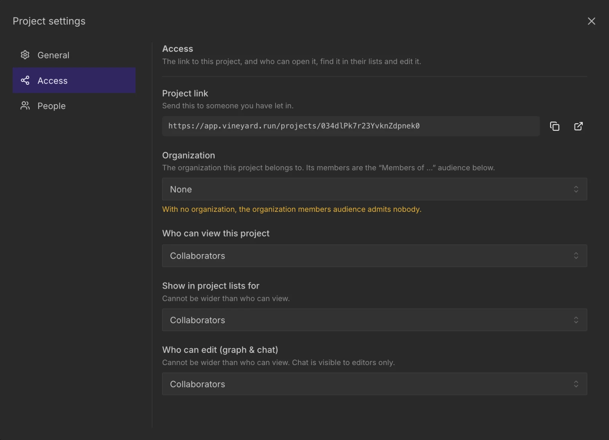
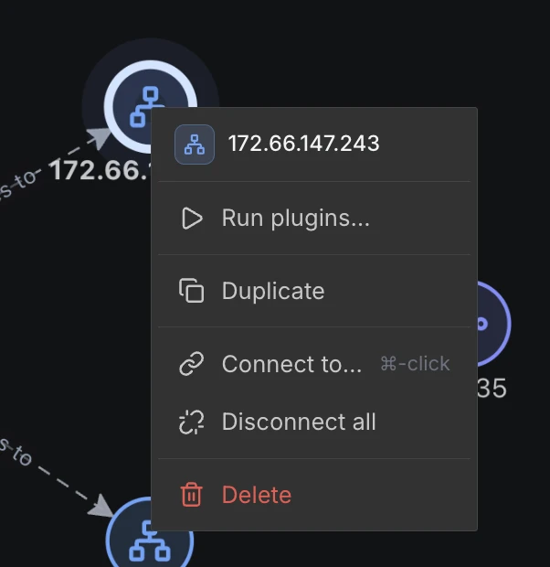
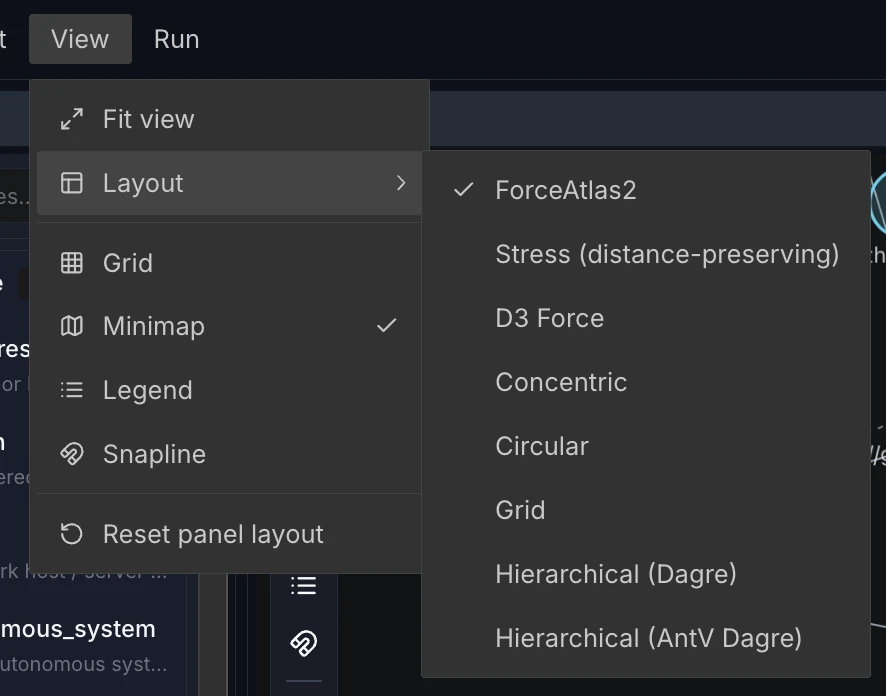
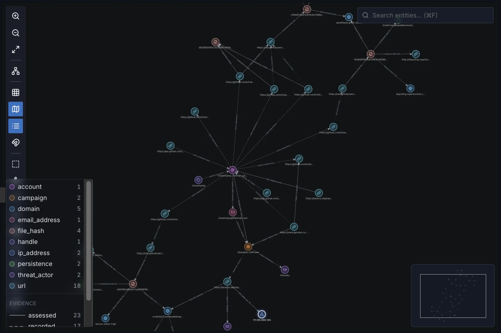

# 캔버스

캔버스는 Vineyard 프로젝트가 존재하는 곳입니다: 팬, 줌, 재배치, 주석이 가능한 그래프 위에 배치된 노드와 엣지. 이 페이지에서는 캔버스 내 툴바와 상단 메뉴 바(**Project / Edit / View / Run**)에서 사용 가능한 모든 컨트롤을 문서화합니다. 대부분은 키로도 쓸 수 있습니다. [단축키](shortcuts.md)를 참조하세요.

## 동일한 작업에 도달하는 두 가지 방법

보기 컨트롤은 두 번 노출되며, 둘은 항상 동기화됩니다:

- **캔버스 내 툴바** — 캔버스 왼쪽 상단 가장자리에 고정된 컴팩트한 세로 막대로, 작업 중 가장 자주 사용하는 컨트롤이 있습니다.
- **상단 메뉴 바** — **Project**, **Edit**, **View** 메뉴로, 보기 토글과 함께 데이터 및 탐색 작업을 추가합니다 (네 번째 메뉴인 **Run**은 플러그인과 AI 에이전트를 실행합니다 — [플러그인 실행](running-plugins.md) 참조).

메뉴 바, 도구 모음, 우클릭 메뉴의 모든 명령은 **커맨드 팔레트**(**⌘K**, Windows와 Linux에서는 **Ctrl+K**)에서도 이름으로 찾을 수 있고, 레이아웃, 노드를 추가할 타입, 노드도 함께 찾습니다. [커맨드 팔레트](shortcuts.md#command-palette)를 참조하세요. 팔레트에서 우클릭 메뉴의 명령은 선택한 대상에 대해 실행됩니다.

## 보기 컨트롤 (툴바 + View 메뉴)

툴바 토글 버튼은 켜져 있을 때 강조 표시되고, 메뉴 항목은 켜져 있을 때 체크 표시됩니다.

| 컨트롤 | 동작 | 인터페이스 |
| --- | --- | --- |
| **Zoom in** (확대) | 캔버스를 확대합니다 (1.2×). | 툴바 |
| **Zoom out** (축소) | 캔버스를 축소합니다 (0.8×). | 툴바 |
| **Fit view** (보기 맞춤) | 모든 노드가 보이도록 전체 그래프를 프레임에 맞춥니다. | 툴바, **View** |
| **Layout** | 내장 레이아웃 중 하나를 적용합니다 (아래 참조). 활성 레이아웃에 체크 표시됩니다. | 툴바, **View** |
| **Grid** | 배경 정렬 그리드를 토글합니다. | 툴바, **View** |
| **Minimap** | 미니맵 개요 패널을 토글합니다 (우측 하단). | 툴바, **View** |
| **Legend** (범례) | 노드 유형 범례를 토글합니다 (좌측 하단). | 툴바, **View** |
| **Snapline** | 노드 드래그 시 표시되는 정렬 가이드를 토글합니다. | 툴바, **View** |
| **Filter** (필터) | 라벨, 유형, 증거 등급, 연결 없음을 기준으로 캔버스에서 노드와 엣지를 숨깁니다([노드와 엣지 숨기기](#숨기기) 참조). 숨기기 규칙이 하나라도 있는 동안 강조 표시됩니다. | 툴바 |
| **Show all hidden** (숨긴 것 모두 보이기) | 숨기기 규칙을 모두 지워 캔버스가 다시 전부 그리게 합니다. 숨기기 규칙이 없으면 누를 수 없습니다. | **View** |
| **Node table** (노드 표) | 캔버스 아래의 [노드 표](#노드-표)를 열거나 닫습니다. 열려 있는 동안 체크 표시됩니다. | **View** |
| **Reset panel layout** (패널 레이아웃 초기화) | 프로젝트 작업 공간의 패널 배치를 기본값으로 복원합니다. | **View** |
| **Saved views** (저장된 뷰) | 지금 캔버스 상태(노드 위치, 확대, 숨기기 규칙, 패널 배치)를 이름을 붙여 저장하고, 저장해 둔 뷰를 엽니다. [저장된 뷰](#저장된-뷰)를 참조하세요. | **View** |

!!! note "Reset panel layout은 그래프가 아닌 패널을 초기화합니다"
    **Reset panel layout**은 주변 작업 공간 패널(캔버스, 사이드 패널 등)을 초기 분할로 복원하며, 이때 노드 표도 닫힙니다. 그래프 레이아웃을 다시 실행하거나 노드를 이동하지 **않습니다**. 노드를 재배치하려면 대신 **Layout**을 선택하세요.

## 기타 툴바 버튼

툴바는 보기 컨트롤 아래에 **Edit** 메뉴의 선택 작업(Select all, connected neighbors, outbound, inbound (1 hop), Invert, Select isolated, Clear)을 반복합니다. 마지막에는 **Run plugins**와 **Ask the AI agent**가 있습니다. **Run plugins**의 툴팁은 범위를 알려 줍니다 — "Run plugins on N selected nodes", 아무것도 선택하지 않았으면 whole-graph 플러그인을 뜻하는 "nothing selected". 노드가 선택된 상태에서 **Ask the AI agent**를 누르면 그 노드에 대한 질문이 미리 채워진 채로 AI 에이전트 패널이 열립니다. 키로도 누를 수 있는 버튼은 툴팁 끝에 그 키를 적습니다. 예를 들면 *Fit view · F*입니다([단축키](shortcuts.md#shown-keys) 참조).

## 상단 메뉴 바

### Project

| 항목 | 동작 |
| --- | --- |
| **Project settings…** (프로젝트 설정) | 프로젝트 설정 대화상자를 엽니다. **General**에는 프로젝트 이름, **Leave**(협업자만), 프로젝트 삭제(소유자만)가 있습니다. **Access**에는 프로젝트 링크, 프로젝트가 속한 조직, 그리고 누가 프로젝트를 보고, 프로젝트 목록에서 보고, 편집할 수 있는지가 있습니다. 이 설정은 프로젝트 소유자나 해당 조직의 소유자/관리자만 바꿀 수 있고, 그 외 사용자에게는 읽기 전용으로 보입니다. **People**에는 소유자와 협업자가 표시됩니다. 프로젝트 소유자나 조직 소유자/관리자가 사용자 이름으로 협업자를 초대하고(**View only** / **Can edit**), 권한을 바꾸고, 내보낼 수 있습니다. 초대받은 사람은 초대를 수락한 뒤에야 접근 권한을 얻으며, 초대는 그 사람의 대시보드와 **Projects** 페이지에 표시됩니다. 수락 전까지는 "Invitation pending"으로 표시되고 초대를 취소할 수 있습니다. 로컬 모드에서는 **General**만 있습니다. |
| **Export graph (JSON)** (그래프 내보내기) | 현재 그래프를 JSON 파일로 다운로드합니다 ([그래프 내보내기](#json-그래프-내보내기) 참조). |
| **Import graph (JSON)…** (그래프 가져오기) | 내보낸 JSON 파일을 프로젝트로 불러오는 대화상자를 엽니다. 노드는 매번 새로 만들어지므로, 같은 파일을 두 번 가져오면 모든 노드가 한 번 더 추가됩니다. Vineyard에서 내보낸 파일만 읽으며, STIX 2.1 번들과 MISP 이벤트는 플러그인 팩으로 검토를 거쳐 가져옵니다([STIX·MISP 파일 가져오기](running-plugins.md#stix-misp) 참조). |
| **Activity log…** (활동 로그) | 프로젝트의 활동 로그를 엽니다. 거르고 내보낼 수 있습니다([활동 로그](#활동-로그) 참조). |
| **Add from Marketplace…** (마켓플레이스에서 추가) | 이 프로젝트에 범위가 지정된 [마켓플레이스](../marketplace.md)를 열어 플러그인, Type Pack, Skill Pack을 추가합니다. |

프로젝트를 공개 링크로만 열었다면 **Activity log…**는 비활성화되고(프로젝트 멤버 전용), **Project settings…**에는 프로젝트 링크만 보입니다. 로그인하지 않은 상태라면 **Add from Marketplace…**도 표시되지 않습니다. 로컬 모드에서는 **Activity log…**가 표시되지 않습니다.

<figure class="vy-shot" markdown="span">
  { width="800" loading=lazy }
  <figcaption>Project settings → Access: 프로젝트 링크, 소속 조직, 보기·목록 표시·편집 권한.</figcaption>
</figure>

### Edit

| 항목 | 동작 |
| --- | --- |
| **Select all** (전체 선택) | 모든 노드를 선택됨으로 표시합니다. |
| **Select connected neighbors (1 hop)** (연결된 이웃 선택) | 현재 선택의 1홉 이웃을 선택에 추가합니다. |
| **Select outbound 1-hop nodes** (나가는 방향 1홉 노드 선택) | 선택이 가리키는 노드를 추가합니다(선택된 노드에서 나가는 엣지만 따라감). |
| **Select inbound 1-hop nodes** (들어오는 방향 1홉 노드 선택) | 선택을 가리키는 노드를 추가합니다(선택된 노드로 들어오는 엣지만 따라감). |
| **Invert selection** (선택 반전) | 선택되지 않은 모든 노드를 선택하고, 선택된 노드는 선택 해제합니다. |
| **Select isolated nodes** (고립 노드 선택) | 엣지가 없는 모든 노드를 선택합니다. |
| **Clear selection** (선택 해제) | 모든 노드 선택을 해제하고 선택 개수를 초기화합니다. |
| **Merge selected nodes…** (선택한 노드 병합) | 선택한 노드로 병합 화면을 엽니다([노드 병합](#merging-nodes) 참조). 노드를 두 개 이상 선택해야 사용할 수 있습니다. |
| **Copy labels** (라벨 복사) | 선택한 노드의 라벨을 한 줄에 하나씩 복사합니다([라벨 복사하기](#라벨-복사하기) 참조). |
| **Copy labels, defanged** (디팡해서 라벨 복사) | 라벨 속 주소, 도메인, URL, 이메일이 살아 있는 링크가 되지 않도록 디팡해서 복사합니다. |

세 가지 1홉 작업은 선택에 추가하므로, 다시 누르면 한 홉씩 더 나아갑니다. 아무것도 선택되지 않았으면 비활성화됩니다. 두 복사 항목은 노드를 선택하기 전까지 비활성화됩니다.

!!! note "노드 추가하기"
    새 노드는 이 메뉴가 아니라 **Types**(유형) 패널에서 만듭니다. 프로젝트의 Type Pack이 제공하는 유형 중 하나를 클릭하세요. 커맨드 팔레트에서 **Add node:** 뒤에 타입 이름이 붙은 명령(예: **Add node: Domain**)도 같은 일을 합니다.

### Run

| 항목 | 동작 |
| --- | --- |
| **Ask the AI agent…** (AI 에이전트에게 묻기) | AI 에이전트 패널을 새 대화로 엽니다(열려 있던 대화는 **Tasks**에 남습니다). 이전 대화는 **Tasks**에서 해당 행을 클릭해 다시 엽니다. |
| **Run plugins…** (플러그인 실행) | 실행 패널을 엽니다. 노드가 선택되어 있으면 그 선택으로 범위가 지정됩니다. |
| **Run the last plugins again on the selection** (직전 플러그인 다시 실행) | 프로젝트에서 플러그인을 실행한 뒤에 나타납니다. 직전 실행의 플러그인에 체크하고 파라미터를 채운 채로 현재 선택을 범위로 실행 패널을 엽니다 ([같은 플러그인을 다시 실행하기](running-plugins.md#running-the-same-plugins-again) 참조). |
| *(Skill packs)* | 구분선 아래 **Skill packs** 라벨 밑에, 여기서 사용할 수 있는 설치된 Skill Pack이 먼저 나열되고(팩이 요구하는 플러그인 팩이 모두 설치되어 있고 이 앱에서 실행될 수 있을 때만 나열되므로, 브라우저에서는 Account & identity pivoting이 빠집니다) 그다음 프로젝트 자체 팩이 나열됩니다. 자체 팩 중 플러그인을 실행할 수 없는 팩은 흐리게 표시되고 *needs plugins*가 붙습니다. 팩을 선택하면 읽기용으로 열리며, 아무것도 실행하지 않습니다 ([Skill Pack 사용하기](skillpacks.md) 참조). 이 그룹은 나열할 팩이 있을 때 나타나며, 프로젝트 소유자에게는 항상 보이고 끝에 **New skill pack**(프로젝트 자체 팩이 32개가 되면 사용할 수 없음)과 **Import skill pack…**이 있습니다 ([프로젝트 자체 Skill Pack](skillpacks.md#custom-skill-packs) 참조). |

## 우클릭 메뉴 {#right-click-menus}

- **노드** — **Run plugins…**(이 노드에 대해), **Copy labels**와 **Copy labels, defanged**([라벨 복사하기](#라벨-복사하기) 참조), **Duplicate**(복제), **Connect to…**([엣지 그리기](#엣지-그리기) 참조), **Disconnect all**(노드에 닿는 모든 엣지 삭제), **Delete**.
- **엣지** — **Reverse direction**(방향 반전), **Delete**.
- **선택** — 무언가 선택된 상태에서 빈 캔버스를 우클릭하거나, 여러 항목 선택에 포함된 노드나 엣지를 우클릭하면 열립니다. 머리글에 개수가 표시됩니다(*Selected: N nodes, M edges*). **Run plugins…**, **Connect to…**, **Show in node table**, **Copy labels**, **Copy labels, defanged**(노드가 선택된 경우), **Merge nodes…**(노드가 두 개 이상 선택된 경우, [노드 병합](#merging-nodes) 참조), **Delete (N)**, **Select all**, **Fit view**.
- **빈 캔버스** (선택 없음, 머리글 *Nothing selected — whole project*) — whole-graph 플러그인에 대한 **Run plugins…**, **Select all**, **Fit view**.

키로도 할 수 있는 항목은 오른쪽에 그 키를 보여 줍니다. Run plugins…는 **R**, Connect to…는 **C**와 **⌘-클릭**(Mac) 또는 **Ctrl-클릭**, Delete는 **⌫**(Mac) 또는 **Delete**입니다. 엣지 메뉴에는 키가 없습니다. 엣지를 우클릭해도 엣지가 선택되지 않는데, 키는 선택에 동작하기 때문입니다.

**Esc**는 메뉴만 닫고, 그 아래에 있는 것은 닫지 않습니다. Esc는 한 번 누를 때마다 하나씩, 앞에 있는 것부터 치웁니다. 대상을 기다리는 **Connect to…**, 열린 메뉴(우클릭 메뉴, 또는 메뉴 바의 **Project**, **Edit**, **View**, **Run** 메뉴)나 툴바의 **Filter** 패널, 그다음 앞에 그려진 패널, 마지막으로 선택 순서입니다. 패널은 Review 대화상자, Run plugins, Skill pack 패널, AI 에이전트 순으로 앞에 그려집니다. Run plugins 패널이 Skill pack 패널 위에 열려 있으면 첫 Esc는 Run plugins를, 다음 Esc는 Skill pack 패널을 닫고, 더 닫을 것이 없으면 Esc는 **Clear selection**처럼 선택을 해제합니다. 메뉴 바의 메뉴는 그 메뉴만 닫히고, 포커스가 메뉴 안에 있었다면 메뉴 바의 그 메뉴 이름으로 돌아갑니다. Review 대화상자는 그 안에서 누른 Esc와, **Apply**를 누른 직후처럼 아무것에도 포커스가 없을 때 누른 Esc로 닫힙니다. 검토가 열려 있는 동안 Run plugins는 Esc로 닫히지 않습니다. 패널 안에서 누르거나 패널을 클릭한 직후에 누른 Esc는 그 위에 그려진 패널이 아니라 그 패널로 갑니다. 입력란에서 누르거나 Properties 패널을 클릭한 뒤에 누른 Esc는 선택을 그대로 두고, 한글 음절을 끝내는 Esc는 음절만 끝냅니다. Esc를 누를 때 Shift 같은 수정키를 함께 누르고 있어도 똑같이 동작합니다.

**Delete**, **Delete (N)**, **Disconnect all**은 매번 먼저 확인을 묻습니다. 캔버스에서 **Delete**나 **⌫** 키를 눌러도 같습니다. 확인 창은 무엇이 지워지는지 알려 줍니다. 예: *Delete 3 nodes and 17 connected edges? This cannot be undone.* 노드를 지우면 그 노드에 연결된 엣지도 모두 함께 지워지며, 그 엣지도 개수에 포함됩니다. **Cancel**에 포커스가 있어서 습관적으로 Enter를 눌러도 삭제되지 않고, Esc로도 취소됩니다. 삭제는 되돌릴 수 없습니다. 프로젝트를 아직 불러오는 중이면 노드 삭제와 **Disconnect all**이 거부되고 *The project is still loading — delete again once it has finished.*라는 알림이 표시됩니다. 함께 셀 엣지가 아직 다 도착하지 않았기 때문입니다. 서버에 로그인한 상태라면 활동 로그에 지운 노드마다 타입이, 지운 엣지마다 라벨이 한 줄씩 남습니다.

<figure class="vy-shot" markdown="span">
  { width="301" loading=lazy }
  <figcaption>노드 메뉴.</figcaption>
</figure>

## 라벨 복사하기 {#라벨-복사하기}

노드를 선택하고 **⌘C**(Windows와 Linux에서는 **Ctrl+C**)를 누르면 노드 라벨이 한 줄에 하나씩 복사되어, 티켓이나 메신저, 보고서에 바로 붙여 넣을 수 있습니다. 라벨은 캔버스에서처럼 줄여 쓴 것이 아니라 Properties 패널에 보이는 전체 라벨입니다. 노트처럼 여러 줄로 된 라벨은 한 줄로 복사됩니다. 몇 개를 복사했는지 짧은 알림이 나옵니다. Edit 메뉴, 노드나 선택의 우클릭 메뉴, [커맨드 팔레트](shortcuts.md#command-palette)의 **Copy labels**도 같은 일을 하고, 데스크탑 앱에서는 메뉴 바의 **Edit ▸ Copy**도 같습니다.

⌘C는 다른 것이 복사되지 않을 때만 노드를 복사합니다.

- 입력칸에 입력하는 중이면 ⌘C는 늘 그렇듯 입력칸의 텍스트를 복사합니다.
- Properties 패널이나 AI 에이전트의 답처럼 화면의 텍스트가 선택되어 있으면 ⌘C는 그 텍스트를 복사합니다.
- **Settings**나 Review 대화상자 같은 대화상자가 열려 있으면 ⌘C는 그 뒤의 노드를 복사하지 않습니다.
- 노드의 라벨만 복사하므로, 링크만 선택되어 있으면 ⌘C는 아무것도 복사하지 않습니다.

**디팡.** **Copy labels, defanged**는 라벨 속 주소, 도메인, URL, 이메일을 살아 있는 링크가 아니게 바꿔 적습니다. `hxxps://evil[.]example/a`, `evil[.]example`, `admin[@]evil[.]example`, `203[.]0[.]113[.]7`처럼 적고, IPv6 주소의 콜론은 `[:]`로 적습니다. 리디렉트 대상처럼 URL 안에 든 것도 `hxxps://evil[.]example/r?u=hxxps://next[.]example/x`처럼 같은 방식으로 적습니다. `invoice.zip`이나 `setup.py`처럼 확장자가 최상위 도메인이기도 한 파일 이름은 도메인으로 읽히므로 도메인처럼 디팡됩니다(`invoice[.]zip`). 이름, 해시, 그 밖의 파일 이름처럼 나머지는 그대로 복사되고, 이미 디팡해서 적은 라벨은 바뀌지 않습니다. AI 에이전트의 지표 추출은 이렇게 적은 것을 원래대로 읽습니다. ⌘C가 늘 디팡해서 복사하게 하려면 **Settings ▸ Graph ▸ Defang when copying**을 켭니다. 다른 도구나 차단 목록에 붙여 넣을 목록에는 값이 그대로 있어야 하므로 기본값은 꺼짐입니다.

## 레이아웃

레이아웃을 적용하면 노드 위치가 재계산된 후 보기가 맞춰집니다.

<figure class="vy-shot" markdown="span">
  { width="443" loading=lazy }
  <figcaption>View ▸ Layout. 현재 레이아웃에 체크 표시가 붙습니다.</figcaption>
</figure>

| 레이아웃 | 설명 |
| --- | --- |
| **ForceAtlas2** | 노드를 밀어내고 연결된 노드를 끌어당기는 힘 기반 레이아웃(Gephi의 ForceAtlas2). 링크 분석 그래프용으로 만들어졌습니다. 기본값입니다. |
| **Stress (distance-preserving)** | 화면상 거리가 노드 사이의 홉 수를 따르도록 배치합니다. ForceAtlas2보다 클러스터 구분은 약합니다. |
| **D3 Force** | D3 기반 힘 유도 변형. |
| **Concentric** | 노드를 동심원 고리로 배열하며 겹침을 방지합니다. |
| **Circular** | 노드를 단일 원 주위에 균등하게 배치합니다. |
| **Grid** | 노드를 정규 그리드 위에 배치하며 겹침을 방지합니다. |
| **Hierarchical (Dagre)** | 위에서 아래로 계층적 레이아웃, 방향성/트리형 그래프에 적합. |
| **Hierarchical (AntV Dagre)** | AntV 자체의 Dagre 변형 — 역시 위에서 아래로 계층 배치하며, 넓은 그래프에서 대개 더 빠릅니다. |

!!! tip "팁"
    낯선 그래프의 시작점으로는 ForceAtlas2가 가장 좋습니다. 어느 클러스터에 속하는지보다 두 개체가 몇 단계 떨어져 있는지가 중요하면 Stress로, 관계가 방향성이고 명확한 계층을 원할 때는 Hierarchical (Dagre)로 전환하세요.

## 오버레이

<figure class="vy-shot" markdown="span">
  { width="800" loading=lazy }
  <figcaption>범례(왼쪽 아래)는 그래프에 있는 유형과 개수, 증거 등급을 보여 주고, 미니맵(오른쪽 아래)은 현재 보이는 영역을 표시합니다.</figcaption>
</figure>

### 검색 {#검색}

캔버스 오른쪽 위의 **Search entities…** 입력란은 유형이나 속성 값으로 노드를 찾습니다. `AS64496`처럼 AS 번호를 입력하면 ASN이 64496인 노드도 찾습니다. **⌘F**(Mac) 또는 **Ctrl+F**, 또는 **/**로 입력란으로 바로 이동하고, **↑**/**↓**와 **Enter**로 결과를 고르며, **Esc**로 목록을 닫습니다. **⌘G** / **⇧⌘G**(Ctrl+G / Ctrl+Shift+G)는 목록을 열지 않고 다음, 이전 결과로 이동합니다. 결과를 고르면 해당 노드가 선택되고 화면 가운데로 옵니다. 캔버스가 [숨긴](#숨기기) 노드라면 먼저 보이게 합니다. 프로젝트를 아직 불러오는 중에는 결과가 비어 있어도 노드가 없다는 뜻이 아니라 아직 도착하지 않았다는 뜻입니다.

### 그리드

팬과 줌에 따라 캔버스를 따라다니는 미묘한 배경 그리드로, 노드 정렬을 위한 시각적 참조를 제공합니다.

### 미니맵

우측 하단 모서리에 도킹된 반투명 개요 패널. 현재 보기를 표시하는 뷰포트 직사각형과 함께 전체 그래프를 축소판으로 보여줍니다 — 대규모 프로젝트에서 방향을 잡는 데 유용합니다.

### 범례 {#범례}

좌측 하단의 반투명 미니맵 스타일 패널로, 그래프에 **현재 존재하는** 노드 유형을 나열합니다. 각 항목은 노드의 유형 색상과 일치하는 색상 견본, 유형의 이름(설치된 팩이 정의하지 않은 유형이면 원래 유형 문자열), 해당 유형의 노드 개수를 **표시**합니다. 항목은 레이블 기준 알파벳 순으로 정렬됩니다. 그래프가 비어 있으면 범례에 "No nodes."라고 표시됩니다.

항목을 클릭하면 해당 유형의 모든 노드가 선택되고, Shift-클릭하면 현재 선택에 추가됩니다. 항목에 마우스를 올리거나 포커스하면 캔버스에서 다른 유형이 모두 흐려집니다. 항목 끝의 눈 아이콘(항목을 가리키는 동안 나타남)을 누르면 그 유형을 캔버스에서 [숨깁니다](#숨기기). 숨긴 유형의 항목은 흐리게 표시되고 개수는 그대로 남으며, 누르면 그 유형이 다시 보입니다.

유형 아래의 **Evidence** 키는 프로젝트에 있는 엣지 신뢰도 등급(assessed, asserted, recorded, circumstantial, contested, unassessed)을 강한 순서대로 나열하며, 각 등급을 캔버스가 그 등급에 쓰는 것과 같은 선 스타일(대시, 두께, 불투명도)과 개수로 표시합니다. 등급에 마우스를 올리면 의미가 표시되며, [증거 등급](properties.md#evidence-grades)에 모두 정리되어 있습니다. 등급을 누르면 그 등급의 엣지를 캔버스에서 숨기고, 한 번 더 누르면 다시 보입니다. 숨긴 등급은 흐리게, 빗금 친 눈 아이콘과 함께 표시되며, 그 등급의 엣지가 하나도 남지 않아도 목록에 남습니다.

범례는 프로젝트가 사용하는 Type Pack을 반영합니다 — 예를 들어, [Infrastructure Type Pack](typepacks.md)으로 구축된 조사는 `infrastructure.ip_address`, `infrastructure.domain` 등의 개수를 표시하며, 각각 Type Pack에서 정의된 이름과 색상으로 해석됩니다.

### 스냅라인

활성화된 경우, 노드를 다른 노드의 가장자리나 중심 근처로 드래그하면 정렬 가이드(수직 및 수평선)가 표시되고 노드가 정렬 위치에 스냅됩니다. 그리드, 미니맵, 범례와 달리 스냅라인은 지속적 패널이 없습니다 — 활발히 드래그하는 동안에만 나타납니다.

### 병렬 엣지

같은 두 노드를 연결하는 엣지가 둘 이상이면 — 방향에 관계없이 — 캔버스는 서로 겹쳐
그리는 대신 호(arc) 모양으로 벌려서 각 엣지가 보이고 개별적으로 클릭 가능하도록
합니다.

## 노드와 엣지 숨기기 {#숨기기}

큰 그래프에서는 그려진 것의 상당 부분이 지금 다루는 질문과 관계가 없습니다. 툴바의 **Filter**는 프로젝트를 바꾸지 않고 그것들을 캔버스에서 치웁니다.

- **Label contains…**(라벨 포함)는 라벨에 입력한 텍스트가 들어 있는 노드를 숨깁니다. [검색](#검색)과 같은 방식으로 맞춥니다. 대소문자를 가리지 않고, `AS64496`은 라벨이 정확히 64496인 노드도 찾습니다. **Show only matches**(일치하는 것만 보이기)를 고르면 반대로 라벨이 일치하지 않는 노드를 모두 숨깁니다. 캔버스는 글자를 칠 때마다 바뀌지 않고, 입력을 잠시 멈추거나 Enter를 누르면 입력한 텍스트를 따릅니다. **×**는 텍스트를 바로 지웁니다. 한글은 치고 있는 음절에 모음이 들어가면 따르고, 다른 입력기로 쓰는 글은 입력을 확정하면 따릅니다.
- **Hide nodes with no visible links**(보이는 연결이 없는 노드 숨기기)는 다른 규칙을 적용한 뒤 보이는 엣지가 하나도 닿지 않는 노드를 숨깁니다. 숨긴 등급의 엣지로만 연결된 노드도 함께 숨겨집니다. 노드에서 자기 자신으로 가는 엣지는 연결로 칩니다.
- **Types**(유형): 유형의 체크를 해제하면 그 유형의 노드를 숨깁니다. 카테고리 없이 이름만 적힌 경우처럼 같은 유형을 다른 이름으로 저장한 노드도 함께 숨겨집니다. 유형마다 보이는 노드와 숨긴 노드를 합쳐 프로젝트에 있는 노드 수를 표시합니다. **Types** 패널에서 숨겼거나 마지막 노드가 삭제되어 프로젝트에 노드가 하나도 없는 숨긴 유형은 개수 0으로 목록에 남습니다.
- **Evidence**(증거): 등급의 체크를 해제하면 그 등급의 엣지를 숨깁니다.

양쪽 끝 중 하나가 숨겨진 엣지도 숨겨집니다. 패널의 **Show all**(모두 보이기)이나 **View ▸ Show all hidden**은 모든 규칙을 지웁니다.

같은 규칙을 다른 두 곳에서도 정할 수 있습니다. **Types** 패널에서는 유형마다 옆에 상자가 있고, 그 유형의 노드가 보이는 동안 체크되어 있습니다. 아이콘만 보일 만큼 좁은 패널에서는 상자 대신 숨긴 유형을 흐리게 표시합니다. [범례](#범례)에서는 유형 항목의 눈 아이콘과 등급 항목이 패널의 상자와 같은 일을 합니다.

캔버스 아래 상태 줄은 프로젝트 전체 개수 옆에 숨긴 개수를 표시합니다. 예: *Nodes: 400 (120 hidden) | Edges: 900 (310 hidden)*. 규칙이 하나라도 있는 동안 **Filter** 버튼은 강조 표시되고, 툴팁이 얼마나 숨겼는지 알려 줍니다.

숨기기는 캔버스가 그리는 것만 바꿉니다.

- 숨긴 노드는 프로젝트에 그대로 있습니다. 플러그인, AI 에이전트, [검색](#검색), [노드 표](#노드-표), **Export graph**는 여전히 모든 노드를 봅니다.
- 숨긴 노드와 엣지는 선택할 수 없습니다. 그래서 **Run plugins**, **Delete (N)**, **Connect to…**, AI 에이전트가 캔버스에 보이지 않는 것에 대해 동작하는 일은 없습니다. Select all, Invert, 범례 항목, 노드 표의 상자는 숨긴 노드를 빼고 선택하며, 선택된 노드나 엣지가 숨겨지면 선택에서 빠집니다.
- 노드 하나로 가는 동작은 그 노드가 숨겨져 있으면 그 노드만 보이게 합니다. 검색 결과 고르기, 노드 표의 행 누르기, 활동 로그의 **Show on the canvas**, AI 에이전트의 `select_node`, 협업자가 선택한 것 따라가기가 그렇습니다. 노드는 캔버스에 그려지면 선택되고 화면 가운데로 옵니다. 그 전에 다른 것을 선택하면 그 선택이 유지됩니다. 패널은 이것을 *N shown on request*(요청으로 보임)로 세고, **Hide again**(다시 숨기기)을 누르면 규칙대로 다시 숨깁니다. 마지막 규칙을 지워도 이 목록은 사라지므로, 나중에 정한 규칙은 이 노드들도 다른 노드처럼 숨깁니다.
- 플러그인 실행의 변경을 검토하는 동안에는, 그 실행이 바꾸거나 지울 노드와 엣지, 그리고 새로 만들 엣지가 잇는 노드를 규칙과 관계없이 그립니다.
- 숨긴 노드는 캔버스의 자리를 유지하고, 다시 보이면 그 자리로 돌아옵니다. 노드를 숨긴 채로 레이아웃을 적용하면 보이는 노드만 배치합니다. 숨긴 노드는 다시 보일 때 새로 추가된 노드처럼 배치되며, 한꺼번에 많이 보이게 하면 그래프 전체를 다시 배치합니다.
- 규칙은 열려 있는 프로젝트에 속하며, 프로젝트를 떠나거나 페이지를 새로 고칠 때까지 유지됩니다. [저장된 뷰](#저장된-뷰)에 담아 두면 다시 쓸 수 있습니다.

## 저장된 뷰 {#저장된-뷰}

노드 위치, 확대, 숨기기 규칙, 패널 배치는 페이지를 새로 고치거나 프로젝트를 다시 열면 모두 처음으로 돌아갑니다. 그래서 보고서나 브리핑을 위해 정리한 배치가 사라집니다. **View ▸ Saved views**는 그 배치를 이름을 붙여 저장합니다.

- **Save view…**(뷰 저장)를 누르면 *Saved views* 대화상자가 열립니다. 이름을 입력하고 **Save**를 누르거나 Enter를 누릅니다. 뷰에는 숨긴 노드를 포함한 모든 노드의 위치, 확대와 캔버스 가운데에 있던 지점, [숨기기 규칙](#숨기기), 패널 배치가 담깁니다. 프로젝트에 같은 이름(대소문자 무시)의 뷰가 이미 있으면 저장할 때 그 뷰를 바꾸며, 버튼에 **Replace**(바꾸기)가 표시됩니다.
- 프로젝트의 뷰는 **Save view…** 아래에 최근에 저장한 것부터 나열됩니다. 하나를 고르면 그 뷰를 엽니다. 대화상자에도 같은 목록이 있고, 항목마다 **Open**(열기)과 삭제 버튼이 있습니다. 삭제 버튼은 지우기 전에 한 번 더 묻습니다.
- 뷰를 열면 노드를 저장할 때의 자리로 돌려놓고, 같은 지점을 같은 확대로 보여 주고, 저장해 둔 숨기기 규칙을 적용하고, 패널 배치를 복원합니다. 캔버스를 다시 그리는 동안 *Opening view…*가 표시됩니다.
    - 저장한 뒤에 추가된 노드처럼 뷰에 자리가 없는 노드는 지금 자리에 그대로 둡니다. 유형을 숨겨 둔 동안 추가된 노드처럼 캔버스에도 자리가 없는 노드는 연결된 노드 옆에 놓고, 연결된 노드가 없거나 그 근처에 빈자리가 없으면 그래프 옆에 놓습니다. 그래서 나머지 배치는 움직이지 않습니다. 그사이 삭제된 노드는 건너뜁니다. 각각 몇 개였는지 메시지로 알려 줍니다.
    - 저장한 패널 배치가 지금 작업 공간에 맞지 않으면(예: 패널 하나가 빠져 있으면) 패널은 그대로 두고 메시지로 알려 줍니다. 뷰의 나머지는 그대로 열립니다.
    - 뷰를 여는 것은 숨기기처럼 보이는 것만 바꿉니다. 그 뒤에 **Layout**을 고르면 평소처럼 노드를 다시 배치하고, AI 에이전트의 *Re-arrange the graph after each turn* 설정이 켜져 있으면 에이전트 턴도 다시 배치합니다. 저장된 뷰 자체는 바뀌지 않습니다.
- 레이아웃을 계산하는 동안이나 프로젝트를 아직 불러오는 동안에는 뷰를 저장하거나 열 수 없습니다. 메시지가 표시되면 캔버스가 자리를 잡은 뒤에 다시 시도하세요.
- 뷰는 이 브라우저(또는 데스크탑 앱)에 프로젝트별로, 로그인한 계정에 묶여 저장됩니다. [로컬 모드](modes.md)는 따로 저장합니다. 협업자에게는 보이지 않습니다. 프로젝트나 프로젝트 파일, **Export graph**에 포함되지 않으며, 브라우저에서 사이트 데이터를 지우면 함께 지워집니다. **Project settings**에서 프로젝트를 삭제하거나 프로젝트에서 나가면 이 기기에 있던 그 프로젝트의 뷰도 지워집니다. 로그인하지 않은 상태, 예를 들어 로그인하지 않고 링크로 연 프로젝트에서는 뷰를 저장할 수 없습니다.
- 프로젝트마다 뷰를 20개까지 저장할 수 있습니다. 위치가 공간을 차지하므로 아주 큰 프로젝트는 더 적게 저장됩니다. 앱의 다른 기능이 쓸 공간을 남기기 위해, 한 기기에 저장된 모든 프로젝트의 뷰를 합친 크기에도 따로 한도가 있습니다. 뷰가 들어가지 않으면 대화상자가 알려 주고, 이미 저장된 것은 바뀌지 않습니다. 이 프로젝트나 다른 프로젝트의 뷰를 지우면 공간이 생깁니다.

## 노드 표 {#노드-표}

`View ▸ Node table`은 캔버스 아래 창에 프로젝트의 노드를 표로 엽니다. 노드를 한꺼번에 정렬하고 거르고 고를 때 씁니다. 메뉴 항목을 다시 고르거나 창 제목 줄의 **×**를 누르면 닫힙니다. 여러 노드가 선택된 상태에서는 **Show in node table**로 그 노드들에 대해 엽니다. Properties 패널의 *N nodes selected* 아래 버튼과, 선택에 대한 캔버스 우클릭 메뉴 항목이 있습니다. 이 창도 다른 창처럼 끌어서 옮길 수 있고, **Reset panel layout**을 누르면 닫힙니다.

### 열

**Type**(타입), **Label**(라벨), **Fields**(노드의 나머지 값), **Links**(노드에 닿는 엣지 수. 0이면 고립 노드), **Added**(추가 시각), **Updated**(수정 시각)입니다. 라벨은 캔버스에 보이는 것과 같습니다.

타입 필터에서 타입 하나를 고르면 **Fields** 대신 그 타입의 필드마다 열이 하나씩 생깁니다. Type Pack이 선언한 필드가 팩의 순서대로 먼저 오고, 그 밖에 노드에 있는 필드가 많이 채워진 순서로 뒤따릅니다. 어느 노드도 채우지 않은 필드와 라벨이 이미 보여 주는 필드는 열을 받지 않습니다. 필드 열은 12개까지 보이고, 더 있으면 표 위의 줄이 몇 개인지 알려 줍니다. 키워드 필터는 보이지 않는 필드도 검색합니다.

### 정렬

열 머리글을 누르면 그 열로 정렬하고, 한 번 더 누르면 순서가 뒤집히며, 세 번째로 누르면 그 열의 정렬이 풀립니다. **Type**, **Label**, 필드 열은 A(또는 가장 작은 수)부터, **Links**, **Added**, **Updated**는 큰 값이나 최근 값부터 시작합니다. 다른 머리글을 Shift-클릭하면 첫 번째 열 다음 기준으로 함께 정렬합니다. 첫 번째 열의 값이 같거나 비어 있는 행은 다음 열의 순서를 따릅니다. 숫자가 든 텍스트는 숫자로 정렬하므로 `10.0.0.9`가 `10.0.0.10`보다 앞에 옵니다. 빈 값은 어느 방향으로 정렬하든 맨 뒤로 갑니다.

### 필터

- **All nodes** / **From selection** — *From selection*은 표를 열었을 때 선택되어 있던 노드를 보여 줍니다. 캔버스를 따라가지 않으므로, 행을 눌러 가며 살펴보면 선택은 바뀌어도 표에 나오는 행은 그대로입니다. 캔버스 선택이 이와 다르면 옆에 새로 고침 버튼이 나타나고, 누르면 지금 선택으로 바꿉니다.
- **All types** — 타입 하나만 봅니다. 타입마다 노드 수가 함께 나옵니다.
- **Filter by keyword** — [검색](#검색)과 같은 것을 찾습니다(타입이나 속성 값. 필드 이름은 찾지 않고, `AS64496`은 ASN이 64496인 노드를 ASN 목록 안에서도 찾습니다). 여기에 표에 보이는 라벨과 타입 이름도 찾습니다. **Esc**나 **×**를 누르면 입력란이 비워집니다.
- **Shown and hidden** / **Shown on the canvas** / **Hidden on the canvas** — 캔버스가 노드를 [숨기는](#숨기기) 동안 나타나며, 캔버스가 그리는 노드나 숨긴 노드만 보여 줍니다.

표 위의 줄은 보이는 행 수와 캔버스에서 선택된 노드 수, 그리고 그 행 가운데 캔버스가 숨긴 수를 알려 줍니다. 한 페이지에 100행씩 보입니다. 프로젝트를 아직 불러오는 중이면 노드가 도착하는 대로 행이 나타납니다.

### 표에서 선택하기

체크박스가 곧 캔버스 선택입니다. 노드가 캔버스에서 선택되어 있을 때만 그 행의 상자가 체크됩니다.

- 상자를 체크하면 그 노드가 선택에 더해지고, 해제하면 선택에서 빠집니다. 다른 노드와 엣지의 선택은 그대로입니다. 상자를 **Shift**-클릭하면 마지막으로 누른 행부터 그 행까지 모두 같이 바뀝니다.
- 머리글의 상자는 보이는 모든 행(모든 페이지)을 선택에 더합니다. 모두 선택되어 있으면 모두 뺍니다.
- 행을 누르면 그 노드만 선택하고 캔버스 가운데로 옮깁니다. 검색 결과를 고를 때와 같습니다. **⌘-클릭**(Mac)이나 **Ctrl-클릭**은 그 행을 선택에 더하거나 빼고, **Shift-클릭**은 마지막으로 누른 행부터 그 행까지 더합니다.
- 선택을 바꾸지 않고 값을 복사하려면 그 텍스트 위를 끌어서 선택합니다. 텍스트가 선택된 채로 끝나는 클릭은 선택을 바꾸지 않습니다. 더블클릭은 일반 클릭처럼 첫 번째 클릭에서 그 행을 선택합니다.
- **Select N on canvas**는 보이는 행(모든 페이지)을 정확히 그대로 선택으로 만듭니다. 그 뒤 **Run plugins**, **Delete (N)**, **Connect to…**, AI 에이전트가 그 노드들에 대해 동작합니다.
- 캔버스가 [숨긴](#숨기기) 노드의 행에는 상자 대신 빗금 친 눈 아이콘이 있습니다. 숨긴 노드는 선택할 수 없기 때문입니다. 머리글의 상자, Shift 범위, **Select N on canvas**는 이 행을 뺍니다. 행을 누르면 그 노드를 캔버스에 보이게 하고 선택합니다.

표는 선택만 바꾸므로, 프로젝트를 보기만 할 수 있는 참여자도 쓸 수 있습니다.

## 엣지 그리기 {#엣지-그리기}

연결을 시작할 노드를 선택한 다음, 연결할 대상 노드를 **⌘-클릭**(Mac) 또는 **Ctrl-클릭**(Windows/Linux)합니다. 클릭한 자리에 작은 상자가 열리면 관계(자유 텍스트, 예: `resolves to`)를 입력하고 **Enter**를 누릅니다. 선택된 모든 노드에서 클릭한 노드로 엣지가 하나씩 생성됩니다. 클릭할 때 **Shift**를 누르고 있거나 상자의 **Reverse**를 누르면 반대 방향(클릭한 노드 → 선택)으로 연결합니다. 노드나 선택을 우클릭해 **Connect to…**를 고르거나 캔버스에서 **C**를 누른 뒤 대상을 그냥 클릭해도 됩니다. **Esc**는 어느 단계에서든 취소하며, Enter를 누르기 전에는 아무것도 기록되지 않습니다. 엣지는 순서가 있는 노드 쌍마다 하나뿐이므로, 이미 연결된 쌍은 건너뛰고 "already connected"로 집계합니다. 반대 방향은 별개의 엣지입니다. 아무것도 선택하지 않았으면 클릭해도 먼저 노드를 선택하라는 안내만 표시됩니다.

<figure class="vy-shot">
  <video src="../../../assets/guide/draw-edge.mp4" poster="../../../assets/guide/draw-edge.webp" width="960" height="638" muted loop playsinline controls preload="none" aria-label="IP 하나를 클릭하고 다른 하나를 Shift-클릭한 뒤 AS 노드를 ⌘-클릭, 관계를 입력하고 Enter: 선택한 노드마다 엣지가 하나씩 생깁니다."></video>
  <figcaption>IP 하나를 클릭하고 다른 하나를 Shift-클릭한 뒤 AS 노드를 ⌘-클릭, 관계를 입력하고 Enter: 선택한 노드마다 엣지가 하나씩 생깁니다.</figcaption>
</figure>

## 노드 병합 {#merging-nodes}

한 엔터티가 프로젝트에 노드 둘 이상으로 들어 있으면(예: `Example.com.`과 `example.com`, `+82 10-1234-5678`과 `010-1234-5678`) 하나로 합칠 수 있습니다. 노드를 선택한 뒤 우클릭해 **Merge nodes…**를 고르거나, **Edit → Merge selected nodes…**를 고릅니다. 한 번에 노드 21개까지 합칩니다. 남길 노드 하나와 거기로 합칠 노드 20개입니다.

병합 화면은 아무것도 바꾸기 전에 병합이 할 일을 보여 줍니다.

- **Keep**에는 선택한 노드가 유형, 링크 수와 함께 나옵니다. 처음에는 링크가 가장 많은 노드가 골라져 있습니다. 그래야 옮기는 링크가 가장 적습니다. 다른 노드를 남기려면 그 노드를 고릅니다. 선택한 노드의 유형이 다르면 아무 노드도 골라져 있지 않으니, 새 유형의 노드를 고릅니다. 나머지 노드마다 타입팩이 그 노드를 남길 노드와 어떻게 보는지 표시됩니다. *same identity*(타입팩이 표기를 접으면 식별 필드가 같은 값), *same e164*(또는 팩이 식별의 정규형으로 표시한 다른 필드), *same entity via …*(선택한 다른 노드를 거쳐 같은 엔터티), *not identified as the same*입니다. 타입팩이 같은 엔터티로 보지 않는 노드가 있으면 경고가 나옵니다. 병합은 그 노드를 삭제하므로, 한 엔터티라고 확실한 노드만 합칩니다.
- **Fields**에는 남길 노드에 값이 없어서 다른 노드 가운데 처음으로 값을 가진 노드에서 채우는 필드와, 충돌이 나옵니다. 충돌은 남길 노드에 이미 값이 있는데 다른 노드의 값이 다른 필드입니다. 남길 노드의 값을 두고 다른 값은 쓰지 않습니다. 다른 값을 남기려면 그 노드를 남기거나, 병합한 뒤 필드를 고칩니다.
- **Links**에는 남길 노드로 합치는 노드들의 모든 링크와 각 링크가 어떻게 되는지가 나옵니다. 링크는 각자의 기록(누가 썼는지, 증거 등급과 그 등급을 매긴 쪽)을 가지고 남길 노드로 옮겨집니다. 남길 노드에 같은 링크가 이미 있으면 다른 작성자의 링크는 그 링크의 확증이 됩니다(다른 노드의 링크는 직접 쓴 것이고 남길 노드의 링크는 그렇지 않으면, 남길 노드의 링크가 직접 쓴 링크의 기록을 이어받습니다). 남길 노드가 그 노드와 다른 문구로 이미 이어져 있으면 이 링크는 노드와 함께 삭제됩니다. 합치는 노드끼리의 링크는 병합과 함께 삭제됩니다. 옮긴 링크는 새 엣지이므로 활동 로그의 이력은 다시 시작합니다.

선택한 노드는 모두 그래프에 들어 있어야 하고(리뷰를 기다리는 노드는 안 됩니다), 유형이 같아야 합니다. 유형이 다른 노드는 다른 종류의 엔터티입니다. 옛 유형의 노드를 새 유형의 노드로 대신하려면(예: 옛 `financial.crypto_address`를 새 `cryptocurrency.crypto_address`로) 새 유형의 노드를 남길 노드로 고르고, 그때 화면에 나오는 체크박스를 켭니다. 체크박스에는 대신하는 유형, 대신되는 유형, 남길 노드가 적혀 있습니다. 다른 노드의 링크는 남길 노드로 옮겨지고 필드는 옮겨지지 않습니다. 남길 노드를 다른 노드로 바꾸면 체크박스가 꺼집니다. 프로젝트를 아직 불러오는 중이면 **Review merge**를 쓸 수 없습니다. 병합은 삭제할 노드의 링크를 모두 보아야 하기 때문입니다. 리뷰를 기다리는 다른 변경 세트가 합칠 노드나 그 링크를 바꾸는 동안에도 쓸 수 없습니다. 병합의 삭제가 그 변경을 없애기 때문입니다. 화면에 그 변경 세트의 이름과 **Open that review**가 나오니, 그 변경 세트를 먼저 적용하거나 버립니다.

**Review merge**를 누르면 병합이 **Merge**라는 별도의 변경 세트로 스테이징되고 [Review 대화상자](running-plugins.md#reviewing-a-runs-changes)에 열립니다. 거기서 적용하기 전에는 아무것도 바뀌지 않습니다. AI 에이전트의 `merge_nodes`가 하는 병합과 같은 병합이며, 리뷰와 적용도 똑같이 다룹니다. 모든 행에 병합의 일부라고 표시되고, 노드의 삭제를 해제하면 그 노드는 남고 그 노드에서 옮겨 갈 것도 함께 해제됩니다. 적용할 때 노드는 그 노드에서 옮겨 가는 링크와 필드가 모두 들어간 뒤에야 삭제되고, 병합을 스테이징한 뒤에 바뀐 노드는 삭제하지 않습니다([중복과 병합](tasks.md#duplicates-and-merging) 참조). 리뷰를 닫아도 병합은 스테이징된 채로 남고, **Tasks**의 행으로 다시 엽니다.

합친 노드의 작성자가 같은 링크를 그려서 등급이 올라간 링크는 Properties 패널에 *Graded by a merge*로 표시되며, 직접 매긴 등급으로 표시되지 않습니다. 정한 것은 노드들이 한 엔터티라는 것이지, 그 링크를 얼마나 믿을지가 아니기 때문입니다.

## 엣지 살펴보기 {#inspecting-an-edge}

엣지를 클릭하면 Properties 패널에 나옵니다. 양 끝 노드, 레이블을 쓴 쪽, 증거 등급과 그 등급을 매긴
쪽과 뜻, **Re-verify**, 바꿀 수 있는 **relation**과 **confidence**, 그리고 엣지를 그린 쪽이 함께 기록한
값입니다. [링크](properties.md#a-link)를 참조하세요.

## JSON 그래프 내보내기 {#json-그래프-내보내기}

`Project ▸ Export graph (JSON)`은 프로젝트의 현재 노드와 엣지를 프로젝트 이름을 딴 JSON 파일로 다운로드합니다. 내보내기는 그래프 데이터의 스냅샷을 캡처합니다:

```json
{
  "project": "my-investigation",
  "exported_at": "2026-06-28T12:00:00.000Z",
  "nodes": [ /* … */ ],
  "edges": [ /* … */ ]
}
```

프로젝트를 아직 불러오는 중이면(예: 재연결 후 다시 동기화하는 동안) 내보내기가 거부되고 *The project is still loading — export again once it has finished.*라는 알림이 표시됩니다. 내보내기에 성공하면 알림에 기록된 노드와 엣지 개수가 표시됩니다.

## 활동 로그 {#활동-로그}

`Project ▸ Activity log…`는 프로젝트의 활동 로그를 최신순으로 엽니다. 누가 어떤 노드나 엣지를 만들고 바꾸고 지웠는지, 누가 프로젝트와 멤버를 바꿨는지가 남습니다. 프로젝트 멤버 전용이고, 서버에 로그인한 상태에서만 있습니다. 로컬 프로젝트는 활동 로그를 남기지 않습니다.

서랍은 서버에서 로그를 한 페이지씩 읽습니다. 맨 아래의 **Load older**는 서랍을 열었을 때, 또는 필터를 마지막으로 바꿨을 때의 로그에서 다음 페이지를 읽습니다. 그 뒤에 일어난 일은 그때그때 맨 위에 나타나고, 제목 옆의 숫자는 그것까지 포함해 조건에 맞는 행의 수입니다.

각 행에는 동작, 계정, 요약이 있고 그 아래에 UTC 시각(초까지, 예: `2026-11-14 09:02:33Z`)과 얼마 전인지가 표시됩니다. 시각에 마우스를 올리면 서버가 저장한 자릿수 그대로 보입니다. 행의 대상(예: `node 033rOr…eClw`)을 누르면 그 대상에 관한 행만 남습니다. 노드 대상 뒤의 **Show on the canvas** 버튼은 그 노드가 아직 프로젝트에 있으면 선택하고, 캔버스가 [숨긴](#숨기기) 노드라면 먼저 보이게 합니다.

### 필터

| 필터 | 고르는 행 |
| --- | --- |
| **Actor** (행위자) | 계정 하나, 이름 전체로 고릅니다. `kim`은 `kimberly`와 맞지 않습니다. 행에는 기록될 때의 계정 이름이 남으므로, 그 뒤에 이름을 바꾼 계정의 이전 행은 옛 이름으로 남아 있습니다. AI 에이전트나 플러그인이 쓴 내용은 그것을 적용한 분석가의 계정으로 기록되므로, 이 필터로는 분석가가 직접 고친 것과 가를 수 없습니다. |
| **Action** (동작) | 고른 동작 중 하나. 예: *Node deleted*와 *Edge deleted*. |
| **Target** (대상) | 노드, 엣지, 멤버, 프로젝트 중 하나, 또는 노드나 엣지 하나. 옆의 십자선 버튼은 캔버스에서 선택한 노드나 엣지를 대상으로 잡습니다. |
| **Period (UTC days)** (기간) | 첫날 0시부터 마지막 날 끝까지(UTC)의 행. 두 날 모두 포함됩니다. |

필터는 함께 적용되고, **Clear filters**가 모두 지웁니다.

지정한 필터를 서버가 적용하지 않으면, 서랍은 필터가 고르지 않은 행을 보여 주는 대신 그렇다고 알리고 행을 보여 주지 않으며, 내보내기는 파일을 만들지 않습니다. 이 필터들보다 오래된 서버가 그렇습니다. 그런 서버는 **Action** 하나만 적용합니다. 로그 전체를 보려면 필터를 지웁니다.

### 활동 로그 내보내기 {#활동-로그-내보내기}

**Export ▸ CSV (spreadsheet)** 또는 **Export ▸ JSON**은 서랍에 불러온 행만이 아니라 필터에 맞는 행 전체를 `activity-<프로젝트>-<UTC 시각>.csv` 또는 `.json`으로 다운로드합니다. 파일에는 내보내기를 시작한 때의 로그가 최신순으로 들어갑니다. 읽는 동안 기록된 행은 빠지고, 파일 머리에 가장 최근 행의 시각(`as of`)이 적힙니다. 읽는 동안 서랍에 읽은 행 수가 표시되고, **Cancel**을 누르면 멈추며 파일은 만들어지지 않습니다. 한 번에 최대 50,000행을 내보냅니다. 그보다 긴 로그는 기간을 나눠 내보냅니다.

각 행에는 계정 이름(`actor_name`)과 계정 id(CSV는 `actor_id`, JSON은 `actor`)가 들어갑니다. 각 파일의 머리에는 어느 프로젝트인지, 언제 누가 내보냈는지, 어느 행까지 읽었는지, 어떤 필터를 썼는지, 그리고 로그에 남지 않는 것이 적힙니다.

- 요약은 256자까지만 저장됩니다.
- 수정 행은 덮어쓴 이전 값을 필드 20개까지, 값마다 200자까지만 남기고, 새 값은 남기지 않습니다. 그래프를 편집할 수 없는 계정으로 내보내면 이전 값은 모든 행에서 빠집니다.
- AI 에이전트나 플러그인이 쓴 내용은 그것을 적용한 분석가의 계정으로 기록됩니다.
- `actor_name`은 행이 기록될 때의 계정 이름입니다. 이름을 바꾼 계정의 이전 행은 옛 이름을 유지하고, 삭제된 계정의 이름은 다시 가입에 쓰일 수 있습니다. 그래서 이름이 같고 id가 다른 행은 서로 다른 계정이 쓴 것입니다. 그 뒤에 삭제된 계정은 id가 비어 있습니다.
- `session` 열은 앱이 밝힌, 그 쓰기를 한 앱 세션입니다. 서버는 그것이 같은 계정의 열린 세션인지만 확인합니다.
- 아직 수락되지 않은 초대에 관한 행은 프로젝트 소유자와 조직 관리자에게만 포함됩니다.

시각은 UTC로 씁니다. CSV 파일의 머리 줄은 `#`로 시작하고, `=`, `+`, `-`, `@`로 시작할 칸은 스프레드시트가 수식으로 실행하지 않도록 앞에 `'`를 붙입니다. JSON 파일에는 그 값이 바뀌지 않고 그대로 들어갑니다.

## 마켓플레이스에서 추가

`Project ▸ Add from Marketplace…`는 현재 프로젝트에 범위가 지정된 [마켓플레이스](../marketplace.md)를 열어, 프로젝트에 직접 연결된 플러그인, Type Pack, Skill Pack을 추가할 수 있습니다. 전체 흐름은 [둘러보기 및 설치](installing.md)를 참조하세요.

## 다음 / 함께 보기

- [플러그인 실행](running-plugins.md) — 캔버스의 노드에 대해 플러그인을 실행합니다.
- [Type Pack 사용하기](typepacks.md) — 노드 유형, 색상, 레이블이 범례를 구동하는 방식.
- [Properties 패널](properties.md) — 선택한 노드나 엣지를 읽고 편집하는 곳.
- [작업 및 실행](tasks.md) — 장기 실행 플러그인 실행을 추적합니다.
- [마켓플레이스 둘러보기](../marketplace.md) — 추가할 팩을 찾습니다.
