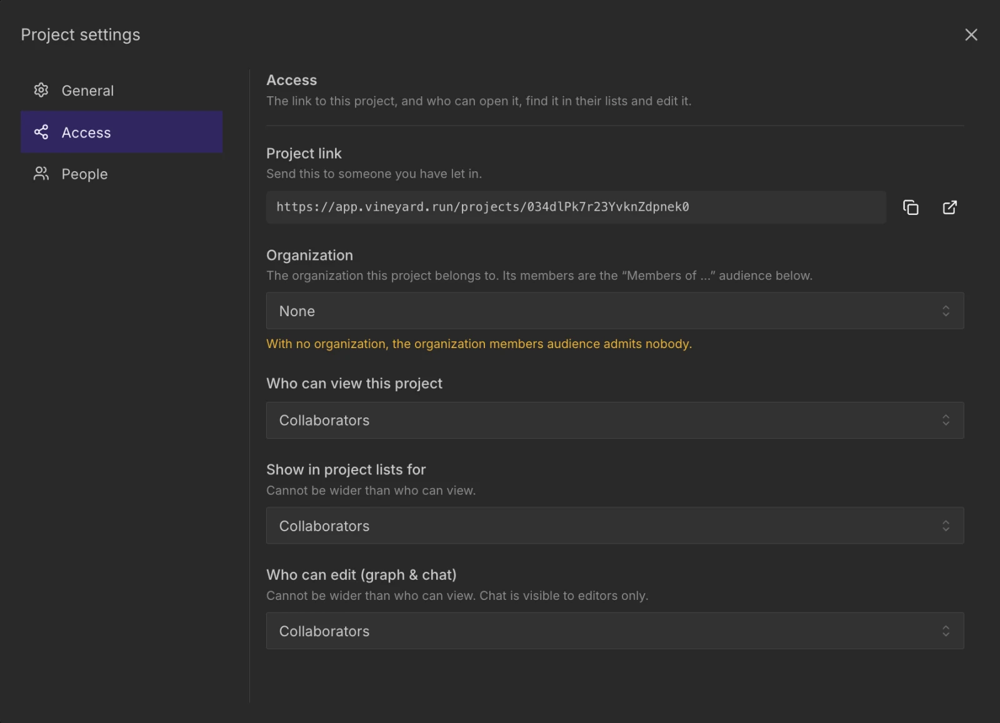
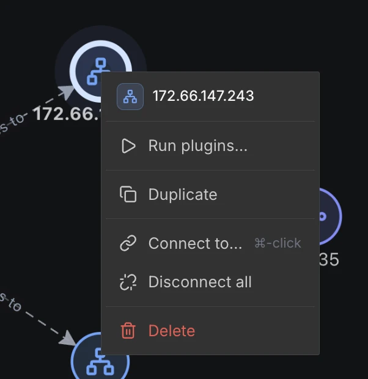
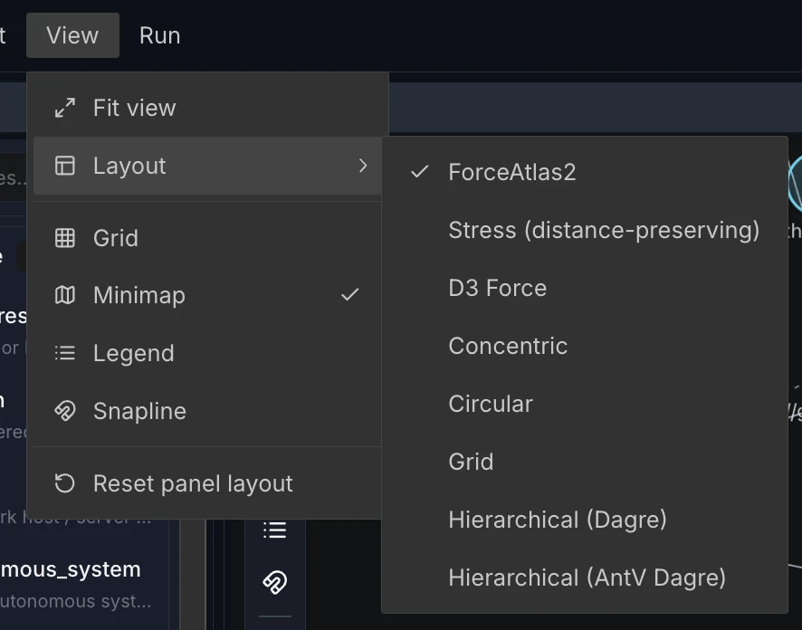
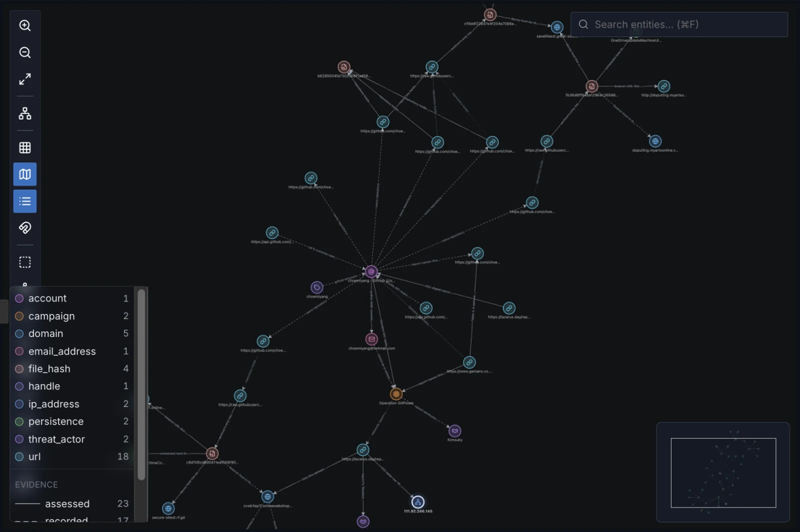

# The canvas

The canvas is where a Vineyard project lives: nodes and edges laid out on a graph you can pan, zoom, re-layout, and annotate. This page documents every control available in the on-canvas toolbar and in the top menu bar (**Project / Edit / View / Run**).

## Two ways to reach the same actions

The view controls are exposed twice, and both stay in sync:

- **On-canvas toolbar** — a compact vertical bar pinned to the top-left edge of the canvas, for the controls you reach for most while working.
- **Top menu bar** — the `Project`, `Edit`, and `View` menus, which add data and navigation actions alongside the view toggles (a fourth menu, `Run`, launches plugins and the AI agent — see [Running plugins](running-plugins.md)).

## View controls (toolbar + View menu)

Toolbar toggle buttons appear highlighted when on; menu items are checkmarked when on.

| Control | Action | Surfaces |
| --- | --- | --- |
| **Zoom in** | Zooms the canvas in (1.2×). | Toolbar |
| **Zoom out** | Zooms the canvas out (0.8×). | Toolbar |
| **Fit view** | Frames the entire graph so every node is visible. | Toolbar, View |
| **Layout** | Applies one of the built-in layouts (see below). The active layout is checkmarked. | Toolbar, View |
| **Grid** | Toggles the background alignment grid. | Toolbar, View |
| **Minimap** | Toggles the minimap overview panel (bottom-right). | Toolbar, View |
| **Legend** | Toggles the node-type legend (bottom-left). | Toolbar, View |
| **Snapline** | Toggles alignment guides shown while dragging nodes. | Toolbar, View |
| **Node table** | Opens or closes the [node table](#node-table) below the canvas; checkmarked while it is open. | View |
| **Reset panel layout** | Restores the project workspace's panel arrangement to its default. | View |

!!! note "Reset panel layout resets panels, not the graph"
    *Reset panel layout* restores the surrounding workspace panels (the canvas, side panels, etc.) to their initial split, which closes the node table. It does **not** re-run a graph layout or move your nodes. To re-arrange nodes, pick a **Layout** instead.

## Other toolbar buttons

Below the view controls, the toolbar repeats the **Edit** menu's selection actions (Select all, connected neighbors, outbound, inbound (1 hop), Invert, Select isolated, Clear). It ends with **Run plugins**, whose tooltip names the scope — "Run plugins on N selected nodes", or "nothing selected" for the whole-graph plugins — and **Ask the AI agent**; with nodes selected, the AI agent panel opens pre-filled with a question about them.

## Top menu bar

### Project

| Item | Action |
| --- | --- |
| **Project settings…** | Opens the project settings dialog. **General** holds the project's name, **Leave** (collaborators only) and deleting the project (owner only). **Access** holds the project link, the organization the project belongs to, and who can view it, see it in their project lists and edit it; only the project owner or an owner/admin of its organization can change these, and others see them read-only. **People** lists the owner and the collaborators; the project owner or an organization owner/admin can invite collaborators by username (View only / Can edit), change their permission and remove them. An invitee gets access only after accepting the invitation, which appears on their dashboard and Projects page; until then they show as "Invitation pending" and the invite can be cancelled. In local mode the dialog has **General** only. |
| **Export graph (JSON)** | Downloads the current graph as a JSON file (see [Export graph](#export-graph-json)). |
| **Import graph (JSON)…** | Opens a dialog to load an exported JSON file into the project. Every node is created fresh, so importing the same file twice adds every node again. It reads only Vineyard's own export; STIX 2.1 bundles and MISP events come in through a plugin pack, with a review (see [Importing STIX and MISP files](running-plugins.md#stix-misp)). |
| **Activity log…** | Opens the project's activity log, which you can filter and export (see [Activity log](#activity-log)). |
| **Add from Marketplace…** | Opens the [Marketplace](../marketplace.md) scoped to this project so you can add plugins, Type Packs and Skill Packs. |

If you opened the project only through its public link, **Activity log…** is disabled — it is for project members only — and **Project settings…** shows only the project link; if you are not signed in either, **Add from Marketplace…** is not shown. In local mode **Activity log…** is not shown.

<figure class="vy-shot" markdown="span">
  { width="800" loading=lazy }
  <figcaption>Project settings → Access: the project link, its organization, and who can view, list and edit the project.</figcaption>
</figure>

### Edit

| Item | Action |
| --- | --- |
| **Select all** | Marks every node as selected. |
| **Select connected neighbors (1 hop)** | Adds the 1-hop neighbors of the current selection to it. |
| **Select outbound 1-hop nodes** | Adds the nodes the selection points to (follows only edges leaving a selected node). |
| **Select inbound 1-hop nodes** | Adds the nodes that point to the selection (follows only edges entering a selected node). |
| **Invert selection** | Selects every unselected node and deselects every selected one. |
| **Select isolated nodes** | Selects every node with no edges. |
| **Clear selection** | Deselects all nodes and clears the selection count. |

The three 1-hop actions add to the selection, so pressing one again walks one more hop; they are disabled until something is selected.

!!! note "Adding a node"
    New nodes are created from the **Types** panel, not from this menu: click one of the types that the project's Type Packs provide.

### Run

| Item | Action |
| --- | --- |
| **Ask the AI agent…** | Opens the AI agent panel on a new conversation (an open one is kept in **Tasks**). To return to an earlier conversation, click its row in **Tasks**. |
| **Run plugins…** | Opens the run panel, scoped to the current selection if any nodes are selected. |
| *(Skill packs)* | Below a divider, under a **Skill packs** label: the installed skill packs that can be used here (a pack is listed only when every plugin pack it requires is installed and can run in this app, so in the browser Account & identity pivoting is missing), then the project's own packs, where one whose plugins cannot run is dimmed and marked *needs plugins*. Picking a pack opens it for reading; it does not run anything (see [Skill Packs](skillpacks.md)). The group appears once there is a pack to list; the project owner always sees it, with **New skill pack** (unavailable once the project has 32 packs of its own) and **Import skill pack…** at the end (see [Your project's own skill packs](skillpacks.md#custom-skill-packs)). |

## Right-click menus

- **Node** — Run plugins… (on this node), Duplicate, Connect to… (see [Drawing edges](#drawing-edges)), Disconnect all (deletes every edge touching the node), Delete.
- **Edge** — Reverse direction, Delete.
- **Selection** — right-click empty canvas with anything selected, or a node or edge inside a multi-item selection; the header shows the count (*Selected: N nodes, M edges*). Run plugins…, Connect to… and Show in node table (when nodes are selected), Delete (N), Select all, Fit view.
- **Empty canvas** (nothing selected, headed *Nothing selected — whole project*) — Run plugins… on the whole-graph plugins, Select all, Fit view.

**Esc** closes the menu and nothing under it. Each press of Esc puts away one thing, the front one first: a **Connect to…** waiting for its target, an open menu, then the panel drawn in front, and last the selection. With the Run plugins panel open over a Skill pack panel, the first Esc closes Run plugins, the next one closes the Skill pack panel, and once nothing is left open Esc clears the selection, like **Clear selection**. An Esc pressed inside a panel, or right after you clicked in it, goes to that panel rather than to one drawn over it. An Esc typed in a field, or pressed after a click in the Properties panel, leaves the selection alone, and the Esc that finishes a Korean syllable only finishes the syllable. Holding Shift (or another modifier) while you press Esc makes no difference.

**Delete**, **Delete (N)** and **Disconnect all** ask first, every time. The confirmation says what will go, for example *Delete 3 nodes and 17 connected edges? This cannot be undone.* Deleting a node also deletes every edge connected to it, and the count includes those edges. **Cancel** has the focus, so pressing Enter by reflex does not delete; Esc cancels too. A delete cannot be undone. While the project is still loading, deleting a node and **Disconnect all** are refused, because the edges they would count have not all arrived yet: *The project is still loading — delete again once it has finished.* When you are signed in to a server, the activity log keeps a line for each deleted node with its type, and for each deleted edge with its label.

<figure class="vy-shot" markdown="span">
  { width="301" loading=lazy }
  <figcaption>The node menu.</figcaption>
</figure>

## Layouts

Applying a layout re-computes node positions and then fits the view.

<figure class="vy-shot" markdown="span">
  { width="443" loading=lazy }
  <figcaption>View ▸ Layout, with the active layout checkmarked.</figcaption>
</figure>

| Layout | Description |
| --- | --- |
| **ForceAtlas2** | Force-directed layout (Gephi's ForceAtlas2) that pushes nodes apart and pulls connected ones together; built for link-analysis graphs. The default. |
| **Stress (distance-preserving)** | Places nodes so that on-screen distance follows the number of hops between them; clusters are less pronounced than in ForceAtlas2. |
| **D3 Force** | A D3-based force-directed variant. |
| **Concentric** | Arranges nodes in concentric rings; overlap is prevented. |
| **Circular** | Places nodes evenly around a single circle. |
| **Grid** | Lays nodes out on a regular grid; overlap is prevented. |
| **Hierarchical (Dagre)** | Top-down layered layout, good for directed / tree-like graphs. |
| **Hierarchical (AntV Dagre)** | AntV's own Dagre variant — also top-down and layered, typically faster on wide graphs. |

!!! tip
    ForceAtlas2 is the best starting point for an unfamiliar graph. Switch to Stress when how far apart two entities are matters more than which cluster they sit in, and to Hierarchical (Dagre) when the relationships are directional and you want clear layers.

## Overlays

<figure class="vy-shot" markdown="span">
  { width="800" loading=lazy }
  <figcaption>The legend (bottom-left) lists the types in the graph with counts and the evidence grades; the minimap (bottom-right) marks the current view.</figcaption>
</figure>

### Search

The **Search entities…** field at the top-right of the canvas finds nodes by type or by any of their property values; typing an AS number such as `AS64496` also finds nodes whose ASN is 64496. **⌘F** (Mac) or **Ctrl+F** jumps to the field; **↑**/**↓** and **Enter** pick a result, and **Esc** closes the list. Picking a result selects that node and centers it. While the project is still loading, an empty result means the node has not arrived yet, not that it doesn't exist.

### Grid

A subtle background grid that follows the canvas as you pan and zoom, giving you a visual reference for aligning nodes.

### Minimap

A translucent overview panel docked at the bottom-right corner. It shows the whole graph in miniature with a viewport rectangle marking your current view — useful for orienting yourself in a large project.

### Legend

A translucent, minimap-style panel at the bottom-left that lists the node **types currently present** in the graph. Each entry shows a colored swatch matching the node's type color, the type's name (the raw type string if no installed pack defines it), and a per-type **count** of how many nodes of that type exist. Entries are sorted alphabetically by label. When the graph is empty the legend reads "No nodes."

Click a row to select every node of that type, or Shift-click to add them to the current selection. Hovering (or focusing) a row dims every other type on the canvas.

Below the types, an **Evidence** key lists the edge confidence grades present in the project (assessed, asserted, recorded, circumstantial, contested, unassessed), strongest first, each drawn with the same line style (dash, width, opacity) the canvas uses for that grade and with a count. Hover a grade for what it means.

The legend reflects whatever Type Packs the project uses — for example, an investigation built on the [Infrastructure Type Pack](typepacks.md) might show counts for `infrastructure.ip_address`, `infrastructure.domain`, and so on, each resolved to its Type Pack-defined name and color.

### Snapline

When enabled, dragging a node near another node's edges or center shows alignment guides (vertical and horizontal lines) and snaps the node into alignment. Unlike the grid, minimap, and legend, snaplines have no persistent panel — they appear only while you are actively dragging.

### Parallel edges

When two or more edges connect the same pair of nodes — in either direction — the canvas bends
them apart into arcs instead of drawing one on top of the other, so each edge stays visible and
individually clickable.

## Node table {#node-table}

`View ▸ Node table` opens a table of the project's nodes in a pane below the canvas, to sort, filter and pick nodes in bulk. Choose the menu item again, or press **×** in the pane's title bar, to close it. With several nodes selected, **Show in node table** opens it on those nodes: the button under *N nodes selected* in the Properties panel, or the item in the canvas's right-click menu for a selection. The pane can be dragged elsewhere like any other; **Reset panel layout** closes it.

### Columns

**Type**, **Label**, **Fields** (the node's other values), **Links** (the number of edges touching the node; 0 means it is isolated), **Added** and **Updated**. The label is the one the canvas shows.

When one type is picked in the type filter, **Fields** is replaced by a column per field of that type: the fields its Type Pack declares first, in the pack's order, then any other fields the nodes carry, most common first. A field no node fills gets no column, nor does the field the label already shows. Up to 12 field columns are shown; the line above the table says how many more there are, and the keyword filter still searches them.

### Sorting

Click a column header to sort by it, click again to reverse, and a third time to stop sorting by it. **Type**, **Label** and the field columns start from A (or the smallest number); **Links**, **Added** and **Updated** start with the largest or newest. Shift-click another header to sort by it as well, after the first: rows the first column leaves equal or empty are ordered by the next. Text sorts as numbers where it has digits, so `10.0.0.9` comes before `10.0.0.10`; empty values go last whichever way a column is sorted.

### Filters

- **All nodes** / **From selection** — *From selection* lists the nodes that were selected when the table was opened on them. It does not follow the canvas: clicking through the rows changes the selection but not which rows are listed. When the canvas selection is something else, a refresh button beside it takes the current selection instead.
- **All types** — one type only, with the number of nodes of each.
- **Filter by keyword** — matches what [Search](#search) matches (the type or any property value, never a field name, and `AS64496` for an ASN of 64496, also inside a list of ASNs), and the label and type name as the table shows them. **Esc** empties the field.

The line above the table counts the rows shown and the nodes selected on the canvas. 100 rows are shown per page. While the project is still loading, rows appear as nodes arrive.

### Selecting from the table

The checkboxes are the canvas selection: a box is ticked exactly when its node is selected on the canvas.

- Tick a box to add its node to the selection; untick it to take the node out. Other selected nodes and edges stay selected. **Shift**-click a box to do the same to every row from the last one you clicked.
- The header box adds every row shown, on every page, to the selection, or takes them all out when they are all selected.
- Click a row to select only that node and center it on the canvas, as picking a search result does. **⌘-click** (Mac) or **Ctrl-click** adds or removes the row, and **Shift-click** adds the rows from the last one clicked.
- To copy a value without changing the selection, drag across its text: a click that ends with text selected leaves the selection as it is. A double-click selects the row with its first click, as a plain click does.
- **Select N on canvas** makes exactly the rows shown, on every page, the selection. **Run plugins**, **Delete (N)**, **Connect to…** and the AI agent then act on them.

The table only changes the selection, so a participant who can only view the project can use it too.

## Drawing edges

Select the node(s) you want to link from, then **⌘-click** (Mac) or **Ctrl-click** (Windows/Linux) the node to link them to. A small box opens at the click; type the relation (free text, e.g. `resolves to`) and press **Enter**. One edge is created from every selected node to the clicked node. Hold **Shift** while clicking, or press **Reverse** in the box, to link the other way (clicked node → selection). You can also right-click a node or a selection and choose **Connect to…**, then plain-click the target. **Esc** cancels at either step, and nothing is written until you press Enter. An edge is unique per ordered pair of nodes, so pairs that are already connected are skipped and counted as "already connected"; the reverse direction is a separate edge. If nothing is selected, the click only shows a hint to select the nodes first.

<figure class="vy-shot">
  <video src="../../assets/guide/draw-edge.mp4" poster="../../assets/guide/draw-edge.webp" width="960" height="638" muted loop playsinline controls preload="none" aria-label="Click one IP, Shift-click another, ⌘-click the AS node, type the relation and press Enter: one edge from each selected node."></video>
  <figcaption>Click one IP, Shift-click another, ⌘-click the AS node, type the relation and press Enter: one edge from each selected node.</figcaption>
</figure>

## Inspecting an edge {#inspecting-an-edge}

Click an edge to show it in the Properties panel. The top names its two ends, who wrote its label
(*Edited here*, *Written by …* or *Original label*), and its evidence grade with who set it and what
the grade means, followed by **Re-verify**. Below that, **relation** (the edge's label) and
**confidence** are the two values you can change, if you can edit the project.

Under **Recorded with this link** is everything else the edge stores, read-only for everyone. It is
what the plugin or the agent that drew the edge recorded with it, such as where and when the link
was observed: OTX Passive DNS, for example, stores `source`, `record_type`, `first_seen` and
`last_seen`. The list also holds `corroborated_by`, the other writers that drew the same link, which
the evidence grade counts. An edge that stores nothing more, such as one you drew yourself, shows
*Nothing else is stored with this link.* The [Review dialog](running-plugins.md#reviewing-a-runs-changes)
shows the same list for an edge that is waiting to be applied.

## Export graph (JSON) {#export-graph-json}

`Project ▸ Export graph (JSON)` downloads the project's current nodes and edges as a JSON file named after the project. The export captures a snapshot of the graph data:

```json
{
  "project": "my-investigation",
  "exported_at": "2026-06-28T12:00:00.000Z",
  "nodes": [ /* … */ ],
  "edges": [ /* … */ ]
}
```

While the project is still loading (for example while it re-syncs after a reconnect), export is refused with *The project is still loading — export again once it has finished.* When the export succeeds, a toast reports how many nodes and edges were written.

## Activity log {#activity-log}

`Project ▸ Activity log…` opens the project's activity log, newest first: who created, changed or deleted which node or edge, and who changed the project and its members. It is for project members, and only when you are signed in to a server; a local project keeps no activity log.

The drawer reads the log from the server a page at a time. **Load older** at the bottom reads the next page, as the log stood when the drawer opened or the filters last changed. What happens after that appears at the top as it happens, and the count beside the title is how many rows match, those included.

Each row shows the action, the account and a summary, then the time in UTC to the second (for example `2026-11-14 09:02:33Z`) and how long ago that was. Hover the time to see it with every digit the server stored. Click a row's target, such as `node 033rOr…eClw`, to see only the rows about it. **Show on the canvas**, the button after a node's target, selects that node if it is still on the canvas.

### Filters

| Filter | What it matches |
| --- | --- |
| **Actor** | One account, by its whole name: `kim` does not match `kimberly`. A row keeps the name the account had when it was written, so an account renamed since has its earlier rows under the old name. Writes made by the AI agent or by a plugin are recorded under the account of the analyst who applied them, so this filter cannot tell them apart from that analyst's own edits. |
| **Action** | Any of the chosen actions, for example *Node deleted* and *Edge deleted*. |
| **Target** | Nodes, edges, members or the project, or one node or edge. The crosshair button next to it picks the node or edge selected on the canvas. |
| **Period (UTC days)** | Rows from the start of the first day to the end of the last, in UTC. Both days are included. |

The filters combine, and **Clear filters** removes them all.

If the server does not apply a filter you set, the drawer says so and shows no rows rather than rows the filter did not choose, and an export writes no file. This happens with a server older than these filters, which applies only a single **Action**. Clear the filters to read the whole log.

### Export the activity log {#export-activity-log}

**Export ▸ CSV (spreadsheet)** or **Export ▸ JSON** downloads every row the filters match, not only the rows loaded in the drawer, as `activity-<project>-<UTC time>.csv` or `.json`. The file holds the log as it stood when the export began, newest first. Rows written while it reads are left out, and the top of the file gives the time of its newest row (`as of`). While it reads, the drawer shows how many rows it has read; **Cancel** stops it and writes no file. One export reads at most 50,000 rows. For a longer log, export a period at a time.

Each row carries the account's name (`actor_name`) and its id (`actor_id` in the CSV, `actor` in the JSON). The top of each file says which project it is, when and by whom it was exported, up to which row it reads, which filters were used, and what the log does not hold:

- A summary is stored up to 256 characters.
- An edit row keeps what it overwrote for at most 20 fields, each cut to 200 characters, and does not keep the new value. If your account cannot edit the graph, the overwritten values are left out of every row.
- Writes made by the AI agent or by a plugin are recorded under the account of the analyst who applied them.
- `actor_name` is the name the account had when the row was written. A renamed account's earlier rows keep the old name, and the name of a deleted account can be registered again, so rows with one name and different ids were written by different accounts. The id is empty for an account deleted since.
- The `session` column names the app session the write came from, as the app stated it. The server checks only that it was an open session of the same account.
- Rows about invitations not yet accepted are included only for the project owner and organization managers.

Times are written in UTC. In the CSV file the top lines begin with `#`, and a cell that would begin with `=`, `+`, `-` or `@` begins with `'` so that a spreadsheet does not run it as a formula. The JSON file keeps those values unchanged.

## Add from Marketplace

`Project ▸ Add from Marketplace…` opens the [Marketplace](../marketplace.md) scoped to the current project, where you can add plugins, Type Packs and Skill Packs that are wired straight to it. See [Browse & install](installing.md) for the full flow.

## Next / See also

- [Running plugins](running-plugins.md) — execute plugins against nodes on the canvas.
- [Working with Type Packs](typepacks.md) — how node types, colors, and labels drive the legend.
- [Tasks](tasks.md) — track long-running plugin runs.
- [Browse the Marketplace](../marketplace.md) — find packs to add.
