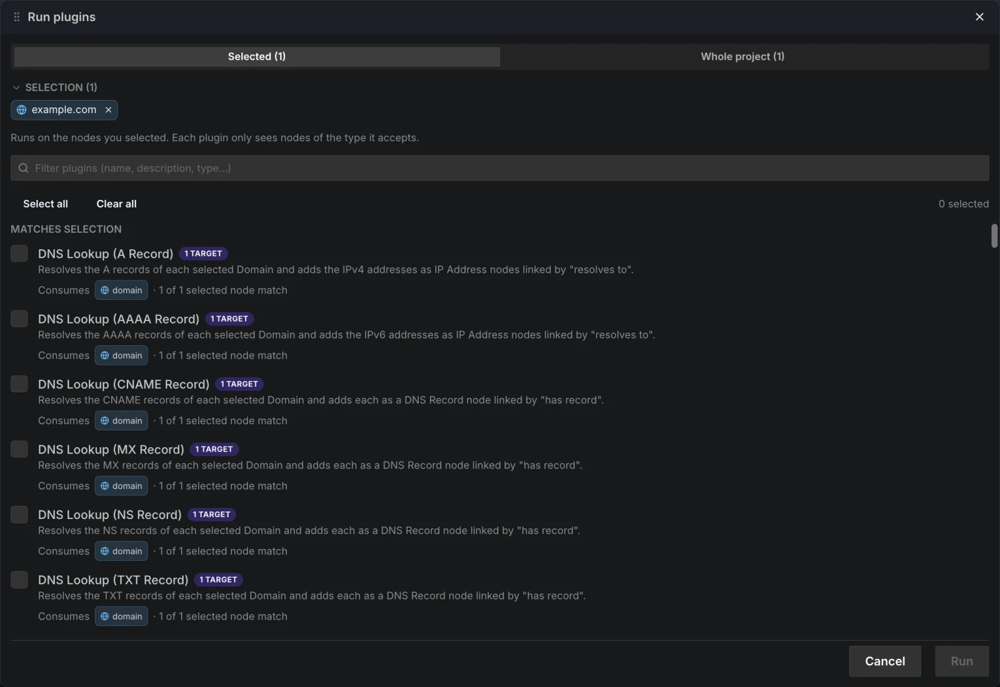
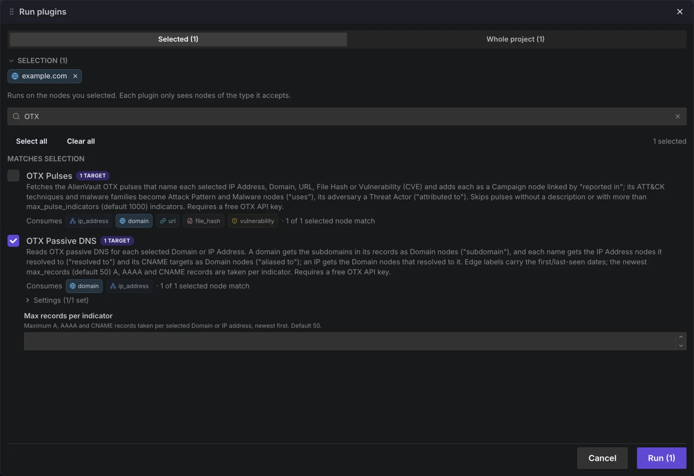
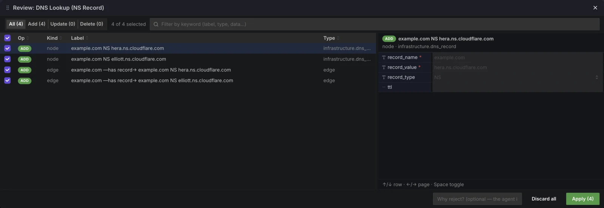

# 플러그인 실행

플러그인이 프로젝트에 설치되면 노드·선택 영역·빈 캔버스의 우클릭, 캔버스 도구 모음의 ▶ 버튼,
상단 메뉴 바의 **Run ▸ Run plugins…**, 또는 커맨드 팔레트(**⌘K**)에서 **Run plugins** 패널을
엽니다. **Tasks**(작업) 패널에서 실행을 감시하고 취소할 수 있습니다.

## 플러그인이 어디에 표시되는가

설치된 모든 플러그인은 하나의 패널, **Run plugins**에 나열됩니다. 맨 위의 범위 전환에서
**Selected (N)** — 선택된 노드만, 각 플러그인은 자신이 받는 유형의 노드만 봄 — 또는
**Whole graph (N)** — 노드 입력을 받지 않는 플러그인만 — 를 고릅니다. 입력 유형(`consumes`)을
선언한 플러그인은 **선택한 노드에만** 실행되며, "이 유형의 모든 노드에 실행" 지름길은 없습니다
(에이전트의 `invoke_plugin`이 `node_ids` 없는 호출을 거부하는 것과 같습니다).
모든 플러그인은 입력(`consumes`)을 선언하며, 그 선언이 어느 그룹에 표시될지를 결정합니다:

- **Matches selection** / **Matches project data** → `consumes` 유형이 범위 안에 있는
  플러그인으로, "N targets" 배지가 붙습니다.
- **Whole-graph / input via form** → 아무것도 소비하지 않는 플러그인 (예: Chaos 팩). 이들도
  현재 선택을 받으므로, Black Hole 같은 플러그인은 먼저 노드를 선택하세요.
- **Not applicable here** → 설치되어 있지만 입력 유형이 하나도 범위 안에 없음 (회색 표시).
- **Desktop only** → 설치되어 있지만 브라우저에서는 실행할 수 없음.

여러 플러그인을 체크하고 **Run (N)**을 누를 수 있습니다. 플러그인이 6개를 넘으면 이름, 설명,
유형을 검색하는 필터 상자가 나타나고, 그 **×**로 비웁니다. 선택 칩은 ×로 이번 실행에서만 뺄 수
있으며, 캔버스 선택은 그대로 유지됩니다.

<figure class="vy-shot" markdown="span">
  { width="800" loading=lazy }
  <figcaption>example.com을 우클릭해 연 Run plugins 패널: 범위 전환, 선택 칩, 선택과 맞는 플러그인.</figcaption>
</figure>

## 실행 인터페이스 {#launch-surfaces}

=== "노드 우클릭"

    노드, 선택 영역, 또는 빈 캔버스를 우클릭하고 **Run plugins…**를 고릅니다. 패널은 그
    노드/선택 영역을 범위로, 빈 캔버스에서는 프로젝트 전체를 범위로 열립니다.

=== "Run 메뉴"

    상단 메뉴 바의 **Run** 메뉴 — `Run ▸ Run plugins…` — 는 같은 패널을 현재 선택을
    범위로, 아무것도 선택하지 않았다면 프로젝트 전체를 범위로 엽니다. 캔버스 도구 모음의 ▶
    버튼도 같으며, 툴팁이 범위를 알려 줍니다.

=== "커맨드 팔레트"

    **⌘K**(**Ctrl+K**)를 누르고 플러그인 이름을 입력합니다. **Run WHOIS on the selection**(노드를
    읽지 않는 플러그인은 **Run** 뒤에 플러그인 이름)을 고르면 그 플러그인에 체크한 채로 선택을 범위로
    패널이 열립니다. 패널이 이미 열려 있었다면 그 플러그인만 체크됩니다. 팔레트에서는 아무것도 실행되지
    않습니다. 패널을 확인하고 **Run**을 누릅니다. **Run**에 포커스가 가며, 그 플러그인에 비어 있는 필수
    필드가 있으면 그 필드로 갑니다. [커맨드 팔레트](shortcuts.md#command-palette)를 참조하세요.

### 같은 플러그인을 다시 실행하기 {#running-the-same-plugins-again}

피벗에서는 홉마다 같은 플러그인을 실행합니다. 한 번 실행한 뒤에는 **Run ▸ Run the last plugins
again on the selection**(커맨드 팔레트에도 있음)이 지금 선택한 노드를 범위로 패널을 엽니다. 직전
실행의 플러그인에 체크되어 있고 그 플러그인에 입력했던 파라미터가 채워져 있으며, **Run**에 포커스가
있어 **Enter**로 실행합니다. 고른 파일, 목록 값, 플러그인이 비밀번호나 비밀값으로 표시한 값은
기억하지 않으므로, 파일이 필요한 실행은 파일을 다시 고르게 됩니다. 이미 열린 패널에 입력해 둔 파라미터는 입력한
대로 둡니다. 프로젝트를 떠나면 직전 실행은 잊힙니다.

포커스는 이렇게 패널이 열릴 때 한 번만 옮겨지고, 입력하는 동안에는 옮겨지지 않습니다. 비어 있는 필수
필드가 있으면 **Run** 대신 그 필드로 커서가 갑니다. 패널이 이미 열려 있고 다른 플러그인이 체크되어
있었다면 그 체크는 그대로 두고 **Run**에 포커스를 주지 않으므로, 여기서 고르지 않은 플러그인이
**Enter**로 실행되는 일은 없습니다.

## 실행 전 양식

입력을 받는 플러그인을 체크하면 **Run plugins** 패널에서 그 아래에 필드가 나타납니다 — 텍스트,
숫자, 스위치, 드롭다운, 또는 파일 드롭 영역. 필수 필드는 *로 표시되며, 채울 때까지 **Run**은
비활성 상태로 남습니다. 드롭다운 목록이 펼쳐져 있을 때 **Esc**는 그 목록만 닫으므로 체크한 플러그인과
입력한 값은 그대로 남고, 다음 Esc가 패널을 닫습니다. 플러그인이 실행될 노드는 이 필드가 아니라 패널의 범위에서 옵니다.
파일 입력은 파일당 최대 25 MB, 실행당 50개 파일과 250 MB까지 받습니다.

저장된 설정(예: API 키나 게이트웨이 URL)이 필요한 플러그인에는 접을 수 있는
**Settings (x/y set)** 블록이 표시됩니다. 이 값은 입력하는 대로 저장되어 이후 실행에서도
재사용됩니다. 같은 팩에서 같은 대상을 호출하는 플러그인들은 값 하나를 함께 쓰므로, 그중 하나에
입력한 키가 같은 키를 쓰는 나머지 플러그인에도 채워집니다. 팩 없이 단독으로 게시된 플러그인이나
네트워크 대상을 선언하지 않은 플러그인은 자기 값을 따로 가집니다. 비밀 필드에는 값이 전송되는
호스트가 표시되고, 팩 안의 다른 플러그인이 그 값을 함께 쓰면 그 개수도 표시됩니다(*Sent to … ·
shared with N other plugins in this pack*). **Run (N)**을 누르면 체크한 모든 플러그인이 시작됩니다.

기관의 MISP나 OpenCTI처럼 주소를 분석가만 아는 서버에 연결하는 팩도 있습니다. 이런 팩의 주소
칸에는 요청이 갈 곳(*Requests from this plugin go to …*)이나, 주소가 쓰이지 않는 이유(예: *This
address is not used: it must start with https://*)가 표시됩니다. 주소를 정하기 전에는 플러그인이 그곳에
아무것도 보내지 않습니다. 브라우저에서는 이 컴퓨터의 주소(`localhost`)가 아닌 `http://` 주소는
쓰이지 않습니다. 브라우저가 https 앱에서 그 요청을 막기 때문이니, https 주소를 쓰거나 데스크톱 앱을
쓰세요. 데스크톱 앱에서 이 컴퓨터나 기관 네트워크에 있는 서버는 신뢰한다고
확인해야 읽을 수 있습니다. 칸 아래의 **Trust … on this computer…**를 누르고 대화상자에서 확인하세요.
그 오리진은 **Desktop Settings…**의 **Additional trusted origins**에 추가되어 모든 프로젝트에
적용되며, 지울 때도 그곳에서 지웁니다.

값은 이 기기에서 계정별로 따로 보관되며, 브라우저에서는 이 탭에만 있다가 탭을 닫으면 사라지고,
데스크탑 앱에서는 암호화되어 다시 실행해도 유지됩니다(암호화할 수 없는 컴퓨터에서는 이번 세션
동안만). 이는 Vineyard 안에서 계정을 분리하는 것이지, 이 컴퓨터를 직접 쓸 수 있는 사람으로부터
보호하는 것은 아닙니다. 패널 아래쪽의 **Manage Keys & Secrets**는 **Settings → Keys & Secrets**를
엽니다. 그 안의 **Plugin keys** 표에는 이 기기에서 이 계정에 저장된 모든 플러그인 키가 **Pack**,
**Key**, **Sent to**, **Value** 열로 나열되며, 프로젝트 안에서는 그 프로젝트의 팩들이 선언했지만
아직 설정하지 않은 키도 함께 나열됩니다. 행에서 저장된 비밀 값을 보거나(**Show**), 값을 설정하거나
교체하거나(**Set**, **Replace**), 지울(**Forget**) 수 있으며, **Forget all…**은 저장된 플러그인
키를 모두 지웁니다.

<figure class="vy-shot" markdown="span">
  { width="800" loading=lazy }
  <figcaption>OTX Passive DNS를 체크하면 입력 필드와 접힌 Settings (1/1 set) 블록이 나타납니다.</figcaption>
</figure>

## 실행 변경 사항 검토 {#reviewing-a-runs-changes}

플러그인은 프로젝트에 직접 쓰지 않습니다. 추가·변경·삭제하려는 내용은 스테이징되며, 실행이
끝나면 토스트("N change(s) staged — review to apply")와 **Tasks** 행의 **needs review** 배지가
표시됩니다. 행을 클릭해 **Review**(검토) 대화상자를 열고, 원하지 않는 항목의 체크를 해제한 뒤
**Apply (N)**(또는 **⌘Enter** / **Ctrl+Enter**)을 누르거나 — **Discard all**을 누르세요. **/**를 누르면
**Filter by keyword**로 이동합니다. 적용하기 전에는 프로젝트에 아무것도
기록되지 않으며, **Review** 대화상자가 열려 있는 동안 변경 사항은 캔버스에 미리보기로만 표시됩니다.
아무것도 스테이징하지 않은 실행은 요약(없으면 "No changes")을 보여 주는 토스트로 끝납니다.
엣지의 레이블과 이미 저장된 필드를 그대로 두는 변경은 스테이징되지 않으므로, 같은 데이터로
플러그인을 다시 실행해도 그런 엣지는 다시 나오지 않습니다.

대화상자 오른쪽에는 선택한 행의 속성이 나옵니다. 노드라면 행을 적용한 뒤 노드가 갖게 될 값입니다.
변경은 노드에 저장된 값에 제안한 값을 병합한 결과입니다. 새 노드인데, 이 실행을 스테이징한 뒤 적용한
다른 검토가 같은 노드를 이미 프로젝트에 추가했다면 노드를 하나 더 만들지 않고 그 노드에 병합합니다.
이때 창에 *This node is already in the project*가 표시되고 병합된 값이 나옵니다. 엣지라면 그 아래 **Recorded with this link**에
행을 적용한 뒤 엣지에 레이블과 등급 말고 저장될 값이 나옵니다. 새 엣지는 플러그인이 함께 기록한
값(링크를 어디서 언제 관측했는지 등), 변경은 엣지에 저장된 값에 제안한 값을 덮어쓴 결과, 삭제는
엣지와 함께 사라지는 값입니다. 엣지의 Properties 패널에도 같은 목록이 있습니다
([링크와 함께 기록된 값](properties.md#recorded-with-this-link) 참고). 적용이 끝난 뒤나 Tasks에서 기록으로 다시 연
실행에서는 그 사이 엣지가 바뀌었을 수 있으므로, 목록 제목이 **Proposed by this change**로 바뀌고 그
행이 제안한 값만 나옵니다. 반영되었는지는 **Status** 열에, 엣지에 지금 저장된 값은 엣지의
Properties 패널에 나옵니다.

노드의 체크를 해제하면 그 노드가 있어야 하는 엣지도 함께 빠지며, 하단에 그 개수가
표시됩니다(*N edges excluded — their endpoint nodes are not being created*). 아직 검토를 기다리는
다른 실행의 노드를 가리키는 링크가 있으면 하단에 그렇게 표시되니, 그 검토를 먼저 적용하세요. 이
실행을 먼저 적용하면 해당 링크는 행마다 이유가 붙은 채 이 실행에 스테이징된 상태로 남고, 다른
실행을 적용한 뒤 이 실행을 다시 적용하면 반영됩니다. 다른 실행을 폐기하면 해당 링크는 건너뜁니다.
**Discard all** 옆의 선택 입력 필드 **Why reject?**에 적은 이유는, 변경이 AI 에이전트 대화에서 나온
경우 에이전트에게 전달됩니다.

X나 **Esc**로 대화상자를 닫아도 실행은 계속 검토를 기다리며, 그동안 고른 내용도 함께 남습니다.
체크를 해제하거나 다시 체크한 항목과 **Why reject?**에 적은 이유는 검토를 다시 열면 그대로 있고,
다른 프로젝트를 열었다가 돌아와도 마찬가지입니다. **Esc**는 대화상자 어디에서 누르든, 그리고
**Apply**를 누른 직후처럼 아무것에도 포커스가 없을 때도 대화상자를 닫습니다. 키보드로 **Apply**한
뒤(**Tab**으로 **Apply**에 가서 **Enter**, 또는 **Why reject?**에서 **⌘Enter**/**Ctrl+Enter**)에도
마지막으로 무엇을 클릭했든 마찬가지이며, 검토 뒤의 AI 에이전트, Run plugins, Skill pack 패널은 열린
채로 남습니다. **Filter by keyword** 칸에 글자가 있을 때는 그 칸의 **×**처럼 먼저 필터를 지웁니다.
AI 에이전트 같은 다른 패널을 클릭한 직후에 누른 Esc는 그 패널로 갑니다. 검토가 열려 있는 동안
Run plugins나 Skill pack 패널 안에서 누르거나 그 패널을 클릭한 직후에 누른 Esc는 그 패널을 닫고 검토는
그대로 둡니다. 다른 곳에서 누른 Esc는 그 패널들을 그대로 둡니다.

검토를 기다리는 실행은 이 기기에도 계정별로 저장되므로, 새로 고침, 재시작, 앱 업데이트, 비정상
종료로 사라지지 않습니다. 다음에 프로젝트를 열면 **Tasks**에서 다시 검토를 기다리며, 고른 내용과
**Why reject?**에 적은 이유도 그대로 있습니다. 페이지가 사라질 때 대화상자가 열려 있었어도
마찬가지입니다. 새로 고침이나 비정상 종료로 중간에 끊긴 플러그인 실행이나 AI 턴은 그때까지
스테이징한 내용을 가지고 돌아옵니다. 그 내용의 **Tasks** 행은 **Stop**으로 중지했을 때처럼 `cancelled`이고
*Cut short by a reload*라고 표시되며, 검토에는 *Cut short by a reload — this is what it had staged by
then, not everything it would have found.*가 나옵니다. 적용하는 도중에 페이지가 사라진 실행도
돌아오지만, 서버가 그 행의 일부를 이미 기록했을 수 있습니다. 그런 실행의 검토에는 *An apply of this
set was under way when the page went away — some of these rows may already be in the graph*가 나오고,
플러그인 실행이라면 **Tasks** 행에도 같은 내용이 표시됩니다. 다시 적용하거나 폐기하기 전에 그래프를
확인하세요. 이런 실행을 폐기하면, 그래프에 이미 있어서 지금 적용해도 아무것도 바꾸지 않는 행은
적용된 것으로, 나머지는 폐기된 것으로 기록됩니다. 아래의 일부 적용 뒤 폐기와 같으며, AI 에이전트에게는
무엇이 반영되었고 나머지는 거부되었다고 전달됩니다. 이를 가리려면 그래프 전체가 필요하므로,
프로젝트를 아직 불러오는 중에 폐기하면 모든 행이 폐기된 것으로 기록됩니다.
실행은 마지막으로 바뀐 뒤 7일 동안 보관되고,
열어 둔 탭이 있으면 그보다 오래 보관되며, 그 뒤에 삭제됩니다. 대화상자 하단에는 검토가 어디에 보관되는지 나옵니다. 보통은 *Kept on this device only —
a reload brings this review back, for 7 days after its last change*이고, 로그인한 계정이 없거나 이
기기의 저장소가 거부하면 *Held in this tab only — a reload loses this review*입니다. 저장소가 거부하는
동안에는 빨간 알림(*Changes waiting for review are not being kept on this device*)도 화면에 남고,
플러그인 실행이나 AI 턴이 아직 작업 중일 때 프로젝트를 떠나려 하면 변경이 이 탭에만 있어 새로
고치면 사라진다고 알립니다([기본적으로 임시](tasks.md#ephemeral-by-default) 참조). 검토를 기다리는
실행의 내용은 Vineyard 서버로 전송되지 않습니다. 아직 열려 있는 탭에서 기다리는 실행은 그 탭에
남습니다. 다른 탭에는 그 탭을 닫은 뒤 프로젝트를 다시 열 때 나타납니다.

AI 에이전트가 노드의 필드를 고치는 변경은 에이전트가 바꾼 필드만 기록합니다. 에이전트가 노드를
읽은 뒤 이 탭이나 다른 탭에서 누군가 바꾼 필드는 새 값이 유지되며, 오른쪽 속성에는 적용한 뒤의
노드 모습이 나옵니다.

일부 변경을 기록하지 못하면 **Partly applied** 토스트가 그 개수를 알려 줍니다. 실패한 항목은 행마다
이유가 붙은 채 스테이징된 상태로 남고 실행은 계속 검토를 기다리므로, 검토를 다시 열어 재시도하면
됩니다. 적용하거나 폐기한 실행의 행을 클릭하면, 적용하거나 폐기한 내용이 읽기 전용 기록으로
열립니다.

실행의 일부가 이미 적용된 뒤 **Discard all**을 누르면 아직 스테이징된 변경만 버려지고, 적용된 내용은
그래프에 남습니다. 이때 실행은 폐기가 아니라 적용으로 기록됩니다. 배지는 **applied**로 표시되고,
기록에는 적용된 내용과 함께 버린 행이 *excluded*로 표시되며, 실행이 AI 에이전트 대화에서 나온
경우 에이전트에게는 무엇이 반영되었고 나머지는 거부되었다고 전달됩니다.

<figure class="vy-shot" markdown="span">
  { width="800" loading=lazy }
  <figcaption>실행 하나의 Review 대화상자: 스테이징된 노드와 엣지, 선택한 행의 속성, Apply (4) / Discard all.</figcaption>
</figure>

## 진행률 및 취소 {#progress-and-cancellation}

직접 시작한 모든 실행은 **작업**이 되어 **Tasks** 패널에 표시됩니다 — 실시간 상태 배지, 플러그인이
보고하는 경우 진행률 막대, 그리고 **Stop**(중지) 컨트롤이 있습니다. **Stop**은 플러그인에 종료를 요청하며, 약 3초 안에 끝나지
않으면 강제 종료됩니다. 이미 스테이징된 변경 사항은 버려지지 않고 검토할 수 있도록
유지됩니다. 시간 예산(기본 10분, 최대 60분)을 넘긴 실행은 중지되고 실패로 표시됩니다. 실패한
실행은 스테이징해 둔 내용을 모두 버립니다. 시간 예산을 넘겨 중지된 실행, 샌드박스가 시작되지 않은
실행, 플러그인 오류로 끝난 실행이 모두 그렇습니다. 부분 결과가 남는 것은 **Stop**으로 멈추거나 새로 고침으로 실행이 끊긴 경우뿐입니다.
상태와 컨트롤에 대해서는 [작업 및 실행](tasks.md)을 참조하세요.

플러그인이 보내는 요청마다 따로 기한도 있습니다(플러그인이 따로 정하지 않으면 길어야 약 1분). 그래서
응답하지 않는 호스트가 있어도 실행 전체 예산을 붙잡고 있지 않고 그 요청만 실패합니다. 이런 실행이
끝까지 완료되었지만 아무것도 스테이징하지 않았다면 토스트가 노란색으로 표시되고 응답하지 않은
호스트를 알려 줍니다(*no answer from …*). 이때의 "No changes"는 "찾은 것이 없음"이 아니라
"확인하지 못함"으로 읽으세요.

AI 에이전트가 시작한 플러그인 실행은 따로 **Tasks** 행을 갖지 않습니다. 무언가를 스테이징한
실행은 각각 그 대화의 변경 세트로 나타나 대화에서 검토하며, **Apply automatically**에서는 턴이 끝날
때 적용됩니다. 턴을 멈추거나 대화를 삭제하면 이 실행들도 멈춥니다.
[에이전트가 할 수 있는 일](tasks.md#what-the-agent-can-do)을 참조하세요.

## STIX·MISP 파일 가져오기 {#stix-misp}

**Project ▸ Import graph (JSON)…**는 Vineyard에서 내보낸 그래프만 읽습니다. TIP나 정보 공유
채널에서 받은 STIX 2.1 번들과 MISP 이벤트는 [마켓플레이스](../marketplace.md)의 **STIX & MISP
Import** 플러그인 팩으로 가져옵니다.

1. 프로젝트에 팩을 설치합니다. 이 팩은 Infrastructure, Identity, Endpoint, Cryptocurrency, Geo,
   Threat Type Pack의 유형을 씁니다. 유형의 Type Pack이 없는 노드는 빠지고, 실행 요약에 설치할 Type
   Pack이 나옵니다.
2. **Whole graph**에서 **Run plugins**를 열고 **Import STIX or MISP Files**를 체크한 뒤, 그 필드에
   파일을 끌어놓습니다. 파일은 함께 읽으므로 한 파일의 관계가 다른 파일의 객체에 닿습니다. 파일은
   이 기기에서 읽고 업로드하지 않습니다.
3. 평소처럼 실행을 검토합니다. 파일의 내용은 적용할 때에만 프로젝트에 들어갑니다.

그래프에는 다음과 같이 들어갑니다.

- 관측값은 각자의 유형(IP 주소, 도메인, URL, 파일 해시, 인증서 등)이 되므로 다른 플러그인이 쓴
  노드와 만납니다. 패턴이 값만 가리키는 STIX 지표는 그 값들의 노드가 되고, 그 밖의 패턴은
  Indicator 하나로 남습니다. 맞는 유형이 없는 값은 `observable_type` 필드가 있는 Indicator가
  됩니다.
- `пример.рф`나 `example.xn--p1ai`처럼 국제화 최상위 도메인 아래의 도메인은 프로젝트에
  Infrastructure 4.3 이상이 있으면 Domain이 됩니다. 그보다 오래된 Infrastructure 팩에서는 TLP와 출처를
  가진 Indicator로 스테이징되고, 요약에 그 개수가 나옵니다(*… domains this project's Domain type
  refuses staged as Indicators (Infrastructure 4.3 or later takes internationalised names)*).
- MISP의 `btc`, `xmr`, `dash` 속성은 값이 그 네트워크에서 유효한 주소이면 Cryptocurrency Type Pack의
  Crypto Address가 되어 `bitcoin`, `monero`, `dash` 위에 그 네트워크의 정규형으로 적힙니다. 다른
  유형으로 잘못 분류되었거나 체크섬이 틀린 값처럼 유효하지 않은 값은 그 형식이 정하는 네트워크에
  들어갑니다. `0x…` 값은 `evm`, 나머지는 `unknown`입니다.
- STIX 관계와 목격(sighting), MISP 객체 참조는 관계를 말로 적은 레이블의 엣지가 됩니다
  (`attributed-to` → `attributed to`). 파일이 같은 두 노드 사이에 관계를 두 개 적으면 엣지 하나가
  둘 다 적습니다. STIX 보고서나 MISP 이벤트는 노드가 아니며, 그 이름은 담고 있던 각 노드의
  `source_report` 필드에 들어갑니다.
- 파일이 표시한 노드에는 `tlp` 필드가 생깁니다. 값은 `TLP:CLEAR`, `TLP:GREEN`, `TLP:AMBER`,
  `TLP:AMBER+STRICT`, `TLP:RED` 중 하나이고, TLP 1.0의 WHITE는 CLEAR로 적습니다. 두 레이블이
  만나면 더 엄격한 쪽을 따릅니다. 파일이 표시하지 않은 노드에는 `tlp`가 없고, 실행 요약에 그런
  노드의 개수가 나옵니다. MISP `attributes/restSearch` 내보내기는 `includeEventTags=1`로 만들었을
  때에만 이벤트의 TLP를 담으며, 그렇지 않으면 요약이 알려 줍니다.
- 새 엣지에도 `tlp` 필드가 생깁니다. 값은 파일이 그 관계에 준 TLP이고, 없으면 양쪽 노드 중 더
  엄격한 쪽의 TLP입니다. 관계의 `description`이나 목격의 `first_seen`, `last_seen` 같은 나머지
  필드는 엣지 Properties 패널의 **Recorded with this link**에 있습니다.
- 가져오기는 프로젝트에 이미 있는 노드의 TLP를 낮추거나 `source_report`, `created_by`, `tags`,
  `markings`, `references`를 지우지 않고, 새 값을 덧붙입니다. 검토를 적용할 때 그 시점의
  프로젝트를 기준으로 다시 확인하므로, 검토를 기다리는 가져오기 여러 개를 어떤 순서로 적용해도
  됩니다. 노드에 직접 입력한 TLP는 그 안의 가장 엄격한 레이블로 읽으므로, `TLP:RED (Case 7 only)`나
  `RED - do not share`는 RED로 지켜지고, `TLP=RED`, `TLP/RED`, `(RED)`도 그렇습니다. `see note`처럼
  레이블이 없는 값은 지켜지지 않습니다.
- 검토를 적용할 때 프로젝트에 이미 있는 엣지는 레이블과 필드를 그대로 둡니다. 이 실행을
  스테이징한 뒤 다른 가져오기가 추가한 엣지도 마찬가지입니다. 이런 엣지는 파일의 TLP를 받지
  않으므로, 엣지가 말하는 내용을 공유하기 전에 파일의 표시를 확인하세요.
- 한 번의 실행은 노드 1,500개, 엣지 3,000개, 3 MB에서 멈춥니다. 요약에 빠진 개수가 나오니, 큰
  파일은 나눠서 가져오세요. 요약은 새 노드, 바뀐 노드, 프로젝트에 이미 있던 노드를 나눠 적으므로,
  전에 가져온 파일은 새로 스테이징할 것이 없다고 나옵니다.

가져온 내용은 다른 노드처럼 프로젝트에 저장되므로, 공유 프로젝트에서는 TLP와 관계없이 협업자가
봅니다.

## 제재 목록 스크리닝 {#sanctions}

[마켓플레이스](../marketplace.md)의 **Sanctions Screening** 플러그인 팩은 암호화폐 주소와 사람,
조직을 OFAC의 SDN(Specially Designated Nationals) 목록과 대조합니다. 계정이나 키가 필요 없고,
브라우저와 데스크탑 앱에서 모두 동작합니다.

1. 프로젝트에 팩을 설치합니다. 이 팩은 Cryptocurrency와 Identity Type Pack의 유형을 씁니다.
2. 노드를 선택하고 **Run plugins**를 연 뒤, Crypto Address 노드에는 **OFAC Address Screening**을,
   Person과 Organization 노드에는 **OFAC Name Screening**을 체크합니다.
3. 평소처럼 실행을 검토합니다.

그래프에는 다음과 같이 들어갑니다.

- **주소**는 그 주소의 네트워크에서 정확히 일치하는지 봅니다. 스크리닝한 주소마다 `sanctioned`
  (`true` 또는 `false`), `sanctions_list`(`OFAC SDN`), `sanctions_programs`, 목록의 날짜인
  `sanctions_as_of`가 들어갑니다. 목록에 오른 주소에는 목록이 지정한 사람이나 조직에서
  `listed address` 링크가 SDN `uid`, 프로그램과 함께 그려집니다.
- 분석가나 다른 출처가 이미 `sanctioned`로 표시한 주소는, `sanctions_list`가 없거나 다른 목록이면
  값을 그대로 둡니다. OFAC 목록에 없다고 해서 그 표시가 풀리지는 않습니다. 요약에 그런 주소의 수가
  나오고, OFAC 목록에도 있으면 `listed address` 링크는 그대로 그려집니다.
- 같은 문자열이라도 네트워크가 다르면 다른 계정입니다. 요약에 그 사실이 나오지만 일치로 세지
  않습니다. 목록이 체인을 밝히지 않고 USDT나 USDC로 올린 `0x…` 값은 모든 EVM 네트워크의 그 주소와
  일치로 봅니다.
- 네트워크가 `evm`이나 `unknown`인 주소, Financial 팩의 옛 암호화폐 주소는 목록이 그 문자열을 올린
  네트워크마다 노드가 생기고, 원래 노드에서 `same address on`(옛 유형에서는 `same as`)으로
  연결됩니다. 원래 노드의 네트워크는 그대로 둡니다. 옛 주소의 currency가 체인 하나를 가리키면
  (`btc`, `ltc`, `xmr`, `trx`, `sol`) 그 체인에서만 대조합니다.
- **이름**은 유사도로 대조합니다. 가까운 항목마다 `possible sanctions match` 링크가 생기고, 링크에는
  `score`, 서로 맞은 두 이름, 생년월일이 있는 사람이면 `date_of_birth_check`가 담깁니다. 몇 개까지
  연결할지는 **Min score**(기본 0.85)와 **Max candidates**(기본 3)로 정합니다. 대상 노드에는 제재
  대상이라는 표시를 하지 않습니다. 후보는 비슷한 이름일 뿐이니, 같은 당사자로 보기 전에 당사자
  노드의 생년월일, 국적, 목록 항목을 비교하세요. 라틴 문자가 아닌 이름은 아무것과도 맞지 않으므로
  로마자 별칭으로 스크리닝하세요.
- 목록의 당사자는 SDN 항목마다 노드 하나이고, `KIM, Yong Chol (OFAC SDN 12211)`처럼 uid를 붙여
  이름을 짓습니다. 목록 안에서도 같은 이름을 가진 항목이 여럿 있기 때문입니다.
- 목록이 바뀌지 않았으면 다시 실행해도 스테이징할 것이 없습니다. 새 목록에서 빠진 주소에는
  `sanctioned = false`가 쓰이고, 이전 지정의 기록으로 `listed address` 링크는 남습니다. 프로젝트에
  이미 있는 링크는 라벨을 그대로 두고, 프로그램처럼 새 목록이 바꾸거나 더한 키만 받습니다.

목록의 출처: OFAC 원본 파일은 브라우저에서 읽을 수 없어서, 이 팩은 공개 사본인
[sanctions-mirror](https://github.com/Vineyard-Intelligence/sanctions-mirror)를 읽습니다. 이 저장소는
6시간마다 목록을 다시 만들고 OFAC의 digest와 대조합니다. 한 번의 실행은 주소 목록 전체, 또는 목록에
오른 개인이나 단체 전체를 내려받아 이 기기에서 대조합니다. 그래서 GitHub는 스크리닝이 있었다는
사실만 알고 무엇을 대조했는지는 모릅니다. 미러가 3일 동안 OFAC를 확인하지 않았으면 요약이
경고합니다. 일치 결과로 조치하기 전에 OFAC의
[Sanctions List Search](https://sanctionssearch.ofac.treas.gov/)에서 확인하세요. 다른 목록(UN, EU,
영국, 한국)은 대조하지 않습니다.

## Blockchair로 코인 따라가기 {#blockchair}

[마켓플레이스](../marketplace.md)의 **Blockchair** 플러그인 팩은 Bitcoin, Bitcoin Cash, Litecoin,
Bitcoin SV, Dogecoin, Dash, Zcash(투명 주소)의 주소와 거래를 Blockchair API로 읽습니다. 분석가 본인의
Blockchair API 키가 필요하며, 네 플러그인에 한 번만 입력합니다. Cryptocurrency Type Pack의 유형을
쓰므로 그 팩도 프로젝트에 설치하세요.

| 플러그인 | 실행 대상 | 쓰는 것 |
|---|---|---|
| **Blockchair Address Summary** | Crypto Address | 확정된 `balance`, `first_seen`, `last_seen`, `address_kind`, Blockchair의 합계와 날짜(`blockchair_received`, `blockchair_first_spent` 등). 요청 하나에 주소 100개. 아무것도 만들지 않음 |
| **Blockchair Address Transactions** | Crypto Address | 최근 거래, 또는 **Start from**을 oldest로 두면 처음 거래와 그 입력·출력. 주소에는 `tx_count`, `history_examined`, `history_complete` |
| **Blockchair Transaction** | Crypto Transaction | 거래의 블록, 수수료, 개수, 그리고 입력·출력 |
| **Blockchair Network Check** | `network`가 `unknown`인 Crypto Address | 그 문자열이 쓰인 네트워크마다 Crypto Address 하나 |

그래프에는 다음과 같이 들어갑니다.

- 거래는 노드입니다. 거래가 쓰는 입력의 주소는 거래에 **input to**로 이어지고, `amount`(그 주소가
  넣은 입력의 합계)와 `inputs`(`index`, `amount`, `prev_txid`, `prev_vout`)를 담습니다. 거래가 보내는
  주소는 **output to**로 이어지고 `amount`와 `outputs`(`index`, `amount`)를 담습니다. 금액은 코인의
  기본 단위(사토시가 아니라 BTC)로 적은 10진 문자열입니다.
- 거래의 각 쪽에서 선택한 주소는 언제나 그리고, 나머지는 금액이 큰 순서로 **Counterparties per
  side**까지 그립니다. 거래 노드의 `blockchair_not_drawn`이 그리지 않은 개수이고, 모두 그렸으면 0입니다.
  앞서 그린 링크는 그래프에 남아 있으므로, 나중에 더 작은 값으로 실행해도 이 수는 올라가지 않습니다.
- 프로젝트에 이미 다른 라벨로 있는 링크는 그 라벨을 그대로 두고 금액만 더합니다. 플러그인이 쓸
  라벨(`input to`, `output to`)이 이미 붙은 링크는 다른 수집기가 금액 없이 그린 경우처럼 담긴 값이
  다를 때만 금액을 받습니다. 거래의 금액은 바뀌지 않으므로, 다시 실행해도 검토에 링크 행이 새로
  올라오지 않습니다.
- `history_examined`와 `history_complete`는 그 주소에서 읽은 거래를 모두 그렸을 때만 씁니다. 키의 하루 요청
  한도를 다 쓰는 등으로 실행이 중간에 멈추면, 주소에는 잔액과 날짜만 들어가고 다시 실행할 주소는
  실행 요약에 나옵니다.
- 주소는 네트워크마다 정한 형식으로 씁니다. Bitcoin Cash는 `bitcoincash:` 없는 CashAddr, Litecoin
  `3…`는 `M…`, bech32는 소문자입니다. 다른 표기로 적힌 선택 주소는 그 표기를 유지하고, 실행은 그
  주소의 거래를 여전히 그 노드에 잇습니다.
- 그 네트워크에서 한 번도 쓰이지 않은 주소는 `balance` 0과 `blockchair_output_count` 0을 받습니다.
  조회 실패가 아니라 실제로 없다는 결과입니다. HTTP 404나 주소 목록이 없는 응답처럼 그렇게 말하지 않는
  응답은 조회 실패로 세고 아무것도 쓰지 않습니다.
- Network Check는 활동이 있는 네트워크마다 노드를 하나 만들고, unknown 노드에서 **same address on**으로
  잇습니다. 링크의 `check_blockchair`가 판정 근거입니다. `basis`는 `activity`이거나, 그 형식을 쓰는
  네트워크가 하나뿐이면 `format`이고, `as_of`는 Blockchair 응답의 날짜입니다. 같은 쌍을 다른 플러그인이
  판정해도 그 기록이 따로 남도록 이 키 하나에 담습니다. 체인 분기 전에 쓰인 `1…` 주소는 Bitcoin과
  Bitcoin Cash에, 그리고 Bitcoin SV에도 활동이 있습니다. 문자열만 같은 별개의 계정입니다. `D…` 주소는
  Blockchair가 다루지 않는 Verge 주소일 수도 있으므로, 쓰인 적이 없으면 unknown으로 남습니다.
- 잔액, 날짜, 거래 목록은 확정된 것만 셉니다. 아직 멤풀에 있는 거래는 빠집니다.
- 10분 시간 예산을 넘긴 실행은 실패하고 스테이징해 둔 내용을 모두 버립니다([진행률 및
  취소](#progress-and-cancellation) 참고). 그래서 Blockchair 실행은 7분쯤부터 새 주소나 거래를 받지
  않고, 하던 것을 마친 뒤 실행 요약에 **STOPPED**와 다시 실행할 개수를 적습니다. 주소마다 거래를 많이
  읽는 큰 선택은 여러 번에 나눠 실행해야 할 수 있습니다.

실행 요약에 그 실행이 쓴 키의 Blockchair 요청 포인트가 나옵니다. Blockchair는 조회한 모든 주소와
거래를 키와 함께 받습니다.

## Blockscout PRO로 자금 추적하기 {#blockscout-pro}

**Blockscout PRO** 플러그인 팩은 본인의 Blockscout PRO API 키로 EVM 체인을 읽습니다. 키는
[dev.blockscout.com](https://dev.blockscout.com/)에서 무료로 받습니다. Etherscan 무료 키가 OP
Mainnet을 다루지 않으므로, OP Mainnet이 이 팩을 쓰는 이유입니다. 데스크탑 앱에서만 실행됩니다. 키는
플러그인 하나의 설정에 한 번만 붙여 넣으면 네 플러그인이 함께 씁니다.

키로 읽을 수 있는 체인은 키의 Blockscout 플랜이 정합니다. 무료 플랜은 Ethereum, OP Mainnet,
Ethereum Classic, Arbitrum One을 초당 요청 5건, 하루 100,000크레딧까지 읽습니다. Polygon PoS와
Base는 유료 플랜(Builder 이상)이 필요합니다. Blockscout는 2026-10-01부터 두 체인을 무료 플랜에서
뺀다고 발표했고, 2026-11-16에 측정했을 때 무료 플랜 키는 두 체인 모두 거부되었습니다. 플랜은
바뀌므로 팩은 체인 목록을 따로 두지 않고 Blockscout의 응답을 따릅니다.

- 키의 플랜에 들어 있지 않은 체인이 있으면, 실행은 그 체인의 주소와 거래를 건너뛰고 나머지를
  계속 진행합니다. 요약에는 그 체인, 그 체인이 들어 있는 플랜, 건너뛴 수가 나옵니다.
- 키가 없거나 Blockscout가 받아 주지 않는 키이면 실행이 멈춥니다. 그날의 크레딧을 다 써도
  멈춥니다.

| 플러그인 | 실행 대상 | 쓰는 것 |
|---|---|---|
| **Blockscout Address History** | Crypto Address | 그 주소가 보내고 받은 상대 주소와의 `sent to` 링크. 네이티브 코인과 ERC-20 토큰 |
| **Blockscout Address Details** | Crypto Address | 계정·계약 구분, 잔액, 거래 수, 공개 라벨. 계약이면 배포자(`deployed`)와 그 토큰(`token contract`) |
| **Blockscout First Funder** | Crypto Address | 그 주소에 네이티브 코인을 처음 보낸 쪽: `first_funder`, `first_funding_tx`, `activated_at` |
| **Blockscout Transaction** | Crypto Transaction | 블록, 시각, 상태, 수수료, 종류. 보낸 쪽은 거래로 `input to`, 받은 쪽은 거래에서 `output to` |

결과를 읽는 법:

- 체인은 노드의 `network`가 정합니다. Blockscout가 다루지 않는 `bsc`·`avalanche_c` 노드와,
  네트워크가 아직 `evm`·`unknown`인 노드는 건너뛰고 요약에 이유를 적습니다.
- Address History는 목록마다 최신 것부터 **Pages per list**(한 페이지 50행)까지 읽고, 모든 목록이
  빠짐없이 읽은 블록만 셉니다. 링크의 `summary_blockscout`는 자산별 건수와 합계를 그 범위
  (`window_from`, `window_to`), 읽은 목록(`feeds`)과 함께 줍니다. `complete: false`는 더 오래된
  이력을 읽지 않았다는 뜻입니다.
- 주소의 `history_complete: true`와 `first_seen`은 **Include internal transactions**를 켜야
  씁니다. 거래소 출금이나 L2의 브리지 입금처럼 계약이 지급한 코인은 내부 전송으로만 들어오고,
  지갑의 첫 코인인 경우가 많습니다. 이 옵션을 끄면 `history_complete`는 `false`이고
  `first_seen`은 쓰지 않습니다.
- 두 주소 사이에 이미 있는 링크는 직접 쓴 라벨을 포함해 라벨을 그대로 둡니다. 수치는 그 링크에
  더합니다. `recent`에는 최근 이체 20건이 담깁니다. 이미 `recent`가 있는 링크에는 이번 실행의 이체를
  거래와 자산 기준으로 합쳐 넣으므로, 이전 실행이나 다른 출처가 남긴 행이 이번 실행의 행만으로
  바뀌지 않습니다.
- Address History는 Blockscout가 스캠 에어드롭으로 표시한 토큰을
  **Include tokens Blockscout flags as scams**를 켜야 읽습니다. 주소 오염(address poisoning) 사건에는 이 옵션이 필요합니다. 발행(mint), 소각,
  NFT 전송은 링크로 그리지 않습니다.
- 첫 자금 공급자는 더 이른 자금 유입이 없다고 확인될 때만 씁니다. 주소의 내부 전송이 페이지
  한도를 넘거나, 거래 없이 받은 코인(Ethereum의 비콘 체인 출금, 블록 생성 보상)이 먼저였을 수
  있으면 아무것도 쓰지 않고 요약에 이유를 적습니다.
- EIP-7702로 코드에 위임한 지갑은 `eoa`로 쓰고, 위임 대상은 `eip7702_delegate`에 적습니다.
- Blockscout Transaction은 실패한 거래에 `revert_reason`을 씁니다. 예:
  `execution reverted: V3TooLittleReceived()`.
- 조회 한 번에 20–40크레딧이 들고, 실행 요약에 쓴 크레딧이 나옵니다. 조회한 모든 주소와 거래는
  Blockscout가 봅니다.

## Chaos 레퍼런스 팩

Chaos 팩은 실행 루프를 배우기 위해 그래프를 재구성하는 여섯 개의 작은 플러그인을 담은
단일 번들(`run.vineyard.pluginpacks.chaos`)입니다:

| 플러그인 | 하는 일 |
|---|---|
| Korean Roulette | 임의의 노드 하나를 유지하고 나머지 모두 삭제 |
| Russian Roulette | 임의의 노드 하나 삭제 |
| Thanos Snap | 노드의 절반을 무작위로 삭제 |
| Black Hole | 선택된 노드의 1-홉 이웃 삭제 |
| Dumb AI Optimizer | 몇 초간 가짜 진행 표시, 아무것도 변경하지 않음 |
| Schrödinger's Node | 임의의 노드 선택; 50% 삭제 / 50% 아무것도 안 함 |

!!! tip "안전하게 시도하세요"
    Chaos 팩은 의도적으로 파괴적입니다. 실제 작업을 잃지 않도록 폐기용 그래프에서
    실행하여 Korean Roulette, Thanos Snap, Black Hole이 캔버스를 재구성하는 것을
    지켜보세요.

## 다음 / 함께 보기

- [작업 및 실행](tasks.md) — 작업 상태, 진행률, 중지, 검토
- [둘러보기 및 설치](installing.md) — 플러그인을 프로젝트에 가져오기
- [Type Pack 사용하기](typepacks.md) — 플러그인이 작용하는 노드 유형
