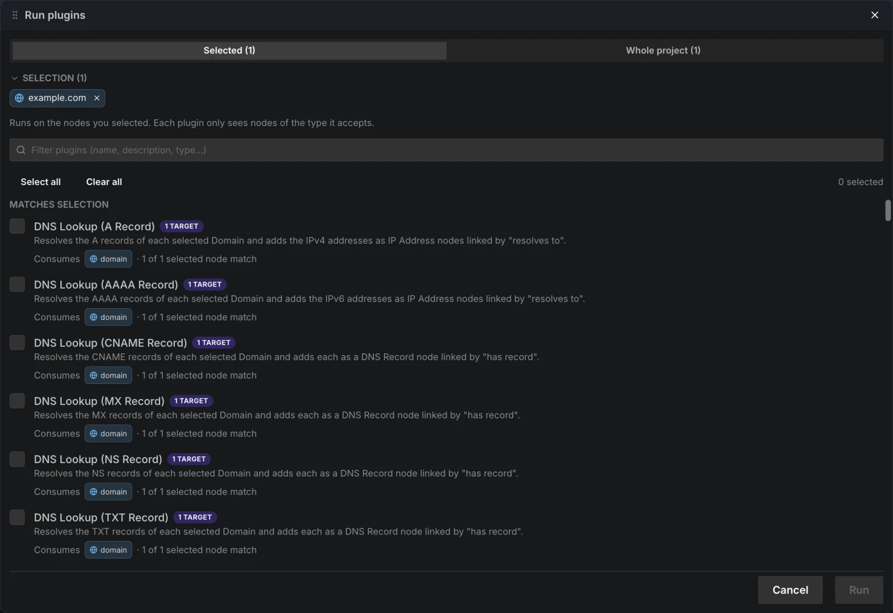
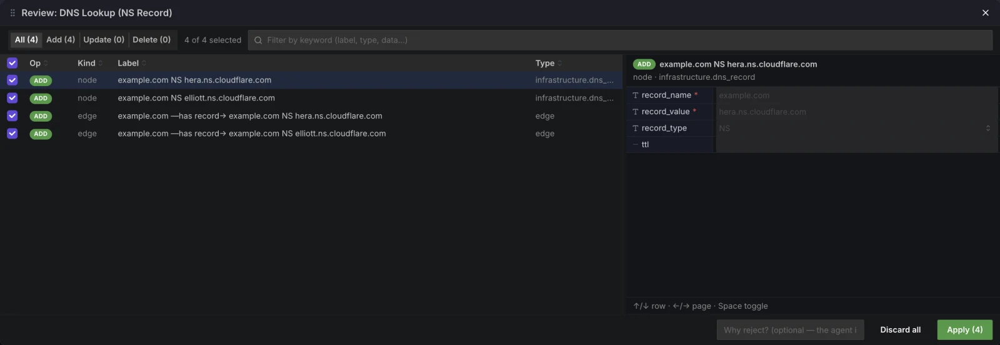

# Running plugins

Once a plugin is installed in a project, you open the **Run plugins** panel from a right-click on
a node, a selection or empty canvas, from the ▶ button on the canvas toolbar, from
**Run ▸ Run plugins…** in the top menu bar, or from the command palette (**⌘K**). You watch and cancel the run from the Tasks panel.

## Where a plugin shows up

Every installed plugin is listed in one panel, **Run plugins**. At the top, a scope switch picks
**Selected (N)** — the plugins that read nodes, each seeing only the selected ones of the type it
accepts — or **Whole graph (N)** — the plugins that take no node input at all. A plugin that
declares an input type (`consumes`) runs only on nodes you picked; there is no "run it over every
node of that type" shortcut, the same way the agent's `invoke_plugin` refuses a call without
`node_ids`. Every plugin declares its inputs, and that declaration decides which group it appears
in:

- **Matches selection** → plugins whose `consumes` types are in the selection, with an
  "N targets" badge.
- **Whole-graph / input via form** → plugins that consume nothing (e.g. the Chaos pack, or a query
  plugin that reads its form). They still receive your current selection, so for one like Black
  Hole select a node first.
- **Not applicable here** → installed, but none of their input types are in scope (greyed out).
- **Desktop only** → installed, but not runnable in a browser.

You can tick several plugins and press **Run (N)**. Once there are more than 6 plugins, a filter
box searches names, descriptions and types. Selection chips can be dropped from this run with their
×, which leaves the canvas selection unchanged.

<figure class="vy-shot" markdown="span">
  { width="800" loading=lazy }
  <figcaption>Run plugins opened from a right-click on example.com: the scope switch, the selection chip, and the plugins that match it.</figcaption>
</figure>

## Launch surfaces {#launch-surfaces}

=== "Right-click a node"

    Right-click a node, a selection, or empty canvas and choose **Run plugins…**. The panel opens
    scoped to that node/selection, or to the whole project from empty canvas.

=== "The Run menu"

    The top menu bar's **Run** menu — `Run ▸ Run plugins…` — opens the same panel, scoped to your
    current selection, or to the whole project when nothing is selected. The ▶ button on the canvas
    toolbar does the same; its tooltip names the scope.

=== "The command palette"

    Press **⌘K** (**Ctrl+K**) and type the plugin's name. **Run WHOIS on the selection** (for a plugin
    that reads no nodes, **Run** and its name) opens the panel on your selection with that plugin
    ticked. If the panel was already open, it becomes the only plugin ticked. Nothing runs from the
    palette: you check the panel and press **Run**. **Run** takes the focus, or, when the plugin has
    a required field that is empty, that field does. See [Command palette](shortcuts.md#command-palette).

### Running the same plugins again {#running-the-same-plugins-again}

A pivot runs the same plugins hop after hop. After a run, **Run ▸ Run the last plugins again on the
selection** (also in the command palette) opens the panel on what is selected now, with the last
run's plugins ticked and the parameters you typed for them filled in, and **Run** focused, so
**Enter** runs them. Files you picked, list values, and anything a plugin marks as a password or a
secret are not kept, so a run that needs a file asks for it again. A parameter you have already typed in an open
panel is left as you typed it. The last run is forgotten when you leave the project.

The focus moves once, when the panel opens this way, and never while you fill it in. When a required
field is empty, the cursor goes to that field instead of **Run**. When the panel was already open
with other plugins ticked, they stay ticked and **Run** does not take the focus, so **Enter** never
runs a plugin you did not choose here.

## The pre-run form

When you tick a plugin that takes input, its fields appear under it in the Run plugins panel —
text, number, switch, dropdown, or a file drop zone. Required fields are marked * and **Run** stays
disabled until they are filled. The nodes a plugin runs on come from the panel's scope, not from
these fields. File inputs accept at most 25 MB per file, 50 files and 250 MB per run.

Plugins that need stored settings (for example an API key or gateway URL) show a collapsible
**Settings (x/y set)** block. These values are saved as you type and reused on later runs. Plugins
of the same pack that call the same destinations share one value, so a key typed for one of them
is filled in for the others that ask for it; a plugin published on its own, or one that declares
no network destination, keeps its own. A secret field names the hosts its value is sent to and,
when other plugins in the pack share it, how many (*Sent to … · shared with N other plugins in
this pack*). Press **Run (N)** to start every ticked plugin.

Some packs connect to a server whose address only you know, such as your organisation's MISP or
OpenCTI. Their address field says where requests will go (*Requests from this plugin go to …*), or
why the address is not used, for example *This address is not used: it must start with https://*.
The plugin sends nothing there until the address is set. In the browser an `http://` address is not
used unless it is on this computer (`localhost`), because the browser blocks it from the https app:
use an https address, or the desktop app. In the desktop app, a server on this
computer or on your organisation's network can be read only once you trust it: press
**Trust … on this computer…** under the field and confirm the dialog. The origin is added to
**Additional trusted origins** in **Desktop Settings…**, applies in every project, and is removed
there.

Values are kept separately for each account on this device — in the browser only in this tab, gone
when it closes; in the desktop app encrypted and kept across launches (for the session only, on a
computer that cannot encrypt them). This separates accounts inside Vineyard, not from someone with
direct access to this computer. **Manage Keys & Secrets**, at the bottom of the panel, opens
**Settings → Keys & Secrets**. Its **Plugin keys** table lists every plugin key stored for your
account on this device, with **Pack**, **Key**, **Sent to** and **Value** columns; inside a project
it also lists the keys the project's packs declare that are not set yet. From a row you can show a
stored secret (**Show**), set or replace the value (**Set**, **Replace**) and remove it
(**Forget**); **Forget all…** removes every stored plugin key.

<figure class="vy-shot" markdown="span">
  { width="800" loading=lazy }
  <figcaption>Ticking OTX Passive DNS shows its field and its collapsed Settings (1/1 set) block.</figcaption>
</figure>

## Reviewing a run's changes {#reviewing-a-runs-changes}

A plugin never writes to the project directly. What it would add, change or delete is staged, and when
the run ends you get a toast ("N change(s) staged — review to apply") and a **needs review** badge
on its Tasks row. Click the row to open the Review dialog, untick anything you do not want, then
press **Apply (N)** (or **⌘Enter** / **Ctrl+Enter**) — or **Discard all**. **/** jumps to **Filter by keyword**. Nothing is written to the project until you apply; while the
Review dialog is open, the changes are only previewed on the canvas. A run that stages nothing ends
with a toast showing its summary (or "No changes"). A change that would leave an edge as it is, with
its label and the fields it already stores, is not staged, so running a plugin again over the same
data does not list those edges again.

The right side of the dialog shows the selected row's properties. For a node, they are what the
node will hold once the row is applied: for a change, its stored values with the proposed ones merged
in. A new node that is in the project by now, because a review you applied since this run staged
added it, is merged into that node instead of being added twice; the pane then says *This node is
already in the project* and shows the merged values. For an edge, **Recorded with this
link** below them lists what the edge will store besides its label and grade once the row is
applied: for a new edge, what the plugin recorded with it, such as where and when the link was
observed; for a change, the edge's stored values with the proposed ones in their place; for a
delete, what goes with the edge. The edge's Properties panel shows the same list (see
[Recorded with this link](properties.md#recorded-with-this-link)). Once the apply has finished, or
when you reopen the run from Tasks as history, the list is headed **Proposed by this change** and shows only
what the row itself proposed, since the edge may have changed since. The **Status** column says
whether it landed, and the edge's Properties panel shows what it stores now.

Unticking a node also leaves out the edges that need it, and the footer says how many (*N edges
excluded — their endpoint nodes are not being created*). If some links point at nodes from another
run that is still waiting for review, the footer says so: apply that review first. Applied before it,
those links stay staged in this run with the reason on each row, and they land when you apply this
run again after the other one. If the other run is discarded instead, they are skipped. The
optional **Why reject?** field beside **Discard all** gives your reason to the AI agent when the
changes came from one of its conversations.

Closing the dialog with the X or **Esc** keeps the run waiting for review, and keeps your choices
with it: what you unticked or ticked back on, and what you typed in **Why reject?**, are still there
when you reopen the review, even after opening another project and coming back. **Esc** closes the
dialog from anywhere in it, except in the **Filter by keyword** field while it holds text, where it
clears the filter first.

A run waiting for review is also kept on this device, under your account, so a reload, a restart, an
app update or a crash does not lose it. The next time you open the project it is waiting for review
again in Tasks, with your choices and your **Why reject?** text, even if the dialog was open when the
page went away. A plugin run or AI turn that a reload or a crash cut short comes back with what it had
staged by then. The Tasks row for what it staged is `cancelled`, as after **Stop**, and says *Cut short
by a reload*, and the review says *Cut short by a reload — this is what it had staged by then, not everything it would
have found.* A run whose apply was under way when the page went away comes back too, but the server
may already have written some of its rows: its review says *An apply of this set was under way when
the page went away — some of these rows may already be in the graph*, and a plugin run's Tasks row
says so as well. Check the graph before you apply or discard it. A run is kept for 7 days after its last change, and longer while a tab has it open, and
then deleted. The footer of the dialog says where the review is kept: *Kept on this device only — a reload brings
this review back, for 7 days after its last change*, or *Held in this tab only — a reload loses this
review* when no account is signed in or this device's storage refuses it. Nothing of a run waiting for
review is sent to the Vineyard server. A run waiting in a tab that is still open stays with that tab:
another tab shows it only once that tab has been closed, the next time it opens the project.

A change from the AI agent that edits a node's fields writes only the fields the agent changed. A
field that someone else changed after the agent read the node, in this tab or another, keeps its new
value, and the properties on the right show the node as it will be after the apply.

If some changes cannot be written, a **Partly applied** toast says how many. Those stay staged with
the reason on each row and the run is still waiting for review: reopen it to try them again. Once a
run is applied or discarded, clicking its row opens a read-only record of what was applied or
discarded.

If you press **Discard all** after part of a run has been applied, only the changes still staged are
thrown away; what was applied stays in the graph. The run is then recorded as applied, not
discarded: its badge reads **applied**, its record lists what was applied and marks the discarded
rows *excluded*, and when the run came from an AI agent conversation, the agent is told what landed
and that you rejected the rest.

<figure class="vy-shot" markdown="span">
  { width="800" loading=lazy }
  <figcaption>The Review dialog for one run: the staged nodes and edges, the selected row's properties, and Apply (4) / Discard all.</figcaption>
</figure>

## Progress and cancellation

Every run you start becomes a **task** shown in the Tasks panel, with a live status badge, a
progress bar where the plugin reports one, and a **Stop** control. Stop asks the plugin to wind down;
if it has not finished within about 3 seconds, it is force-stopped. Any changes it had already staged
are kept for you to review, not thrown away. A run that exceeds its time budget (10 minutes by
default, at most 60) is stopped and marked failed. A run that fails discards anything it had staged:
that includes a run stopped for exceeding its time budget, a sandbox that did not start, and a
plugin error. Only **Stop**, or a reload that cuts the run short, keeps partial results. See
[Tasks & runs](tasks.md) for states and controls.

Each request a plugin makes also has its own deadline, by default a minute at most unless the
plugin sets another, so a host that does not answer fails that request instead of holding the run
for its whole budget. If such a run still completes but stages nothing, its toast is yellow and
names the hosts that did not answer (*no answer from …*). Read "No changes" there as "could not
check", not "nothing found".

Plugin runs the AI agent starts have no Tasks row of their own. Each one that staged something
appears as a change set in that conversation and is reviewed there, or applied at the end of the
turn under **Apply automatically**. Stopping the turn, or deleting the conversation, stops them. See
[What the agent can do](tasks.md#what-the-agent-can-do).

## Importing STIX and MISP files {#stix-misp}

**Project ▸ Import graph (JSON)…** reads only a graph exported from Vineyard. STIX 2.1 bundles and
MISP events, the files a TIP or a sharing channel sends, come in through the **STIX & MISP Import**
plugin pack from the [Marketplace](../marketplace.md):

1. Install the pack in the project. It writes types from the Infrastructure, Identity, Endpoint,
   Financial, Geo and Threat type packs; a node whose type pack is missing is left out, and the
   run's summary names the type pack to install.
2. Open **Run plugins** on **Whole graph**, tick **Import STIX or MISP Files** and drop the files on
   its field. The files are read together, so a relationship in one file reaches the objects in
   another. They are read on this device and are not uploaded.
3. Review the run as usual. What the files hold reaches the project only when you apply it.

What lands on the graph:

- Observables become their own types (IP address, domain, URL, file hash, certificate and so on),
  so they meet the nodes other plugins wrote. A STIX indicator whose pattern only names values
  becomes those values' nodes; any other pattern stays one Indicator. A value with no matching type
  becomes an Indicator with an `observable_type` field.
- STIX relationships and sightings and MISP object references become edges labelled with the
  relation in words (`attributed-to` → `attributed to`). When the files state two relations between
  the same two nodes, one edge names both. A STIX report or a MISP event is not a node: its name is
  in the `source_report` field of each node it held.
- A node the files mark gets a `tlp` field: `TLP:CLEAR`, `TLP:GREEN`, `TLP:AMBER`,
  `TLP:AMBER+STRICT` or `TLP:RED`, with TLP 1.0 WHITE written as CLEAR. Where two labels meet, the
  stricter one wins. A node the files leave unmarked gets no `tlp`, and the run's summary counts
  those nodes. A MISP `attributes/restSearch` export carries its events' TLP only when it was made
  with `includeEventTags=1`; the summary says so when it was not.
- Each new edge gets a `tlp` field too: the one the files give the relationship, or else the
  stricter of its two nodes'. Its other fields, such as a relationship's `description` or a
  sighting's `first_seen` and `last_seen`, are under **Recorded with this link** in its
  Properties panel.
- An import does not lower the TLP of a node already in the project, or drop its
  `source_report`, `created_by`, `tags`, `markings` or `references`: the new values are added.
  This is checked again when you apply the review, against the project as it is then, so imports
  waiting for review at once can be applied in any order. A TLP typed on a node counts as the
  strictest label in it, so `TLP:RED (Case 7 only)` or `RED - do not share` is held as RED. A
  value with no label in it, such as `see note`, is not.
- An edge already in the project when you apply the review keeps its label and fields, including
  one another import added after this one was staged. It does not take the file's TLP, so check
  the file's marking before you share what such an edge says.
- A run stops at 1,500 nodes, 3,000 edges or 3 MB. The summary says how many were left out; split a
  larger file. It also tells new nodes, updated nodes and nodes already in the project apart, so a
  file you imported before reports nothing new to stage.

What you import is stored in the project like any other node, so in a shared project its
collaborators see it, whatever its TLP.

## Screening against sanctions lists {#sanctions}

The **Sanctions Screening** plugin pack from the [Marketplace](../marketplace.md) checks crypto
addresses, people and organizations against OFAC's Specially Designated Nationals list (SDN). It
needs no account or key, and works in the browser and the desktop app.

1. Install the pack in the project. It writes types from the Cryptocurrency and Identity type packs.
2. Select the nodes, open **Run plugins** and tick **OFAC Address Screening** for Crypto Address
   nodes or **OFAC Name Screening** for Person and Organization nodes.
3. Review the run as usual.

What lands on the graph:

- **Addresses** are matched exactly, on their own network. Each screened address gets `sanctioned`
  (`true` or `false`), `sanctions_list` (`OFAC SDN`), `sanctions_programs` and `sanctions_as_of`,
  the date of the list. A listed address is linked from the person or organization the list names
  by `listed address`, with the SDN `uid` and programmes.
- An address you, or another source, already marked `sanctioned` with no `sanctions_list` or
  another list's keeps its fields: OFAC not listing it does not clear it. The summary counts such
  addresses, and an OFAC listing of one is still drawn as its `listed address` link.
- The same string on another network is another account: the summary names it, and it is not a
  hit. A `0x…` value the list gives for USDT or USDC without naming a chain is a hit on that address
  on every EVM network.
- An address whose network is `evm` or `unknown`, or a legacy Financial crypto address, gets a node
  on each network the list names it on, linked from the original by `same address on` (from the
  legacy type, `same as`). The original keeps its network. A legacy address whose currency names
  one chain (`btc`, `ltc`, `xmr`, `trx`, `sol`) is screened on that chain only.
- **Names** are matched by similarity. Each close entry is linked as a `possible sanctions match`
  with its `score`, the two names that met and, for a person with a date of birth,
  `date_of_birth_check`. **Min score** (0.85 by default) and **Max candidates** (3) set how many.
  The subject is not marked sanctioned: a possible match is a similar name, so compare the date of
  birth, nationality and listing on the party node before treating it as the same party. A name in
  a script other than Latin meets nothing; screen a romanized alias.
- A listed party is one node per SDN entry, labelled with its uid, such as
  `KIM, Yong Chol (OFAC SDN 12211)`, because the list itself gives one name to several entries.
- A re-run on an unchanged list stages nothing. On a newer list, an address that is no longer listed
  is written `sanctioned = false`, and its `listed address` link stays as the record of the earlier
  listing. Links already in the project keep the keys they have: plugins cannot read a link's data
  in this version of Vineyard, so the pack leaves existing links as they are, and the summary says
  how many.

Where the list comes from: OFAC's own file cannot be read from a browser, so the pack reads a public
copy, [sanctions-mirror](https://github.com/Vineyard-Intelligence/sanctions-mirror), which rebuilds
it every six hours and checks it against OFAC's digest. A run downloads the whole address list, or
every listed individual or entity, and matches on your device: GitHub sees that a screening
happened, not what was screened. The summary warns when the mirror has not checked OFAC for three
days. Confirm a hit on OFAC's [Sanctions List Search](https://sanctionssearch.ofac.treas.gov/)
before acting on it. Other lists (UN, EU, UK, Korea) are not checked.

## Following coins with Blockchair {#blockchair}

The **Blockchair** plugin pack from the [Marketplace](../marketplace.md) reads addresses and
transactions on Bitcoin, Bitcoin Cash, Litecoin, Bitcoin SV, Dogecoin, Dash and Zcash (transparent
addresses) through Blockchair's API. It needs your own Blockchair API key, typed once for all four
plugins, and writes the Cryptocurrency type pack's types, so install that pack in the project too.

| Plugin | Run it on | What it writes |
|---|---|---|
| **Blockchair Address Summary** | Crypto Address | The confirmed `balance`, `first_seen`, `last_seen`, `address_kind`, and Blockchair's totals and dates (`blockchair_received`, `blockchair_first_spent`, …). 100 addresses per request. It creates nothing |
| **Blockchair Address Transactions** | Crypto Address | The latest transactions, or with **Start from** set to oldest the first ones, with their inputs and outputs; `tx_count`, `history_examined` and `history_complete` on the address |
| **Blockchair Transaction** | Crypto Transaction | The block, fee and counts on the transaction, and its inputs and outputs |
| **Blockchair Network Check** | Crypto Address whose network is `unknown` | A Crypto Address on each network the string was used on |

What lands on the graph:

- A transaction is a node. Each address it spends from is linked to it **input to**, with `amount`
  (that address's total across the inputs) and `inputs` (`index`, `amount`, `prev_txid`,
  `prev_vout`). Each address it pays is linked **output to**, with `amount` and `outputs` (`index`,
  `amount`). Amounts are decimal strings in the coin's own unit, BTC rather than satoshi.
- On each side of a transaction the selected addresses are always drawn, then the largest others up
  to **Counterparties per side**. `blockchair_not_drawn` on the transaction counts the ones left out,
  and reads 0 when nothing was. A later run with a smaller cap does not raise it, because the links
  drawn before are still there.
- A link already in the project under another label keeps that label and gets the amounts. One
  that already has the label the plugin would write (`input to`, `output to`) is left as it is:
  plugins cannot read a link's data, and a transaction's amounts do not change. So running the
  plugin again adds no link rows to the review, and the summary counts the links it left alone.
- `history_examined` and `history_complete` are written only when every transaction read for the
  address was drawn. If a run stops part-way, for example when the key's daily requests run out, the
  address still gets its balance and dates, and the summary says which addresses to run again.
- Addresses are written in each network's own form: CashAddr without `bitcoincash:` for Bitcoin
  Cash, `M…` for a Litecoin `3…`, lower-case bech32. A selected address written another way keeps
  its spelling, and the run still links its transactions to it.
- An address never used on its network gets a zero `balance` and `blockchair_output_count` 0. That
  is a real negative, not a failed lookup: an answer that does not say so, such as an HTTP 404 or an
  answer without the list of addresses, counts as a failed lookup and writes nothing.
- Network Check makes one node for each network where the string has activity, linked **same
  address on** from the unknown node. The link's `check_blockchair` says how it was decided: `basis`
  is `activity`, or `format` when only one network has that format, and `as_of` is the date of
  Blockchair's answer. It is a key of its own so that another plugin settling the same pair keeps
  its own record beside it. A `1…` address used before a chain split has activity on Bitcoin and
  Bitcoin Cash, and on Bitcoin SV too: separate accounts that share a string. A `D…` address may
  also be a Verge address, which Blockchair does not cover, so an unused one stays unknown.
- Balances, dates and transaction lists are confirmed only: transactions still in the mempool are
  left out.
- A run that passes its 10-minute time budget fails and keeps nothing it staged (see
  [Progress and cancellation](#progress-and-cancellation)). So a Blockchair run takes no new
  address or transaction after about seven minutes, finishes what it has, and says **STOPPED** in
  its summary with how many to run again. A large selection with many transactions per address can
  take several runs.

Each run's summary says how many of the key's Blockchair request points it used. Blockchair
receives every address and transaction looked up, with your key.

## Following funds with Blockscout PRO {#blockscout-pro}

The **Blockscout PRO** plugin pack reads EVM chains with your own Blockscout PRO API key, which
[dev.blockscout.com](https://dev.blockscout.com/) issues free. OP Mainnet is why you would reach for
it, since Etherscan's free key does not serve it. It runs in the desktop app only. Paste the key
into one of its plugins' settings once; all four share it.

Which chains the key reads depends on its Blockscout plan. The free plan reads Ethereum, OP Mainnet,
Ethereum Classic and Arbitrum One, at 5 requests a second and 100,000 credits a day. Polygon PoS and
Base need a paid plan (Builder or higher): Blockscout announced that they leave the free plan from
2026-10-01, and a free-plan key was refused both when this was measured on 2026-11-16. Plans
change, so the pack keeps no list of its own and goes by Blockscout's answer:

- When the key's plan does not include a chain, the run skips that chain's addresses and
  transactions and goes on with the rest. The summary names the chain, the plans that include it
  and how many it skipped.
- A missing key, or one Blockscout does not accept, stops the run, and so does running out of the
  day's credits.

| Plugin | Run it on | What it writes |
|---|---|---|
| **Blockscout Address History** | Crypto Address | `sent to` links to and from the addresses it paid and was paid by, in the native coin and ERC-20 tokens |
| **Blockscout Address Details** | Crypto Address | Account or contract, balance, transaction count, public label; a contract's deployer (`deployed`) and its token (`token contract`) |
| **Blockscout First Funder** | Crypto Address | Who first sent it the native coin: `first_funder`, `first_funding_tx`, `activated_at` |
| **Blockscout Transaction** | Crypto Transaction | Block, time, status, fee and kind; its senders `input to` it and its recipients `output to` from it |

Reading what it wrote:

- The node's `network` decides the chain. A node on `bsc` or `avalanche_c`, which Blockscout does
  not cover, and a node whose network is still `evm` or `unknown` are skipped, and the summary says
  why.
- Address History reads each list newest first, up to **Pages per list** (50 rows a page), and
  counts only the blocks every list covered completely. Each link's `summary_blockscout` gives the
  counts and totals per asset with that window (`window_from`, `window_to`) and the lists it covers
  (`feeds`); `complete: false` means older history was not read.
- `history_complete: true` and `first_seen` on the address need **Include internal transactions**.
  Coin paid out through a contract, such as an exchange withdrawal or a bridge deposit on an L2,
  arrives only as an internal transfer, and is often a wallet's first coin. Without that option,
  `history_complete` is `false` and `first_seen` is not written.
- A link already between two addresses keeps its label, including one you wrote; the figures are
  added to it. A new link gets the latest 20 transfers in `recent`. A link that already exists
  keeps its `recent` as it was, because a plugin cannot read the rows already on it and would
  otherwise replace them; the run's summary counts these links.
- Address History leaves out tokens Blockscout flags as scam airdrops unless you tick
  **Include tokens Blockscout flags as scams**, which an address-poisoning case needs. Mints, burns and NFT transfers are not
  linked.
- A first funder is written only once every earlier funding is ruled out. When the address's
  internal transfers run past the page limit, or it also received coin with no transaction
  (beacon-chain withdrawals on Ethereum, credits for producing blocks) that may have come first,
  nothing is written and the summary says why.
- A wallet delegated to code under EIP-7702 is written as an `eoa`, with the delegate in
  `eip7702_delegate`.
- Blockscout Transaction writes `revert_reason` for a failed transaction, such as
  `execution reverted: V3TooLittleReceived()`.
- A lookup costs 20 to 40 credits, and each run's summary gives the credits it used. Blockscout
  sees every address and transaction you look up.

## The Chaos reference pack

The Chaos pack is a single bundle (`run.vineyard.pluginpacks.chaos`) of six small plugins that
reshape your graph for learning the run loop:

| Plugin | What it does |
|---|---|
| Korean Roulette | Keeps one random node, deletes all others |
| Russian Roulette | Deletes one random node |
| Thanos Snap | Deletes half the nodes at random |
| Black Hole | Deletes the 1-hop neighbors of the selected node |
| Dumb AI Optimizer | Shows fake progress for a few seconds, changes nothing |
| Schrödinger's Node | Picks a random node; 50% delete, 50% nothing |

!!! tip "Try it safely"
    The Chaos pack is destructive by design. Run it on a throwaway graph so you can watch
    Korean Roulette, Thanos Snap, and Black Hole reshape the canvas without losing real work.

## Next / See also

- [Tasks & runs](tasks.md) — task states, progress, stop, and review
- [Browse & install](installing.md) — getting a plugin into your project
- [Working with Type Packs](typepacks.md) — the node types plugins act on
