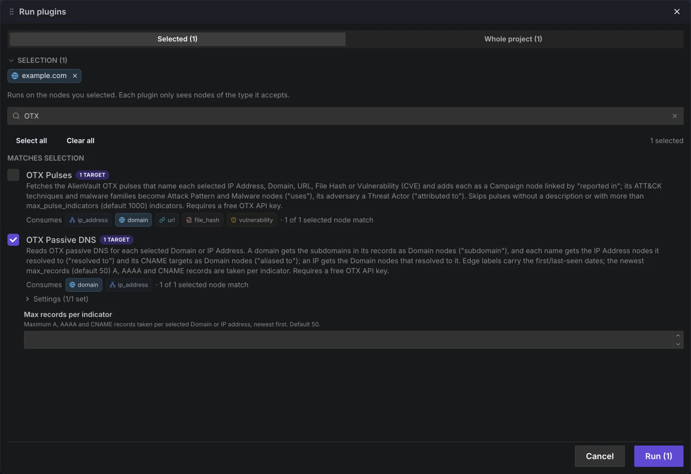

# Running plugins

Once a plugin is installed in a project, you open the **Run plugins** panel from a right-click on
a node, a selection or empty canvas, from the ▶ button on the canvas toolbar, or from
**Run ▸ Run plugins…** in the top menu bar. You watch and cancel the run from the Tasks panel.

## Where a plugin shows up

Every installed plugin is listed in one panel, **Run plugins**. At the top, a scope switch picks
**Selected (N)** — the plugins that read nodes, each seeing only the selected ones of the type it
accepts — or **Whole graph (N)** — the plugins that take no node input at all. A plugin that
declares an input type (`consumes`) runs only on nodes you picked; there is no "run it over every
node of that type" shortcut, the same way the agent's `invoke_plugin` refuses a call without
`node_ids`. Every plugin declares its inputs, and that declaration decides which group it appears
in:

- **Matches selection** → plugins whose `consumes` types are in the selection, with an
  "N targets" badge.
- **Whole-graph / input via form** → plugins that consume nothing (e.g. the Chaos pack, or a query
  plugin that reads its form). They still receive your current selection, so for one like Black
  Hole select a node first.
- **Not applicable here** → installed, but none of their input types are in scope (greyed out).
- **Desktop only** → installed, but not runnable in a browser.

You can tick several plugins and press **Run (N)**. Once there are more than 6 plugins, a filter
box searches names, descriptions and types. Selection chips can be dropped from this run with their
×, which leaves the canvas selection unchanged.

<figure class="vy-shot" markdown="span">
  { width="800" loading=lazy }
  <figcaption>Run plugins opened from a right-click on example.com: the scope switch, the selection chip, and the plugins that match it.</figcaption>
</figure>

## Launch surfaces

=== "Right-click a node"

    Right-click a node, a selection, or empty canvas and choose **Run plugins…**. The panel opens
    scoped to that node/selection, or to the whole project from empty canvas.

=== "The Run menu"

    The top menu bar's **Run** menu — `Run ▸ Run plugins…` — opens the same panel, scoped to your
    current selection, or to the whole project when nothing is selected. The ▶ button on the canvas
    toolbar does the same; its tooltip names the scope.

## The pre-run form

When you tick a plugin that takes input, its fields appear under it in the Run plugins panel —
text, number, switch, dropdown, or a file drop zone. Required fields are marked * and **Run** stays
disabled until they are filled. The nodes a plugin runs on come from the panel's scope, not from
these fields. File inputs accept at most 25 MB per file, 50 files and 250 MB per run.

Plugins that need stored settings (for example an API key or gateway URL) show a collapsible
**Settings (x/y set)** block. These values are saved as you type and reused on later runs. Plugins
of the same pack that call the same destinations share one value, so a key typed for one of them
is filled in for the others that ask for it; a plugin published on its own, or one that declares
no network destination, keeps its own. A secret field names the hosts its value is sent to and,
when other plugins in the pack share it, how many (*Sent to … · shared with N other plugins in
this pack*). Press **Run (N)** to start every ticked plugin.

Some packs connect to a server whose address only you know, such as your organisation's MISP or
OpenCTI. Their address field says where requests will go (*Requests from this plugin go to …*), or
why the address is not used, for example *This address is not used: it must start with https://*.
The plugin sends nothing there until the address is set. In the browser an `http://` address is not
used unless it is on this computer (`localhost`), because the browser blocks it from the https app:
use an https address, or the desktop app. In the desktop app, a server on this
computer or on your organisation's network can be read only once you trust it: press
**Trust … on this computer…** under the field and confirm the dialog. The origin is added to
**Additional trusted origins** in **Desktop Settings…**, applies in every project, and is removed
there.

Values are kept separately for each account on this device — in the browser only in this tab, gone
when it closes; in the desktop app encrypted and kept across launches (for the session only, on a
computer that cannot encrypt them). This separates accounts inside Vineyard, not from someone with
direct access to this computer. **Manage Keys & Secrets**, at the bottom of the panel, opens
**Settings → Keys & Secrets**. Its **Plugin keys** table lists every plugin key stored for your
account on this device, with **Pack**, **Key**, **Sent to** and **Value** columns; inside a project
it also lists the keys the project's packs declare that are not set yet. From a row you can show a
stored secret (**Show**), set or replace the value (**Set**, **Replace**) and remove it
(**Forget**); **Forget all…** removes every stored plugin key.

<figure class="vy-shot" markdown="span">
  { width="800" loading=lazy }
  <figcaption>Ticking OTX Passive DNS shows its field and its collapsed Settings (1/1 set) block.</figcaption>
</figure>

## Reviewing a run's changes {#reviewing-a-runs-changes}

A plugin never writes to the project directly. What it would add, change or delete is staged, and when
the run ends you get a toast ("N change(s) staged — review to apply") and a **needs review** badge
on its Tasks row. Click the row to open the Review dialog, untick anything you do not want, then
press **Apply (N)** — or **Discard all**. Nothing is written to the project until you apply; while the
Review dialog is open, the changes are only previewed on the canvas. A run that stages nothing ends
with a toast showing its summary (or "No changes"). A change that would leave an edge as it is, with
its label and the fields it already stores, is not staged, so running a plugin again over the same
data does not list those edges again.

The right side of the dialog shows the selected row's properties. For a node, they are what the
node will hold once the row is applied: for a change, its stored values with the proposed ones merged
in. A new node that is in the project by now, because a review you applied since this run staged
added it, is merged into that node instead of being added twice; the pane then says *This node is
already in the project* and shows the merged values. For an edge, **Recorded with this
link** below them lists what the edge will store besides its label and grade once the row is
applied: for a new edge, what the plugin recorded with it, such as where and when the link was
observed; for a change, the edge's stored values with the proposed ones in their place; for a
delete, what goes with the edge. The edge's Properties panel shows the same list
(see [Inspecting an edge](canvas.md#inspecting-an-edge)). Once the apply has finished, or when you
reopen the run from Tasks as history, the list is headed **Proposed by this change** and shows only
what the row itself proposed, since the edge may have changed since. The **Status** column says
whether it landed, and the edge's Properties panel shows what it stores now.

Unticking a node also leaves out the edges that need it, and the footer says how many (*N edges
excluded — their endpoint nodes are not being created*). If some links point at nodes from another
run that is still waiting for review, the footer says so: apply that review first. Applied before it,
those links stay staged in this run with the reason on each row, and they land when you apply this
run again after the other one. If the other run is discarded instead, they are skipped. The
optional **Why reject?** field beside **Discard all** gives your reason to the AI agent when the
changes came from one of its conversations.

Closing the dialog with the X or **Esc** keeps the run waiting for review, and keeps your choices
with it: what you unticked or ticked back on, and what you typed in **Why reject?**, are still there
when you reopen the review, even after opening another project and coming back. **Esc** closes the
dialog from anywhere in it, except in the **Filter by keyword** field while it holds text, where it
clears the filter first.

If some changes cannot be written, a **Partly applied** toast says how many. Those stay staged with
the reason on each row and the run is still waiting for review: reopen it to try them again. Once a
run is applied or discarded, clicking its row opens a read-only record of what was applied or
discarded.

If you press **Discard all** after part of a run has been applied, only the changes still staged are
thrown away; what was applied stays in the graph. The run is then recorded as applied, not
discarded: its badge reads **applied**, its record lists what was applied and marks the discarded
rows *excluded*, and when the run came from an AI agent conversation, the agent is told what landed
and that you rejected the rest.

<figure class="vy-shot" markdown="span">
  { width="800" loading=lazy }
  <figcaption>The Review dialog for one run: the staged nodes and edges, the selected row's properties, and Apply (4) / Discard all.</figcaption>
</figure>

## Progress and cancellation

Every run you start becomes a **task** shown in the Tasks panel, with a live status badge, a
progress bar where the plugin reports one, and a **Stop** control. Stop asks the plugin to wind down;
if it has not finished within about 3 seconds, it is force-stopped. Any changes it had already staged
are kept for you to review, not thrown away. A run that exceeds its time budget (10 minutes by
default, at most 60) is stopped and marked failed. A run that fails discards anything it had staged:
that includes a run stopped for exceeding its time budget, a sandbox that did not start, and a
plugin error. Only **Stop** keeps partial results. See [Tasks & runs](tasks.md) for states and
controls.

Each request a plugin makes also has its own deadline, by default a minute at most unless the
plugin sets another, so a host that does not answer fails that request instead of holding the run
for its whole budget. If such a run still completes but stages nothing, its toast is yellow and
names the hosts that did not answer (*no answer from …*). Read "No changes" there as "could not
check", not "nothing found".

Plugin runs the AI agent starts have no Tasks row of their own. Each one that staged something
appears as a change set in that conversation and is reviewed there, or applied at the end of the
turn under **Apply automatically**. Stopping the turn, or deleting the conversation, stops them. See
[What the agent can do](tasks.md#what-the-agent-can-do).

## Importing STIX and MISP files {#stix-misp}

**Project ▸ Import graph (JSON)…** reads only a graph exported from Vineyard. STIX 2.1 bundles and
MISP events, the files a TIP or a sharing channel sends, come in through the **STIX & MISP Import**
plugin pack from the [Marketplace](../marketplace.md):

1. Install the pack in the project. It writes types from the Infrastructure, Identity, Endpoint,
   Financial, Geo and Threat type packs; a node whose type pack is missing is left out, and the
   run's summary names the type pack to install.
2. Open **Run plugins** on **Whole graph**, tick **Import STIX or MISP Files** and drop the files on
   its field. The files are read together, so a relationship in one file reaches the objects in
   another. They are read on this device and are not uploaded.
3. Review the run as usual. What the files hold reaches the project only when you apply it.

What lands on the graph:

- Observables become their own types (IP address, domain, URL, file hash, certificate and so on),
  so they meet the nodes other plugins wrote. A STIX indicator whose pattern only names values
  becomes those values' nodes; any other pattern stays one Indicator. A value with no matching type
  becomes an Indicator with an `observable_type` field.
- STIX relationships and sightings and MISP object references become edges labelled with the
  relation in words (`attributed-to` → `attributed to`). When the files state two relations between
  the same two nodes, one edge names both. A STIX report or a MISP event is not a node: its name is
  in the `source_report` field of each node it held.
- A node the files mark gets a `tlp` field: `TLP:CLEAR`, `TLP:GREEN`, `TLP:AMBER`,
  `TLP:AMBER+STRICT` or `TLP:RED`, with TLP 1.0 WHITE written as CLEAR. Where two labels meet, the
  stricter one wins. A node the files leave unmarked gets no `tlp`, and the run's summary counts
  those nodes. A MISP `attributes/restSearch` export carries its events' TLP only when it was made
  with `includeEventTags=1`; the summary says so when it was not.
- Each new edge gets a `tlp` field too: the one the files give the relationship, or else the
  stricter of its two nodes'. Its other fields, such as a relationship's `description` or a
  sighting's `first_seen` and `last_seen`, are under **Recorded with this link** in its
  Properties panel.
- An import does not lower the TLP of a node already in the project, or drop its
  `source_report`, `created_by`, `tags`, `markings` or `references`: the new values are added.
  This is checked again when you apply the review, against the project as it is then, so imports
  waiting for review at once can be applied in any order. A TLP typed on a node counts as the
  strictest label in it, so `TLP:RED (Case 7 only)` or `RED - do not share` is held as RED. A
  value with no label in it, such as `see note`, is not.
- An edge already in the project when you apply the review keeps its label and fields, including
  one another import added after this one was staged. It does not take the file's TLP, so check
  the file's marking before you share what such an edge says.
- A run stops at 1,500 nodes, 3,000 edges or 3 MB. The summary says how many were left out; split a
  larger file. It also tells new nodes, updated nodes and nodes already in the project apart, so a
  file you imported before reports nothing new to stage.

What you import is stored in the project like any other node, so in a shared project its
collaborators see it, whatever its TLP.

## The Chaos reference pack

The Chaos pack is a single bundle (`run.vineyard.pluginpacks.chaos`) of six small plugins that
reshape your graph for learning the run loop:

| Plugin | What it does |
|---|---|
| Korean Roulette | Keeps one random node, deletes all others |
| Russian Roulette | Deletes one random node |
| Thanos Snap | Deletes half the nodes at random |
| Black Hole | Deletes the 1-hop neighbors of the selected node |
| Dumb AI Optimizer | Shows fake progress for a few seconds, changes nothing |
| Schrödinger's Node | Picks a random node; 50% delete, 50% nothing |

!!! tip "Try it safely"
    The Chaos pack is destructive by design. Run it on a throwaway graph so you can watch
    Korean Roulette, Thanos Snap, and Black Hole reshape the canvas without losing real work.

## Next / See also

- [Tasks & runs](tasks.md) — task states, progress, stop, and review
- [Browse & install](installing.md) — getting a plugin into your project
- [Working with Type Packs](typepacks.md) — the node types plugins act on
