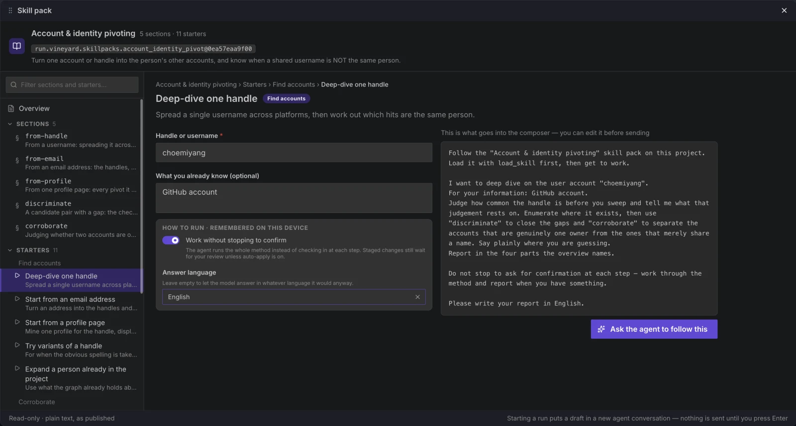

# Skill Pack 사용하기

Skill Pack은 **텍스트**입니다: AI 에이전트가 참고할 수 있는 재사용 가능한 조사 *플레이북*입니다.

플러그인이 그래프를 바꾸는 곳에서, Skill Pack은 **에이전트가 일하는 방식을** 바꿉니다: 에이전트가 따르는 지침입니다. 자체적인 권한을 요청하지 않으며 아무것도 실행하지 않습니다.

## Skill Pack이 담고 있는 것

Skill Pack은 세 부분으로 이루어진 단일 문서입니다:

| 부분 | 역할 |
| --- | --- |
| `overview` | 플레이북이 무엇을 위한 것인지, 어떻게 라우팅하는지 — 에이전트가 먼저 읽습니다. |
| `sections` | 실제 단계. 에이전트가 **필요할 때** 하나씩 로드합니다. |
| `starters` | 실행을 시작하는 준비된 방법 — 채워 넣을 빈칸(`{{handle}}`, `{{email}}`…)이 있는 프롬프트 템플릿입니다. |

팩은 또한 `applies_to`(관련된 노드 타입)와 `triggers`(키워드 힌트)를 선언하므로, 에이전트와 UI가 언제 관련이 있는지 알 수 있습니다.

## Skill Pack 설치

Skill Pack은 플러그인과 정확히 같은 방식으로 [마켓플레이스](../marketplace.md)에서 설치합니다:

1. 마켓플레이스를 열고 팩을 찾습니다 (예: **Account & identity pivoting**).
2. 팩이 `requires`(단계가 호출하는 플러그인 팩)를 선언하면, 마켓플레이스가 **동시 설치**를 제안합니다 — 이들 없이는 스킬을 사용할 수 없습니다.
3. 한 번 설치하면, 팩은 해당 프로젝트의 에이전트에게 제공됩니다.

!!! note "가용성은 의존성에 따라 결정됩니다"
    Skill Pack은 `requires`의 모든 플러그인 팩이 해당 프로젝트에 설치되어 있고 **이 플랫폼에서 실행될 수 있는** 경우에만 **사용 가능**합니다. 나중에 하나를 제거하거나, 필요한 팩이 데스크탑 전용인데 브라우저에서 프로젝트를 열면, 스킬은 조용히 에이전트에게 제공되지 않고 **Run ▸ Skill packs** 목록에서도 빠집니다. 예를 들어 Account & identity pivoting은 데스크탑 앱에서만 실행되는 WhatsMyName 팩이 필요하므로, 이 스킬은 데스크탑 앱에서만 사용할 수 있고 브라우저에서는 메뉴에 나타나지 않습니다.

현재 카탈로그에는 두 개의 Skill Pack이 있습니다:

| Skill Pack | `applies_to` | 요구 사항 | 하는 일 |
| --- | --- | --- | --- |
| **Account & identity pivoting** (`run.vineyard.skillpacks.account_identity_pivot`) | `identity.handle`, `identity.account`, `identity.email_address`, `identity.person` | `run.vineyard.pluginpacks.whatsmyname` (데스크탑 앱 전용) | 하나의 계정이나 핸들을 그 사람의 다른 계정들로 확장 — 그리고 공유된 사용자명이 **같은 사람이 아닌** 경우를 구분합니다. |
| **Infrastructure pivoting** (`run.vineyard.skillpacks.infra_pivot`) | `infrastructure.ip_address`, `infrastructure.domain`, `infrastructure.certificate`, `infrastructure.autonomous_system` | — (필수 없음; 그래프 툴과 프로젝트에 있는 DNS/RDAP/인증서/ASN 수집 플러그인을 사용하며, 그것 없이 갈 수 없는 홉은 밝힘) | 하나의 지표(IP/도메인/인증서)를 연결된 발자국으로, 검증 가능한 홉씩 확장합니다. |

## Skill Pack 사용

상단 메뉴 바에서 **Run ▸ Skill packs**를 열고 팩을 고릅니다. **Skill pack** 패널은 왼쪽에 팩의 구성 — **Overview**(무엇에 관한 팩인지, 어떤 플러그인이 필요한지, 에이전트가 먼저 읽는 본문), 모든 **섹션**, 카테고리(`Find accounts`, `Corroborate`, `Report`, …)별 **starter** — 을 나열하고, 고른 항목을 오른쪽에 보여 줍니다. 목록 위의 **Filter sections and starters…** 상자에 입력하면 그 내용이 들어 있는 섹션과 starter만 보입니다. 처음 열면 첫 번째 starter가 선택되어 있고, 다른 패널처럼 그래프 작업을 하면서 옮기거나 크기를 바꿀 수 있으며, **Esc**를 누르면 닫힙니다.

<figure class="vy-shot" markdown="span">
  { width="800" loading=lazy }
  <figcaption>Skill pack 패널: 왼쪽에 개요·섹션·스타터, 오른쪽에 고른 스타터의 입력칸과 프롬프트 미리보기.</figcaption>
</figure>

그다음:

- 여기서 실행을 시작하거나 — 왼쪽에서 **starter**를 고르고, 빈칸을 채우고(필수 항목은 표시됨), 원하면 *How to run* 아래의 **Work without stopping to confirm**과 **Answer language**를 정하고(둘 다 이 기기에 기억되어 다음 실행에도 적용됩니다), 미리보기를 확인한 뒤 **Ask the agent to follow this**를 누릅니다. 프롬프트는 새 AI 에이전트 대화의 입력창에 들어가며(이미 열려 있던 대화는 Tasks에 그대로 남습니다), 직접 편집해 전송하기 전에는 아무것도 전송되지 않습니다; 또는
- 자신의 말로 그냥 요청합니다 — 에이전트가 관련성을 판단하고(`applies_to` / `triggers`를 통해) 스스로 읽습니다.

!!! tip "스킬은 지침이지 명령이 아닙니다"
    에이전트는 플레이북을 프로젝트에 맞게 조정할 수 있습니다. 팩의 단계를 진행할 수 없다면(예: 프로젝트에 없는 플러그인이 필요한 홉), 에이전트는 메모리로 채우기보다 그 지점을 멈추고 명확히 말합니다.

## 프로젝트 자체 Skill Pack {#custom-skill-packs}

마켓플레이스에서 설치한 팩 말고도, 프로젝트는 자체 Skill Pack을 가질 수 있습니다: 설치된 팩을 복사해 고친 것, 처음부터 새로 쓴 것, 파일에서 가져온 것입니다. 이 팩은 레지스트리가 아니라 프로젝트에 저장됩니다. **Run ▸ Skill packs**에서는 설치된 팩 다음에 나열되고, Skill pack 패널에서는 **Custom** 배지가 붙습니다.

| 작업 | 위치 | 하는 일 |
| --- | --- | --- |
| **Make a copy** | Skill pack 패널, 팩 이름 옆 | 독립된 사본을 프로젝트에 저장하고 편집기에서 엽니다. 사본의 이름은 *Copy of …*, 식별자는 `local.project.skillpacks.account_identity_pivot_copy` 같은 형태, 버전은 `1.0.0`, 작성자는 본인입니다. 원본이 업데이트되거나 철회되어도 사본은 바뀌지 않습니다. |
| **New skill pack** | **Run ▸ Skill packs** | 빈 팩을 편집기에서 엽니다. 처음 **Save**를 누를 때 만들어집니다. 프로젝트 자체 팩이 32개가 되면 사용할 수 없습니다. |
| **Import skill pack…** | **Run ▸ Skill packs** | 1 MB 이하의 Skill Pack JSON 파일을 저장하지 않은 상태로 편집기에서 엽니다. **Save**를 눌러야 프로젝트에 들어갑니다. Skill Pack에 속하지 않는 필드는 빠지며, 패널에 어떤 필드인지 표시됩니다. Skill Pack이 아닌 파일은 거부되며, 문제가 있는 파일도 거부되고 각 문제가 파일 안의 위치와 함께 나열됩니다. 작성자가 비어 있거나 없는 것만으로는 가져오기가 멈추지 않으며, **Save** 전에 편집기가 작성자를 입력하라고 요구합니다. |
| **Edit** | Skill pack 패널, 자체 팩 | 팩을 편집기에서 엽니다. |
| **Export JSON** | Skill pack 패널, 자체 팩 | 게시된 팩과 같은 형식의 `.skill.json` 파일로 팩을 다운로드합니다. |
| **Delete** | Skill pack 패널, 자체 팩 | *Deleting this pack removes it from this project for everyone.*가 표시되고, **Delete pack**을 누르면 삭제됩니다. |

가져오는 파일의 식별자가 프로젝트 자체 팩 중 하나와 같으면, 가져오기가 멈추고 *A custom pack with this identifier already exists.*가 표시됩니다. **Replace it**은 그 팩을 파일 내용으로 채워 편집기에서 열며, 저장하면 기존 팩이 대체됩니다. **Import as a copy**는 파일을 새 팩으로 가져오고, **Cancel**은 아무것도 가져오지 않습니다. 식별자가 `run.vineyard` 네임스페이스에 속하거나, 설치된 팩 등 프로젝트의 다른 팩이 이미 쓰고 있는 파일도 같은 방식으로 새 팩으로 가져옵니다. 이런 팩에는 사본과 같은 규칙이 적용됩니다: 새 `local.project.skillpacks.*` 식별자를 받고, 다른 팩이 이미 쓰는 이름은 *Copy of …*가 되며, 작성자 `VINEYARD`는 본인 사용자 이름으로 바뀝니다.

**편집기.** 왼쪽 열에 **Details**(식별자, 이름, 설명, 작성자, 버전, **Applies to**, **Triggers**, **Requires**), **Overview**, **Sections**, **Starters**가 나열되고, **New section**과 **New starter**로 항목을 추가합니다. 아래쪽 막대에는 **Save**를 막는 *problem*과 막지 않는 *warning*의 개수가 표시됩니다(warning의 예: overview가 언급하지 않는 섹션, 이 프로젝트에서 실행할 수 없는 필수 플러그인). 개수를 누르면 첫 번째 항목으로 이동합니다. **Save**를 누르기 전에는 아무것도 기록되지 않습니다. **Discard changes**는 편집 내용을 버리고, 저장할 것이 없을 때 표시되는 **Done**은 읽기 화면으로 돌아갑니다. 그사이 다른 세션에서 팩이 바뀌었다면 저장이 거부되고 *This pack changed elsewhere, so your changes were not saved.*가 표시되며, **Reload pack**을 누르면 초안 대신 저장된 팩을 불러옵니다. 로컬 모드에는 사용자 이름이 없으므로 **Author**가 빈 채로 시작하고, 채울 때까지 problem으로 표시됩니다. 저장된 팩에 작성자가 있어야 **Export JSON**을 사용할 수 있습니다.

- **누가 보고 바꿀 수 있는가.** 프로젝트를 편집할 수 있는 사람은 모두 **Run ▸ Skill packs**에서 자체 팩을 보고, 읽고, 실행을 시작하고, 내보낼 수 있으며, 그 사람의 AI 에이전트도 이 팩을 사용할 수 있습니다. 프로젝트를 보기만 할 수 있는 사람에게는 보이지 않습니다. 사본 만들기, 새로 만들기, 가져오기, 편집, 삭제는 프로젝트 소유자만 할 수 있으며, 그 버튼과 메뉴 항목도 소유자에게만 표시됩니다.
- **한도.** 프로젝트는 자체 팩을 최대 32개까지 가질 수 있고, 팩 하나는 최대 256 KB입니다. 로그인 상태에서는 전체 합계도 1 MB를 넘을 수 없습니다. 각 필드에도 길이 제한이 있으며, 편집기가 이를 표시하고 넘는 텍스트는 거부합니다.
- **예약된 이름.** `run.vineyard` 네임스페이스와 작성자 이름 `VINEYARD`는 공식 팩의 것이므로 편집기가 둘 다 거부합니다. 새 팩과 사본은 `local.project.skillpacks.*` 네임스페이스에서 시작하며, 식별자는 `org.example.skillpacks.my_pack`처럼 같은 형식의 다른 식별자로 바꿀 수 있습니다. 단, `run.vineyard` 안에 있으면 안 됩니다. 프로젝트의 다른 팩이 이미 쓰는 식별자나 이름은 거부됩니다.
- **레지스트리 검토 없음.** 이 팩은 레지스트리를 거치지 않습니다. 에이전트에게는 이런 팩이 *written in this project by its owner; not reviewed by the registry*라고 알려지며, 다른 모든 팩과 마찬가지로 앱 자체 규칙이 이 팩보다 우선합니다.
- **플러그인을 실행할 수 없는 팩.** 필요한 플러그인 팩을 이 프로젝트에서 실행할 수 없는 자체 팩은 에이전트에게 제공되지 않습니다. 이 팩은 **Run ▸ Skill packs**에 흐리게 남고 *needs plugins*가 붙으므로, 열어서 고치거나 내보내거나 삭제할 수 있습니다. 패널에는 *The agent does not use this pack while a plugin it needs cannot run in this project.*가 표시되고, **Ask the agent to follow this**는 사용할 수 없습니다.

## 다음 / 함께 보기

- [둘러보기 및 설치](installing.md) — 플러그인 및 Type Pack과 공유되는 설치 흐름
- [플러그인 실행](running-plugins.md) — 스킬의 단계가 호출하는 팩을 에이전트가 실행하는 방식
- [Skill Pack (개발자 가이드)](../develop/skillpacks.md) — 자신만의 플레이북 만들기
- [작업 및 실행](tasks.md) — Skill Pack을 따르는 실행 추적
