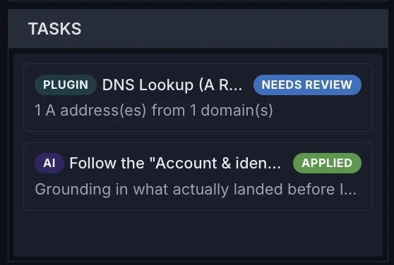
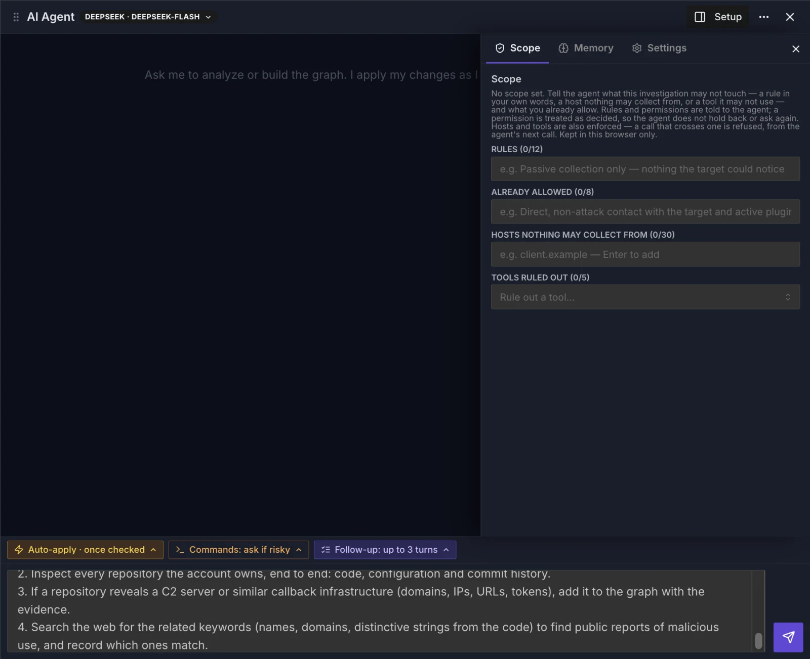
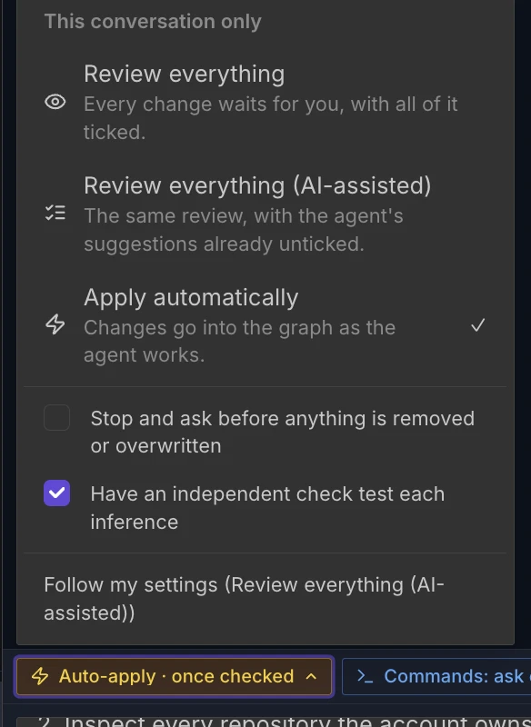
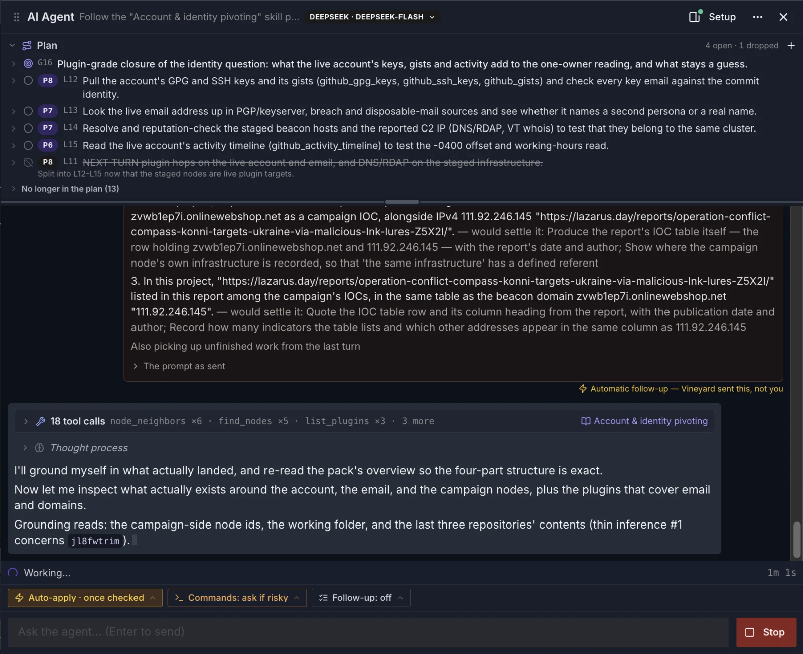

# 작업 및 실행

Vineyard에서 직접 시작한 모든 플러그인 실행과 모든 AI 에이전트 대화는 **작업**이며, **Tasks**(작업) 패널에 표시됩니다(대화당 한 행이며, 새 턴마다 그 행이 갱신됩니다).

## 작업의 작동 방식 {#how-tasks-work}

실행 중인 작업에는 **running** 배지와, 플러그인이 보고하는 경우 진행률 표시줄이 표시됩니다.

AI 에이전트가 시작한 플러그인 실행에는 따로 **Tasks** 행이 생기지 않고, 해당 대화의 행에 속합니다. 무언가를 스테이징한 실행은 각각 그 대화 안의 별도 변경 세트가 되어 거기서 검토하게 되며, **Apply automatically**에서는 에이전트 자신의 변경과 마찬가지로 턴이 끝날 때 적용됩니다. 턴을 중지하거나 대화를 삭제하면 그 턴이 시작한 플러그인도 중지됩니다.

## 작업 상태 {#task-states}

| 상태 | 의미 |
| --- | --- |
| `running` | 활발히 실행 중. |
| `succeeded` | 성공적으로 완료됨 (종료). |
| `failed` | 오류로 종료됨 (종료). |
| `cancelled` | 완료 전에 사용자가 중지함 (종료). 중지한 AI 턴은 프로젝트를 다시 열면 대개 `incomplete`로 돌아옵니다. 새로 고침이나 비정상 종료로 끊긴 실행도 그때까지 스테이징한 내용을 가지고 `cancelled`로 돌아오며, 아래에 *Cut short by a reload*가 표시됩니다. |
| `incomplete` | AI 에이전트 전용 — 에이전트가 끝내기 전에 턴이 멈춤 (종료): 응답받지 못한 도구 호출이 남은 채 끝났거나, 프로젝트를 다시 열었을 때 사용자가 중지했거나 단계를 다 썼거나 앱이 닫혀 끊긴 턴. 그때까지 한 작업은 남아 있으니, 대화를 열고 **Continue**를 누르세요. |

단계를 다 쓴 턴은 `succeeded` 배지로, 사용자가 중지한 턴은 `cancelled` 배지로 프로젝트를 다시 열 때까지 남습니다. 어느 쪽이든 대화에는 멈춘 이유와 **Continue** 버튼이 표시됩니다.

실행 중인 플러그인 작업에는 **Stop**(중지) 버튼이 있습니다(AI 턴은 AI 에이전트 패널에서 중지합니다). 행을 클릭하면 열립니다: AI 작업은 해당 대화를 다시 열고, 플러그인 작업은 검토를 엽니다. 변경 사항이 있는 실행이 끝나면 배지가 대신 검토 상태 — **needs review**(또는 **N to review**), **applied**, **discarded** — 를 보여 주며, 대기 중인 변경 사항이 있는 AI 작업에는 **Review staged changes** 버튼도 표시됩니다. `failed`나 `cancelled` 배지는 검토 상태 대신 표시되므로, 중지한 실행은 변경 사항을 남겼더라도 대개 `cancelled`로 남습니다. 이때도 플러그인 실행의 행을 누르면 남은 변경 사항의 검토가 열리고, AI 작업에는 **Review staged changes** 버튼이 그대로 있습니다. 중지한 플러그인 실행은 다른 프로젝트를 열었다가 돌아오면([기본적으로 임시](#ephemeral-by-default) 참고) **needs review**로 표시됩니다.

<figure class="vy-shot" markdown="span">
  { width="279" loading=lazy }
  <figcaption>검토를 기다리는 플러그인 실행과, 변경이 반영된 AI 대화.</figcaption>
</figure>

!!! note "Stop은 협력적입니다"
    **Stop**은 플러그인이 정상적으로 종료되도록 요청합니다. 약 3초 안에 반환하지 않으면 강제 종료됩니다. 스스로 종료하든 강제 종료되든, 이미 스테이징된 변경 사항은 유지되어 검토할 수 있습니다. 실패한 실행은 다릅니다: 스테이징한 내용을 모두 폐기합니다. 시간 예산(플러그인이 따로 정하지 않으면 10분, 최대 60분)을 넘겨 중지되고 실패로 표시된 실행, 샌드박스나 코드를 불러오지 못한 플러그인, 플러그인 오류로 끝난 실행이 모두 여기에 해당합니다. 부분 결과는 **Stop**으로 중지했거나 새로 고침으로 실행이 끊겼을 때만 남습니다.

## 기본적으로 임시 {#ephemeral-by-default}

플러그인 실행 작업은 브라우저 탭 메모리에만 존재합니다. 탭을 닫으면 사라지지만, 아직 검토를 기다리는 실행은 예외입니다. 다른 프로젝트를 열면 이전 프로젝트의 플러그인 행은 사라지고, 같은 탭에서 그 프로젝트로 돌아오면 아직 검토를 기다리는 플러그인 실행만 다시 나타납니다. AI 대화는 이 기기에 저장되어(프로젝트별) 새로 고침 후에도 **Tasks** 행으로 돌아오므로 다시 열 수 있습니다. 대화는 진행되는 대로 저장되므로, 앱을 닫아 중간에 끊긴 턴도 남아 있고 이어서 진행할 수 있습니다. 검토를 기다리는 스테이징된 변경 사항도 마지막으로 바뀐 뒤 7일 동안(열어 둔 탭이 있으면 그보다 오래) 이 기기에 보관됩니다. 새로 고침이나 재시작 뒤에도 다시 검토를 기다리며, 에이전트에게도 아직 검토를 기다린다고 전달됩니다([실행 변경 사항 검토](running-plugins.md#reviewing-a-runs-changes) 참고). 더 이상 보관되지 않는 변경 세트, 즉 7일이 지났거나 이 기기에 저장하지 못한 변경 세트는 새로 고침하면 사라집니다. 적용이 이미 그 일부를 기록했다면 그 부분은 그래프에 남고, 대화에는 그 세트가 *N applied · M not applied*로 표시됩니다. 그래프에 이미 있는 노드의 중복처럼 따로 쓸 내용이 없던 변경이 있으면 그 사이에 *K skipped*도 표시됩니다. 에이전트에게는 무엇이 반영되었는지, 그 적용에서 체크를 해제한 행은 거부되었다는 것, 나머지 중 어느 것이 사라졌는지가 전달되므로, 에이전트는 사라진 것만 다시 제안합니다.

플러그인 실행이나 AI 턴이 아직 작업 중일 때 프로젝트를 떠나려 하면 먼저 묻습니다: *Stop the running plugin and leave this project?* 또는 *Stop the agent and leave this project?* **Stay in this project**를 누르면 그대로 머물고, **Stop and leave**를 누르면 작업을 중지하고 떠납니다.

데스크탑 앱에서는 플러그인 실행이나 AI 턴이 아직 작업 중일 때 창을 닫거나, 앱을 종료하거나, 새로 고침해도 먼저 묻습니다: *Leave while an AI turn or plugin run is still in progress?* **Stay**를 누르면 그대로 남습니다. **Leave anyway**를 누르면 닫기·종료·새로 고침이 진행되고, 턴의 나머지는 사라집니다. 턴이나 플러그인 실행이 그때까지 스테이징한 내용과 이미 검토를 기다리던 변경 사항은 이 기기에 보관되어, 다음에 프로젝트를 열면 검토를 기다립니다. 이렇게 끊긴 실행에는 *Cut short by a reload*가 표시됩니다. 브라우저 탭에서는 브라우저가 자체 대화상자로 묻습니다.

작업 행과 대화 내용은 Vineyard 서버로 전송되지 않으며, 적용된 변경 사항만 프로젝트에 기록됩니다 — 검토에서 직접 적용한 것과, **Apply automatically**에서 에이전트가 적용한 것입니다. 에이전트의 모델 호출은 앱에서 AI 프로바이더로 바로 갑니다. 웹 검색어와 에이전트가 읽는 페이지가 어디로 가는지는 설정에 따라 달라집니다. 기본 설정에서 로그인한 상태라면, 에이전트가 프로젝트 내용으로 작성한 검색어가 Vineyard 서버를 거쳐 Serper와 Google로 갑니다. 브라우저 탭에서는 기본 페이지 읽기 방식이 에이전트가 여는 모든 URL을 리더 서비스 r.jina.ai로 보내며, 데스크탑 앱은 직접 가져오기가 실패할 때만 그렇게 합니다. [웹 검색과 페이지 읽기](#web-search-and-page-reading)를 참고하세요.

!!! tip "AI 대화는 이 기기에, 계정별로 남습니다"
    대화, 메시지, 프로젝트 메모리, 그리고 대화별 세션 스코프와 계획은 이 기기에만 보관되며 서버에 기록되지 않습니다. AI 프로바이더 키·웹 검색 키와 마찬가지로 계정별로 따로 보관됩니다 — 이는 Vineyard 안에서 계정을 분리하는 것이지, 이 컴퓨터를 직접 쓸 수 있는 사람으로부터 보호하는 것은 아닙니다. AI 프로바이더, 모델, 키는 AI 에이전트 패널의 **Setup → Settings**에서 설정하고, 웹 검색 키는 **Settings → AI agent**에 있습니다. 두 종류의 키는 모두 **Settings → Keys & Secrets**(**LLM keys**, **Search engine keys**)에 나열되며, 거기서 보거나(**Show**) 교체하거나(**Replace**) 지울(**Forget**) 수 있습니다. 데스크탑 앱은 이 키들을 컴퓨터의 키체인으로 암호화해 보관하고(암호화할 수 없는 컴퓨터에서는 그 세션 동안만 남습니다), 웹 앱은 탭을 닫을 때까지만 보관합니다.

## AI 에이전트 패널 {#the-ai-agent-panel}

AI 에이전트 패널 머리글에는 **AI Agent**, 대화 제목, 사용 중인 모델(모델을 누르면 바꿀 수 있습니다)이 표시되고, 그 뒤에 **Setup**, **⋯**, **Close**가 있습니다. **Setup**은 세 탭이 있는 서랍을 엽니다:

- **Session scope** — 이 대화에만 적용되는 경계: **Rules**, **Already allowed**, **Hosts nothing may collect from**(하위 도메인 포함), **Tools ruled out**. 새 채팅은 스코프 없이 시작하므로, 한 대화에서 정한 경계는 같은 프로젝트의 다른 대화에는 적용되지 않습니다. 규칙과 허용 사항은 에이전트에게 전달되고, 호스트와 도구는 코드로도 강제되어 이를 넘는 호출은 거부됩니다([에이전트가 할 수 있는 일](#what-the-agent-can-do) 참고). 스코프가 적용 중이면 **Setup** 버튼에 청록색 점이 표시됩니다.
- **Project memory** — 에이전트의 메모로, 프로젝트의 모든 대화가 함께 씁니다.
- **Settings** — 프로바이더, 모델, 키, 그리고 **Advanced** 아래의 **Temperature**, **Max output tokens**, **Context window**, **Seed**. 여기서 정한 temperature, max output tokens, seed는 이 브라우저에서 **Settings → AI agent**의 기본값보다 우선하며, 비워 두면 그 기본값을 따릅니다. **Context window**는 압축 시점을 계산할 때 기준으로 삼는 컨텍스트 윈도우 크기로, Vineyard가 모델의 윈도우 크기를 모를 때 설정합니다([대화 압축](#conversation-compaction-token-compression) 참고).

**⋯**에는 **Export this conversation as HTML**, **Open the agent's working folder**(데스크탑 앱에서만), **Delete conversation…**이 있습니다. 내보낸 페이지는 그것만으로 읽을 수 있으며, 페이지의 **Save as JSON** 버튼은 같은 기록을 JSON으로 저장합니다.

<figure class="vy-shot" markdown="span">
  { width="800" loading=lazy }
  <figcaption>Setup을 Session scope 탭으로 연 AI 에이전트 패널. 입력창 위의 칩은 다음 메시지의 적용 방식, 명령 실행, follow-up 턴을 보여 줍니다.</figcaption>
</figure>

입력창 위의 칩 한 줄은 다음 메시지가 어떤 설정으로 실행될지 보여 줍니다. 적용 방식 칩과 **Commands** 칩은 이 대화에만 적용되는 메뉴를 열며, **Follow my settings**를 고르면 계정 설정으로 돌아갑니다. **Follow-up**은 다음 메시지 하나에만 적용됩니다:

- 첫 번째 칩은 에이전트의 변경을 누가 적용하는지 보여 줍니다: **Review everything**, **Review everything (AI-assisted)**(같은 검토이되, 에이전트의 제안에 따라 일부 항목이 미리 체크 해제됨), **Apply automatically**. 변경이 검토 없이 반영되는 동안에는 호박색으로 바뀝니다. 이 메뉴에는 **Stop and ask before anything is removed or overwritten**과 **Have an independent check test each inference**도 있습니다. 검증이 실행되면 Review 대화상자에 각 행의 판정을 보여 주는 **Check** 열(*supported*, *weak*, *unresolved*, *refuted*, *not checked*, *check failed*, 에이전트가 철회한 변경은 *dropped*)이 추가되고, 목록 아래의 **Independent check** 창에 포커스된 행의 주장, 그에 대한 반론, 무엇으로 판가름 날지가 표시됩니다. 창의 위쪽 가장자리를 끌어 크기를 조절할 수 있습니다.
- **Commands**(데스크탑 앱에서만) — 에이전트가 이 컴퓨터에서 명령을 실행해도 되는지: **Do not run commands**, **Ask every time**, **Ask only for risky commands**, **Never ask**. 묻지 않고 명령을 실행하는 동안 칩이 빨간색입니다.
- **Follow-up** — **Keep working after this turn, on its own**을 켜고 턴 수를 정하면, 에이전트가 그 턴 수까지 묻지 않고 이어서 작업합니다. **Apply automatically**가 필요하며, 보낸 메시지 하나가 끝나면 다시 꺼집니다.

<figure class="vy-shot" markdown="span">
  { width="292" loading=lazy }
  <figcaption>첫 번째 칩의 메뉴. 여기서는 Apply automatically에 독립 검증을 켠 상태입니다.</figcaption>
</figure>

그 밖에 알아 둘 것:

- 검토를 기다리는 변경이 있는 동안에는 메시지를 보낼 수 없습니다. 입력창 위 줄에 *N change(s) across M change sets need review*가 **Review**, **Discard all**과 함께 표시됩니다. 이 **Discard all**은 **Review** 대화상자의 것과 같게 동작합니다. 일부가 이미 적용된 변경 세트는 적용으로 기록되고, 나머지는 거부된 것으로 남습니다.
- 에이전트가 계획을 세워 작업할 때는 대화 위에 **Plan** 띠가 나타납니다. 단서(lead)를 추가하거나, 우선순위를 올리거나 내리거나, 빼 버릴 수 있습니다. 에이전트는 다음 계획 갱신 때나 다음 턴이 시작될 때 이를 전달받습니다.
- 도구 호출이 여러 번인 턴은 한 줄로 접힙니다. 이 줄은 호출 수를 세고, 에이전트가 읽은 Skill Pack을 책 아이콘 뒤에 표시하며(첫 번째는 이름으로, 나머지는 **+N**), 메모·오류·스테이징된 변경을 알려 줍니다. 누르면 펼쳐집니다.
- 답변 속 이미지는 설명과 주소로만 표시되며, 불러오지 않습니다.
- 턴이 실행되는 동안 대화와 입력창 사이의 막대가 지금 하는 일을 보여 주고 경과 시간을 초 단위로 셉니다. *Planning…*, *Checking staged changes…*, *Applying staged changes…*, *Finishing the turn…*처럼 앱이 직접 알리는 단계에서는 청록색이고, 그 밖의 *Thinking…*, *Running*과 도구 이름, *Working…*에서는 보라색입니다.
- **Show token usage**를 켜면(**Settings → AI agent**) 각 답변 아래에 그 턴이 쓴 토큰이 표시됩니다.

<figure class="vy-shot" markdown="span">
  { width="800" loading=lazy }
  <figcaption>실행 중인 화면: 위쪽의 Plan, 자동 follow-up 턴, 에이전트가 읽은 스킬팩 이름이 붙은 채 한 줄로 접힌 도구 호출 18개.</figcaption>
</figure>

## 대화 닫기와 삭제 {#closing-and-deleting-a-conversation}

입력란이 비어 있을 때 **↑**를 누르면 마지막으로 한 질문을 다시 불러와 고쳐서 보낼 수 있습니다. 입력란 밖 어디서나 **G** 다음 **A**를 누르면 입력란으로 커서가 옮겨 가고, 패널이 닫혀 있으면 새 대화가 열립니다([단축키](shortcuts.md) 참조).

패널을 **닫아도** — 닫기 버튼이든 **Esc**든 — 에이전트는 멈추지 않습니다. 실행 중인 턴은 계속 진행되고 **Tasks**에 행이 남아 있어 거기서 다시 열 수 있습니다. **Setup** 서랍이 열려 있으면 Esc나 서랍 바깥 클릭은 서랍부터 닫습니다. 패널을 닫으려면 Esc를 한 번 더 누르세요. Esc는 패널을 향한 것일 때만 패널을 닫습니다. 패널 안에서 입력하거나 작업하는 중에 누른 경우, 또는 마지막으로 패널을 클릭한 직후(예: 턴이 실행 중이라 입력창이 잠긴 동안)입니다. 패널 안의 드롭다운이나 대화상자를 닫는 Esc는 그것만 닫고, 캔버스나 다른 패널에서 누른 Esc는 AI 에이전트 패널에 영향을 주지 않습니다.

대화를 **삭제**하면(**⋯ → Delete conversation…**) 먼저 확인을 묻습니다. **Cancel**에 포커스가 있어서 습관적으로 Enter를 눌러도 삭제되지 않습니다. 확인하면:

- 대화와 그 **Tasks** 행, 세션 스코프, 계획이 이 기기에서 삭제됩니다 — 되돌릴 수 없습니다.
- 에이전트가 아직 작업 중이면 그 턴을, 턴이 시작한 플러그인 실행과 함께 먼저 중지합니다.
- 이 대화에서 제안됐지만 아직 적용하지 않은 변경 세트는 폐기됩니다(확인창에 개수가 표시됩니다). 이미 그래프에 적용한 변경은 그대로 남습니다.
- 패널이 닫힙니다.

삭제할 것이 생기기 전까지 **Delete conversation…**은 회색으로 비활성화되고 *Nothing to delete yet*이라고 표시됩니다.

## 에이전트가 할 수 있는 일 {#what-the-agent-can-do}

에이전트는 도구를 통해 작업하며, 마지막 열의 한도 안에서 스스로 도구를 호출합니다. 이 가운데 호출 전에 사용자에게 물을 수 있는 것은 명령 실행뿐입니다. 그래프에 대한 변경은 모두 적용 방식을 거칩니다: 검토를 위해 스테이징되거나, **Apply automatically**에서는 턴이 끝날 때 적용됩니다. 턴의 도구 호출 줄을 펼치면 각 호출이 도구 이름으로 표시됩니다.

| 할 수 있는 일 | 도구 | 제한 |
| --- | --- | --- |
| 프로젝트 읽기 | `list_node_types`, `graph_stats`, `read_nodes`, `find_nodes`, `get_node`, `read_edges`, `node_neighbors`, `similar_hashes`, `get_selection` | 읽기 전용. `similar_hashes`는 파비콘의 `phash`·`dhash` 같은 지각 해시를 64비트 중 몇 비트가 다른지로 비교합니다. 기본은 10비트, 최대 16비트입니다. 빈 아이콘의 해시와 같거나 가까운 값(빈 아이콘, 한 가지 색 아이콘, 대칭인 아이콘)은 비교하지 않고, 그래프 밖에서 가져온 해시는 어떤 필드로 계산한 값인지 하나만 지정해야 합니다. |
| 두 노드가 이어지는 경로 찾기 | `find_paths` | 읽기 전용. 다른 읽기 도구처럼 이미 그래프에 들어간 것만 보고, 스테이징된 것은 보지 않습니다. 경로를 짧은 것부터 최대 10개, 경로마다 링크 최대 6개까지 돌려줍니다. 기본으로 링크가 50개를 넘는 노드는 거쳐 가지 않습니다. 공유 네임서버, 등록기관, 호스팅 업체처럼 무관한 것들을 잇는 노드입니다. 건너뛴 노드가 무엇인지, 두 노드가 그런 노드를 거치거나 더 긴 경로로 이어지는지를 에이전트에게 알려 줍니다. 두 노드가 이어지지 않는다고 알려 주는 것은 필터로 범위를 좁히지 않았는데도 길이에 상관없이 어떤 링크 사슬로도 이어지지 않을 때뿐입니다. 프로젝트를 아직 불러오는 중이면(예: 재연결 후 다시 동기화하는 동안) 그래프의 나머지가 들어올 때까지 기다리고, 그래도 다 들어오지 않았으면 지금까지 들어온 부분만 보고 답했다고 알려 줍니다. |
| 노드 주변 살펴보기 | `neighborhood` | 읽기 전용. 다른 읽기 도구처럼 이미 그래프에 들어간 것만 보고, 스테이징된 것은 보지 않습니다. 링크 한 개, 두 개, 세 개 떨어진 노드(기본은 두 개까지)를 유형별로 세고, 거리마다 최대 50개를 보여 줍니다. 유형마다 돌아가며 고르므로 IP 주소 수백 개에 이메일 주소 몇 개가 묻히지 않습니다. 기본으로 링크가 50개를 넘는 노드(공유 네임서버, 등록기관, 호스팅 업체 등)의 링크는 따라가지 않습니다. 그 노드는 세고, 거쳐 가지 않았다는 사실과 그런 노드를 모두 거쳐 가면 몇 개까지 세어지는지, 그렇게 한 번에 세려면 어떤 값을 지정하면 되는지를 에이전트에게 알려 줍니다. 주변에 아무것도 없다고 알려 주는 것은 그 노드에 다른 노드로 이어진 링크가 하나도 없을 때뿐입니다. 프로젝트를 아직 불러오는 중이면 그래프의 나머지가 들어올 때까지 기다리고, 그래도 다 들어오지 않았으면 지금까지 들어온 부분만 보고 답했다고 알려 줍니다. |
| 노드들이 공유하는 것 찾기 | `common_ground` | 읽기 전용. 다른 읽기 도구처럼 이미 그래프에 들어간 것만 보고, 스테이징된 것은 보지 않습니다. 노드 2~20개를 비교해, 그중 여럿이 함께 연결된 노드, 같은 필드에 든 같은 값(모든 필드를 비교하며, 참·거짓 값은 비교하지 않습니다. WHOIS 레코드의 등록자 이메일과 이메일 주소 노드의 이메일처럼 필드 이름이 다르면 같은 값이어도 비교하지 않습니다), 노드끼리 직접 이어진 링크를 돌려줍니다. 대소문자, 띄어쓰기, 전각 문자, 호스트 이름 끝의 점만 다른 값은 같은 값으로 봅니다. 설치된 타입팩이 비교 규칙을 따로 정한 필드는 그 필드를 가진 모든 노드에서 대신 그 규칙을 따릅니다. Cryptocurrency 팩을 설치하면 암호화폐 주소와 거래 해시는 Financial 팩의 레거시 유형까지 그 팩의 규칙으로 비교하므로, 대소문자를 구별하는 체인에서 대소문자만 다른 두 주소는 서로 다른 값입니다. 그 팩이 없으면 레거시 주소도 다른 값처럼 대소문자를 무시합니다. 공유하는 값마다 프로젝트에서 그 값을 가진 노드 수와 그 필드에 있는 서로 다른 값의 수를 에이전트에게 알려 줍니다. 링크가 50개를 넘는 공유 노드와 50개를 넘는 노드가 가진 값은 표시해서 맨 뒤에 둡니다. 그만큼 흔한 것은 아무것도 이어 주지 않습니다. |
| 필드 하나의 값이 어떻게 퍼져 있는지 세기 | `aggregate_values` | 읽기 전용. 다른 읽기 도구처럼 이미 그래프에 들어간 것만 보고, 스테이징된 것은 보지 않습니다. 프로젝트를 아직 불러오는 중이면 나머지가 들어올 때까지 기다립니다. 한 유형의 노드에 대해 한 필드에 값을 가진 노드 수, 서로 다른 값의 수, 그중 노드 하나만 가진 값의 비율을 세고, 많이 가진 값부터 그 값을 가진 노드 수와 함께 보여 줍니다. 필드를 지정하지 않으면 그 노드들이 가진 모든 필드를 요약합니다. 같은 값으로 보는 기준은 `common_ground`와 같습니다. 참·거짓 값도 세고, `open_ports`처럼 텍스트 필드 하나에 담긴 목록은 Properties 패널이 보여 주는 항목 하나하나로 셉니다. 이 수는 이 프로젝트 안에서만 센 것이고, 에이전트에게도 그렇게 알려 줍니다. 서로 관련되어 수집된 노드들은 운영자의 값을 함께 가지므로, 여기서 많은 노드가 가진 값이라고 다른 곳에서도 흔한 것은 아닙니다. 분류를 요청하면 Operation MIDAS(Black Hat Europe 2024)를 따라 필드를 특정요소(서로 다른 값 100개 이상, 그중 절반 이상이 노드 하나에만 있음), 준특정요소(10개 이상), 비식별요소(10개 미만)로 나눕니다. 값을 가진 노드가 100개보다 적고, 서로 다른 값이 100개보다 적으며 그 절반 이상이 노드 하나에만 있는 필드는 분류하지 않습니다. 노드가 더 많으면 특정요소가 될 수 있어서, 그 크기에서는 기준이 필드가 아니라 프로젝트의 크기를 재기 때문입니다. 목록 필드는 그보다 적은 노드로도 서로 다른 항목이 100개를 넘을 수 있고, 적은 값을 많은 노드가 함께 가진 필드는 크기와 관계없이 범주이므로 둘 다 분류합니다. 프로젝트를 아직 불러오는 중일 때는 아무것도 분류하지 않습니다. |
| 텍스트에서 지표 추출 | `extract_indicators` | 넘겨받은 텍스트와 지정한 노드만 읽습니다. 앱 밖으로 아무것도 보내지 않고 아무것도 스테이징하지 않습니다. 찾은 값은 후보이며, 에이전트가 다른 노드와 똑같이 `create_node`로 스테이징합니다. |
| 그래프의 연결이 무엇에 걸려 있는지 보기 | `graph_structure` | 읽기 전용이며, 다른 읽기 도구처럼 이미 그래프에 들어간 것만 봅니다. 그래프의 연결 성분, 그 안의 클러스터, 그리고 두 무리를 혼자서 잇는 링크와 노드를 돌려줍니다. 두 무리 사이의 유일한 링크, 그리고 무리 사이의 모든 연결이 거쳐 가는 노드입니다. 그런 링크가 틀리면 두 무리는 아예 이어지지 않으므로, 링크는 확인할 순서대로 옵니다. 등급이 약한 것부터 오므로 등급이 `asserted`보다 낮거나 없는 링크가 나머지보다 먼저이고, 등급이 같으면 그 링크에 걸린 노드 수 순입니다. 기본으로 `find_paths`처럼, 공유 네임서버처럼 링크가 50개를 넘는 노드를 거치는 경로는 두 무리를 잇는 두 번째 연결로 치지 않습니다. 그런 노드를 빼면 두 무리 사이의 유일한 링크나 노드가 되는 것도 목록에 넣고, 그 노드를 함께 알려 줍니다. 노드 하나만 나머지에 잇는 링크는 개수만 세고 목록에 넣지 않습니다. 노드를 지정하면 그 노드가 속한 부분만 보고, 그 노드끼리의 연결이 기대는 것을 앞에 둡니다. 그런 연결 지점에 있는 노드의 링크가 50개를 넘으면 공유 인프라로 표시하며, 이는 두 무리가 관련 있다는 근거가 되지 않습니다. 클러스터는 캔버스가 멈추지 않도록 백그라운드에서 계산합니다. 그럴 수 없는 환경에서 그래프의 링크가 15,000개를 넘거나 클러스터 계산이 실패하면 클러스터를 계산하지 않았다고 에이전트에게 알려 줍니다. 프로젝트를 아직 불러오는 중이면 `find_paths`처럼 그래프의 나머지가 들어올 때까지 기다립니다. |
| 링크로 노드 순위 매기기 | `rank_nodes` | 읽기 전용이며, 다른 읽기 도구처럼 이미 그래프에 들어간 것만 봅니다. 노드를 링크 수(전체, 또는 그 노드를 가리키거나 그 노드에서 나가는 것으로 기록된 링크만)나, 다른 노드 사이의 최단 연결 가운데 그 노드를 거쳐 가는 것의 수로 순위를 매기고, 한 번에 최대 100개를 돌려줍니다. 순위가 높다는 것은 살펴볼 곳이라는 뜻일 뿐 무엇이 관련 있다는 근거가 아니라고 모든 답에서 에이전트에게 알려 줍니다. 링크가 가장 많은 노드는 대개 네임서버 같은 공유 인프라이며, 링크가 50개를 넘는 노드는 그렇게 표시합니다. 노드를 거쳐 가는 연결로 매기는 순위는 기본으로 `find_paths`처럼 링크가 50개를 넘는 노드를 거쳐 가지 않습니다. 이 순위는 캔버스가 멈추지 않도록 백그라운드에서 계산합니다. 그런 노드를 거치지 않고 이어지는 부분이 너무 커서 전부 셀 수 없으면 그 부분의 점수는 출발 노드 표본으로 추정하고, 어떤 점수가 추정값인지 에이전트에게 알려 줍니다. 서로 그런 노드로만 이어진 그룹들은 하나씩 따로 세므로, 작은 그룹은 정확하게 셉니다. 백그라운드를 쓸 수 없는 환경에서 그래프가 멈추지 않고 계산하기에는 너무 크거나 계산이 실패하면, 계산하지 않았다고 에이전트에게 알려 줍니다. 프로젝트를 아직 불러오는 중이면 `find_paths`처럼 그래프의 나머지가 들어올 때까지 기다립니다. |
| 값으로 노드 고르기 | `filter_nodes` | 읽기 전용이며, 다른 읽기 도구처럼 이미 그래프에 들어간 것만 봅니다. 주어진 조건을 모두 만족하는 필드를 가진 노드를 고릅니다. 조건은 숫자나 날짜가 기준보다 앞이거나 뒤인지(`2026-12-31` 같은 날짜, 또는 지금부터 30일 뒤처럼 지금을 기준으로 센 날짜), 정확한 값이거나 목록의 값 중 하나인지, 필드가 어떤 텍스트를 포함하거나 정규식에 맞는지, 필드가 채워져 있는지, 지각 해시가 다른 해시와 몇 비트 이내로 다른지(기본 10비트, 최대 16비트)입니다. 텍스트 비교는 에이전트가 따로 요청하지 않으면 대소문자를 구분하지 않습니다. 도메인의 네임서버나 호스트의 열린 포트처럼 한 줄에 하나씩 또는 쉼표로 구분해 목록을 담은 텍스트 필드는 항목마다 비교하므로, 네임서버가 둘인 도메인은 그중 어느 쪽으로도 찾을 수 있습니다. 시각 없이 날짜만 있는 값은 그날 하루 전체로 봅니다. 한 번에 최대 100개를 돌려주고, 노드마다 조건이 읽은 값을 함께 보여 줍니다. `12.3K`로 적힌 팔로워 수, 조건이 가리키는 바로 그날의 시각 없는 날짜, 쉼표가 두 항목을 나누는 것인지 알 수 없는 값처럼 값을 비교할 수 없는 노드는 결과에서 빠지며, 에이전트가 나머지를 전부인 것처럼 보고하지 않도록 몇 개가 빠졌는지와 그 예시를 알려 줍니다. `similar_hashes`와 마찬가지로 빈 아이콘의 해시와 같거나 가까운 값은 비교하지 않으며, 그런 해시만 가진 노드가 몇 개인지와 이것이 답에서 빠진 부분이 아니라는 점을 에이전트에게 알려 줍니다. 어떤 노드에도 없는 필드에 대한 조건은 거부하고, 노드들이 가진 필드를 알려 줍니다. 정규식은 백그라운드에서 4,096자 이하의 값에만 시험하고 3초가 지나면 멈추므로, 끝없이 도는 패턴이 앱을 멈추게 할 수 없습니다. 그렇게 될 수 있다고 알려진 모양의 패턴은 처음부터 거부합니다. 백그라운드에서 아무것도 실행할 수 없는 환경에서는 정규식을 거부합니다. 프로젝트를 아직 불러오는 중이면 `find_paths`처럼 그래프의 나머지가 들어올 때까지 기다립니다. |
| 중복 찾기와 병합 | `find_duplicates`, `merge_nodes` | `find_duplicates`는 읽기 전용입니다. 타입팩의 식별 규칙으로 같은 엔터티인 같은 유형의 노드들을 큰 묶음부터 모으고, 링크가 가장 많은 노드를, 묶음의 일부가 이미 병합 중이면 그 병합이 남기는 노드를 남길 노드로 제안합니다. 한 번에 묶음을 최대 25개 돌려주며, 묶음마다 남길 노드를 먼저 해서 최대 5개 노드를 라벨과 링크 수와 함께, 그다음 노드들을 id로 모두 합쳐 최대 21개까지 적습니다. `merge_nodes` 한 번에 합칠 수 있는 만큼입니다. 스테이징된 병합이 이미 가져가는 노드는 빼고 그 수만 세므로, 병합한 뒤 다시 부르면 큰 묶음의 나머지가 나오고, 모든 노드가 병합 중인 묶음은 목록에 나오지 않고 수만 셉니다. `merge_nodes`는 아래 도구들처럼 그래프를 바꿉니다. 한 번에 중복 노드를 최대 20개까지 남길 노드로 합치며, 그래프에 들어간 같은 유형의 노드만 합칩니다(옛 유형의 노드를 새 유형으로 대신하는 경우는 예외). 병렬 워커는 중복을 찾을 수는 있지만 합칠 수는 없으며, 찾은 묶음을 리드 에이전트에게 알리고 리드 에이전트가 합칩니다. ([중복과 병합](#duplicates-and-merging) 참고) |
| 그래프 변경 | `create_node`, `update_node`, `delete_node`, `create_edge`, `update_edge`, `delete_edge`, 그리고 스테이징한 내용을 다루는 `read_staged`, `drop_staged` | 적용 방식(첫 번째 칩, 또는 Settings의 **Apply the agent's changes automatically**)과, 그 위에 더해지는 **Stop and ask before anything is removed or overwritten** 및 독립 검증. |
| 설치된 플러그인 실행 | `list_plugins`, `invoke_plugin` | 실행을 시작할 때 승인을 받지 않으며, 플러그인은 평소처럼 네트워크 요청을 보냅니다. 수집한 내용은 에이전트 자신의 변경과 똑같이 처리됩니다. 이 빌드에서 실행할 수 없는 플러그인(예: 브라우저에서의 데스크탑 전용 플러그인)은 시작할 수 없습니다. 대상이 **Hosts nothing may collect from**의 호스트를 가리키거나 `invoke_plugin`이 **Tools ruled out**에 있으면 실행이 거부됩니다. 앱이 플러그인의 코드가 레지스트리의 다이제스트와 맞지 않아 거부하면, 에이전트는 그 턴에서 그 플러그인과, 같은 팩에서 같은 코드를 실행하는 다른 플러그인을 다시 실행하지 않으며, 어느 플러그인이 거부되었는지 알리도록 안내받습니다. |
| 웹 검색과 페이지 읽기 | `web_search`, `fetch_page` | **Allow web search**, **Search provider**, **Reading a page**([웹 검색과 페이지 읽기](#web-search-and-page-reading) 참고). 제외된 호스트를 가리키는 검색어나 URL은 거부됩니다. |
| 여러 단서를 동시에 조사 | `investigate_in_parallel`, 그리고 이 턴의 워커 결과와 반박 검증 판정을 다시 불러오는 `read_findings` | 호출당 워커는 최대 5개, 워커마다 최대 8단계. 읽기·수집 도구는 같지만, 자체적인 병렬 조사, 반박 검증, 계획, 메모리 쓰기는 할 수 없습니다. |
| 주장하기 전에 반박 검증 | `challenge_claim` | 별도의 모델 호출로, 턴당 최대 8회이며 **Independent review prompt**에 따라 판단합니다. |
| 계획 유지 | `update_plan`, `prove_goal` | **Plan** 띠에 표시됩니다. |
| 프로젝트 메모리 유지 | `remember`, `consolidate_memory` | **Project memory size**. 자신의 메모를 묻지 않고 합치거나 정리할 수 있습니다. |
| Skill Pack 읽기 | `list_skills`, `load_skill` | 프로젝트에 필요한 플러그인이 설치되어 있고 여기서 실행할 수 있는 Skill Pack이 있을 때만 제공됩니다. |
| 노드와 노드 사이의 경로 보여 주기 | `select_node` | 보기 전용이며 데이터를 바꾸지 않습니다. 노드 하나, 또는 노드 최대 200개와 링크 최대 200개(예: `find_paths`가 찾은 경로의 모든 노드와 링크)를 한 번에 선택하고 화면을 그쪽으로 옮깁니다. 지금 선택한 것은 이것으로 바뀝니다. AI 에이전트 패널처럼 떠 있는 패널이 가리지 않는 캔버스 영역에 다 들어가지 않으면 다 들어갈 때까지 축소하고, 그 영역 가운데에 놓습니다. 확대는 하지 않으므로 노드 하나나 이미 화면에 들어가는 노드들은 지금 배율 그대로입니다. 화면이 옮겨 가는 동안 직접 확대·축소하거나 캔버스를 끌거나 다른 것을 보여 주면 그 동작이 우선하고, 에이전트의 나머지 이동은 멈춥니다. 노드나 링크 하나를 보여 줄 때는 Properties 패널에도 엽니다. 캔버스 필터가 숨긴 노드라면 그 노드만 보이게 하고, 에이전트에게도 그렇다고 알립니다. 캔버스가 아직 그래프를 그리거나 배치하는 중이면 먼저 최대 8초 동안 기다리며, Stop을 누르면 아무것도 바꾸지 않고 기다림을 끝냅니다. 이번 턴에 스테이징된 노드나 캔버스에 아직 그려지지 않은 노드는 보여 줄 수 없습니다. 보여 주지 못한 id와 그 이유를 에이전트에게 알려 주고, 나머지는 그대로 보여 줍니다. |
| 명령 실행 (데스크탑 앱) | `run_command` | **Commands** 칩, 또는 Settings의 **Run commands on this machine**. 사용자 권한으로 프로젝트의 작업 폴더에서 실행되며, 기본 2분(최대 10분)까지 실행됩니다. 제외된 호스트를 가리키는 명령줄은 거부됩니다. |
| 파일 작업 (데스크탑 앱) | `list_files`, `read_file`, `write_file`, `edit_file`, `delete_file` | Commands 설정과 관계없이, 프로젝트의 작업 폴더(**⋯ → Open the agent's working folder**) 안에서만. 파일을 덮어쓰면 이전 내용의 사본이 남고, 삭제하면 파일이 `.vineyard-trash/`로 옮겨집니다. 명령으로 지운 파일은 남지 않습니다. |

`extract_indicators`는 IPv4·IPv6 주소와 대역, 도메인, URL, 이메일 주소, 전화번호, MD5·SHA-1·SHA-256 해시, CVE 번호, 비트코인·이더리움 형식·TRON 주소, Telegram 핸들을 찾으며, `hxxp`나 `[.]` 같은 디팡 표기도 읽습니다. 도메인은 실제 최상위 도메인으로 끝나야 하므로 `invoice.pdf` 같은 파일 이름은 빠지고, 마침표 뒤 띄어쓰기가 빠진 두 문장인 `sentence.It`도 빠집니다. @핸들은 텍스트가 Telegram에 있다고 밝힌 경우에만 Telegram 핸들로 봅니다. `Telegram: @a | X: @b`에서는 `@a`만 해당합니다. 체크섬이 맞지 않는 지갑 주소(Base58Check, Bech32, EVM 주소의 대소문자인 EIP-55)도 이유와 함께 빠집니다. 결과마다 몇 번 나왔는지와 어떻게 적혀 있었는지를 알려 주고, 사설·문서용 주소, **Hosts nothing may collect from**에 속한 호스트, 같은 값을 가진 같은 유형의 노드를 표시합니다. 주소는 Properties 패널과 같은 방식으로 읽으므로 대역 이름도 양쪽이 같습니다([값 읽기](properties.md#reading-values)). Teredo, 6to4, NAT64 주소는 공인 IPv4 주소를 담고 있어 표시하지 않습니다. 같은 값이라도 유형이 다른 노드(예: 도메인을 담은 `threat.indicator`)는 같은 노드로 보지 않으므로, 에이전트는 도메인 노드를 따로 만들 수 있습니다.

### 중복과 병합 {#duplicates-and-merging}

한 엔터티가 두 번 기록되면 링크가 두 노드로 나뉘고, 그 엔터티를 거치는 피벗은 먼저 닿은 쪽에서 멈춥니다. `find_duplicates`는 두 가지로 중복을 찾습니다.

- **같은 식별.** 식별 필드가 타입팩의 식별 규칙으로 접은 뒤 같은 값인 노드들입니다. Infrastructure 4.3.0부터는 끝에 점을 붙이거나 유니코드로 쓴 도메인·호스트·DNS 레코드 이름(`Bücher.de.`와 `xn--bcher-kva.de`), 0을 줄여 쓴 IPv6 주소와 줄이지 않은 주소, 부분마다 세 자리로 채운 IPv4 주소, 스킴·호스트의 대소문자나 기본 포트, 퍼센트 인코딩만 다른 URL이 여기에 듭니다. URL 경로의 대소문자는 그대로 비교합니다. 식별이 같은 노드가 둘 있는 것은 타입팩이 그 표기를 접기 전에 만들어졌거나, 손으로 만들었거나, 가져왔거나, 두 수집이 동시에 썼기 때문입니다.
- **같은 정규형.** 전화번호는 적힌 그대로 식별하므로 `+82 10-1234-5678`과 `010-1234-5678`은 쓸 때 두 노드로 남습니다. 팩이 `e164`를 채우면 같은 번호로 찾아집니다. 찾아 알려 줄 뿐 저절로 합치지는 않습니다. 병합을 적용하기 전에는 아무것도 합쳐지지 않습니다.

타입팩이 더한 규칙은 프로젝트에서 그 타입팩을 업데이트한 뒤에 적용됩니다.

`merge_nodes`는 노드 하나를 남기고 나머지를 거기로 합치며, 다른 변경과 똑같이 스테이징됩니다.

- 남길 노드에 값이 없는 필드는 중복 노드의 값으로 채웁니다. 이미 값이 있는 필드는 바꾸지 않습니다. 중복 노드의 다른 값은 에이전트에게 알리고 그 노드의 행에 **not kept**로 적을 뿐 쓰지 않습니다. 예외는 두 가지이며, 둘 다 가져오기에서와 같고 에이전트에게 각각 알립니다.
    - `tlp`는 남길 노드와 중복 노드들 가운데 가장 엄격한 TLP 라벨로 올리며 낮추지는 않습니다. 다른 필드를 내주지 않는 옛 유형의 중복 노드도 라벨은 올립니다. `TLP:AMBER`와 `amber`, `TLP:WHITE`와 `TLP:CLEAR`처럼 한 라벨을 두 가지로 적은 것은 같은 값이라 충돌이 아니지만, `TLP:RED (Case 7 only)`와 `TLP:RED`처럼 라벨 옆에 메모가 붙은 것은 여전히 다릅니다. 삭제를 해제해 남긴 중복 노드는 라벨을 내주지 않고, 그다음으로 엄격한 라벨이 그대로 적용됩니다.
    - 출처 필드 `source_report`, `created_by`, `tags`, `markings`, `references`는 합칩니다. 남길 노드의 항목은 그대로 두고 중복 노드마다 다른 항목을 더합니다(`fields_unioned`). 남길 노드가 이미 가진 항목뿐인 중복 노드는 충돌이 아니고, 객체처럼 목록이 아닌 값은 여전히 충돌입니다.

    채우기는 적용하는 시점의 노드에 적용되므로, 그 사이에 남길 노드에 쓴 값은 그대로 남습니다.

- 중복 노드의 링크는 각자의 문구와 기록을 그대로 가지고 남길 노드로 옮겨집니다. 누가 썼는지, 증거 등급과 그 등급을 매긴 쪽, 작성자가 남긴 필드이며, 적용하는 시점의 링크 그대로입니다. 직접 그린 링크는 남길 노드에서도 직접 그린 링크입니다. 옮긴 링크는 새 엣지이므로, 활동 로그의 엣지 이력은 이어지지 않습니다.
- 남길 노드가 같은 노드와 이미 링크로 이어져 있으면 중복 노드의 링크를 다시 더하지 않습니다. 문구가 같으면 다른 작성자의 링크는 남는 링크의 확증으로 기록하고, 같은 수집기가 두 표기에서 그린 링크나 에이전트의 링크는 아무것도 더하지 않습니다. 중복 노드의 링크가 직접 쓰거나 등급을 매긴 링크이고 남는 링크는 그렇지 않으면, 남는 링크가 그 기록을 이어받고 원래 작성자는 확증으로 기록됩니다. 문구가 다르면 남는 링크를 두고 중복 노드의 링크는 노드와 함께 삭제되며, 에이전트는 두 문구를 모두 안내받습니다.
- 두 중복 노드가 같은 노드와 다른 문구로 이어져 있으면 첫 번째 노드의 링크를 옮기고, 에이전트는 두 문구를 모두 안내받습니다. 첫 번째 중복 노드를 남기면 두 번째 노드의 링크가 그 문구 그대로 대신 옮겨집니다.
- 에이전트가 같은 턴에 스테이징한 링크가 중복 노드가 이미 가진 링크와 같은 두 노드를 잇더라도, 중복 노드의 링크를 대신하지 않습니다. 중복 노드의 링크가 옮겨져 먼저 적용되고, 에이전트의 링크는 아무것도 더하지 않습니다.
- 합치는 노드끼리의 링크는 삭제됩니다.
- 링크 여럿이 하나로 합쳐지면 남는 링크는 그 가운데 가장 엄격한 TLP 라벨을 갖고, 남는 링크가 직접 쓴 링크의 기록을 이어받을 때도 낮아지지 않습니다(`links_tlp_raised`). 중복 노드의 링크가 다른 작성자나 같은 작성자가 그린 남길 노드의 같은 링크에 합쳐질 때와, 두 중복 노드의 같은 링크가 하나로 옮겨질 때가 그렇습니다.

리뷰에서는 병합의 모든 행에 병합이라고 표시됩니다. 남길 노드의 업데이트(*fields filled from …*, 라벨이 올라가면 *tlp raised from … to …*, 출처 필드를 합치면 *source_report combined, adding …*도), 옮기는 링크(*moved from …*), 확증되는 링크, 중복 노드의 삭제(*merged into …*, 남지 않는 필드 포함)입니다. 라벨이 올라가는 옮기는 링크와 확증되는 링크는 끝에 *; tlp raised from TLP:CLEAR to TLP:RED*가 붙고(라벨이 없던 링크는 *none*), 라벨 때문에만 합쳐지는 링크는 *(merge: the same link on …, by the same source; tlp raised from …)*로 표시됩니다. Tasks 행의 요약에는 *source_report combined* 같은 말이 나옵니다. 중복 노드의 삭제를 해제하면 그 노드는 그대로 남습니다. 그 노드에서 옮겨 갈 링크, 그 노드가 채울 필드, 그 노드가 더할 확증도 함께 해제됩니다. 두 중복 노드가 함께 가진 링크나 필드는 둘 중 하나라도 삭제되면 선택된 채로 남고, 삭제되는 노드의 것을 가져옵니다.

적용할 때 중복 노드는 그 노드에서 옮겨 가는 링크와 필드가 모두 들어간 뒤에야 삭제됩니다. 그중 하나가 거부되면(예: 프로젝트의 링크 한도) 삭제는 이유와 함께 리뷰에 남고, 다시 적용하면 나머지를 먼저 다시 시도합니다. 그 사이에 남길 노드가 삭제되었으면 아무것도 합치지 않고 중복 노드도 그대로 둡니다. 그 사이에 삭제된 중복 노드는 병합에 아무것도 내주지 않습니다. 그 필드로 남길 노드를 채우지 않고, 그 노드에서만 올 것은 이유와 함께 건너뜁니다. 새로 고침으로 병합의 적용이 중간에 끊겼으면, 다시 적용할 때 마저 끝냅니다. 이미 옮겨진 링크는 그 이동이 남긴 것으로 알아보고 삭제를 진행합니다. 같은 두 노드에 같은 문구지만 기록이 다른 링크가 있으면 병합은 멈춥니다. 중복 노드를 지우면 그 기록을 잃기 때문입니다.

병합은 스테이징할 때 중복 노드에 있던 링크와 필드를 옮기므로, 그 뒤에 달라진 중복 노드는 합치지 않습니다. 그 노드에 링크가 새로 그려졌거나 그 노드의 링크 문구가 바뀌었거나, 필드에 값이 쓰였거나, 같은 변경 세트의 다른 변경이 그 노드를 건드리거나, 병합이 기대던 남길 노드의 링크가 지워지거나 문구가 바뀌거나 새로 생긴 경우입니다. 그 노드에서는 아무것도 옮기지 않고, 삭제는 이유와 함께 건너뛰며, 에이전트는 지금의 그래프로 다시 병합할 수 있습니다. 병합이 기다리는 동안 수집이 중복 노드의 값을 쓰면 그 중복 노드에 더하지 않습니다. 남길 노드의 식별이 같으면 남길 노드로 가고, 아니면 새 노드가 됩니다. 에이전트가 중복을 병합한 뒤에는, 병합된 중복 노드나 그 노드의 링크에 하는 에이전트의 쓰기(그 노드 편집, 그 노드로 링크 그리기, 그 링크의 문구 바꾸기나 삭제, 그 노드 다시 삭제)가 거부되고, 대신 쓸 노드를 안내받습니다. 검토를 기다리는 다른 변경 세트의 병합, 직접 한 병합도 마찬가지이므로, 에이전트가 알린 병합이 자기의 엉뚱한 쓰기 때문에 적용 때 건너뛰어지는 일이 없습니다.

캔버스에서 직접 노드를 병합할 수도 있습니다([노드 병합](canvas.md#merging-nodes) 참조). 같은 코드가 계획하고 스테이징하는 같은 병합이며, **Merge**라는 별도의 변경 세트로 검토를 기다립니다. 아래의 적용 방식과 독립 검증은 에이전트의 것이므로 이 병합에는 적용되지 않습니다. 에이전트가 찾은 중복을 합치지 않으면(병렬 워커는 합칠 수 없고, 에이전트는 같은 엔터티라고 확실하지 않은 묶음을 그대로 둡니다) 그 이유와 직접 합치는 방법을 알려 줍니다.

병합은 노드를 삭제하므로, **Apply automatically**에서 **Stop and ask before anything is removed or overwritten**을 켜 두었으면 검토로 멈춥니다. 남길 노드의 라벨을 올리거나 출처 필드를 합치는 것도 플러그인이 값을 바꿀 때처럼 거기서 멈추게 합니다. 독립 검증을 켜 두었으면 병합을 한 번, 노드들이 같은 엔터티라는 주장으로 판단합니다. 옮기는 링크와 채우는 필드는 새 주장이 아니므로 검증하지 않습니다. 검증이 그 주장을 반박하면 삭제만이 아니라 병합 전체가 검토를 기다립니다.

에이전트가 엣지를 읽을 때(`read_edges`, `node_neighbors`, 그리고 `get_selection`의 엣지)는 각 엣지에 그 링크를 얼마나 믿을지에 대해 프로젝트가 기록한 내용이 함께 옵니다: 증거 등급(캔버스가 그리고 범례의 **Evidence** 키가 나열하는 등급), 그 등급을 매긴 쪽, 라벨을 쓴 쪽, 같은 링크를 함께 그린 다른 작성자, 그리고 수집기가 처음과 마지막으로 관측한 시각입니다. 기록되지 않은 항목은 빠집니다. 플러그인이 엣지에 저장한 그 밖의 필드는 에이전트가 요청할 때만 옵니다. 에이전트는 각 등급의 뜻을 안내받으며(`recorded`는 도구가 링크를 기록했다는 뜻이지 누군가 검증했다는 뜻이 아니라는 점, 직접 정한 `unassessed`는 검사가 매긴 등급을 대신했을 수 있다는 점, **Re-verify**로 매겨진 등급은 플러그인이 아니라 직접 실행한 재검증에서 왔다는 점, 직접 한 병합이 올린 등급은 합친 노드의 작성자들이 같은 링크를 그렸다는 것에서만 왔다는 점 포함), 등급을 직접 정할 수는 없습니다.

모든 턴은 **Step budget**으로 제한됩니다. 턴이 병렬 워커와 `challenge_claim`에 넘기는 모델 호출은 step budget의 다섯 배인 별도 한도에서 차감됩니다. `web_search`, `fetch_page`, `invoke_plugin`, `run_command`, `investigate_in_parallel`은 대화별로 **Tools ruled out**에 넣을 수 있으며, 병렬 워커에도 같은 세션 스코프가 적용됩니다.

## 웹 검색과 페이지 읽기 {#web-search-and-page-reading}

에이전트가 검색하거나 페이지를 열 때 무슨 일이 일어나는지는 **Settings → AI agent**의 아래 설정으로 정합니다. 변경은 다음 질문부터 적용됩니다. 이 선택은 로그인 상태에서는 계정에, 로컬 모드에서는 이 기기에 저장됩니다([로그인 모드와 로컬 모드](modes.md)).

### 웹 검색 허용 {#allow-web-search}

**Allow web search**는 기본값이 켜짐이며, 에이전트에게 `web_search`와 `fetch_page`를 제공합니다. 끄면 에이전트와 병렬 워커 모두 이 두 도구를 갖지 않으므로, 프로젝트의 어떤 내용도 검색 프로바이더나 페이지 리더로 나가지 않습니다. 꺼져 있는 동안 **Search provider**와 **Reading a page**는 흐리게 표시됩니다.

### 검색 프로바이더 {#search-provider}

**Search provider**는 에이전트의 검색어가 어디로 갈지 정합니다. 검색어는 에이전트가 프로젝트 내용으로 작성하므로, 조사 중인 도메인, 계정, 인물이 들어갈 수 있습니다. 목록의 각 옵션에는 누가 검색어를 보는지가 적혀 있고, *no key*, *desktop only*, *unreliable* 배지가 붙습니다. 이 앱에서 쓸 수 없는 옵션은 회색으로 비활성화되며, 로컬 모드에서는 두 서버 옵션에 *needs the Vineyard server*가 표시됩니다.

| 프로바이더 | 검색어가 가는 곳 | 키 | 사용 가능한 곳 |
| --- | --- | --- | --- |
| **Serper, through the Vineyard server** (기본값) | Vineyard 서버(`auxiliary.vineyard.run`) → Serper → Google | 필요 없음(운영자의 키) | 로그인 상태의 브라우저와 데스크탑 앱; 로컬 모드에서는 불가 |
| **Brave, through the Vineyard server** | Vineyard 서버(`auxiliary.vineyard.run`) → Brave | 필요 없음(운영자의 키) | 로그인 상태의 브라우저와 데스크탑 앱; 로컬 모드에서는 불가 |
| **Brave, with your own key** | 데스크탑 앱 → Brave | 필요 | 데스크탑 앱에서만 |
| **Mojeek** | 앱 → Mojeek | 필요 | 브라우저와 데스크탑 앱 |
| **SearXNG (self-hosted)** | 앱 → 설정한 주소 → 그 인스턴스가 모으는 검색 엔진들 | 필요 없음; 인스턴스 주소가 필요하며, 인스턴스가 JSON 출력(`formats: [json]`)을 켜 두고 앱의 호출을 허용하는 CORS 헤더를 보내야 함 | 브라우저와 데스크탑 앱 |
| **Jina** | 앱 → Jina | 선택; 없으면 검색 속도 제한이 심함 | 브라우저와 데스크탑 앱 |
| **Exa** | 앱 → Exa | 필요 | 브라우저와 데스크탑 앱 |
| **Serper, with your own key** | 앱 → Serper → Google | 필요 | 브라우저와 데스크탑 앱 |
| **DeepSeek, with your own key** | 앱 → DeepSeek | 필요(DeepSeek API 키, 호출당 과금; 검색어는 128자까지) | 브라우저와 데스크탑 앱 |
| **Kimi (Moonshot), with your own key** | 데스크탑 앱 → Moonshot | 필요(Moonshot API 키, 호출당 과금) | 데스크탑 앱에서만 |
| **DuckDuckGo** | 데스크탑 앱 → DuckDuckGo | 필요 없음 | 데스크탑 앱에서만; DuckDuckGo가 데이터센터·VPN 주소를 CAPTCHA로 막기 때문에 *unreliable*로 표시됨 |

선택한 프로바이더를 지금 환경에서 쓸 수 없으면, 에이전트는 실패하는 대신 다른 프로바이더로 검색합니다:

- 브라우저 탭에서는 데스크탑 전용 선택(계정 설정을 함께 쓰는 데스크탑 앱에서 고른 것)이 **Serper, through the Vineyard server**로 대체됩니다.
- 로컬 모드에서는 기본값을 포함한 서버 옵션이 **DuckDuckGo**로 대체됩니다.

두 서버 옵션은 운영자의 키로 실행되므로 한도가 소진될 수 있습니다. 안정적이어야 하는 작업에는 직접 키를 넣는 프로바이더를 고르세요. 키를 받는 프로바이더를 고르면 목록 아래에 키 입력란이, SearXNG를 고르면 주소 입력란이 나타납니다. 둘 다 **This device only**이며, 입력한 내용은 이 기기에만 남고 Vineyard 서버로 전송되지 않습니다. 키는 에이전트의 다른 키와 같은 방식으로, 데스크탑 앱에서는 암호화되어, 웹 앱에서는 탭을 닫을 때까지만 보관되고, 주소는 바꿀 때까지 남습니다.

### 페이지 읽기 {#reading-a-page}

**Reading a page**는 에이전트가 링크를 텍스트로 바꾸는 방식을 정합니다. 어떤 방식도 키나 로그인이 필요하지 않습니다.

| 방식 | URL이 가는 곳 |
| --- | --- |
| **Whichever works** (기본값) | 데스크탑 앱에서는 Vineyard가 직접 페이지를 가져오고, 실패할 때만 리더 서비스 r.jina.ai로 넘어갑니다. 브라우저 탭에서는 모든 URL이 먼저 r.jina.ai로 가고, 직접 가져오기는 대안으로 쓰입니다. 어느 쪽이든 HTML은 Markdown으로 변환됩니다. |
| **Reader service (r.jina.ai)** | r.jina.ai가 페이지를 가져와 정리된 텍스트를 돌려줍니다. 거의 모든 사이트를 처리하지만, 에이전트가 여는 모든 URL을 보게 됩니다. |
| **Direct, converted to Markdown** | Vineyard가 직접 페이지를 가져와 HTML을 Markdown으로 줄이며, 링크는 유지합니다. 다른 누구도 개입하지 않습니다. 브라우저 탭에서는 교차 출처 요청을 허용하는 사이트에서만 동작하며, 데스크탑 앱에는 이런 제한이 없습니다. |
| **Direct, exactly as served** | 같은 방식으로 가져오되 변환하지 않습니다. HTML 페이지에서는 컨텍스트를 훨씬 많이 쓰며, JSON이나 일반 텍스트 엔드포인트, 또는 제공된 그대로 원본을 보존해야 할 때 씁니다. |

데스크탑 앱의 직접 가져오기는 자기 컴퓨터와 사설 네트워크 주소를 거부하고, 리디렉션을 한 단계씩 직접 따라가므로 **Hosts nothing may collect from**의 호스트로 넘어가는 단계는 요청하기 전에 거부됩니다. 브라우저 탭에서는 제외된 호스트로 리디렉션된 페이지를 받은 뒤에 폐기합니다. 리더 서비스는 자기 서버에서 리디렉션을 따라가므로 이를 검사할 수 없습니다.

### 비표준 포트 허용 {#allow-non-standard-ports}

**Allow non-standard ports**는 **Desktop app** 그룹에 있으며 기본값은 꺼짐입니다. 데스크탑 앱의 직접 가져오기는 80번과 443번 포트만 쓰는데, 이 설정을 켜면 자기 컴퓨터와 사설 네트워크는 계속 막아 둔 채 다른 포트도 쓸 수 있습니다. 리더 서비스와 브라우저 탭에는 영향이 없으며, 웹 검색이 꺼져 있거나 리더 서비스를 골랐으면 회색으로 비활성화됩니다.

## AI 에이전트 설정 {#ai-agent-settings}

**Settings → AI agent**(Mac에서는 **⌘,**, 그 밖에서는 **Ctrl+,**로 Settings를 엽니다)에는 에이전트의 기본값이 있습니다. 로그인 상태에서는 계정에, 로컬 모드에서는 이 기기에 저장되며, **This device only**로 표시된 항목은 이 브라우저에만 남습니다. 변경은 다음 질문부터 적용됩니다. 대화마다 칩으로 적용 방식과 Commands 설정을 따로 정할 수 있습니다.

**Provider**와 **Model**은 여기서 읽기 전용으로 표시됩니다. AI 에이전트 패널의 **Setup → Settings**에서 고르며, 이 기기에만 보관됩니다.

### 동작 {#behaviour}

| 설정 | 기본값 | 하는 일 |
| --- | --- | --- |
| **Step budget** | 50 (1–200) | 에이전트가 한 턴에서 멈추고 보고하기 전까지 이어 갈 수 있는 단계 수. 병렬 워커와 `challenge_claim`은 이 값의 다섯 배인 별도의 모델 호출 한도를 씁니다. |
| **Project memory size** | 메모 50개 (10–200) | 프로젝트 메모리가 담을 수 있는 메모 수. 가득 차면 에이전트의 기록이 거부되어, 정리해 달라고 사용자에게 요청해야 합니다. 모든 메모는 턴마다 다시 읽힙니다. |
| **Compaction threshold** | 70% (30–75%, 5 단위) | 이전 메시지를 요약하는 시점. [대화 압축](#conversation-compaction-token-compression) 참고. |
| **Allow web search** | 켜짐 | 에이전트에게 검색 도구와 페이지 읽기 도구를 제공합니다. |
| **Show reasoning** | 켜짐 | 프로바이더가 보내 주는 경우, 모델의 사고 과정을 각 답변 아래에 접어서 보여 줍니다. |
| **Show token usage** | 꺼짐 | 각 답변 아래에 그 턴이 쓴 토큰을, 캐시된 비율과 호출별 내역과 함께 보여 줍니다. |
| **Re-arrange the graph after each turn** | 꺼짐 | 에이전트 턴의 변경이 적용될 때마다 현재 레이아웃을 그래프 전체에 다시 실행합니다. |

### 웹 검색 {#web-search}

이 그룹에는 **Search provider**(기본값 **Serper, through the Vineyard server**), 키를 받는 프로바이더의 키 입력란과 SearXNG의 주소 입력란(둘 다 **This device only**), **Reading a page**(기본값 **Whichever works**)가 있습니다. 각 선택이 하는 일은 [웹 검색과 페이지 읽기](#web-search-and-page-reading)를 참고하세요.

### 검토와 적용 {#review-and-apply}

| 설정 | 기본값 | 하는 일 |
| --- | --- | --- |
| **Apply the agent's changes automatically** | **Review everything (AI-assisted)** | **Review everything**(모든 변경이 승인을 기다리며, 모두 체크된 채 열림), **Review everything (AI-assisted)**(같은 검토이되, 에이전트가 권하지 않는 변경은 미리 체크 해제됨), **Apply automatically** 중 하나. |
| **Stop and ask before anything is removed or overwritten** | 켜짐 | **Apply automatically**에서만: 무언가를 삭제하거나, 사용자가 쓴 링크 레이블을 바꾸거나, 이미 값이 있는 필드를 덮어쓰는 변경 세트를 검토를 위해 멈춰 둡니다. |
| **Have an independent check test each inference, and collect what would settle it** | 꺼짐 | 두 번째 모델이 각 관계, 덮어쓰기, 삭제를 검증합니다. 에이전트가 새로 그리거나 문구를 바꾼 링크는 그 링크에 함께 기록하는 필드까지 같이 검증합니다. 검토 모드에서는 판정을 행에 표시하고, **Apply automatically**에서는 반박된 것을 보류합니다. |
| **Verification limit** | 50 (1–500) | 독립 검증이 한 변경 세트에서 검사하는 최대 항목 수. |

### 데스크탑 앱 {#desktop-app}

| 설정 | 기본값 | 하는 일 |
| --- | --- | --- |
| **Run commands on this machine** | **Ask every time** | **Do not run commands**, **Ask every time**, **Ask only for risky commands**, **Never ask** 중 하나. 브라우저에서 설정하면 다음에 데스크탑 앱을 열 때 그 앱에 적용됩니다. |
| **Allow non-standard ports** | 꺼짐 | 자기 컴퓨터와 사설 네트워크는 계속 막아 둔 채, 데스크탑 앱의 직접 페이지 가져오기가 80번과 443번 외의 포트를 쓸 수 있게 합니다. 웹 검색이 꺼져 있거나 리더 서비스를 골랐으면 회색으로 비활성화됩니다. |

### 생성 {#generation}

**Temperature**(0–2), **Top-p**(0–1), **Maximum output tokens**(최대 1,000,000), **Seed**는 모두 기본적으로 비어 있으며, 이때는 프로바이더의 기본값이 쓰입니다. AI 에이전트 패널의 **Setup → Settings → Advanced**에서 정한 temperature, max output tokens, seed가 그 브라우저에서는 우선합니다.

### 시스템 프롬프트와 독립 검토 프롬프트 {#system-prompt-and-independent-review-prompt}

**System prompt**와 **Independent review prompt** 상자에는 각각 기본 제공 텍스트가 표시됩니다. 수정한 뒤 **Save**를 누르면 그 프롬프트 전체가 교체되고, **Reset to default**를 누르면 기본 제공 텍스트로 돌아갑니다. 시스템 프롬프트(최대 40,000자)는 에이전트가 사용자의 턴에서 따르는 텍스트로, 실행할 때 열린 프로젝트의 타입 카탈로그가 덧붙습니다. 독립 검토 프롬프트(최대 20,000자)는 독립 검증과 `challenge_claim`이 판단 기준으로 삼는 텍스트입니다.

### 이 기기 {#on-this-device}

세 항목 모두 **This device only**입니다: **API keys**(AI 에이전트 패널의 **Setup → Settings**에서 입력), **Self-hosted model address**(직접 운영하는 Ollama 또는 호환 런타임의 주소), **Chat history**(프로젝트별로 보관).

## 대화 압축 (토큰 압축) {#conversation-compaction-token-compression}

긴 AI 대화는 **자동으로** 압축됩니다 — 수동 `/compact` 명령은 없습니다. 대화 히스토리가 모델의 컨텍스트 윈도우를 초과할 것 같으면, Vineyard가 가장 오래된 턴들을 하나의 밀도 높은 요약으로 접어서 에이전트가 프로젝트의 처음부터 끝까지 계속 작업할 수 있게 합니다.

동작 방식:

1. **트리거.** 매 턴이 시작될 때 Vineyard가 요청 크기를 추정해, 지시문·도구·대화를 합친 크기가 **Settings → AI agent → Compaction threshold**에서 정한 모델 컨텍스트 윈도우의 비율(30–75%, 기본값 70%)을 채우게 되면 압축합니다. 턴의 도구 결과와 모델의 답변이 나머지 공간을 써야 하므로, 압축은 윈도우가 가득 차기 **전에** 발생합니다. Vineyard가 모델의 윈도우 크기를 모르면 64,000토큰으로 가정하니, 실제 크기는 **Setup → Settings → Advanced → Context window**에서 설정하세요.
2. **그대로 유지되는 것.** **가장 최근 4턴**(분석가와 에이전트가 두 번 주고받은 분량)은 항상 원문 그대로 유지되어, 바로 앞의 맥락은 절대 요약되지 않습니다.
3. **압축되는 것.** 그보다 오래된 대화는 LLM(설정한 것과 같은 모델 — 그래서 요약이 대화와 같은 언어와 문체로 작성됨)에 보내져 최대 200단어의 밀도 높은 사실 요약을 만들라는 지시를 받습니다: 논의된 지표와 엔티티(도메인, IP, 계정, 해시), 각각에 대해 어떤 근거로 확립된 것, 분석가의 결정, 거부된 것과 그 이유, 미해결 질문. 추측은 추가되지 않습니다.
4. **교체.** 요약은 모델로 보내는 요청 안에서만 `[earlier conversation, summarized]` 프리픽스가 붙은 단일 메시지로 이전 턴들을 대신합니다. 화면에 보이는 대화, 저장된 기록, 내보내기는 모두 그대로 유지됩니다. 압축할 때마다 원래의 이전 턴들을 요약하며, 그 턴들이 바뀌지 않는 동안에는 요약을 재사용합니다.
5. **실패 시 안전.** 요약 호출이 실패하면 히스토리는 **변경 없이** 그대로 남습니다 — 압축은 조용히 조사의 앞부분을 잃어버리지 않습니다. 대신 공급자 오류를 보게 됩니다.

## 협업자 프레즌스 {#collaborator-presence}

프로젝트를 공유하면, 참여자는 프로젝트 제목 옆에서 협업자 배지를 봅니다. 각 배지에는 협업자의 아바타와 색상, 그리고 현재 선택 중인 대상이 표시되며, 배지를 클릭하면 그 위치로 이동합니다. 프레즌스는 프로젝트 참여자에게만 전송됩니다 — 공개 링크로 보는 사람은 명단도 인원수도 보지 못합니다. 로그인한 상태로 공개 링크를 통해 프로젝트를 열면 내 이름, 아바타, 색상이 참여자의 명단에 표시됩니다. 다만 나는 참여자의 명단을 볼 수 없고, 내 선택은 공유되지 않습니다. 실시간 명단은 저장되지 않지만, 감사 로그의 편집을 해당 접속에 귀속할 수 있도록 로그인한 각 연결은 세션(누가, 언제 시작하고 끝났는지)으로 기록됩니다.

## 다음 / 함께 보기

- [플러그인 실행](running-plugins.md) — 실행이 작업이 되는 방식.
- [작업 생명주기 (내부)](../develop/lifecycle.md) — 이러한 상태 뒤의 개발자 대상 메커니즘.
- [시작하기](getting-started.md) — 가이드의 나머지 부분에 대한 오리엔테이션.
