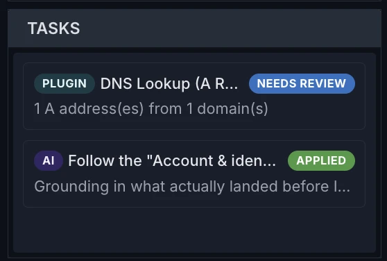
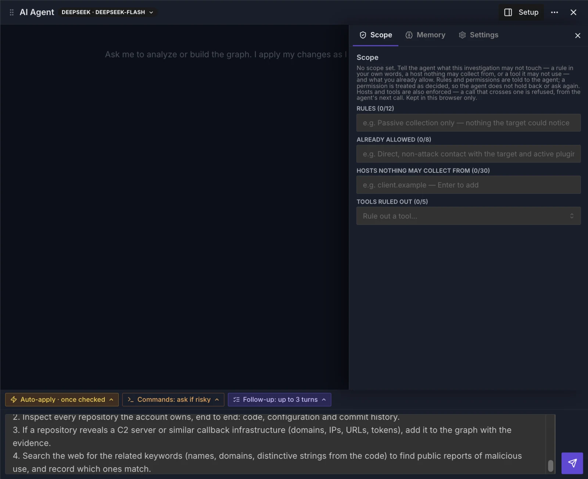
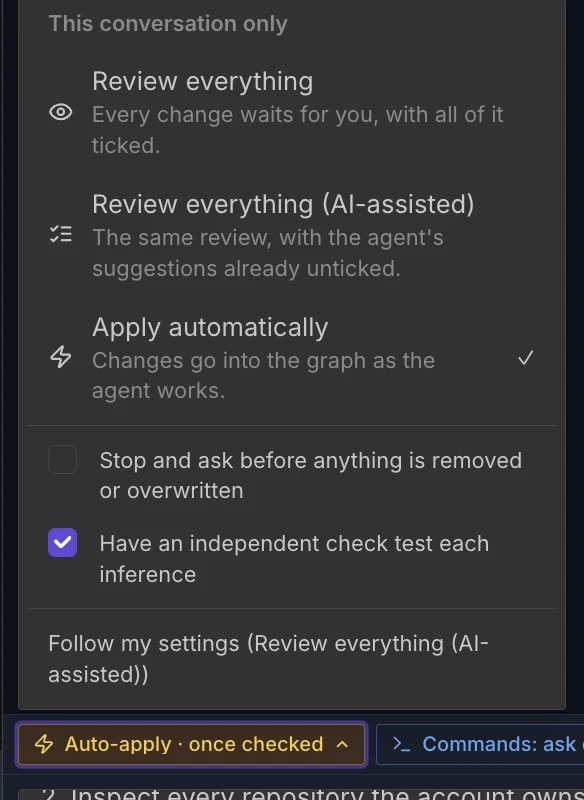
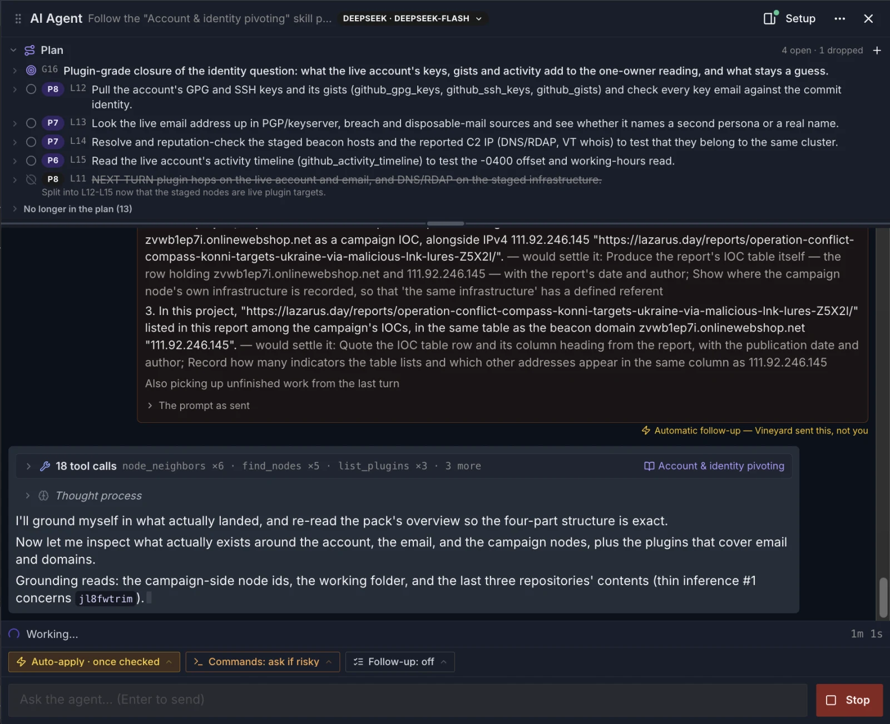

# Tasks & runs

Every plugin run you start, and every AI agent conversation, is a **task** shown in the Tasks panel (one row per conversation; each new turn updates it).

## How tasks work

A running task shows a **running** badge and, when the plugin reports it, a progress bar.

Plugin runs the AI agent starts have no Tasks row of their own; they belong to the conversation's row. Each run that staged something becomes its own change set in that conversation and is reviewed there, or, under **Apply automatically**, applied at the end of the turn like the agent's own changes. Stopping the turn, or deleting the conversation, stops the plugins it started.

## Task states

| State | What it means |
| --- | --- |
| `running` | Actively executing. |
| `succeeded` | Finished successfully (terminal). |
| `failed` | Ended with an error (terminal). |
| `cancelled` | You stopped it before it finished (terminal). An AI turn you stopped usually comes back as `incomplete` when you reopen the project. |
| `incomplete` | AI agent only — the turn ended before the agent finished (terminal): it was left with tool calls that never got an answer, or, when you reopen the project, you had stopped it, it had run out of steps, or it was cut off by the app closing. What it did is kept; open the conversation and press **Continue**. |

A turn that runs out of steps keeps its `succeeded` badge, and a turn you stop shows `cancelled`, until the project is reopened; either way the conversation says why it stopped and offers **Continue**.

A running plugin task has a **Stop** button (stop an AI turn from the AI agent panel). Click a row to open it: an AI task reopens its conversation, a plugin task opens its review. After a run with changes, the badge shows the review state instead — **needs review** (or **N to review**), **applied**, or **discarded** — and an AI task with pending changes also has a **Review staged changes** button. A `failed` or `cancelled` badge shows in place of the review state, so a run you stopped usually stays `cancelled` even when it kept changes. A plugin run's row still opens the review of what it kept, and an AI task still has **Review staged changes**. A stopped plugin run that comes back after you open another project and return (see [Ephemeral by default](#ephemeral-by-default)) shows **needs review**.

<figure class="vy-shot" markdown="span">
  { width="279" loading=lazy }
  <figcaption>A plugin run waiting for review, and an AI conversation whose changes were applied.</figcaption>
</figure>

!!! note "Stop is cooperative"
    **Stop** asks the plugin to wind down cleanly. If it has not returned within about 3 seconds, it is force-stopped. Whether it winds down or is force-stopped, the changes it had already staged are kept and offered for review. A run that fails is different: it discards everything it had staged. That includes a run stopped and marked failed for exceeding its time budget (10 minutes unless the plugin declares its own, at most 60), a plugin whose sandbox or code did not load, and a plugin error. Only **Stop** keeps partial results.

## Ephemeral by default

Plugin-run tasks live only in your browser tab's memory; close the tab and they are gone. Opening another project drops the previous project's plugin rows; when you come back to it in the same tab, only the plugin runs still waiting for review return. AI conversations are saved on this device (per project) and come back as Tasks rows after a reload, so you can reopen them. Conversations are saved as they happen, so a turn cut short by closing the app is kept and can be continued. Staged changes that were still waiting for review do not survive a reload.

Leaving a project while a plugin run or an AI turn is still working asks first: *Stop the running plugin and leave this project?* or *Stop the agent and leave this project?* **Stay in this project** keeps you there; **Stop and leave** stops the work and leaves.

Neither task rows nor conversation content are sent to the Vineyard server; only applied changes are written to the project — the ones you apply in a review, and the ones the agent applies under **Apply automatically**. The agent's model calls go from the app straight to your AI provider. Where its web searches and the pages it reads go depends on your settings. With the defaults, when you are signed in, the queries the agent writes from the project pass through the Vineyard server on their way to Serper and Google. In a browser tab, the default page-reading mode sends each URL the agent opens to the reader service r.jina.ai; the desktop app does so only when its own fetch fails. See [Web search and page reading](#web-search-and-page-reading).

!!! tip "AI conversations stay on this device, under your account"
    Conversations, messages, project memory, and each conversation's session scope and plan are kept on this device only and are never written to the server. Like your AI provider and web-search keys, they are kept separately for each account — this separates accounts inside Vineyard, not from someone with direct access to this computer. Set the AI provider, model and key in the AI agent panel under **Setup → Settings**; the web-search key is under **Settings → AI agent**. Both kinds of key are listed under **Settings → Keys & Secrets** (**LLM keys** and **Search engine keys**), where you can show, replace or forget them. The desktop app encrypts them with the computer's keychain (on a computer that cannot encrypt, they last for the session only); the web app keeps them only until you close the tab.

## The AI agent panel

The AI agent panel's header shows **AI Agent**, the conversation's title and its model (click the model to change it), then **Setup**, **⋯** and **Close**. **Setup** opens a drawer with three tabs:

- **Session scope** — your boundaries for this conversation only: **Rules**, **Already allowed**, **Hosts nothing may collect from** (each with its subdomains) and **Tools ruled out**. A new chat starts without a scope, so a boundary set in one conversation does not apply to the project's other conversations. Rules and permissions are told to the agent; hosts and tools are also enforced, and a call that crosses one is refused (see [What the agent can do](#what-the-agent-can-do)). While a scope is in force, a teal dot shows on the **Setup** button.
- **Project memory** — the agent's notes, shared by every conversation on the project.
- **Settings** — provider, model and key, and under **Advanced**, **Temperature**, **Max output tokens**, **Context window** and **Seed**. Temperature, max output tokens and seed set here win over the defaults in **Settings → AI agent** on this browser; a blank field falls back to them. **Context window** is the window size compaction plans against; set it when Vineyard does not know the model's (see [Conversation compaction](#conversation-compaction-token-compression)).

**⋯** holds **Export this conversation as HTML**, **Open the agent's working folder** (desktop app only) and **Delete conversation…**. The exported page reads on its own; its **Save as JSON** button saves the same record as JSON.

<figure class="vy-shot" markdown="span">
  { width="800" loading=lazy }
  <figcaption>The AI agent panel with Setup open on Session scope. The chips above the message box show the apply mode, commands and follow-up turns for the next message.</figcaption>
</figure>

A row of chips above the message box shows what your next message will run under. The apply and **Commands** chips open a menu that applies to this conversation only, with **Follow my settings** to return to your account settings; **Follow-up** applies to your next message only:

- The first chip says who applies the agent's changes: **Review everything**, **Review everything (AI-assisted)** (the same review, with the agent's suggestions already unticked) or **Apply automatically**. It turns amber while changes land without review. The menu also holds **Stop and ask before anything is removed or overwritten** and **Have an independent check test each inference**. When the check has run, the Review dialog adds a **Check** column with its verdict on each row (*supported*, *weak*, *unresolved*, *refuted*, *not checked*, *check failed*, or *dropped* for a change the agent withdrew), and an **Independent check** pane under the list shows the focused row's claim, the case against it and what would settle it. Drag the pane's top edge to resize it.
- **Commands** (desktop app only) — whether the agent may run commands on this machine: **Do not run commands**, **Ask every time**, **Ask only for risky commands** or **Never ask**. The chip is red while commands run without asking.
- **Follow-up** — switch on **Keep working after this turn, on its own** and the agent carries on for up to the number of turns you set, without asking. It needs **Apply automatically**, and it switches off again after the message you send.

<figure class="vy-shot" markdown="span">
  { width="292" loading=lazy }
  <figcaption>The first chip's menu, here set to Apply automatically with the independent check on.</figcaption>
</figure>

Other things to know:

- While changes wait for review you cannot send. The line above the message box says *N change(s) across M change sets need review*, with **Review** and **Discard all**.
- When the agent works from a plan, a **Plan** strip sits above the conversation. Add a lead, raise or lower a lead's priority, or drop it; the agent is told at its next plan update, or when the next turn starts.
- A turn with several tool calls is folded into one line. It counts the calls, names the skill pack the agent read behind a book icon (the first by name, **+N** for more), and flags notes, errors and staged changes; click it to unfold.
- An image in an answer is shown as its description and address, and is never loaded.
- While a turn runs, a bar between the conversation and the message box says what it is doing and counts the seconds. It is teal for the steps the app reports itself, such as *Planning…*, *Checking staged changes…*, *Applying staged changes…* and *Finishing the turn…*, and violet otherwise: *Thinking…*, *Running* and a tool name, or *Working…*.
- With **Show token usage** on (**Settings → AI agent**), each answer shows the tokens its turn used.

<figure class="vy-shot" markdown="span">
  { width="800" loading=lazy }
  <figcaption>A run in progress: the Plan strip on top, an automatic follow-up turn, and 18 tool calls folded into one line that names the skill pack the agent read.</figcaption>
</figure>

## Closing and deleting a conversation

**Closing** the panel — the close button, or **Esc** — never stops the agent: a running turn keeps working and its row stays in Tasks, so you can reopen it from there. If the **Setup** drawer is open, Esc or a click outside it closes the drawer first; press Esc again to close the panel. Esc closes the panel when it is meant for it: pressed while you are typing or working inside the panel, or right after you last clicked in it (for example while a turn is running and the message box is locked). An Esc that closes a dropdown or a dialog inside the panel closes only that, and an Esc pressed on the canvas or in another panel leaves the AI agent panel alone.

**Deleting** a conversation (**⋯ → Delete conversation…**) asks for confirmation first; **Cancel** has the focus, so pressing Enter by reflex does not delete. Once you confirm:

- the conversation, its Tasks row, its session scope and its plan are removed from this device — this cannot be undone;
- if the agent is still working, its turn is stopped first, along with any plugin runs it started;
- change sets proposed in the conversation and not yet applied are discarded (the dialog says how many); changes already applied to the graph stay;
- the panel closes.

**Delete conversation…** is greyed out, marked *Nothing to delete yet*, until there is something to delete.

## What the agent can do {#what-the-agent-can-do}

The agent works through tools and calls them on its own as it works, within the limits in the last column; of these, only running a command can stop to ask you first. Whatever it changes in the graph goes through the apply mode: staged for your review, or, under **Apply automatically**, applied at the end of the turn. Each tool call is listed by its tool name when you unfold a turn's tool-call line.

| What it can do | Tools | What limits it |
| --- | --- | --- |
| Read the project | `list_node_types`, `graph_stats`, `read_nodes`, `find_nodes`, `get_node`, `read_edges`, `node_neighbors`, `get_selection` | Read only. |
| Change the graph | `create_node`, `update_node`, `delete_node`, `create_edge`, `update_edge`, `delete_edge`; `read_staged` and `drop_staged` for what it has staged | The apply mode (the first chip, or **Apply the agent's changes automatically** in Settings), with **Stop and ask before anything is removed or overwritten** and the independent check on top. |
| Run installed plugins | `list_plugins`, `invoke_plugin` | It needs no approval to start a run, and the plugin makes its usual network requests; what it collects is handled like the agent's own changes. It cannot start a plugin this build cannot run, such as a desktop-only plugin in the browser. A run is refused when a target names a host in **Hosts nothing may collect from**, or when `invoke_plugin` is in **Tools ruled out**. |
| Search the web and read pages | `web_search`, `fetch_page` | **Allow web search**, **Search provider** and **Reading a page** (see [Web search and page reading](#web-search-and-page-reading)). A query or URL that names a ruled-out host is refused. |
| Work several leads at once | `investigate_in_parallel`; `read_findings` recalls this turn's worker findings and challenge verdicts | Up to 5 workers per call, each up to 8 steps, with the same read and collection tools but no fan-out, challenge, plan or memory writes of their own. |
| Challenge a claim before asserting it | `challenge_claim` | A separate model call, up to 8 per turn, judging by the **Independent review prompt**. |
| Keep a plan | `update_plan`, `prove_goal` | Shown in the **Plan** strip. |
| Keep project memory | `remember`, `consolidate_memory` | **Project memory size**. It may merge or retire its own notes without asking. |
| Read skill packs | `list_skills`, `load_skill` | Offered only when the project has a skill pack whose plugins are installed and can run here. |
| Show you a node | `select_node` | View only; changes no data. |
| Run commands (desktop app) | `run_command` | The **Commands** chip, or **Run commands on this machine** in Settings. Runs as you, in the project's working folder, for up to 2 minutes by default (10 at most). A command line that names a ruled-out host is refused. |
| Work with files (desktop app) | `list_files`, `read_file`, `write_file`, `edit_file`, `delete_file` | Only inside the project's working folder (**⋯ → Open the agent's working folder**), whatever the Commands setting. Writing over a file keeps a copy, and deleting moves the file to `.vineyard-trash/`; a file removed by a command is not kept. |

Every turn is bounded by the **Step budget**. The model calls a turn hands to parallel workers and to `challenge_claim` come out of a separate allowance of five times the step budget. Any of `web_search`, `fetch_page`, `invoke_plugin`, `run_command` and `investigate_in_parallel` can be put under **Tools ruled out** for a conversation, and parallel workers are held to the same session scope.

## Web search and page reading {#web-search-and-page-reading}

What happens when the agent searches or opens a page is set under **Settings → AI agent**, by the settings below. A change applies from your next question. The choices are stored with your account when you are signed in, and on this device in local mode ([Signed in or local](modes.md)).

### Allow web search

On by default. It offers the agent `web_search` and `fetch_page`. Off, the agent and its parallel workers have neither tool, so nothing from the project goes to a search provider or a page reader. **Search provider** and **Reading a page** are dimmed while it is off.

### Search provider

Where the agent's queries go. A query is written by the agent from the project, so it can name the domains, accounts and people under investigation. Each option in the list says who sees the query, and badges mark *no key*, *desktop only* and *unreliable*. An option this app cannot use is greyed out; in local mode the two server options are marked *needs the Vineyard server*.

| Provider | Where the query goes | Key | Where it works |
| --- | --- | --- | --- |
| **Serper, through the Vineyard server** (default) | Vineyard server (`auxiliary.vineyard.run`) → Serper → Google | None (the operator's) | Signed in, in the browser or the desktop app; not in local mode |
| **Brave, through the Vineyard server** | Vineyard server (`auxiliary.vineyard.run`) → Brave | None (the operator's) | Signed in, in the browser or the desktop app; not in local mode |
| **Brave, with your own key** | Desktop app → Brave | Yes | Desktop app only |
| **Mojeek** | App → Mojeek | Yes | Browser and desktop app |
| **SearXNG (self-hosted)** | App → the address you set → the engines it aggregates | None; needs your instance's address, with its JSON output turned on (`formats: [json]`) and CORS headers that let the app call it | Browser and desktop app |
| **Jina** | App → Jina | Optional; without one, searches are heavily rate-limited | Browser and desktop app |
| **Exa** | App → Exa | Yes | Browser and desktop app |
| **Serper, with your own key** | App → Serper → Google | Yes | Browser and desktop app |
| **DeepSeek, with your own key** | App → DeepSeek | Yes (your DeepSeek API key, billed per call; queries of up to 128 characters) | Browser and desktop app |
| **Kimi (Moonshot), with your own key** | Desktop app → Moonshot | Yes (your Moonshot API key, billed per call) | Desktop app only |
| **DuckDuckGo** | Desktop app → DuckDuckGo | None | Desktop app only; marked *unreliable*, since DuckDuckGo blocks datacenter and VPN addresses with a CAPTCHA |

When the chosen provider cannot run where you are, the agent searches with another one instead of failing:

- In a browser tab, a desktop-only choice (made in the desktop app, which shares your account's settings) falls back to **Serper, through the Vineyard server**.
- In local mode, a server option, including the default, falls back to **DuckDuckGo**.

The two server options run on the operator's key, so they can run out; for work that has to be reliable, pick a provider you supply your own key for. Choosing a provider that takes a key adds a key field below the list, and choosing SearXNG adds an address field. Both are **This device only**: what you enter stays on this device and is never sent to the Vineyard server. The key is kept like the agent's other keys, encrypted by the desktop app or until the tab closes in the web app; the address stays until you change it.

### Reading a page

How the agent turns a link into text. No mode needs a key or a sign-in.

| Mode | Where the URL goes |
| --- | --- |
| **Whichever works** (default) | In the desktop app, Vineyard fetches the page itself and falls back to the reader service r.jina.ai only when that fails. In a browser tab, every URL goes to r.jina.ai first, and a direct fetch is the fallback. HTML is converted to Markdown either way. |
| **Reader service (r.jina.ai)** | r.jina.ai fetches the page and returns clean text. It handles almost any site, and sees every URL the agent opens. |
| **Direct, converted to Markdown** | Vineyard fetches the page itself and reduces the HTML to Markdown, keeping its links. Nobody else is involved. In a browser tab this works only for sites that allow cross-origin requests; the desktop app has no such limit. |
| **Direct, exactly as served** | The same fetch, with no conversion. Costs far more context on an HTML page; meant for JSON or plain-text endpoints, or for keeping a source exactly as it was served. |

In the desktop app, a direct fetch refuses your own machine and private-network addresses, and follows each redirect itself, so a hop onto a host in **Hosts nothing may collect from** is refused before it is requested. In a browser tab, a page that redirected onto a ruled-out host is discarded after it arrives. The reader service follows redirects on its own servers, where they cannot be checked.

### Allow non-standard ports

Off by default, under **Desktop app**. A direct fetch in the desktop app uses only ports 80 and 443; this lets it use other ports, while your own machine and private network stay closed. It has no effect on the reader service or in a browser tab, and it is greyed out while web search is off or the reader service is chosen.

## AI agent settings {#ai-agent-settings}

**Settings → AI agent** (Cmd/Ctrl+, opens Settings) holds the agent's defaults. They are stored with your account when you are signed in, and on this device in local mode; rows marked **This device only** stay in this browser. Changes apply from your next question. A conversation can override the apply mode and the Commands setting from its chips.

**Provider** and **Model** are shown here read-only: you choose them in the AI agent panel under **Setup → Settings**, and they are kept on this device only.

### Behaviour

| Setting | Default | What it does |
| --- | --- | --- |
| **Step budget** | 50 (1–200) | How many steps the agent may chain in one turn before it has to stop and report. Parallel workers and `challenge_claim` draw on a separate allowance of five times this many model calls. |
| **Project memory size** | 50 notes (10–200) | How many notes the project memory holds before the agent is refused and has to ask you to prune. Every note is re-read into each turn. |
| **Compaction threshold** | 70% (30–75%, in steps of 5) | When older messages are summarized; see [Conversation compaction](#conversation-compaction-token-compression). |
| **Allow web search** | On | Offers the agent its search and page-reading tools. |
| **Show reasoning** | On | Shows the model's thinking, folded under each answer, where the provider sends it. |
| **Show token usage** | Off | Shows the tokens each turn used under its answer, with the cached share and a breakdown by call. |
| **Re-arrange the graph after each turn** | Off | Runs the current layout again over the whole graph each time an agent turn's changes are applied. |

### Web search

This group holds **Search provider** (default **Serper, through the Vineyard server**), a key field for a provider that takes one and an address field for SearXNG, both **This device only**, and **Reading a page** (default **Whichever works**). See [Web search and page reading](#web-search-and-page-reading) for what each choice does.

### Review and apply

| Setting | Default | What it does |
| --- | --- | --- |
| **Apply the agent's changes automatically** | **Review everything (AI-assisted)** | **Review everything** (every change waits, all ticked), **Review everything (AI-assisted)** (the same review, with the changes the agent advises against already unticked) or **Apply automatically**. |
| **Stop and ask before anything is removed or overwritten** | On | With **Apply automatically** only: holds a change set for your review when it deletes something, rewrites a link label you wrote or overwrites a field that already has a value. |
| **Have an independent check test each inference, and collect what would settle it** | Off | A second model tests each relationship, overwrite and removal. Under review it puts its verdict on the row; under **Apply automatically** it holds back what it refutes. |
| **Verification limit** | 50 (1–500) | The most items the independent check examines in one change set. |

### Desktop app

| Setting | Default | What it does |
| --- | --- | --- |
| **Run commands on this machine** | **Ask every time** | **Do not run commands**, **Ask every time**, **Ask only for risky commands** or **Never ask**. Set in the browser, it configures the desktop app the next time you open it. |
| **Allow non-standard ports** | Off | Lets a direct page fetch in the desktop app use ports other than 80 and 443, while your own machine and private network stay closed. Greyed out with web search off or with the reader service chosen. |

### Generation

**Temperature** (0–2), **Top-p** (0–1), **Maximum output tokens** (up to 1,000,000) and **Seed** are all blank by default, which leaves the provider's own default. Temperature, maximum output tokens and seed set in the AI agent panel under **Setup → Settings → Advanced** take precedence on that browser.

### System prompt and Independent review prompt

Each box shows the built-in text. Edit it and press **Save** to replace that prompt completely; **Reset to default** goes back to the built-in. The system prompt (up to 40,000 characters) is what the agent follows on your turns, with the open project's type catalog appended. The independent review prompt (up to 20,000 characters) is what the independent check and `challenge_claim` judge by.

### On this device

Three rows, all **This device only**: **API keys** (entered in the AI agent panel under **Setup → Settings**), **Self-hosted model address** (where your own Ollama or compatible runtime lives) and **Chat history** (kept per project).

## Conversation compaction (token compression)

Long AI conversations are compressed **automatically** — there is no manual `/compact` command. When the conversation history would exceed the model's context window, Vineyard folds the oldest turns into a single dense summary so the agent keeps working on the whole project instead of forgetting its start.

How it works:

1. **Trigger.** At the start of each turn, Vineyard estimates the size of the request and compacts once the instructions, tools and conversation together would fill the share of the model's context window set in **Settings → AI agent → Compaction threshold** (30–75%, default 70%) — *before* the window is full, because the turn's tool results and the model's answer need the rest. When Vineyard does not know the model's window, it assumes 64,000 tokens; set the real one under **Setup → Settings → Advanced → Context window**.
2. **What survives verbatim.** The **most recent 4 turns** (two analyst exchanges) are always kept as-is, so immediate context is never summarized.
3. **What gets compressed.** Everything older is sent to the LLM (the same model you configured, so the summary is written in the same language and register as the conversation) with instructions to produce a dense factual summary of at most 200 words: indicators and entities discussed (domains, IPs, accounts, hashes), what was established about each and on what evidence, decisions made, what was rejected and why, and open questions. No speculation is added.
4. **The replacement.** The summary replaces the older turns only in the request sent to the model, as a single message prefixed `[earlier conversation, summarized]`. The conversation you see, the saved transcript and the export stay whole. Each compaction summarizes the original older turns, and the summary is reused while those turns are unchanged.
5. **Failure is silent-safe.** If the summarization call fails, the history is left **unchanged** — compaction never silently drops the earlier half of an investigation. You would see the provider error instead.

## Collaborator presence

When you share a project, participants see collaborator badges next to the project title, each with the collaborator's avatar and colour and what they currently have selected; click a badge to jump to it. Presence is sent only to project participants — people viewing through a public link see no roster or headcount. If you are signed in, opening a project through its public link puts your name, avatar and colour on the participants' roster, though you do not see theirs and your selection is not shared. The live roster is not stored, but each signed-in connection is recorded as a session (who, when it started and ended) so that edits in the audit log can be attributed to it.

## Next / See also

- [Running plugins](running-plugins.md) — how a run becomes a task.
- [Task lifecycle (internals)](../develop/lifecycle.md) — the developer-facing mechanics behind these states.
- [Getting started](getting-started.md) — orientation for the rest of the guide.
