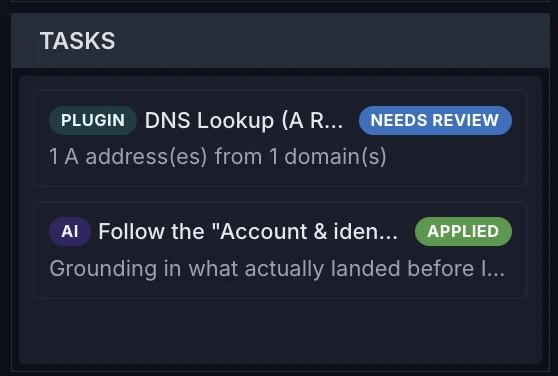
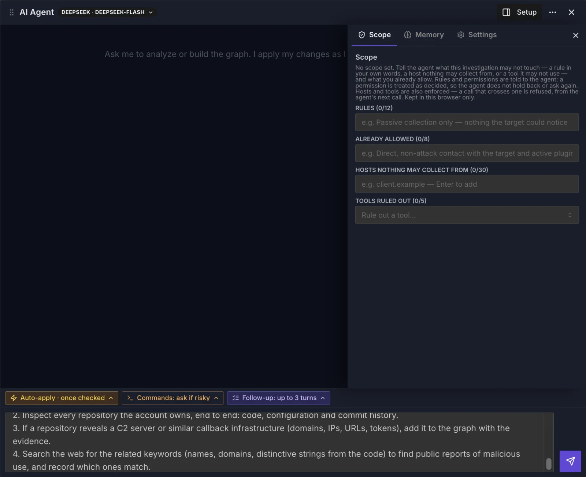
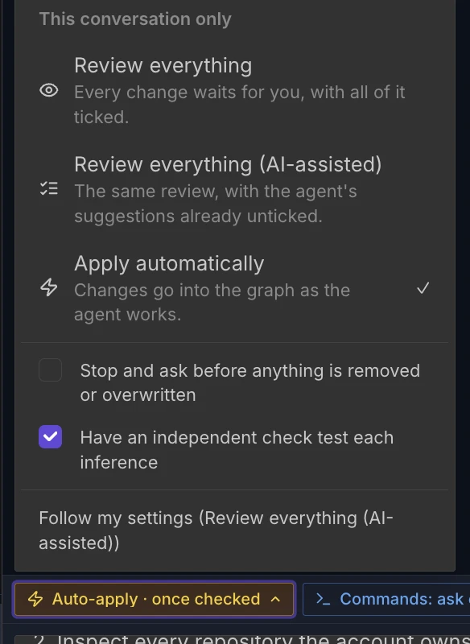
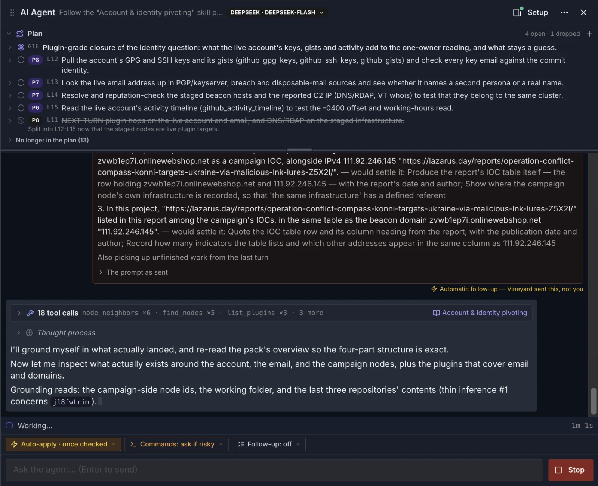

# Tasks & runs

Every plugin run you start, and every AI agent conversation, is a **task** shown in the Tasks panel (one row per conversation; each new turn updates it). If you closed the panel, starting a plugin run opens it again, and so does **View ▸ Tasks** ([Panels](canvas.md#panes)).

## How tasks work

A running task shows a **running** badge and, when the plugin reports it, a progress bar.

Plugin runs the AI agent starts have no Tasks row of their own; they belong to the conversation's row. Each run that staged something becomes its own change set in that conversation and is reviewed there, or, under **Apply automatically**, applied at the end of the turn like the agent's own changes. Stopping the turn, or deleting the conversation, stops the plugins it started.

## Task states

| State | What it means |
| --- | --- |
| `running` | Actively executing. |
| `succeeded` | Finished successfully (terminal). |
| `failed` | Ended with an error (terminal). |
| `cancelled` | You stopped it before it finished (terminal). An AI turn you stopped usually comes back as `incomplete` when you reopen the project. A run a reload or a crash cut short comes back as `cancelled` too, holding what it had staged by then, with *Cut short by a reload — what it had staged by then is waiting for review.* under it, and *Cut short by a reload.* once you have applied or discarded that review. |
| `incomplete` | AI agent only — the turn ended before the agent finished (terminal): it was left with tool calls that never got an answer, or, when you reopen the project, you had stopped it, it had run out of steps, or it was cut off by the app closing. What it did is kept; open the conversation and press **Continue**. |

A turn that runs out of steps keeps its `succeeded` badge, and a turn you stop shows `cancelled`, until the project is reopened; either way the conversation says why it stopped and offers **Continue**.

A running plugin task has a **Stop** button (stop an AI turn from the AI agent panel). Click a row to open it: an AI task reopens its conversation, a plugin task opens its review. After a run with changes, the badge shows the review state instead — **needs review** (or **N to review**), **applied**, or **discarded** — and an AI task with pending changes also has a **Review staged changes** button. A `failed` or `cancelled` badge shows in place of the review state, so a run you stopped usually stays `cancelled` even when it kept changes. A plugin run's row still opens the review of what it kept, and an AI task still has **Review staged changes**. A stopped plugin run that comes back after you open another project and return (see [Ephemeral by default](#ephemeral-by-default)) shows **needs review**.

<figure class="vy-shot" markdown="span">
  { width="279" loading=lazy }
  <figcaption>A plugin run waiting for review, and an AI conversation whose changes were applied.</figcaption>
</figure>

!!! note "Stop is cooperative"
    **Stop** asks the plugin to wind down cleanly. If it has not returned within about 3 seconds, it is force-stopped. Whether it winds down or is force-stopped, the changes it had already staged are kept and offered for review. A run that fails is different: it discards everything it had staged. That includes a run stopped and marked failed for exceeding its time budget (10 minutes unless the plugin declares its own, at most 60), a plugin whose sandbox or code did not load, and a plugin error. Only **Stop**, or a reload that cuts the run short, keeps partial results.

## Ephemeral by default

Plugin-run tasks live only in your browser tab's memory; close the tab and they are gone, except the runs still waiting for review. Opening another project drops the previous project's plugin rows; when you come back to it in the same tab, only the plugin runs still waiting for review return. AI conversations are saved on this device (per project) and come back as Tasks rows after a reload, so you can reopen them. Conversations are saved as they happen, so a turn cut short by closing the app is kept and can be continued. Staged changes still waiting for review are kept on this device too, for 7 days after their last change (longer while a tab has them open): after a reload or a restart they are waiting for review again, and the agent is told they are still waiting (see [Reviewing a run's changes](running-plugins.md#reviewing-a-runs-changes)). A change set that is no longer kept — its 7 days are up, or this device could not store it — is lost on the reload. If an apply had already written part of it, that part stays in the graph: the conversation shows the set as *N applied · M not applied*, with *K skipped* between the two when some changes needed no write of their own, such as a duplicate of a node already in the graph. The agent is told what landed, that the rows you had unticked at that apply were refused, and which of the rest were lost, so it proposes only those again.

Leaving a project while a plugin run or an AI turn is still working asks first: *Stop the running plugin and leave this project?* or *Stop the agent and leave this project?* **Stay in this project** keeps you there; **Stop and leave** stops the work and leaves. When changes are already staged, the dialog says they are kept and will be waiting for review when you open the project again, and whether a reload loses them: *They are kept on this device, so a reload does not lose them either* while this device keeps them, or *They live in this browser tab only — a reload loses them* while no account is signed in or the device's storage refuses them.

In the desktop app, closing the window, quitting or reloading while a plugin run or an AI turn is still working asks too: *Leave while an AI turn or plugin run is still in progress?* **Stay** keeps everything as it is. **Leave anyway** closes, quits or reloads, and the rest of the turn is lost. What the turn or the plugin run had staged by then, and the changes already waiting for review, are kept on this device and are waiting for review the next time you open the project; a run cut short this way is marked *Cut short by a reload*. That is what the prompt says while this device keeps them. While it does not, because no account is signed in or the device's storage refuses them, the prompt says that leaving loses them too: *This device is not keeping the changes waiting for review, or what the turn or plugin run has staged, so leaving loses them too. Stay, and apply or discard them before you leave.* In a browser tab, the browser asks with its own dialog.

Neither task rows nor conversation content are sent to the Vineyard server; only applied changes are written to the project — the ones you apply in a review, and the ones the agent applies under **Apply automatically**. The agent's model calls go from the app straight to your AI provider. Where its web searches and the pages it reads go depends on your settings. With the defaults, when you are signed in, the queries the agent writes from the project pass through the Vineyard server on their way to Serper and Google. In a browser tab, the default page-reading mode sends each URL the agent opens to the reader service r.jina.ai; the desktop app does so only when its own fetch fails. See [Web search and page reading](#web-search-and-page-reading).

!!! tip "AI conversations stay on this device, under your account"
    Conversations, messages, project memory, and each conversation's session scope and plan are kept on this device only and are never written to the server. Like your AI provider and web-search keys, they are kept separately for each account — this separates accounts inside Vineyard, not from someone with direct access to this computer. Set the AI provider, model and key in the AI agent panel under **Setup → Settings**; the web-search key is under **Settings → AI agent**. Both kinds of key are listed under **Settings → Keys & Secrets** (**LLM keys** and **Search engine keys**), where you can show, replace or forget them. The desktop app encrypts them with the computer's keychain (on a computer that cannot encrypt, they last for the session only); the web app keeps them only until you close the tab.

## The AI agent panel

The AI agent panel's header shows **AI Agent**, the conversation's title and its model (click the model to change it), then **Setup**, **⋯** and **Close**. **Setup** opens a drawer with three tabs:

- **Session scope** — your boundaries for this conversation only: **Rules**, **Already allowed**, **Hosts nothing may collect from** (each with its subdomains) and **Tools ruled out**. A new chat starts without a scope, so a boundary set in one conversation does not apply to the project's other conversations. Rules and permissions are told to the agent; hosts and tools are also enforced, and a call that crosses one is refused (see [What the agent can do](#what-the-agent-can-do)). While a scope is in force, a teal dot shows on the **Setup** button.
- **Project memory** — the agent's notes, shared by every conversation on the project.
- **Settings** — provider, model and key, and under **Advanced**, **Temperature**, **Max output tokens**, **Context window** and **Seed**. Temperature, max output tokens and seed set here win over the defaults in **Settings → AI agent** on this browser; a blank field falls back to them. **Context window** is the window size compaction plans against; set it when Vineyard does not know the model's (see [Conversation compaction](#conversation-compaction-token-compression)).

**⋯** holds **Export this conversation as HTML**, **Open the agent's working folder** (desktop app only) and **Delete conversation…**. The exported page reads on its own; its **Save as JSON** button saves the same record as JSON.

<figure class="vy-shot" markdown="span">
  { width="800" loading=lazy }
  <figcaption>The AI agent panel with Setup open on Session scope. The chips above the message box show the apply mode, commands and follow-up turns for the next message.</figcaption>
</figure>

A row of chips above the message box shows what your next message will run under. The apply and **Commands** chips open a menu that applies to this conversation only, with **Follow my settings** to return to your account settings; **Follow-up** applies to your next message only:

- The first chip says who applies the agent's changes: **Review everything**, **Review everything (AI-assisted)** (the same review, with the agent's suggestions already unticked) or **Apply automatically**. It turns amber while changes land without review. The menu also holds **Stop and ask before anything is removed or overwritten** and **Have an independent check test each inference**. When the check has run, the Review dialog adds a **Check** column with its verdict on each row (*supported*, *weak*, *unresolved*, *refuted*, *not checked*, *check failed*, or *dropped* for a change the agent withdrew), and an **Independent check** pane under the list shows the focused row's claim, the case against it and what would settle it. Drag the pane's top edge to resize it.
- **Commands** (desktop app only) — whether the agent may run commands on this machine: **Do not run commands**, **Ask every time**, **Ask only for risky commands** or **Never ask**. The chip is red while commands run without asking.
- **Follow-up** — switch on **Keep working after this turn, on its own** and the agent carries on for up to the number of turns you set, without asking. It needs **Apply automatically**, and it switches off again after the message you send.

<figure class="vy-shot" markdown="span">
  { width="292" loading=lazy }
  <figcaption>The first chip's menu, here set to Apply automatically with the independent check on.</figcaption>
</figure>

Other things to know:

- While changes wait for review you cannot send. The line above the message box says *N change(s) across M change sets need review*, with **Review** and **Discard all**. This **Discard all** works like the Review dialog's: a change set part of which was already applied is recorded as applied, with the rest rejected.
- When the agent works from a plan, a **Plan** strip sits above the conversation. Add a lead, raise or lower a lead's priority, or drop it; the agent is told at its next plan update, or when the next turn starts.
- A turn with several tool calls is folded into one line. It counts the calls, names the skill pack the agent read behind a book icon (the first by name, **+N** for more), and flags notes, errors and staged changes; click it to unfold.
- An image in an answer is shown as its description and address, and is never loaded.
- While a turn runs, a bar between the conversation and the message box says what it is doing and counts the seconds. It is teal for the steps the app reports itself, such as *Planning…*, *Checking staged changes…*, *Applying staged changes…* and *Finishing the turn…*, and violet otherwise: *Thinking…*, *Running* and a tool name, or *Working…*.
- With **Show token usage** on (**Settings → AI agent**), each answer shows the tokens its turn used.

<figure class="vy-shot" markdown="span">
  { width="800" loading=lazy }
  <figcaption>A run in progress: the Plan strip on top, an automatic follow-up turn, and 18 tool calls folded into one line that names the skill pack the agent read.</figcaption>
</figure>

## Closing and deleting a conversation

In an empty message box, **↑** brings back your last question, to edit and send again. **G** then **A** puts the cursor in the message box from anywhere outside a text field, and opens a new conversation when the panel is closed (see [Keyboard shortcuts](shortcuts.md)).

**Closing** the panel — the close button, or **Esc** — never stops the agent: a running turn keeps working and its row stays in Tasks, so you can reopen it from there. If the **Setup** drawer is open, Esc or a click outside it closes the drawer first; press Esc again to close the panel. Esc closes the panel when it is meant for it: pressed while you are typing or working inside the panel, or right after you last clicked in it (for example while a turn is running and the message box is locked). An Esc that closes a dropdown or a dialog inside the panel closes only that, and an Esc pressed on the canvas or in another panel leaves the AI agent panel alone.

**Deleting** a conversation (**⋯ → Delete conversation…**) asks for confirmation first; **Cancel** has the focus, so pressing Enter by reflex does not delete. Once you confirm:

- the conversation, its Tasks row, its session scope and its plan are removed from this device — this cannot be undone;
- if the agent is still working, its turn is stopped first, along with any plugin runs it started;
- change sets proposed in the conversation and not yet applied are discarded (the dialog says how many); changes already applied to the graph stay;
- the panel closes.

**Delete conversation…** is greyed out, marked *Nothing to delete yet*, until there is something to delete.

## What the agent can do {#what-the-agent-can-do}

The agent works through tools and calls them on its own as it works, within the limits in the last column; of these, only running a command can stop to ask you first. Whatever it changes in the graph goes through the apply mode: staged for your review, or, under **Apply automatically**, applied at the end of the turn. Each tool call is listed by its tool name when you unfold a turn's tool-call line.

| What it can do | Tools | What limits it |
| --- | --- | --- |
| Read the project | `list_node_types`, `graph_stats`, `read_nodes`, `find_nodes`, `get_node`, `read_edges`, `node_neighbors`, `similar_hashes`, `get_selection` | Read only. `similar_hashes` compares perceptual hashes, such as a favicon's `phash` and `dhash`, by how many of their 64 bits differ — 10 by default, 16 at most. It does not compare a hash at or near a blank icon's, as a blank, single-colour or symmetric icon's is, and a hash from outside the graph must name the one field it was computed as. |
| Trace how two nodes connect | `find_paths` | Read only. Like the other reads, it sees only what is already in the graph, not what is staged. Returns up to 10 paths of at most 6 links each, shortest first. By default no path passes through a node with more than 50 links, such as a shared name server, registrar or hosting provider that connects unrelated things; the agent is told which nodes it skipped, and whether the two nodes connect through one of them or by a longer route. It is told they are not connected only when no chain of links of any length joins them and no filter narrowed the search. While the project is still loading (for example while it re-syncs after a reconnect), it waits for the rest of the graph; if the graph has still not finished, it is told its answer covers only what has arrived. |
| See what surrounds a node | `neighborhood` | Read only. Like the other reads, it sees only what is already in the graph, not what is staged. Counts the nodes one, two or three links away (two by default) by type, and lists up to 50 of them at each distance, taking from every type in turn so that a few e-mail addresses are not crowded out by hundreds of IP addresses. By default it does not follow the links of a node with more than 50 links, such as a shared name server, registrar or hosting provider: that node is counted, and the agent is told it was not passed through, how many nodes the count would reach if it passed through every such node, and which setting counts them in one call. It is told a node has nothing around it only when the node has no link to another node. While the project is still loading, it waits for the rest of the graph; if the graph has still not finished, it is told its answer covers only what has arrived. |
| Find what nodes have in common | `common_ground` | Read only. Like the other reads, it sees only what is already in the graph, not what is staged. Compares 2 to 20 nodes and returns the nodes several of them link to, the values they hold in the same field (any field; true/false values are not compared, and one value under two different field names, such as a WHOIS record's registrant email and an email address node's email, is not compared), and the links between them. Values that differ only in case, spacing, full-width letters or a host name's trailing dot count as the same value. A field that an installed type pack gives its own rule follows that rule instead, on every node that has the field: with the Cryptocurrency pack installed, crypto addresses and transaction hashes are compared by its rule, the Financial pack's legacy ones included, so two addresses that differ only in case on a chain where case matters are two values. Without that pack, a legacy address ignores case like any other value. For each shared value the agent is told how many nodes in the project hold it and how many different values that field has. A shared node with more than 50 links, or a value more than 50 nodes hold, is marked and listed last: something that common links nothing. |
| Count how one field's values are spread | `aggregate_values` | Read only. Like the other reads, it sees only what is already in the graph, not what is staged, and while the project is still loading it waits for the rest. For the nodes of one type it counts how many hold a value in a field, how many different values there are and what share of them only one node holds, and lists the values most held first, each with how many nodes hold it; without a field it summarises every field those nodes hold. Values count as the same when `common_ground` would call them the same. True/false values are counted, and a list written into one text field, such as `open_ports`, is counted entry by entry: the entries the Properties panel shows. The counts are of this project only, and the agent is told so: nodes collected because they are related share their operator's values, so a value many nodes hold here is not therefore common elsewhere. Asked to classify, it labels a field specific (at least 100 different values, at least half of them held by one node each), quasi-specific (at least 10) or non-identifying (fewer than 10), following Operation MIDAS (Black Hat Europe 2024). It does not classify a field that fewer than 100 nodes hold while it has fewer than 100 different values and at least half of them are held by one node each: with more nodes it could be specific, so at that size the thresholds would measure the project rather than the field. A list field can have 100 different entries among fewer nodes, and a field whose few values many nodes share is categorical at any size, so both are classified. Nothing is classified while the project is still loading. |
| Pull indicators out of text | `extract_indicators` | Reads only the text it is given and the nodes it names. Nothing leaves the app and nothing is staged: what it finds are candidates, which the agent stages with `create_node` like any other node. |
| See what the graph's connections hang on | `graph_structure` | Read only, and like the other reads it sees only what is already in the graph. Returns the graph's connected components, the clusters inside them, and the links and nodes that alone join two groups: a link that is the only one between two groups, and a node every connection between groups runs through. If such a link is wrong, the groups are not connected at all, so links come in the order to check them: the weakest grade first, so those graded below `asserted` or not graded come before the rest, and links of the same grade by how many nodes hang on them. By default, like `find_paths`, it does not count a route through a node with more than 50 links, such as a shared name server, as a second connection between two groups: a link or node that is the only one between them apart from such a node is listed too, with that node named. A link that holds a single node to the rest is counted, not listed. Given nodes, it looks only at the parts of the graph that hold them and puts first what their connection to each other depends on. A node with more than 50 links at such a junction is marked as shared infrastructure that does not show the groups are related. Clusters are computed in the background so the canvas does not freeze; where that is not possible and the graph has more than 15,000 links, or if clustering fails, the agent is told they were not computed. While the project is still loading, it waits for the rest of the graph, as `find_paths` does. |
| Rank nodes by their links | `rank_nodes` | Read only, and like the other reads it sees only what is already in the graph. Ranks nodes by how many links they have (all of them, or only those recorded as pointing to or leaving the node), or by how many of the shortest connections between other nodes run through them, and returns up to 100 at a time. Every answer tells the agent that a high rank says where to look, not that anything is related: the most-linked nodes are usually shared infrastructure, such as a name server, and a node with more than 50 links is marked as such. For connections through a node, like `find_paths` it does not pass through a node with more than 50 links by default. That ranking is computed in the background so the canvas does not freeze. Where a part of the graph that stays connected without passing through such a node is too large to count in full, its scores are estimated from a sample of starting nodes, and the agent is told which scores are estimates. Groups that connect to each other only through such nodes are counted one by one, so small groups are counted exactly. Where the background is not available and the graph is too large to rank this way without freezing, or if the computation fails, the agent is told it was not computed. While the project is still loading, it waits for the rest of the graph, as `find_paths` does. |
| Select nodes by their values | `filter_nodes` | Read only, and like the other reads it sees only what is already in the graph. Selects the nodes whose fields meet every condition it is given: a number or date before or after a bound (a date such as `2026-12-31`, or one counted from now, such as 30 days from now), an exact value or one of a list, text a field contains or a regular expression it matches, whether a field is set, or a perceptual hash within some bits of another (10 by default, 16 at most). Text comparisons ignore case unless the agent asks otherwise. A text field that holds a list one per line or comma-separated, such as a domain's name servers or a host's open ports, is compared item by item, so a domain with two name servers matches either of them. A date without a time counts as that whole day. Returns up to 100 nodes at a time, each with the values the conditions read. A node whose value cannot be compared, such as a follower count written as `12.3K`, a date without a time on the very day a condition falls in, or a value where it is unclear whether a comma separates two items, is left out, and the agent is told how many were left out, with examples, so that it does not report the rest as all of them. As with `similar_hashes`, a hash at or near a blank icon's is not compared; the agent is told how many nodes held only such a hash, and that this is not a gap in the answer. A condition on a field no node holds is refused, and the agent is told the fields the nodes do hold. A regular expression is tested in the background, on values of up to 4,096 characters, and is stopped after 3 seconds, so a pattern that would run without end cannot freeze the app; a pattern of a shape known to do so is refused outright. Where nothing can run in the background, regular expressions are refused. While the project is still loading, it waits for the rest of the graph, as `find_paths` does. |
| Find and merge duplicates | `find_duplicates`, `merge_nodes` | `find_duplicates` is read only. It groups nodes of one type that the type packs' identity rules call the same entity (see [Duplicates and merging](#duplicates-and-merging)), largest group first, and names the best-linked member as the one to keep, or, once part of a group is merged, the node that merge keeps. It returns up to 25 groups a call; each names up to 5 members with their label and number of links, the one to keep first, then the next members by id, up to 21 in all, which is one `merge_nodes` call. Members a staged merge already takes are left out and counted, so a second call after a merge lists the rest of a large group, and a group whose members are all being merged is counted, not listed. `merge_nodes` changes the graph like the tools below: one call folds up to 20 duplicates into the node kept, and only live nodes of one type, unless the agent says it is replacing an older type's node. Parallel workers can find duplicates but not merge them: a worker reports the groups it found to the lead agent, which merges them. |
| Change the graph | `create_node`, `update_node`, `delete_node`, `create_edge`, `update_edge`, `delete_edge`; `read_staged` and `drop_staged` for what it has staged | The apply mode (the first chip, or **Apply the agent's changes automatically** in Settings), with **Stop and ask before anything is removed or overwritten** and the independent check on top. |
| Run installed plugins | `list_plugins`, `invoke_plugin` | It needs no approval to start a run, and the plugin makes its usual network requests; what it collects is handled like the agent's own changes. It cannot start a plugin this build cannot run, such as a desktop-only plugin in the browser. A run is refused when a target names a host in **Hosts nothing may collect from**, or when `invoke_plugin` is in **Tools ruled out**. When the app refuses a plugin's code, the agent does not run that plugin, or another plugin from the same pack that runs the same code, again in that turn, and is told to report which one was refused with the reason the error gives, such as code that does not match the registry's digest or code that could not be checked. It does not call a refusal tampering unless the error says the code did not match. |
| Search the web and read pages | `web_search`, `fetch_page` | **Allow web search**, **Search provider** and **Reading a page** (see [Web search and page reading](#web-search-and-page-reading)). A query or URL that names a ruled-out host is refused. |
| Work several leads at once | `investigate_in_parallel`; `read_findings` recalls this turn's worker findings and challenge verdicts | Up to 5 workers per call, each up to 8 steps, with the same read and collection tools but no fan-out, challenge, plan or memory writes of their own. |
| Challenge a claim before asserting it | `challenge_claim` | A separate model call, up to 8 per turn, judging by the **Independent review prompt**. |
| Keep a plan | `update_plan`, `prove_goal` | Shown in the **Plan** strip. |
| Keep project memory | `remember`, `consolidate_memory` | **Project memory size**. It may merge or retire its own notes without asking. |
| Read skill packs | `list_skills`, `load_skill` | Offered only when the project has a skill pack whose plugins are installed and can run here. |
| Show you nodes, or a path between them | `select_node` | View only; changes no data. Selects one node, or up to 200 nodes and 200 links at once, such as every node and link of a path `find_paths` found, in place of what you had selected, and moves the view onto them. When they do not fit the part of the canvas that floating panels such as the AI agent panel leave uncovered, it zooms out until they do, and centres them there. It never zooms in, so one node, or nodes already in view, keep your zoom. If you zoom, drag the canvas or show something else while the view is moving, your move wins and the rest of the agent's is dropped. One node or link also opens in the Properties panel. A node your canvas filter hides is shown on its own, and the agent is told so. A link it shows whose ends the filter hid brings those ends back onto the canvas with it, not selected, and the agent is told which ones. While the canvas is still drawing or laying out the graph, the agent waits for it first, for up to 8 seconds. Stop ends the wait and changes nothing: a node the filter hid goes back under it, unless you selected it meanwhile. When the canvas takes longer than the wait, a node the filter hid still appears once it is drawn, and the agent is told the filter was hiding it. A node staged this turn, or one the canvas has not drawn yet, cannot be shown; the agent is told which ids it could not show and why, and the rest are still shown. |
| Run commands (desktop app) | `run_command` | The **Commands** chip, or **Run commands on this machine** in Settings. Runs as you, in the project's working folder, for up to 2 minutes by default (10 at most). A command line that names a ruled-out host is refused. A command is one line: one that holds a line break, a tab, a bidi control or another character that does not show as itself (a zero-width or other invisible character, any space but the ordinary one) is refused before you are asked, because the approval would show you something other than what runs. The refusal names the character and where it is, and the agent is told to write a script with `write_file` and run that. |
| Work with files (desktop app) | `list_files`, `read_file`, `write_file`, `edit_file`, `delete_file` | Only inside the project's working folder (**⋯ → Open the agent's working folder**), whatever the Commands setting. Writing over a file keeps a copy, and deleting moves the file to `.vineyard-trash/`; a file removed by a command is not kept. `write_file` and `edit_file` refuse `.url`, `.lnk`, `.scf`, `.library-ms` and `.searchConnector-ms` files and `desktop.ini`, in any case and in the spellings Windows reads as the same name (a dotless `ı` or a long `ſ` in place of `i` or `s`), because Windows reads them as soon as it shows the folder, and such a file can make it offer your Windows sign-in to a server the file names. The agent is told to save under another extension, such as `.txt`. |

`extract_indicators` finds IPv4 and IPv6 addresses and ranges, domains, URLs, e-mail addresses, phone numbers, MD5, SHA-1 and SHA-256 hashes, CVE ids, Bitcoin, Ethereum-format and TRON addresses, and Telegram handles, including defanged spellings such as `hxxp` and `[.]`. A domain must end in a real top-level domain, so a file name such as `invoice.pdf` is left out, and so is `sentence.It`, two sentences with the space after the full stop missing. An @handle counts as a Telegram handle only where the text puts it on Telegram: in `Telegram: @a | X: @b`, only `@a` does. A wallet whose checksum fails (Base58Check, Bech32, or the mixed case of an EVM address, EIP-55) is left out too, with the reason. A result also carries the node it would be, ready to stage, when the project has that type and the value fits it. For a Bitcoin, Ethereum-format or TRON address that is the Cryptocurrency pack's `cryptocurrency.crypto_address` on the network its format settles, as the [value menu](properties.md#the-value-menu) offers it: `bitcoin` for `bc1…`, `tron` for `T…`, `evm` for a `0x` address, and `unknown` for a legacy `1…` or `3…` address, which is the same string on Bitcoin, Bitcoin Cash and Bitcoin SV. Only a project on Financial 2.0.0 or older that has no Cryptocurrency pack gets the legacy `financial.crypto_address` instead, with its currency; Financial 3.0.0 removed that type. Each result says how often it appears and how it was written, and marks private and documentation addresses, hosts under **Hosts nothing may collect from**, and a node of the same type that already has the value. Addresses are read as the Properties panel reads them, so a range is named the same way in both ([Reading values](properties.md#reading-values)); a Teredo, 6to4 or NAT64 address carries a public IPv4 address and is not marked. A node of another type with that value, such as a `threat.indicator` holding a domain, is not the same node, so the agent can still create the domain.

### Duplicates and merging {#duplicates-and-merging}

One entity recorded twice splits its links between two nodes, and a pivot through it stops at whichever one it reached. `find_duplicates` finds them two ways:

- **The same identity.** Nodes whose identifying fields are the same value once the type pack's identity rules fold it. From Infrastructure 4.3.0 that includes a domain, host or DNS record name written with a trailing dot or in Unicode (`Bücher.de.` and `xn--bcher-kva.de`), an IPv6 address with and without zero compression, an IPv4 address padded to three digits per part where each padded part is `000` to `007` (`192.000.002.001`; a part such as `010` is read as octal by browsers, so that address is compared as written), and a URL that differs only in the case of its scheme or host, its default port or its percent-encoding. A URL path keeps its case. Two nodes can share an identity because one was made before its type pack folded the spelling, by hand, by import, or by two collections at once.
- **The same canonical form.** Phone numbers are identified as written, so `+82 10-1234-5678` and `010-1234-5678` stay two nodes when they are written. Once a pack has filled their `e164`, they are found as one number. This is reported, not done by itself: nothing merges them until a merge is applied.

A rule a type pack adds reaches a project only after you update that type pack in the project.

`merge_nodes` keeps one node and folds the others into it, staged like any other change:

- Fields the kept node has no value for are filled from the duplicates. A field it already has is never replaced: a different value on a duplicate is reported to the agent and listed on the duplicate's row as **not kept**, and is not written. There are two exceptions, both as an import has them, and the agent is told of each:
    - `tlp` is raised to the strictest TLP label among the kept node and the duplicates, and never lowered, also from a duplicate of an older type that lends no other field. One label spelled two ways, such as `TLP:AMBER` and `amber`, or `TLP:WHITE` and `TLP:CLEAR`, is one value and no conflict; a label with a note beside it, such as `TLP:RED (Case 7 only)` against `TLP:RED`, still differs. A duplicate you keep by unticking its delete lends no label, and the next strictest one still counts.
    - The source fields `source_report`, `created_by`, `tags`, `markings` and `references` are combined: the kept node's parts stay and each duplicate's other parts are added (`fields_unioned`). A duplicate whose parts the kept node already holds is no conflict; a value that is not a list, such as an object, still is.

    The fill is applied to the node as it is when you apply, so a value written on it in the meantime stays.

- Each link of a duplicate moves to the kept node with its own wording and record: who wrote it, its evidence grade and who gave it, and the fields its writer recorded, as the link stands when you apply. A link you drew yourself is still yours on the kept node. The moved link is a new edge, so the edge's own history in the activity log does not carry over.
- Where the kept node already has a link to the same node, the duplicate's link is not added again. With the same wording, a different writer's link is recorded as corroboration on the kept link; the same collector drawing it from two spellings, or the agent, adds nothing. If the duplicate's link is yours (you wrote it or gave it its grade) and the kept link is not, the kept link takes your record instead, and its own writer is listed as corroborating it. With different wording, the kept link stays and the duplicate's is deleted with it; the agent is told both wordings.
- Where two duplicates link the same node in different words, the first one's link moves and the agent is told both wordings. If you keep the first duplicate, the second one's link moves instead, in its own words.
- A link the agent staged in the same turn on a pair a duplicate already links does not take the place of the duplicate's link. The duplicate's link moves and is applied first, and the agent's adds nothing.
- A link between two of the merged nodes is deleted.
- Where links are folded into one, the link that stands takes the strictest TLP label among them and is never lowered, also when the kept link takes your record (`links_tlp_raised`). That covers a duplicate's link folded into the kept node's same link, by another writer or by the same one, and the same link on two duplicates that moves as one.

In the review every row of a merge says so: the update of the kept node (*fields filled from …*, *tlp raised from … to …* when the label rises, and *source_report combined, adding …* for a source field), each moved link (*moved from …*), each corroborated link, and the duplicate's delete (*merged into …*, with the fields that are not kept). A moved or corroborated link whose label rises ends with *; tlp raised from TLP:CLEAR to TLP:RED* (*none* when the link had no label), and one folded in only for its label reads *(merge: the same link on …, by the same source; tlp raised from …)*. The Tasks row's summary says, for example, *source_report combined*. Unticking a duplicate's delete keeps that node as it is: the links that would move off it, the fields it would fill and the corroboration it would lend are unticked with it. A link or a field that two duplicates both carry stays ticked while either of them is deleted, and is taken from the one that is.

When you apply, a duplicate is deleted only after every link and field moving off it has landed. If one of them is refused, for example at the project's link limit, the delete waits in the review with the reason, and applying again retries the rest first. If the kept node has been deleted in the meantime, nothing is merged and the duplicates stay. A duplicate deleted in the meantime lends the merge nothing: its fields are not filled onto the kept node, and what would have come only from it is skipped with the reason. If a reload cuts a merge's apply short, applying it again completes it: a link already moved is recognised as the move's own, and the delete goes ahead. A link on the same pair in the same words but with another record still holds the merge, because deleting the duplicate would lose that record.

A merge carries the links and fields the duplicate had when it was staged, so a duplicate that has changed since is not merged. That is the case when a link was drawn to it or one of its links was relabelled, a field was written on it, another change in the same set touches it, or a link of the kept node that the merge relied on was removed, relabelled or added. Nothing moves off that duplicate, its delete is skipped with the reason, and the agent can merge again from the graph as it now is. When an earlier apply of the same change set already landed the fill and the moved links and only the delete failed, the reason says what is already on the kept node (blank fields filled from the duplicate, links copied, links folded into the same link), that the duplicate still has its own, and that merging again finds those on the kept node rather than adding them twice. While a merge is waiting, a collection that writes a duplicate's value does not add it to the duplicate. It goes to the kept node when that node has the same identity, and is a new node otherwise. Once the agent has merged duplicates, its own later writes to a merged duplicate or to one of that duplicate's links (editing it, linking to it, relabelling or deleting one of its links, deleting it again) are refused, and it is told the node to write on instead. That holds for a merge in another change set still waiting for review too, your own merge included, so a merge the agent reports is not skipped at apply over a stray write of its own.

You can merge nodes yourself from the canvas as well (see [Merging nodes](canvas.md#merging-nodes)). That is the same merge, planned and staged by the same code, under its own change set named **Merge** for your review; the apply mode and the independent check below are the agent's and do not apply to it. When the agent finds duplicates it does not merge, because a parallel worker cannot merge or because it is not certain the nodes are one entity, it tells you why and where to merge them yourself.

A merge deletes nodes, so under **Apply automatically** with **Stop and ask before anything is removed or overwritten** on, it stops for your review; raising a label or combining a source field on the kept node would stop it there too, as a plugin's change to a value does. The independent check, when it runs, judges a merge once, as the claim that the nodes are one entity; the moved links and the filled fields are not new claims and are not checked. If the check refuses that claim, the whole merge waits for your review, not only the delete.

When the agent reads edges (`read_edges`, `node_neighbors`, and the edges in `get_selection`), each edge comes with what the project records about how far to trust it: its evidence grade (the one the canvas draws and the legend's **Evidence** key lists), who gave that grade, who wrote its label, which other writers drew the same link, and when a collector first and last saw it. Anything that is not recorded is left out. Other fields a plugin stored on an edge come back only when the agent asks for them. The agent is told what each grade means, including that `recorded` means a tool recorded the link, not that anyone verified it, that an `unassessed` you set may have replaced a check's grade, and that a grade from **Re-verify** came from the re-verification you ran, not from a plugin, and that a grade a merge you made raised came only from the merged nodes' writers drawing the same link. It cannot set a grade itself.

Every turn is bounded by the **Step budget**. The model calls a turn hands to parallel workers and to `challenge_claim` come out of a separate allowance of five times the step budget. Any of `web_search`, `fetch_page`, `invoke_plugin`, `run_command` and `investigate_in_parallel` can be put under **Tools ruled out** for a conversation, and parallel workers are held to the same session scope.

## Web search and page reading {#web-search-and-page-reading}

What happens when the agent searches or opens a page is set under **Settings → AI agent**, by the settings below. A change applies from your next question. The choices are stored with your account when you are signed in, and on this device in local mode ([Signed in or local](modes.md)).

### Allow web search

On by default. It offers the agent `web_search` and `fetch_page`. Off, the agent and its parallel workers have neither tool, so nothing from the project goes to a search provider or a page reader. **Search provider** and **Reading a page** are dimmed while it is off.

### Search provider

Where the agent's queries go. A query is written by the agent from the project, so it can name the domains, accounts and people under investigation. Each option in the list says who sees the query, and badges mark *no key*, *desktop only* and *unreliable*. An option this app cannot use is greyed out; in local mode the two server options are marked *needs the Vineyard server*.

| Provider | Where the query goes | Key | Where it works |
| --- | --- | --- | --- |
| **Serper, through the Vineyard server** (default) | Vineyard server (`auxiliary.vineyard.run`) → Serper → Google | None (the operator's) | Signed in, in the browser or the desktop app; not in local mode |
| **Brave, through the Vineyard server** | Vineyard server (`auxiliary.vineyard.run`) → Brave | None (the operator's) | Signed in, in the browser or the desktop app; not in local mode |
| **Brave, with your own key** | Desktop app → Brave | Yes | Desktop app only |
| **Mojeek** | App → Mojeek | Yes | Browser and desktop app |
| **SearXNG (self-hosted)** | App → the address you set → the engines it aggregates | None; needs your instance's address, with its JSON output turned on (`formats: [json]`) and CORS headers that let the app call it | Browser and desktop app |
| **Jina** | App → Jina | Optional; without one, searches are heavily rate-limited | Browser and desktop app |
| **Exa** | App → Exa | Yes | Browser and desktop app |
| **Serper, with your own key** | App → Serper → Google | Yes | Browser and desktop app |
| **DeepSeek, with your own key** | App → DeepSeek | Yes (your DeepSeek API key, billed per call; queries of up to 128 characters) | Browser and desktop app |
| **Kimi (Moonshot), with your own key** | Desktop app → Moonshot | Yes (your Moonshot API key, billed per call) | Desktop app only |
| **DuckDuckGo** | Desktop app → DuckDuckGo | None | Desktop app only; marked *unreliable*, since DuckDuckGo blocks datacenter and VPN addresses with a CAPTCHA |

When the chosen provider cannot run where you are, the agent searches with another one instead of failing:

- In a browser tab, a desktop-only choice (made in the desktop app, which shares your account's settings) falls back to **Serper, through the Vineyard server**.
- In local mode, a server option, including the default, falls back to **DuckDuckGo**.

The two server options run on the operator's key, so they can run out; for work that has to be reliable, pick a provider you supply your own key for. Choosing a provider that takes a key adds a key field below the list, and choosing SearXNG adds an address field. Both are **This device only**: what you enter stays on this device and is never sent to the Vineyard server. The key is kept like the agent's other keys, encrypted by the desktop app or until the tab closes in the web app; the address stays until you change it.

### Reading a page

How the agent turns a link into text. No mode needs a key or a sign-in.

| Mode | Where the URL goes |
| --- | --- |
| **Whichever works** (default) | In the desktop app, Vineyard fetches the page itself and falls back to the reader service r.jina.ai only when that fails. In a browser tab, every URL goes to r.jina.ai first, and a direct fetch is the fallback. HTML is converted to Markdown either way. |
| **Reader service (r.jina.ai)** | r.jina.ai fetches the page and returns clean text. It handles almost any site, and sees every URL the agent opens. |
| **Direct, converted to Markdown** | Vineyard fetches the page itself and reduces the HTML to Markdown, keeping its links. Nobody else is involved. In a browser tab this works only for sites that allow cross-origin requests; the desktop app has no such limit. |
| **Direct, exactly as served** | The same fetch, with no conversion. Costs far more context on an HTML page; meant for JSON or plain-text endpoints, or for keeping a source exactly as it was served. |

In the desktop app, a direct fetch refuses your own machine and private-network addresses, and follows each redirect itself, so a hop onto a host in **Hosts nothing may collect from** is refused before it is requested. In a browser tab, a page that redirected onto a ruled-out host is discarded after it arrives. The reader service follows redirects on its own servers, where they cannot be checked.

### Allow non-standard ports

Off by default, under **Desktop app**. A direct fetch in the desktop app uses only ports 80 and 443; this lets it use other ports, while your own machine and private network stay closed. It has no effect on the reader service or in a browser tab, and it is greyed out while web search is off or the reader service is chosen.

## AI agent settings {#ai-agent-settings}

**Settings → AI agent** (**⌘,** on a Mac or **Ctrl+,** opens Settings) holds the agent's defaults. They are stored with your account when you are signed in, and on this device in local mode; rows marked **This device only** stay in this browser. Changes apply from your next question. A conversation can override the apply mode and the Commands setting from its chips.

**Provider** and **Model** are shown here read-only: you choose them in the AI agent panel under **Setup → Settings**, and they are kept on this device only.

### Behaviour

| Setting | Default | What it does |
| --- | --- | --- |
| **Step budget** | 50 (1–200) | How many steps the agent may chain in one turn before it has to stop and report. Parallel workers and `challenge_claim` draw on a separate allowance of five times this many model calls. |
| **Project memory size** | 50 notes (10–200) | How many notes the project memory holds before the agent is refused and has to ask you to prune. Every note is re-read into each turn. |
| **Compaction threshold** | 70% (30–75%, in steps of 5) | When older messages are summarized; see [Conversation compaction](#conversation-compaction-token-compression). |
| **Allow web search** | On | Offers the agent its search and page-reading tools. |
| **Show reasoning** | On | Shows the model's thinking, folded under each answer, where the provider sends it. |
| **Show token usage** | Off | Shows the tokens each turn used under its answer, with the cached share and a breakdown by call. |
| **Re-arrange the graph after each turn** | Off | Runs the current layout again over the whole graph each time an agent turn's changes are applied. |

### Web search

This group holds **Search provider** (default **Serper, through the Vineyard server**), a key field for a provider that takes one and an address field for SearXNG, both **This device only**, and **Reading a page** (default **Whichever works**). See [Web search and page reading](#web-search-and-page-reading) for what each choice does.

### Review and apply

| Setting | Default | What it does |
| --- | --- | --- |
| **Apply the agent's changes automatically** | **Review everything (AI-assisted)** | **Review everything** (every change waits, all ticked), **Review everything (AI-assisted)** (the same review, with the changes the agent advises against already unticked) or **Apply automatically**. |
| **Stop and ask before anything is removed or overwritten** | On | With **Apply automatically** only: holds a change set for your review when it deletes something, rewrites a link label you wrote or overwrites a field that already has a value. |
| **Have an independent check test each inference, and collect what would settle it** | Off | A second model tests each relationship, overwrite and removal. A link the agent draws or rewords is tested together with the fields it records on the link. Under review it puts its verdict on the row; under **Apply automatically** it holds back what it refutes. |
| **Verification limit** | 50 (1–500) | The most items the independent check examines in one change set. |

### Desktop app

| Setting | Default | What it does |
| --- | --- | --- |
| **Run commands on this machine** | **Ask every time** | **Do not run commands**, **Ask every time**, **Ask only for risky commands** or **Never ask**. Set in the browser, it configures the desktop app the next time you open it. |
| **Allow non-standard ports** | Off | Lets a direct page fetch in the desktop app use ports other than 80 and 443, while your own machine and private network stay closed. Greyed out with web search off or with the reader service chosen. |

### Generation

**Temperature** (0–2), **Top-p** (0–1), **Maximum output tokens** (up to 1,000,000) and **Seed** are all blank by default, which leaves the provider's own default. Temperature, maximum output tokens and seed set in the AI agent panel under **Setup → Settings → Advanced** take precedence on that browser.

### System prompt and Independent review prompt

Each box shows the built-in text. Edit it and press **Save** to replace that prompt completely; **Reset to default** goes back to the built-in. The system prompt (up to 40,000 characters) is what the agent follows on your turns, with the open project's type catalog appended. The independent review prompt (up to 20,000 characters) is what the independent check and `challenge_claim` judge by.

### On this device

Three rows, all **This device only**: **API keys** (entered in the AI agent panel under **Setup → Settings**), **Self-hosted model address** (where your own Ollama or compatible runtime lives) and **Chat history** (kept per project).

## Conversation compaction (token compression)

Long AI conversations are compressed **automatically** — there is no manual `/compact` command. When the conversation history would exceed the model's context window, Vineyard folds the oldest turns into a single dense summary so the agent keeps working on the whole project instead of forgetting its start.

How it works:

1. **Trigger.** At the start of each turn, Vineyard estimates the size of the request and compacts once the instructions, tools and conversation together would fill the share of the model's context window set in **Settings → AI agent → Compaction threshold** (30–75%, default 70%) — *before* the window is full, because the turn's tool results and the model's answer need the rest. When Vineyard does not know the model's window, it assumes 64,000 tokens; set the real one under **Setup → Settings → Advanced → Context window**.
2. **What survives verbatim.** The **most recent 4 turns** (two analyst exchanges) are always kept as-is, so immediate context is never summarized.
3. **What gets compressed.** Everything older is sent to the LLM (the same model you configured, so the summary is written in the same language and register as the conversation) with instructions to produce a dense factual summary of at most 200 words: indicators and entities discussed (domains, IPs, accounts, hashes), what was established about each and on what evidence, decisions made, what was rejected and why, and open questions. No speculation is added.
4. **The replacement.** The summary replaces the older turns only in the request sent to the model, as a single message prefixed `[earlier conversation, summarized]`. The conversation you see, the saved transcript and the export stay whole. Each compaction summarizes the original older turns, and the summary is reused while those turns are unchanged.
5. **Failure is silent-safe.** If the summarization call fails, the history is left **unchanged** — compaction never silently drops the earlier half of an investigation. You would see the provider error instead.

## Collaborator presence

When you share a project, participants see collaborator badges next to the project title, each with the collaborator's avatar and colour and what they currently have selected; click a badge to jump to it. Presence is sent only to project participants — people viewing through a public link see no roster or headcount. If you are signed in, opening a project through its public link puts your name, avatar and colour on the participants' roster, though you do not see theirs and your selection is not shared. The live roster is not stored, but each signed-in connection is recorded as a session (who, when it started and ended) so that edits in the audit log can be attributed to it.

## Next / See also

- [Running plugins](running-plugins.md) — how a run becomes a task.
- [Task lifecycle (internals)](../develop/lifecycle.md) — the developer-facing mechanics behind these states.
- [Getting started](getting-started.md) — orientation for the rest of the guide.
