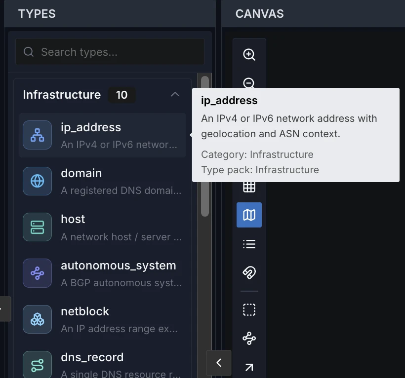

# Type Pack 사용하기

**Type Pack**은 그래프가 보유할 수 있는 엔티티 종류(IP 주소, 도메인, 멀웨어 패밀리,
위협 행위자 등)를 정의하는 작은 JSON 번들입니다. 프로젝트에 설치하면 노드를 생성할 때
해당 유형을 사용할 수 있고, 캔버스에 각 노드가 어떻게 보일지 알려줍니다.

## Type Pack이 제공하는 것

Type Pack은 **엔티티(노드) 유형**을 선언합니다. 엣지에는 유형이 없습니다: 각 엣지는
자유 텍스트 라벨을 가지며, 이 라벨은 사용자가 [엣지를 그릴 때](canvas.md#엣지-그리기)
입력하거나 연결을 찾아낸 플러그인이 씁니다. 각 엔티티 유형은 다음을 포함합니다:

- **`label_property`** — 캔버스에서 노드 이름으로 표시되는 속성 값. IP 주소의 경우
  주소 자체, 취약점의 경우 CVE ID입니다. 일부 유형은 대신 여러 속성을 조합한 라벨
  ([`label_template`](../develop/typepacks.md#entity-types))을 쓰며, 그 속성이 모두 채워지기
  전까지는 `label_property` 값을 표시합니다.
- **속성** 세트 — 입력할 수 있는 명명된 필드(예: `country_code`, `asn`, `registrar`).
  노드 선택 시 **Properties**(속성) 패널에 나타나며, 각 값은 담긴 값의 종류에 맞게 표시됩니다
  ([Properties 패널에서 값 읽기](#reading-values-in-the-properties-panel)). 속성을 편집하면 그 값이 유형이 선언한
  종류, 허용 값, 패턴이나 범위에 맞는지 검사합니다(예: `country_code`는 대문자 두 글자,
  `asn`은 1부터 4294967295까지의 정수여야 함). 검사를 통과하지 못한 값은 저장되지 않고,
  이유를 알리는 메시지가 표시됩니다.
- **`icon`** 및 **`color`** — 노드가 캔버스와 **Types**(유형) 및 **Properties** 패널에서 렌더링되는 방식을
  결정하는 시각적 요소.

## Type Pack 설치하기

다른 항목을 설치하는 것과 동일한 방식으로 Type Pack을 설치합니다([둘러보기 및 설치](installing.md)
참조). 설치되면 해당 유형이 **Types** 패널에 나타나고 노드 생성 시 선택 가능해집니다.
최소 하나의 Type Pack이 설치될 때까지 선택할 수 있는 엔티티 유형이 없습니다.

**Types** 패널에서 유형은 팩이 아니라 **카테고리**별로 묶이므로, 한 팩이 여러 그룹을 채울 수
있습니다(Infrastructure 팩은 **Infrastructure**와 **Web** 양쪽에 나타남). 각 그룹에는 개수가
표시됩니다. 유형에 마우스를 올리면 설명과 **Category:**, 그리고 출처인 **Type pack:**이
표시됩니다. 유형을 클릭하면 해당 유형의 새 노드(`New <유형>` 라벨의 자리표시자)가 생성되고
바로 선택되어 속성을 채울 수 있습니다. 위쪽의 **Search types…** 상자는 유형 이름, 카테고리,
설명, 팩 이름으로 목록을 거릅니다. 패널이 이 상자를 담기에 너무 좁으면 유형 아이콘만
표시됩니다. 설치된 Type Pack이 없으면 패널이 그렇게 알려 주고 **Browse the marketplace**
버튼을 제공합니다. 로그인하지 않고 공유된 프로젝트를 보는 방문자에게는 이 버튼이 표시되지 않습니다.

<figure class="vy-shot" markdown="span">
  { width="410" loading=lazy }
  <figcaption>Types 패널은 유형을 카테고리별로 묶습니다. 유형에 마우스를 올리면 설명, 카테고리, 타입 팩이 표시됩니다.</figcaption>
</figure>

노드를 생성할 때 설치된 Type Pack에서 유형을 선택합니다. Vineyard는 해당 선택을
`category.name` 형식의 **정규화된 문자열**로 저장합니다 — 예:
`infrastructure.ip_address` 또는 `threat.malware`. 플러그인은 자신이 소비하고 생성하는
것을 선언할 때 동일한 형식을 참조합니다.

## 레퍼런스 팩

Vineyard는 여러 공식 Type Pack을 제공합니다. 각각은 독립적입니다 — 조사에 필요한
것만 설치하세요 — 그리고 함께 사용하도록 설계되어 있습니다: 엣지 하나가 서로 다른
팩의 노드를 연결할 수 있습니다(`threat.malware`가 `infrastructure.ip_address`와
**통신하는**, `financial.crypto_address`가 `identity.person`에 의해 **제어되는** 등).

| 팩 (`identifier`) | 카테고리 | 유형 | 모델링 대상 |
|---|---|---|---|
| **Infrastructure** (`…typepacks.infrastructure`) | `infrastructure`, `web` | 15 | 정찰 중 매핑하는 네트워크, 그리고 그 위에서 관측되는 웹 리소스(URL), 웹 지문(헤더, 파비콘, DOM 해시), 트래킹 ID 엔티티 |
| **Threat** (`…typepacks.threat`) | `threat` | 10 | 위협 인텔리전스 (STIX 정렬) |
| **Identity** (`…typepacks.identity`) | `identity` | 7 | 사람, 조직, 온라인 페르소나 |
| **Financial** (`…typepacks.financial`) | `financial` | 4 | 자금 흐름 |
| **Endpoint** (`…typepacks.endpoint`) | `endpoint` | 6 | 호스트 / DFIR 아티팩트 |
| **Geospatial** (`…typepacks.geo`) | `geo` | 3 | 장소와 물리적 맥락 |
| **Social Media** (`…typepacks.social`) | `social` | 5 | 플랫폼에 무관한 계정, 게시물, 해시태그, 그룹, 미디어 |
| **Telegram** (`…typepacks.telegram`) | `telegram` | 4 | 가입 없이 수집한 계정, 채널, 슈퍼그룹, 게시물 |

### Infrastructure — 자세히 보기

`run.vineyard.typepacks.infrastructure`는 정찰 중 매핑하는 네트워크 측 엔티티를
`infrastructure` 카테고리로 모델링합니다:

| 유형 (`category.name`) | 표시 라벨 | 주요 속성 |
|---|---|---|
| `infrastructure.ip_address` | IP 주소 | `version`, `country_code`, `asn`, `reverse_dns` |
| `infrastructure.domain` | 도메인 이름 | `registrar`, `created_date`, `name_servers` |
| `infrastructure.host` | 호스트 이름 | `operating_system`, `open_ports`, `hosting_provider` |
| `infrastructure.autonomous_system` | ASN | `autonomous_system_name`, `registry` |
| `infrastructure.netblock` | CIDR | `network_name`, `asn` |
| `infrastructure.dns_record` | 이름, 유형, 값 (예: `www.example.com A 93.184.216.34`). 유형과 값이 채워지기 전에는 레코드 이름 | `record_type`, `record_value`, `ttl` |
| `infrastructure.whois_record` | 주체 (도메인/IP) | `registrant`, `registrar`, `created_at` |
| `infrastructure.certificate` | SHA-256 지문 | `subject_common_name`, `issuer`, `not_after` |
| `infrastructure.ssh_host_key` | 키의 SHA-256 (16진수) | `key_type` |
| `infrastructure.technologies` | 기술 이름 | `kind`, `vendor`, `version`, `cpe` |

같은 팩이 별도의 `web` 카테고리로 유형 다섯 개를 더 제공합니다:

| 유형 (`category.name`) | 표시 라벨 | 주요 속성 |
|---|---|---|
| `web.url` | URL | `domain` (일반 텍스트로 적은 호스트 이름. 도메인 노드와는 엣지로 연결), `http_status` |
| `web.hhhash` | HTTP 헤더 해시 | `header_count`, `server_hint` |
| `web.favicon_hash` | Shodan 방식 MMH3 해시 (부호 있는 10진수) | `mmh3_hex`, `md5`, `sha256`, `phash`, `dhash`, `favicon_url` |
| `web.dom_hash` | DOM 구조 해시 | `tag_count` |
| `web.tracking_id` | 페이지에 적힌 그대로의 식별자 (예: `G-SXM8TFRYSW`), 동일성은 `provider` + `value` | `provider`, `kind` |

`web.favicon_hash`는 파비콘 하나를 검색 서비스들이 색인하는 형식별로 모두 담습니다. Shodan·FOFA·
Censys·ZoomEye는 `hash_value`, Criminal IP는 `mmh3_hex`, Censys·ZoomEye·360 Quake·Hunter.how·
ONYPHE·VirusTotal은 `md5`, Censys·Netlas·urlscan.io는 `sha256`으로 찾고, `phash`와 `dhash`는
비트가 몇 개 다른지로 비교하는 지각 해시입니다. AI 에이전트는 `similar_hashes`로 이 값을 비교하고,
**Shared-Attribute Clustering** 팩은 `phash`나 `dhash`가 64비트 중 10비트 이하로 다른 파비콘을
`similar favicon` 엣지로 잇습니다(실행할 때 바꿀 수 있음). 빈 아이콘이나 한 가지 색 아이콘은 색과
관계없이 해시가 같고, 대칭인 로고의 `phash`는 그 값과 몇 비트밖에 다르지 않으므로, 둘 다 그 값과
같거나 가까운 해시는 비교하지 않습니다. 그 파비콘의 다른 해시는 그대로 비교합니다.

각 유형은 자체 아이콘과 색상을 제공합니다.

다른 팩도 같은 형태를 따릅니다 — 예를 들어 **Threat** 팩은 `threat.malware`,
`threat.threat_actor`, `threat.indicator`, `threat.operation`(캠페인 내의 경계된 작업 —
하나의 캠페인은 여러 개의 operation을 포함할 수 있음)을, **Identity** 팩은 활동 뒤의
사람과 페르소나를 추가합니다.

!!! tip "Type Pack 혼합하기"
    필요한 만큼 Type Pack을 설치하세요 — 하나의 정규화된 유형 네임스페이스를
    공유하며 설계상 상호 연결됩니다. `threat.malware`를 그것이 비콘하는
    `infrastructure.ip_address`에 연결하고, `threat.campaign`을
    `identity.organization`에 귀속시키고, 몸값 `financial.crypto_transaction`을
    추적할 수 있습니다.

!!! note "신원 및 중복 제거"
    플러그인이나 AI 작업이 노드를 추가할 때, Vineyard는 **유형 + 유형의 식별 필드**로
    중복을 제거합니다 — 유형이 `identity_properties`를 선언하면 그 필드들(예:
    `identity.account` → username + platform, `endpoint.file` → SHA-256·파일 이름·경로·호스트,
    `endpoint.process` → 프로세스 GUID·이름·PID), 아니면 `label_property` 값입니다. 같은
    유형과 같은 식별 값의 두 노드는 병합되고 속성이 결합됩니다. 팩이 대소문자 무시로 표시한
    필드(도메인, 호스트 이름, 이메일, 핸들 등)는 대소문자와 관계없이 일치합니다. 따라서
    가장 유용한 라벨은 읽기 쉽고 *식별적인* 것입니다. 대부분의 유형은 자연적으로
    고유한 필드(IP, CVE ID, 트랜잭션 해시, WHOIS 주체)를 키로 사용합니다. 라벨이
    본질적으로 고유하지 않은 유형(`identity.person`의 이름, `identity.organization`의
    이름)은 같은 라벨을 공유하는 서로 다른 엔티티가 병합되므로, 구분되는 라벨
    (예: `John Smith (DOB 1990)`)을 주세요. 이 두 유형은 라벨만으로 식별되므로 생년월일이나
    등록번호 같은 다른 속성을 채워도 서로 구분되지 않습니다. **수동으로** 추가한 노드는
    절대 자동 병합되지 않습니다.

## Properties 패널에서 값 읽기 {#reading-values-in-the-properties-panel}

**Properties** 패널은 값을 선언된 유형만이 아니라 값이 무엇인지에 따라 보여 줍니다. URL은
호스트를 강조하고, 해시는 줄여서 알고리즘을 옆에 적고, 텍스트 필드 하나에 담긴 목록은 항목으로
나눠 보여 줍니다. 바뀌는 것은 표시 방법뿐입니다. 저장된 값은 사용자가 편집하기 전까지 그대로입니다.

값 끝의 화살표(**›**)를 누르면 그 행 아래에 값 전체를 보는 보기가 열립니다.

| 값 | 그리드 | 행 아래 보기 |
|---|---|---|
| 긴 텍스트(`description`, `bio`, 게시글) | 첫 줄과 나머지 줄 수(`+3 lines`). | 줄바꿈을 지킨 전체 텍스트, **Find**와 **Copy**. |
| 텍스트 필드 하나에 담긴 목록(`name_servers`, `open_ports`, `user_ids`, `tags`) | 앞쪽 항목을 칩으로, 항목 수와 함께. | 한 행에 한 항목, URL이면 그 호스트. **Copy, one per line**과 **Copy defanged**. |
| URL | 저장된 그대로의 URL, 호스트는 강조. 브라우저가 읽지 못하는 URL에는 `unreadable`, 호스트 앞에 사용자 이름이나 비밀번호가 있으면 `credentials` 배지가 붙습니다. | scheme, 호스트(퓨니코드면 유니코드 형태도), 포트, 경로, 디코딩한 쿼리 파라미터 하나하나, fragment. **Defanged**를 켜면 그리드에서도 `hxxps://example[.]com`처럼 보입니다. 같은 호스트를 가진 다른 노드. |
| 해시 | 앞 8자와 뒤 8자, 그리고 속성 이름이나 길이로 읽은 알고리즘(`MD5`, `SHA-1`, `SHA-256`, `mmh3`, `ssdeep`, `TLSH`…). 알고리즘은 라벨일 뿐이며 아무것도 계산하지 않습니다. | 전체 해시, **Copy**, 대문자로 적힌 16진 해시에는 **Lower case**, 같은 값을 가진 다른 노드. |
| IP 주소나 CIDR 블록 | 값, `v4` 또는 `v6`, 그리고 `private`, `loopback`, `documentation` 같은 특수 용도 대역. 호스트 주소로 적은 블록에는 `host bits set`이 붙습니다. | 주소의 표준 표기, 또는 블록의 네트워크, 넷마스크, 첫 주소와 끝 주소, 크기. 같은 /24(IPv6는 /64)에 있거나 블록 안의 주소를 가진 다른 노드. |
| 이메일 주소 | 도메인 강조. | local part, `+` 뒤의 태그, 도메인(유니코드 형태도). |
| 크기, 개수, 금액(`size_bytes`, `*_count`, `followers`, `balance`) | 천 단위 구분. 크기는 KiB, MiB, GiB로도, 금액은 노드의 통화와 함께. | — |
| 코드: 탐지 규칙, armored 키, 원본 레코드, 명령행 | 고정폭 글꼴로 첫 줄. | 줄 번호, YARA, Sigma, PGP armor, WHOIS 강조(8,000자까지), **Find**, **Wrap**, **Copy**, **Download**, 그리고 **Save**를 눌러야 저장되는 코드 편집기 **Edit**. |
| 암호화폐 주소 | 주소 형식이 속한 체인과 체크섬 결과(EIP-55, Base58Check, Bech32, Bech32m). Solana 주소와 모두 소문자인 EVM 주소에는 체크섬이 없고, Monero의 체크섬은 검사하지 않습니다. | 형식, 체인, 노드의 currency나 network 필드가 말하는 값, 블록 탐색기 링크. 탐색기 서버가 사용자의 IP 주소, 시각, 조회한 주소를 알게 되므로 링크는 열기 전에 확인을 받습니다. |
| JSON | 지금처럼 한 줄과 편집용 **{ }**. | 트리: 접고 펴기, 키를 눌러 경로 복사(`rdap.events[0].action`), **Find**, 들여쓴 JSON을 보는 **Raw**. |

날짜, 시각, 선택지, 참/거짓 값, 색은 지금처럼 보입니다. 시간대가 없는 날짜·시각, EXIF 시각
(`2021:12:14 11:58:18`), epoch 숫자는 시각으로 해석하지 않고 저장된 그대로 보여 줍니다.

값의 종류는 선언된 유형, 속성 이름, 값 자체로 판별하므로 흔치 않은 값에서는 틀릴 수 있습니다. 틀려도
바뀌는 것은 표시 방법뿐입니다. 다른 노드 목록은 노드 패널에만 있고 Review 대화상자에는 없습니다.

### 값 편집하기

- 값을 누르거나 **Tab**으로 옮겨 가면 편집할 수 있습니다. 긴 텍스트와 코드는 그 자리에서 커집니다.
- **Esc**는 저장된 값으로 되돌리고 입력칸을 나갑니다. 한 줄 입력칸에서는 **Enter**로 저장합니다. 긴
  텍스트와 코드에서는 **Enter**가 줄바꿈이고, **⌘Enter**(Mac)나 **Ctrl+Enter**로 저장합니다. 입력칸을
  나갈 때도 저장됩니다.
- 텍스트 필드 하나에 담긴 목록은 항목 단위로 편집합니다. 항목을 입력하고 **Enter**를 누르거나 **×**로
  지웁니다. 저장할 때는 값이 원래 쓰던 구분자(한 줄에 하나 또는 `, `)로 다시 이어 붙입니다.
- URL, 이메일 주소, IP 주소, 해시, 암호화폐 주소를 편집하는 동안에는 입력칸 아래 줄에 값의 문제가
  표시됩니다. 유형의 규칙이나 실패한 체크섬입니다. 저장 여부는 유형의 규칙이 정합니다.
- *View only*로 표시된 패널에서도 값을 같은 방식으로 보고 펼칠 수 있지만 편집할 수는 없습니다.

## 버전

Type Pack은 시맨틱 버저닝을 사용합니다. **MAJOR 버전 증가는 유형 정의의 파괴적
변경**을 의미합니다 — 예: 유형 이름 변경 또는 제거 — 기존 유형을 사용하는 노드를
수정해야 할 수 있습니다. 마이너 및 패치 업데이트(새 선택적 속성,
시각적 조정)는 기존 노드를 깨지 않습니다.

## 다음 / 함께 보기

- [캔버스](canvas.md) — 유형화된 노드가 렌더링되고 연결되는 방식
- [플러그인 실행](running-plugins.md) — 플러그인은 Type Pack이 정의한 유형에 작용
- [Skill Pack 사용하기](skillpacks.md) — 이러한 유형을 피벗하는 플레이북
