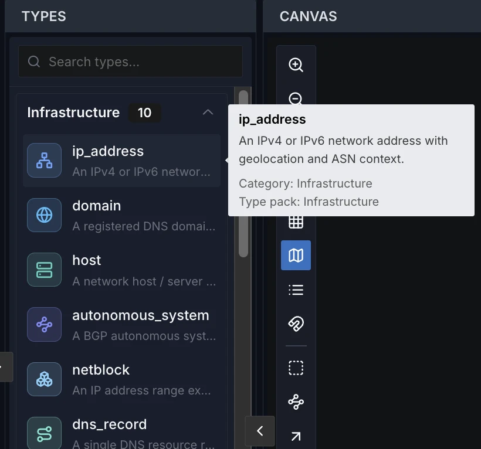

# Type Pack 사용하기

**Type Pack**은 그래프가 보유할 수 있는 엔티티 종류(IP 주소, 도메인, 멀웨어 패밀리,
위협 행위자 등)를 정의하는 작은 JSON 번들입니다. 프로젝트에 설치하면 노드를 생성할 때
해당 유형을 사용할 수 있고, 캔버스에 각 노드가 어떻게 보일지 알려줍니다.

## Type Pack이 제공하는 것

Type Pack은 **엔티티(노드) 유형**을 선언합니다. 엣지에는 유형이 없습니다: 각 엣지는
자유 텍스트 라벨을 가지며, 이 라벨은 사용자가 [엣지를 그릴 때](canvas.md#엣지-그리기)
입력하거나 연결을 찾아낸 플러그인이 씁니다. 각 엔티티 유형은 다음을 포함합니다:

- **`label_property`** — 캔버스에서 노드 이름으로 표시되는 속성 값. IP 주소의 경우
  주소 자체, 취약점의 경우 CVE ID입니다. 일부 유형은 대신 여러 속성을 조합한 라벨
  ([`label_template`](../develop/typepacks.md#entity-types))을 쓰며, 그 속성이 모두 채워지기
  전까지는 `label_property` 값을 표시합니다.
- **속성** 세트 — 입력할 수 있는 명명된 필드(예: `country_code`, `asn`, `registrar`).
  노드 선택 시 **Properties**(속성) 패널에 나타납니다. 속성을 편집하면 그 값이 유형이 선언한
  종류, 허용 값, 패턴이나 범위에 맞는지 검사합니다(예: `country_code`는 대문자 두 글자,
  `asn`은 1부터 4294967295까지의 정수여야 함). 검사를 통과하지 못한 값은 저장되지 않고,
  이유를 알리는 메시지가 표시됩니다.
- **`icon`** 및 **`color`** — 노드가 캔버스와 **Types**(유형) 및 **Properties** 패널에서 렌더링되는 방식을
  결정하는 시각적 요소.

## Type Pack 설치하기

다른 항목을 설치하는 것과 동일한 방식으로 Type Pack을 설치합니다([둘러보기 및 설치](installing.md)
참조). 설치되면 해당 유형이 **Types** 패널에 나타나고 노드 생성 시 선택 가능해집니다.
최소 하나의 Type Pack이 설치될 때까지 선택할 수 있는 엔티티 유형이 없습니다.

**Types** 패널에서 유형은 팩이 아니라 **카테고리**별로 묶이므로, 한 팩이 여러 그룹을 채울 수
있습니다(Infrastructure 팩은 **Infrastructure**와 **Web** 양쪽에 나타남). 각 그룹에는 개수가
표시됩니다. 유형에 마우스를 올리면 설명과 **Category:**, 그리고 출처인 **Type pack:**이
표시됩니다. 유형을 클릭하면 해당 유형의 새 노드(`New <유형>` 라벨의 자리표시자)가 생성되고
바로 선택되어 속성을 채울 수 있습니다. 위쪽의 **Search types…** 상자는 유형 이름, 카테고리,
설명, 팩 이름으로 목록을 거릅니다. 패널이 이 상자를 담기에 너무 좁으면 유형 아이콘만
표시됩니다. 설치된 Type Pack이 없으면 패널이 그렇게 알려 주고 **Browse the marketplace**
버튼을 제공합니다. 로그인하지 않고 공유된 프로젝트를 보는 방문자에게는 이 버튼이 표시되지 않습니다.

<figure class="vy-shot" markdown="span">
  { width="410" loading=lazy }
  <figcaption>Types 패널은 유형을 카테고리별로 묶습니다. 유형에 마우스를 올리면 설명, 카테고리, 타입 팩이 표시됩니다.</figcaption>
</figure>

노드를 생성할 때 설치된 Type Pack에서 유형을 선택합니다. Vineyard는 해당 선택을
`category.name` 형식의 **정규화된 문자열**로 저장합니다 — 예:
`infrastructure.ip_address` 또는 `threat.malware`. 플러그인은 자신이 소비하고 생성하는
것을 선언할 때 동일한 형식을 참조합니다.

## 레퍼런스 팩

Vineyard는 여러 공식 Type Pack을 제공합니다. 각각은 독립적입니다 — 조사에 필요한
것만 설치하세요 — 그리고 함께 사용하도록 설계되어 있습니다: 엣지 하나가 서로 다른
팩의 노드를 연결할 수 있습니다(`threat.malware`가 `infrastructure.ip_address`와
**통신하는**, `financial.crypto_address`가 `identity.person`에 의해 **제어되는** 등).

| 팩 (`identifier`) | 카테고리 | 유형 | 모델링 대상 |
|---|---|---|---|
| **Infrastructure** (`…typepacks.infrastructure`) | `infrastructure`, `web` | 15 | 정찰 중 매핑하는 네트워크, 그리고 그 위에서 관측되는 웹 리소스(URL), 웹 지문(헤더, 파비콘, DOM 해시), 트래킹 ID 엔티티 |
| **Threat** (`…typepacks.threat`) | `threat` | 10 | 위협 인텔리전스 (STIX 정렬) |
| **Identity** (`…typepacks.identity`) | `identity` | 7 | 사람, 조직, 온라인 페르소나 |
| **Financial** (`…typepacks.financial`) | `financial` | 4 | 자금 흐름 |
| **Endpoint** (`…typepacks.endpoint`) | `endpoint` | 6 | 호스트 / DFIR 아티팩트 |
| **Geospatial** (`…typepacks.geo`) | `geo` | 3 | 장소와 물리적 맥락 |
| **Social Media** (`…typepacks.social`) | `social` | 5 | 플랫폼에 무관한 계정, 게시물, 해시태그, 그룹, 미디어 |
| **Telegram** (`…typepacks.telegram`) | `telegram` | 4 | 가입 없이 수집한 계정, 채널, 슈퍼그룹, 게시물 |

### Infrastructure — 자세히 보기

`run.vineyard.typepacks.infrastructure`는 정찰 중 매핑하는 네트워크 측 엔티티를
`infrastructure` 카테고리로 모델링합니다:

| 유형 (`category.name`) | 표시 라벨 | 주요 속성 |
|---|---|---|
| `infrastructure.ip_address` | IP 주소 | `version`, `country_code`, `asn`, `reverse_dns` |
| `infrastructure.domain` | 도메인 이름 | `registrar`, `created_date`, `name_servers` |
| `infrastructure.host` | 호스트 이름 | `operating_system`, `open_ports`, `hosting_provider` |
| `infrastructure.autonomous_system` | ASN | `autonomous_system_name`, `registry` |
| `infrastructure.netblock` | CIDR | `network_name`, `asn` |
| `infrastructure.dns_record` | 이름, 유형, 값 (예: `www.example.com A 93.184.216.34`). 유형과 값이 채워지기 전에는 레코드 이름 | `record_type`, `record_value`, `ttl` |
| `infrastructure.whois_record` | 주체 (도메인/IP) | `registrant`, `registrar`, `created_at` |
| `infrastructure.certificate` | SHA-256 지문 | `subject_common_name`, `issuer`, `not_after` |
| `infrastructure.ssh_host_key` | 키의 SHA-256 (16진수) | `key_type` |
| `infrastructure.technologies` | 기술 이름 | `kind`, `vendor`, `version`, `cpe` |

같은 팩이 별도의 `web` 카테고리로 유형 다섯 개를 더 제공합니다:

| 유형 (`category.name`) | 표시 라벨 | 주요 속성 |
|---|---|---|
| `web.url` | URL | `domain` (일반 텍스트로 적은 호스트 이름. 도메인 노드와는 엣지로 연결), `http_status` |
| `web.hhhash` | HTTP 헤더 해시 | `header_count`, `server_hint` |
| `web.favicon_hash` | Shodan 방식 MMH3 해시 (부호 있는 10진수) | `mmh3_hex`, `md5`, `sha256`, `phash`, `dhash`, `favicon_url` |
| `web.dom_hash` | DOM 구조 해시 | `tag_count` |
| `web.tracking_id` | 페이지에 적힌 그대로의 식별자 (예: `G-SXM8TFRYSW`), 동일성은 `provider` + `value` | `provider`, `kind` |

`web.favicon_hash`는 파비콘 하나를 검색 서비스들이 색인하는 형식별로 모두 담습니다. Shodan·FOFA·
Censys·ZoomEye는 `hash_value`, Criminal IP는 `mmh3_hex`, Censys·ZoomEye·360 Quake·Hunter.how·
ONYPHE·VirusTotal은 `md5`, Censys·Netlas·urlscan.io는 `sha256`으로 찾고, `phash`와 `dhash`는
비트가 몇 개 다른지로 비교하는 지각 해시입니다.

각 유형은 자체 아이콘과 색상을 제공합니다.

다른 팩도 같은 형태를 따릅니다 — 예를 들어 **Threat** 팩은 `threat.malware`,
`threat.threat_actor`, `threat.indicator`, `threat.operation`(캠페인 내의 경계된 작업 —
하나의 캠페인은 여러 개의 operation을 포함할 수 있음)을, **Identity** 팩은 활동 뒤의
사람과 페르소나를 추가합니다.

!!! tip "Type Pack 혼합하기"
    필요한 만큼 Type Pack을 설치하세요 — 하나의 정규화된 유형 네임스페이스를
    공유하며 설계상 상호 연결됩니다. `threat.malware`를 그것이 비콘하는
    `infrastructure.ip_address`에 연결하고, `threat.campaign`을
    `identity.organization`에 귀속시키고, 몸값 `financial.crypto_transaction`을
    추적할 수 있습니다.

!!! note "신원 및 중복 제거"
    플러그인이나 AI 작업이 노드를 추가할 때, Vineyard는 **유형 + 유형의 식별 필드**로
    중복을 제거합니다 — 유형이 `identity_properties`를 선언하면 그 필드들(예:
    `identity.account` → username + platform, `endpoint.file` → SHA-256·파일 이름·경로·호스트,
    `endpoint.process` → 프로세스 GUID·이름·PID), 아니면 `label_property` 값입니다. 같은
    유형과 같은 식별 값의 두 노드는 병합되고 속성이 결합됩니다. 팩이 대소문자 무시로 표시한
    필드(도메인, 호스트 이름, 이메일, 핸들 등)는 대소문자와 관계없이 일치합니다. 따라서
    가장 유용한 라벨은 읽기 쉽고 *식별적인* 것입니다. 대부분의 유형은 자연적으로
    고유한 필드(IP, CVE ID, 트랜잭션 해시, WHOIS 주체)를 키로 사용합니다. 라벨이
    본질적으로 고유하지 않은 유형(`identity.person`의 이름, `identity.organization`의
    이름)은 같은 라벨을 공유하는 서로 다른 엔티티가 병합되므로, 구분되는 라벨
    (예: `John Smith (DOB 1990)`)을 주세요. 이 두 유형은 라벨만으로 식별되므로 생년월일이나
    등록번호 같은 다른 속성을 채워도 서로 구분되지 않습니다. **수동으로** 추가한 노드는
    절대 자동 병합되지 않습니다.

## 버전

Type Pack은 시맨틱 버저닝을 사용합니다. **MAJOR 버전 증가는 유형 정의의 파괴적
변경**을 의미합니다 — 예: 유형 이름 변경 또는 제거 — 기존 유형을 사용하는 노드를
수정해야 할 수 있습니다. 마이너 및 패치 업데이트(새 선택적 속성,
시각적 조정)는 기존 노드를 깨지 않습니다.

## 다음 / 함께 보기

- [캔버스](canvas.md) — 유형화된 노드가 렌더링되고 연결되는 방식
- [플러그인 실행](running-plugins.md) — 플러그인은 Type Pack이 정의한 유형에 작용
- [Skill Pack 사용하기](skillpacks.md) — 이러한 유형을 피벗하는 플레이북
