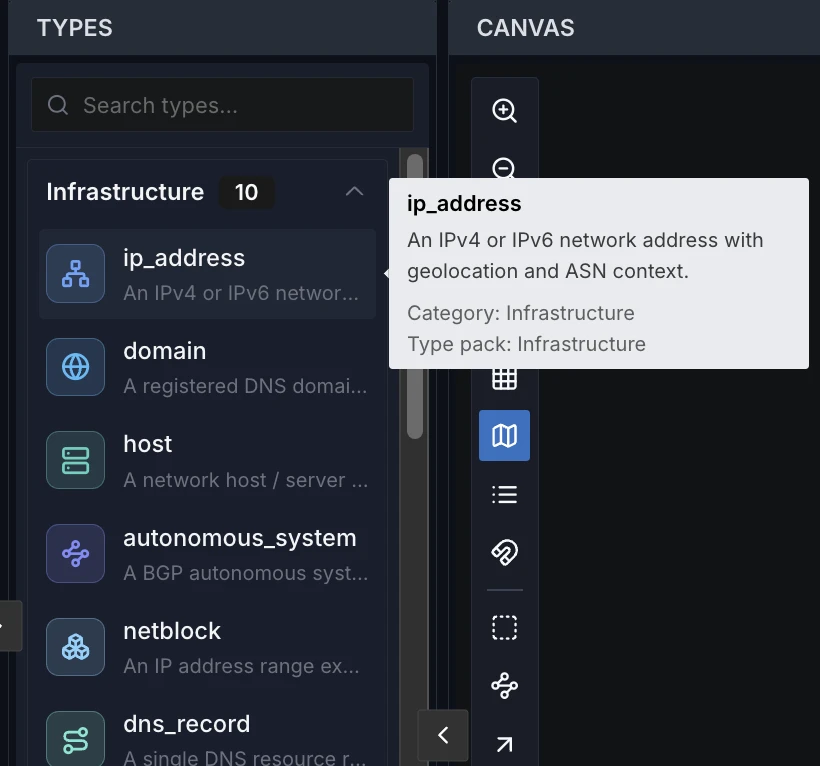

# Working with Type Packs

A **Type Pack** is a small JSON bundle that defines the kinds of entities your graph can hold —
IP addresses, domains, malware families, threat actors, and so on. Installing one in a project
makes those types available when you create nodes, and tells the canvas how each node should look.

## What a Type Pack gives you

A Type Pack declares **entity (node) types**. Edges carry no type: each edge has a free-text
label, written by you when you [draw it](canvas.md#drawing-edges) or by the plugin that found
the link. Each entity type carries:

- A **`label_property`** — the property whose value is shown as the node's name on the canvas.
  For an IP address that is the address itself; for a vulnerability it's the CVE id. Some types
  build the label from several properties instead (a
  [`label_template`](../develop/typepacks.md#entity-types)), and fall back to the
  `label_property` until all of them are filled.
- A set of **properties** — the named fields you can fill in (e.g. `country_code`, `asn`,
  `registrar`). These appear in the Properties panel when a node is selected, each shown by the
  kind of value it holds ([Reading values in the Properties panel](#reading-values-in-the-properties-panel)). When you edit one,
  the value is checked against what the type declares: its kind, its allowed values, and any
  pattern or range (for example, `country_code` must be two capital letters and `asn` a whole
  number from 1 to 4294967295). A value that fails is not saved, and a message says why. A node
  can also hold fields its type does not declare: plugins write them, and you can add your own
  ([Adding and removing fields](#adding-and-removing-fields)).
- An **`icon`** and a **`color`** — the visuals that drive how the node renders on the canvas and
  in the Types and Properties panels.

## Installing a Type Pack

Install a Type Pack the same way you install anything else (see [Browse & install](installing.md)).
Once it is installed, its types show up in the **Types** panel and become selectable when you
create a node. Until at least one Type Pack is installed, there are no entity types to choose
from.

In the Types panel, types are grouped by **category**, not by pack, so one pack can fill several
groups (the Infrastructure pack appears under both Infrastructure and Web), each with a count.
Hover a type to see its description, its **Category:** and the **Type pack:** it comes from.
Click a type to create a new node of that type (a placeholder labelled `New <type>`), which is
selected right away so you can fill in its properties. The box beside each type is ticked while its
nodes are drawn on the canvas; untick it to hide them (see [Hiding nodes and edges](canvas.md#hiding)).
The **Search types…** box at the top
filters the list by type name, category, description or pack name; a panel too narrow for it
shows only the type icons. With no Type Pack installed, the panel says so and offers **Browse the
marketplace**, except to a visitor reading a shared project without signing in.

<figure class="vy-shot" markdown="span">
  { width="410" loading=lazy }
  <figcaption>The Types panel groups types by category; hovering one shows its description, category and type pack.</figcaption>
</figure>

When you create a node, you pick a type from an installed Type Pack. Vineyard stores that choice as
a qualified string in the form `category.name` — for example `infrastructure.ip_address` or
`threat.malware`. Plugins reference the same form when they declare what they consume and
produce.

## The reference packs

Vineyard ships several official Type Packs. Each is self-contained — install the ones your
investigation needs — and they are designed to be used together: an edge can join nodes from
different packs (a `threat.malware` that **communicates with** an
`infrastructure.ip_address`, a `cryptocurrency.crypto_address` **controlled by** an
`identity.person`, and so on).

| Pack (`identifier`) | Category | Types | Models |
|---|---|---|---|
| **Infrastructure** (`…typepacks.infrastructure`) | `infrastructure`, `web` | 15 | The network you map during recon, plus the web resource (URL), web-fingerprint (header, favicon, DOM hash) and tracking-ID entities observed on it |
| **Threat** (`…typepacks.threat`) | `threat` | 10 | Threat-intelligence (STIX-aligned) |
| **Identity** (`…typepacks.identity`) | `identity` | 7 | People, orgs, and online personas |
| **Financial** (`…typepacks.financial`) | `financial` | 4 | Exchanges and other virtual-asset service providers, bank accounts, and two legacy crypto types |
| **Cryptocurrency** (`…typepacks.cryptocurrency`) | `cryptocurrency` | 4 | Addresses, transactions, tokens and non-custodial services on every chain, identified by network |
| **Endpoint** (`…typepacks.endpoint`) | `endpoint` | 6 | Host / DFIR artifacts |
| **Geospatial** (`…typepacks.geo`) | `geo` | 3 | Places and physical context |
| **Social Media** (`…typepacks.social`) | `social` | 5 | Platform-agnostic accounts, posts, hashtags, groups, and media |
| **Telegram** (`…typepacks.telegram`) | `telegram` | 4 | Accounts, channels, supergroups, and posts, collected without joining |

### Financial — bank accounts

An account number is unique only within its bank, so `financial.bank_account` is identified by
`bank_code` and `account_identifier` together: the same number at two banks is two nodes, and the
label names the bank (`123456789012 · KB Kookmin`). Write both without spaces or hyphens. A value
such as `123-456-789012` is refused, and the message says what form to write. `bank_code` is the
country's own bank code where it has one (Korea's three digits, such as `004`, `088` or `090`),
otherwise the SWIFT/BIC, never the bank's name: `KB` or `SHINHAN` is refused. Leave it empty for
an IBAN, which already names its bank.

The AI agent is told which fields identify a bank account and how to write the bank code. An
account written without one still shares a node with any other account of the same number and no
code, whichever bank holds it, so check that the agent's bank accounts carry a bank code when you
review them.

The status of a reported account has its own fields:

| Property | What it records |
|---|---|
| `fraud_registration` | `registered` as a fraud-use account (in Korea, 사기이용계좌), `not_registered` when checked and not found, or `released` after a registration was lifted |
| `payment_suspended_at` | When payments from the account were suspended (in Korea, 지급정지) |
| `report_channels` | Where the account was reported, one per line (112, 1332, the holding bank…) |
| `status_checked_at`, `status_source` | When the status was last confirmed, and by whom |

`account_holder` is the holder of record, who is often not the person who used the account. Record
whoever operated it as an `identity.person` linked by an edge. The AI agent reads a bank account's
properties like any other node's, so its number and holder name go to your AI provider when the
agent reads the node. Leave `account_holder` empty when the case does not need the name.

Bank accounts created before Financial 2.0.0 have no bank code, so a new write of the same account
becomes a separate node. Give an old node its bank code and remove any hyphens from its number,
and later writes of that account land on it; a duplicate already written stays separate. The agent
can still record the status of an old account whose number has hyphens: an edit is checked only on
the values it changes.

### Infrastructure — a closer look

`run.vineyard.typepacks.infrastructure` models the network-side entities you map during
reconnaissance, in the `infrastructure` category:

| Type (`category.name`) | Label shown | Notable properties |
|---|---|---|
| `infrastructure.ip_address` | the IP address | `version`, `country_code`, `asn`, `reverse_dns` |
| `infrastructure.domain` | the domain name | `registrar`, `created_date`, `name_servers` |
| `infrastructure.host` | the hostname | `operating_system`, `open_ports`, `hosting_provider` |
| `infrastructure.autonomous_system` | the ASN | `autonomous_system_name`, `registry` |
| `infrastructure.netblock` | the CIDR | `network_name`, `asn` |
| `infrastructure.dns_record` | name, type and value (e.g. `www.example.com A 93.184.216.34`); the record name until type and value are filled | `record_type`, `record_value`, `ttl` |
| `infrastructure.whois_record` | the subject (domain/IP) | `registrant`, `registrar`, `created_at` |
| `infrastructure.certificate` | the SHA-256 fingerprint | `fingerprint_sha1`, `subject_common_name`, `issuer`, `not_after` |
| `infrastructure.ssh_host_key` | the SHA-256 of the key (hex) | `key_type` |
| `infrastructure.technologies` | the technology name | `kind`, `vendor`, `version`, `cpe` |

The same pack also ships five types in a separate `web` category:

| Type (`category.name`) | Label shown | Notable properties |
|---|---|---|
| `web.url` | the URL | `domain` (the hostname as plain text; an edge links a domain node), `http_status` |
| `web.hhhash` | the HTTP header hash | `header_count`, `server_hint` |
| `web.favicon_hash` | the Shodan-style MMH3 hash (signed decimal) | `mmh3_hex`, `md5`, `sha256`, `phash`, `dhash`, `favicon_url` |
| `web.dom_hash` | the DOM structure hash | `tag_count` |
| `web.tracking_id` | the identifier as the page carries it (e.g. `G-SXM8TFRYSW`); identity is `provider` + `value` | `provider`, `kind` |

`web.favicon_hash` holds one favicon in every form the search services index it under: `hash_value`
for Shodan, FOFA, Censys and ZoomEye, `mmh3_hex` for Criminal IP, `md5` for Censys, ZoomEye,
360 Quake, Hunter.how, ONYPHE and VirusTotal, `sha256` for Censys, Netlas and urlscan.io, and the
perceptual `phash` and `dhash`, which are compared by how many of their bits differ. The AI agent
compares them with `similar_hashes`, and the **Shared-Attribute Clustering** pack links favicons
whose `phash` or `dhash` differ in at most 10 of 64 bits (adjustable per run) with a
`similar favicon` edge. A blank or single-colour icon hashes the same whatever its colour, and a
symmetric logo's `phash` lies within a few bits of that value, so neither compares a hash at or
near it; the favicon's other hash is still compared.

`infrastructure.certificate` is identified by its SHA-256. When the source reports the SHA-1 too
(Shodan, Censys and VirusTotal do), it goes in `fingerprint_sha1`: blocklists such as abuse.ch SSLBL
list certificates by SHA-1 alone, and a SHA-1 cannot be computed from the SHA-256.

`infrastructure.domain` takes a name under an internationalised top-level domain, such as
`.한국` (`xn--3e0b707e`) or `.рф` (`xn--p1ai`), from Infrastructure 4.3.0. Write it in Unicode
(`사이트.한국`) or in punycode (`xn--vf4b27jhrk.xn--3e0b707e`): the two spellings are one domain.
From 4.3.1 the punycode prefix may be in capitals too (`EXAMPLE.XN--P1AI`), as the rest of the name
always could. The AI agent's `extract_indicators` writes a name it reads in text in punycode. A
project on an earlier version refuses these names until the pack is updated (**Update** on its
card in the marketplace).

Each type ships its own icon and color.

### Endpoint — host artifacts

`run.vineyard.typepacks.endpoint` holds what an incident responder finds on a machine. The
**Host Artifacts** plugin pack fills it from exports you already have: its **Process Activity
Import** plugin reads Sysmon events 1, 3 and 22, or ECS process, network and DNS events, from files
you pick in the **Run plugins** panel (JSON, JSON lines, CSV or Windows event XML, parsed on your
device) and draws these links:

| From → to | Label | Edge data |
|---|---|---|
| `endpoint.process` → `endpoint.process` | `spawned` | none |
| `endpoint.process` → `endpoint.file` | `executed from` | none |
| `endpoint.process` → `infrastructure.ip_address` | `connected to`, or `accepted connection from` when every connection was inbound | `source`, `events`, `direction`, `first_seen`, `last_seen`, `ports`, `port_count`, `protocols`, `remote_hostnames` |
| `endpoint.process` → `infrastructure.domain` | `queried` | `source`, `events`, `first_seen`, `last_seen`, `answers`, `failed_events`, `statuses` |

A process is identified by its process GUID, image name and PID, so a record without a Sysmon
`ProcessGuid` or an ECS `process.entity_id` is skipped: without it, the same name and PID on two
hosts would become one node. The process type has no host field, so the plugin writes the computer
name to an extra `hostname` field, which the Properties panel shows. All events between one process
and one destination are one link, and its `events` counts connections or lookups rather than
records: Elastic Defend logs a connection when it opens and again when it closes, and that is one
event. A new link carries that summary from the first import. Importing a later export replaces it
rather than adding to it, and a key the later export has no value for becomes empty. The review
lists only the links whose summary changed, so importing the same export again stages nothing. A
link that is already in the project keeps its label, including one you renamed, and only its summary
is written: a `spawned` or `executed from` link you renamed is left as it is. A command line too
long for one node (Linux allows megabytes of arguments) is cut, keeping its start, and the node says
so in `command_line_truncated` and `command_line_length`.
Loopback and link-local traffic never comes in, and private-network addresses and internal names
only when you turn that on.

!!! warning "Host data on a server"
    Host names, user names and command lines become node fields. In a project on a Vineyard server
    they are stored on that server. For a case whose host data must stay on your computer, use the
    desktop app in local mode ([Signed in or local](modes.md)).

The other packs follow the same shape — for example the **Threat** pack adds
`threat.malware`, `threat.threat_actor`, `threat.indicator`, and `threat.operation` (a bounded
operation within a campaign — one campaign can contain several operations), while **Identity**
adds the people and personas behind the activity.

### Cryptocurrency — a closer look

`run.vineyard.typepacks.cryptocurrency` covers every chain with one set of types, in the
`cryptocurrency` category, and says which chain with `network`. The same string is a different
account on another network — a `1…` address on Bitcoin and on Bitcoin Cash, one `0x…` address on
Ethereum and on BSC — so `network` is part of the identity, and two such nodes never merge.

| Type (`category.name`) | Label shown | Identity | Notable properties |
|---|---|---|---|
| `cryptocurrency.crypto_address` | the address and its network | `network` + `address` + `memo` | `address_kind`, `balance`, `first_funder`, `public_label`, `sanctioned` |
| `cryptocurrency.crypto_transaction` | the hash and its network | `network` + `tx_hash` | `block_height`, `block_time`, `status`, `fee` |
| `cryptocurrency.crypto_token` | the symbol and its network | `network` + `contract_address` | `standard`, `decimals`, `issuer` |
| `cryptocurrency.crypto_service` | the name | `name` | `service_type` (mixer, bridge, gambling, merchant, defi) |

- **Letter case.** Hex, bech32, CashAddr and TON raw values match whatever their case, so an EIP-55
  checksummed address and its lower-case form are one node, and a 64-hex hash matches with or
  without `0x`. Base58 values (legacy Bitcoin, TRON, Solana, Monero, XRPL) are compared exactly.
- **`evm` and `unknown`** are networks not established yet: a `0x…` address whose chain the source
  did not give, and any other address whose network neither the source nor its format settles.
  They stay separate nodes: once the network is established, the `evm` or `unknown` node links to
  the node on that network with `same address on`.
- **Exchanges** and anything else that holds customers' funds (OTC desks, custodial wallets,
  payment processors) are `financial.exchange`; `crypto_service` is for services that do not.
- **Amounts** (`balance`, `fee`) are decimal strings in the network's native unit: full precision,
  but they do not sort as numbers.
- **The Financial pack's** `crypto_address` and `crypto_transaction` remain for older nodes and are
  shown as "(legacy)". They do not merge with the new types. With both packs installed, the short
  name `crypto_address` means the Cryptocurrency pack's type.

Most `network` values have a CAIP-2 chain id, the form other tools exchange: some only as a draft
or a proposal, and a few have none registered. The ids are not part of the identity, so a
correction to one never splits a node.
{#crypto-networks}

| `network` | CAIP-2 |
|---|---|
| `bitcoin` | `bip122:000000000019d6689c085ae165831e93` |
| `bitcoin_cash` | `bip122:000000000000000000651ef99cb9fcbe` |
| `bitcoin_sv` | `bsv:mainnet` (draft) |
| `bitcoin_gold` | none registered |
| `litecoin` | `bip122:12a765e31ffd4059bada1e25190f6e98` |
| `dogecoin` | `bip122:1a91e3dace36e2be3bf030a65679fe82` |
| `dash` | none registered |
| `zcash` | none registered |
| `monero` | `monero:418015bb9ae982a1975da7d79277c270` (draft) |
| `verge` | none registered |
| `ethereum` | `eip155:1` |
| `ethereum_classic` | `eip155:61` |
| `bsc` | `eip155:56` |
| `polygon` | `eip155:137` |
| `arbitrum` | `eip155:42161` |
| `optimism` | `eip155:10` |
| `base` | `eip155:8453` |
| `avalanche_c` | `eip155:43114` |
| `evm` | none: the chain is not established |
| `tron` | `tron:728126428` |
| `solana` | `solana:5eykt4UsFv8P8NJdTREpY1vzqKqZKvdp` |
| `xrpl` | `xrpl:0` |
| `ton` | `tvm:-239` |
| `cardano` | proposed: `cardano:1-764824073` |
| `bnb_beacon` | `cosmos:Binance-Chain-Tigris` (draft) |
| `unknown` | none: the network is not established |

Edges carry no type, so the Cryptocurrency pack fixes the labels and data keys that collectors use.
A pair of nodes has one link: a collector adds its data keys to a link that is already there rather
than relabelling it, and figures from different sources go under keys of their own.

| From → to | Label | Data |
|---|---|---|
| address → address | `sent to` | `network`; per source `summary_<source>` (`asset`, `symbol`, `count`, `total`, `first`, `last`, `window_from`, `window_to`, `complete`); `recent`, the latest 20 (`tx_hash`, `asset`, `amount`, `time`); `first_funding`; `deployment` |
| address → address | `deployed` | `deployment` (`tx_hash`), when the pair has no link yet |
| address → transaction | `input to` | `amount`, `inputs` (`index`, `amount`, `prev_txid`, `prev_vout`) |
| transaction → address | `output to` | `amount`, `outputs` (`index`, `amount`) |
| contract address → token | `token contract` | — |
| address → exchange, service or organization | `attributed to` | per source `attribution_<source>` (`label`, `label_kind`: verified, prediction or public_tag, `as_of`) |
| `evm` or `unknown` address → address | `same address on` | how the network was decided. For a contract it does not mean the same owner |
| person or organization → address | `listed address` | `list` (e.g. OFAC SDN), `uid`, `program` (the entry's programmes), `listed_as` (the codes the list gives the address, e.g. USDT), `as_of`; `listed`, the value as the list wrote it, when it differs |
| URL or domain → address | `accepts payment to` | where the payment address was found |
| legacy `financial.crypto_address`, or a payment `web.tracking_id` → address | `same as` | why they are the same |

`sanctioned`, `sanctions_programs` and `sanctions_as_of` are a screening's answer for the list dated
`sanctions_as_of`: `false` means not on that list, not cleared. The **Sanctions Screening** plugin
pack writes them from OFAC's SDN list, with `sanctions_list` naming the list, and draws the
`listed address` links. It leaves an address alone that is already marked `sanctioned` from another
list or by hand; see [Screening against sanctions lists](running-plugins.md#sanctions).

The **Chain Explorer** plugin pack fills these types without an account or a key. It reads an
address's history and counterparties, a transaction's inputs and outputs, TRON and XRP Ledger first
funders, contract deployers and tokens, explorer labels, and USDT and USDC freezes. Its Identify
Crypto Network plugin decides the network of an `evm` or `unknown` address, a legacy Financial
address or a payment tracking ID, and draws the `same address on` and `same as` links above. An
address whose format several networks share is placed on each network where it has activity, once
every one of those networks has answered: while an explorer is not answering, the address is left
for the next run. An EVM address that has never sent a transaction and holds no coin or code stays
undecided. The pack covers Bitcoin, Litecoin, Bitcoin Cash, Dogecoin, Dash, Zcash, Ethereum, BNB
Smart Chain (the last 30 days), OP Mainnet, Avalanche C-Chain, Ethereum Classic, TRON, Solana, the
XRP Ledger and TON. History on Polygon, Arbitrum and Base needs a keyed pack.

The **Blockchair** plugin pack writes the transaction rows of the table above, `input to` and
`output to`, and `same address on`, for Bitcoin and six chains built like it; see
[Following coins with Blockchair](running-plugins.md#blockchair).

The **Blockscout PRO** plugin pack fills these types and links on Base, OP Mainnet, Ethereum,
Arbitrum One, Polygon PoS and Ethereum Classic with your own free key; see
[Following funds with Blockscout PRO](running-plugins.md#blockscout-pro).

**Solana through Helius.** The **Helius** plugin pack needs a Helius API key, and its free plan
covers history and first funder. A Solana wallet holds SPL tokens in token accounts it owns, so a
plain Solana RPC history leaves out a USDC payment to it; this pack's history includes the
transactions that change those token accounts. It writes `sent to` links with `summary_helius`, and
`recent` on the links it creates; a link already in the project keeps its own `recent` list. SOL a
wallet wraps into its own wSOL account is not counted as a payment. On the address it writes
`balance`, `last_seen`, `history_examined` and `history_complete`, with `first_seen` only when the
whole history was read. Its first-funder plugin writes `first_funder`, `first_funding_tx` and
`activated_at`, and adds `first_funding` to the funder's `sent to` link. That key's `source` says
how the funder was found: `helius funded-by` is Helius's own lookup, which needs a paid Helius plan
(Developer or above); `helius earliest SOL deposit` is the SOL transfer in the transaction where the
address's balance first rose from zero, the definition funded-by itself uses. A free key gets that
method, and so does an address funded-by has no record of. An address first credited by a program
rather than a transfer gets no funder. Helius's identity labels (`public_label`, `helius_category`,
and `attributed to` an exchange, service or firm) need a paid plan too. Token transfers before
December 2022 are not found through token accounts.

To follow funds across several hops, the **Crypto fund-flow tracing** [Skill Pack](skillpacks.md)
tells the agent how to use these plugins: settle each address's network before any hop, follow
transfers by asset, time and amount, stop at exchanges and services, and draft the freeze and records
requests for the exchanges and stablecoin issuers the funds reached. Transfers stay the plugins'
links; an owner the agent infers from a label or a deposit pattern goes in its report as a candidate,
not on the graph.

!!! tip "Mixing Type Packs"
    Install as many Type Packs as you need — they share one qualified-type namespace and
    interlink by design. You might link a `threat.malware` to the `infrastructure.ip_address`
    it beacons to, attribute a `threat.campaign` to an `identity.organization`, and trace a
    ransom `cryptocurrency.crypto_transaction`.

!!! note "Identity & de-duplication"
    When a plugin or AI task adds a node, Vineyard de-duplicates by **type + the type's
    identity fields** — its `identity_properties` when it declares them (e.g. `identity.account`
    → username + platform; `endpoint.file` → SHA-256, file name, path, host; `endpoint.process`
    → process GUID, name, PID; `financial.bank_account` → bank code + account number), otherwise
    its `label_property` value. Two nodes with the same
    type and identity are merged and their properties combined. Fields the pack marks
    case-insensitive (domains, hostnames, emails, handles…) match regardless of case. A crypto
    address or transaction hash matches whatever the case of its hex or bech32 form, while a
    Base58 address is compared exactly and the network is part of its identity. From
    Infrastructure 4.3.0 a domain, host or DNS record name matches without its trailing dot and
    in its punycode form, an IP address in its standard form (IPv6 as RFC 5952 writes it), and a
    URL however its scheme, host, default port or percent-encoding is written; a URL path keeps
    its case. The node keeps the spelling it already has: a matching write in another spelling
    adds its other fields and leaves the identity as it was. The most
    useful label is therefore one that is both readable *and* identifying. Most types key on a naturally-unique field (an IP, a CVE id, a tx
    hash, a WHOIS subject). Where a type's label is inherently non-unique — a
    `identity.person`'s name, an `identity.organization`'s name — distinct entities sharing
    that label will merge, so give them a distinguishing label (e.g. `John Smith (DOB 1990)`).
    These two types are identified by the label alone, so filling another property, such as a
    date of birth or a registration number, does not keep them apart. Phone numbers are
    identified as written, so `+82 10-1234-5678` and `010-1234-5678` are two
    `identity.phone_number` nodes; the **Phone Numbers** plugin pack writes the E.164 form they
    share as `e164` (Identity 2.4.0 and later), with `region` and a `line_type` estimated from
    the number's range, and leaves the label as it is; nodes that share an `e164` are found as
    duplicates (Identity 2.5.0 and later). Nodes you add **manually** are never auto-merged. Nodes
    that are one entity but are already two in the project are found and merged by the AI agent's
    `find_duplicates` and `merge_nodes`, through your review (see
    [Duplicates and merging](tasks.md#duplicates-and-merging)), or you merge them yourself (see
    [Merging nodes](canvas.md#merging-nodes)).

## Reading values in the Properties panel

The Properties panel shows each value by what it is, not only by the type that declares it: a URL
with its host picked out, a hash shortened with its algorithm beside it, a list written into one
text field as separate entries. What changes is how the value is shown. The stored value stays as
it is until you edit it.

A chevron (**›**) at the end of a value opens a view of the whole value under its row.

| Value | In the grid | Under the row |
|---|---|---|
| Long text (`description`, `bio`, a post) | The first line, and how many lines follow (`+3 lines`). | The whole text with its line breaks, **Find** and **Copy**. |
| A list written into one text field (`name_servers`, `open_ports`, `user_ids`, `tags`) | The first entries as chips, and how many there are. | One entry per row, with the host of each URL. **Copy, one per line**, **Copy defanged**, and **Edit as text**. |
| URL | The URL as stored, its host highlighted. A badge marks a URL the browser cannot read (`unreadable`) and one with a user name or password before the host (`credentials`). | Scheme, host (and its Unicode form when it is punycode), port, path, each query parameter decoded, fragment. **Defanged** shows it as `hxxps://example[.]com`, in the grid too. The other nodes with the same host. |
| Hash | The first and last eight characters, and the algorithm read from the property name or the length (`MD5`, `SHA-1`, `SHA-256`, `mmh3`, `ssdeep`, `TLSH`…). The algorithm is a label; nothing is computed. | The whole hash, **Copy**, **Lower case** for a hex hash written in capitals, and the other nodes with the same value. |
| IP address or CIDR block | The value, `v4` or `v6`, and a special-purpose range such as `private`, `loopback` or `documentation`. A block written from a host address is marked `host bits set`. | The canonical form of an address, or a block's network, netmask, first and last address and size. The other nodes in the same /24 (IPv6: /64), or with an address in the block. |
| E-mail address | The domain highlighted. | The local part, the tag after a `+`, and the domain (and its Unicode form). |
| Size, count or amount (`size_bytes`, `*_count`, `followers`, `balance`) | Digits grouped in thousands, a size also in KiB, MiB or GiB, an amount with the node's currency. | — |
| Code: a detection rule, an armored key, a raw record, a command line | Monospace, the first line. | Line numbers, highlighting for YARA, Sigma, PGP armor and WHOIS (up to 8,000 characters), **Find**, **Wrap**, **Copy**, **Download**, and **Edit**, a code editor that saves when you press **Save**. |
| Cryptocurrency address | The chain its format belongs to, and whether its checksum holds (EIP-55, Base58Check, Bech32 and Bech32m). Solana addresses and all-lowercase EVM addresses carry no checksum, and Monero's is not checked. A Base58Check address whose version byte names no chain Vineyard knows (Bitcoin Gold, Dash) shows `checksum ok` without a chain. | The format, the chain, what the node's own currency or network field says, and a link to a block explorer: the one for the network the node names, or for the format's own chain when it names none. The link asks before it opens, because the explorer sees your IP address, the time and the address you looked up. |
| JSON | One line, as before, with **{ }** to edit it. | A tree: fold and unfold, click a key to copy its path (`rdap.events[0].action`), **Find**, and **Raw** for the indented JSON. |

A legacy Bitcoin address is the same string on Bitcoin Cash and Bitcoin SV, and an EVM address the
same string on every EVM chain, each a different account. So no explorer link is offered when the
node names a network of another format, a network Vineyard has no explorer for (Ethereum Classic,
Bitcoin Gold, Dash and others), or only `evm` or `unknown` for an address several chains share. The
view under the row says which.

Dates, times, choices, true/false values and colors are shown as before. A date and time that names
no time zone, an EXIF time (`2021:12:14 11:58:18`) and an epoch number are shown as stored, without
being read as a moment in time.

Which kind a value is, is read from its declared type, the property name and the value itself, so
it can be wrong for an unusual value; a wrong reading changes only how the value is shown and, for a
list written into one text field, how the agent's `aggregate_values` counts its entries. The list of
other nodes appears in the node panel, not in the Review dialog.

### Finding a field {#finding-a-field}

Above the grid, **Find a field or value** and **Hide empty** narrow what it shows. Neither changes the
node, and both are there in a panel marked *View only*.

- **Find a field or value** keeps the fields whose name or value contains what you type, ignoring
  case. `first seen` finds `first_seen`. A list is matched entry by entry and JSON by its values,
  not its keys, and `AS64496` also finds a field that holds the number `64496`. **Esc** or **×**
  empties it. What you type stays when you select another node, so you can look at one field across
  several nodes.
- **Hide empty** leaves out the fields that hold nothing: no value, an empty text, an empty list or
  `{}`. `0` and `false` are values. A field the type requires (`*`) stays. The choice is remembered
  on this device.
- The field you are in stays on screen until you leave it, even when you clear it or what you type
  no longer matches.
- A field you changed stays after you leave it, whatever the finder and **Hide empty** say, until
  the change is saved. When the value is refused or the server cannot be reached, it stays with
  what you typed, so you can correct it.
- While fields are left out, a line under the grid says how many are shown, how many do not match
  (**Clear** empties the finder) and how many are empty (**Show** turns **Hide empty** off).
- The fields the node's type does not declare come after the others, under **Added fields** and the
  name of the type that does not declare them. A plugin, an import, the AI agent or
  [**+ Field**](#adding-and-removing-fields) wrote them, and the type does not check their values.
  When the node's Type Pack is not installed or did not load, Vineyard cannot tell which fields the
  type declares, and the heading is not shown.

### Editing a value

- Click a value, or move to it with **Tab**, to edit it. Long text and code grow in place.
- **Esc** puts the value back as stored and leaves the field. In a one-line field **Enter** saves;
  in long text and code **Enter** adds a line and **⌘Enter** (Mac) or **Ctrl+Enter** saves. A
  value is also saved when you leave the field.
- A list written into one text field is edited as entries: type one and press **Enter**, or remove
  one with its **×**. It is saved with the separator the value already used, one per line or `, `.
  To fix an entry where it stands, without moving it to the end, open the row and choose **Edit as
  text**: the field is then the text as stored. **Edit as entries** turns it back.
- While you type, the field stays the one you clicked, even when what you have typed so far reads
  as a URL, an address or a list. It shows as that kind when you leave it.
- While you edit a URL, an e-mail or IP address, a hash or a cryptocurrency address, a line under
  the field says what is wrong with it: a rule of its type, or a checksum that fails. The type's
  rules decide what is saved.
- In a panel marked *View only*, values are shown and opened the same way and cannot be edited.

### The value menu {#the-value-menu}

Point at a value and **⋯** appears at the end of its cell (on a touch screen it is always there).
It opens a menu for that value:

- **Copy** copies the value as stored, line breaks included, and a structure as indented JSON.
  **Copy defanged** appears when defanging changes the value: the scheme becomes `hxxp`, `hxxps` or
  `fxp`, the dots of a host and of a URL's path become `[.]`, an e-mail's `@` becomes `[@]` and an
  IPv6 address's colons `[:]`, and a URL inside a URL (a redirect's target) is defanged too. A
  host name or an e-mail address is defanged whatever its top-level domain, `dc01.corp` and
  `user@evil.zz` included. **Copy refanged** appears when the value was stored defanged.
  Refanging a defanged copy gives back the value exactly.
- **Search the graph** puts the value, refanged, in the canvas's search box and shows the results,
  so `evil[.]example` finds `evil.example`. It is offered for a value on one line of up to 256
  characters, and for a number.
- When the whole value is one indicator (an IP address or block, a domain, a URL with its scheme,
  an e-mail address, a phone number, a hash, a CVE id, a Bitcoin, TRON or EVM address), the menu
  offers the node it names:
    - **Go to …** when a node with that identity is already in the graph, and **Select it and run
      plugins…** when an installed plugin takes its type and you can edit the project. The graph is
      asked by the value as written too, and a hash in upper case as well, so a SHA-256 stored in
      upper case or an IPv6 address written in full is found as that node. A field that holds
      the node's own identity, such as a domain's `domain_name`, offers neither, however it is
      written.
    - **Review the staged …** when a change set waiting for review already creates it.
    - Otherwise **New … node…**. It stages the node, with a link from the node that holds the value
      labelled with the field's name (`name_servers`), and opens the Review dialog. Nothing is
      written until you apply it, and you can untick the link. The link is recorded as yours, and the
      Tasks pane keeps a row that reopens the review. When an installed plugin takes the node's type,
      **Run plugins** is shown greyed with it, and with **Review the staged …** too: a plugin runs on
      a node in the graph, so the new node has to be applied first.
    - A hash is read with its field's name, as the grid reads it: a 64-digit value under `tx_hash`
      is a transaction id, and a 32-digit one under `imphash` or `ja3` a fingerprint, so neither is
      offered as a file's hash. Nor is a value in a field whose name says fingerprint or thumbprint
      (a certificate's `fingerprint_sha256`, a PGP key's `fingerprint`), or in a field declared `hash`
      that identifies its own node (a DOM hash's `hash_value`): each is the digest of that
      certificate, key or page, not of a file. A SHA-256 becomes a `threat.file_hash`, an MD5 or
      SHA-1 a `threat.indicator`. When no installed Type Pack defines the type, or the type's format refuses
      the value, the item is greyed with the reason.
- **Open in browser…**, for a URL stored with `http://` or `https://`, asks first and names the
  host the browser will connect to, with its Unicode form when it is punycode, which is how a
  look-alike host shows itself. That server sees your IP address and the time, and the page runs in
  your browser. In the desktop app it opens in your default browser, with that browser's own
  profile, cookies and fingerprint. A URL stored defanged is not offered: refang it on purpose
  first.
- **Remove field…** ends the menu of a field the node's type does not declare, also when the field
  holds nothing ([Adding and removing fields](#adding-and-removing-fields)).
- **Esc** closes the menu and nothing behind it. In the Review dialog, keys pressed in the menu or
  in its URL confirmation stay there: Space chooses the item rather than ticking the staged row, and
  Esc in the confirmation leaves the review open.

Each entry of a list written into one text field has its own **⋯** in the view under its row, so
one name server can be copied, searched for or made a node of on its own.

The menu reads a value the way the grid badges it and the AI agent's `extract_indicators` reads
text, so an address shown as `private` in the grid is reported as private there too.

In a panel marked *View only* the menu copies, searches, goes to nodes and opens URLs, and offers
no new node. A link's stored data has the menu too, and a node made from it is not linked, since a
link cannot end at another link. In the Review dialog the menu copies and opens URLs only.

### Adding and removing fields {#adding-and-removing-fields}

A node can hold fields its type does not declare. Plugins write them, and you can add your own, such
as notes or tags, without waiting for a new version of the Type Pack. The grid lists them under
**Added fields**, after the fields the type declares ([Finding a field](#finding-a-field)).

- **+ Field**, under the last row, opens a form with a **Name**, a **Kind** and a **Value**. **Add
  field** writes the field to the node at once; it is not staged for review.
- A name is lower-case letters, digits and `_`, starting with a letter, up to 31 characters. That is
  the rule a Type Pack's own field names follow, so a later version of the pack can declare the
  field under the name you gave it. A name such as `First Seen` is refused with **Use `first_seen`**
  beside it. A field the type declares is filled in its own row, and a field the node already has is
  changed in its row, so neither name is accepted here.
- Under the name, **Suggested** offers `notes` (text) and `tags` (a list), then the fields that other
  nodes of the same type carry and their type does not declare, most common first, so one field
  keeps one name across the graph. Clicking a name fills it in, with the kind the other nodes hold
  it as. A name the type declares or the node has is not suggested.
- The kinds are **Text**, **Number**, **True / false**, **List** (text entries: type one and press
  **Enter**) and **JSON** (an object `{…}` or a list `[…]`). A field is added with its value: an
  empty text, a list with no entries, and `{}` or `[]` are refused, since a field with nothing in it
  reads as one the node does not have. A number too large to store exactly is refused; choose
  **Text** to keep every digit.
- **Enter** in the name or in a number adds the field, and **⌘Enter** (Mac) or **Ctrl+Enter** adds it
  from anywhere in the form, the JSON editor included, with a list entry you are still typing.
  **Esc** or **Cancel** closes the form and drops what you typed. If the panel moves to another node
  first, the form closes and a notice offers **Copy the value**.
- Adding waits until a change you made in a row has been saved, then writes the node's data as it is
  at that moment with the new field in it, so a change saved just before, yours or someone else's,
  is kept. If someone else added a field of the same name meanwhile, the form says so and writes
  nothing.
- A field the node's type does not declare has **Remove field…** at the end of its value menu
  (**⋯**), also when it holds nothing. Vineyard asks first and shows what the field holds. If the
  field changes before you confirm, you are asked again with its new value; if someone else has
  already removed it, nothing is written. Like adding, it waits for a change you made in a row to be
  saved. Like a removal in the JSON view, it writes the node's whole data, so a change someone else
  saves at the same moment can be lost.
- A field the type declares keeps its row: clear its value instead, or, when the type does not
  require it, remove it in the JSON view. When the node's Type Pack is not installed or did not
  load, Vineyard cannot tell which fields the type declares, so **Remove field…** is not offered;
  the JSON view can still remove a field.
- In a panel marked *View only*, **+ Field** is not shown and no field can be removed.

### Document and JSON views {#document-and-json-views}

Under a node's name, **Table**, **Document** and **JSON** change how the panel shows it. The choice
is remembered on this device. **Table** is the grid described above.

**Document** shows the node as one page to read:

- Its title, its type, and the fields that identify it, then its one-line values, then each longer
  value under its field name: long text as paragraphs with its line breaks, a rule or a raw record
  as code, a list as entries, JSON folded to one line until you open it. Declared fields with
  nothing in them are named under *Not collected*. A value over 40 lines shows its start and
  **Show all**.
- **Source** gives when the node was created and last changed (UTC). **Who created and changed it**
  reads the account that did each from the activity log. It is read when you click, not each time
  a node is selected. Agent and plugin writes are recorded under the account that applied them. In
  local mode, and for an account that opened the project through its public link, only the times
  are shown: the activity log is for project members. If the activity log cannot be read, the page
  says so and offers **Try again**, and the last writer seen since the tab opened is shown under
  *In this session*.
- **Links** lists the node's outgoing and incoming links grouped by label, with how many carry each
  evidence grade. Click a node in the list to select it and centre it on the canvas.
- **Copy as Markdown** copies the page for a report. Every value, and every name that comes from
  the data (the title, field names, link labels, account names), is written as code, so nothing in
  it turns into a link, an image or formatting where you paste it, and line breaks are kept. Times
  are in UTC, without "3h ago". Copied before **Who created and changed it** has answered, the
  Markdown says the names were not read from the activity log.

**JSON** shows the node's whole data as indented JSON; **Tree** folds it, finds in it and copies a
key's path (`whois.events[0]`). **Edit** opens the data in the JSON editor, where a field can be
changed, added or removed.

- Saving writes only the fields you changed, added or removed. A field you left as it was keeps
  whatever the node holds when you save, so a change someone else made to it while the editor was
  open is kept. A line above the editor names the fields that changed since you opened it. If
  someone else already made every change you made, saving writes nothing.
- Before a save removes a field, or replaces a field someone else changed since you opened the
  editor, Vineyard asks. A save that removes a field writes the node's whole data, so a change
  someone else saves at the same moment can be lost.
- A field the type marks required (`*`) cannot be removed; give it another value instead. Changed
  values are checked against the type as in the table, and a number too large to store exactly has
  to be written in quotes.
- **Esc** and a click outside close the editor only while you have typed nothing. **Cancel**
  discards your edit. Nothing closes the editor while a save is on its way. A save that is
  refused (you have no write access) or fails leaves the editor open with the reason, so your edit
  can be fixed or copied.
- If the panel moves off the node while the editor holds an edit you have not saved (the agent
  selected another node, or someone deleted this one), the editor closes without saving and a
  notice offers **Copy your JSON**. A save that fails after the editor has closed is reported the
  same way.
- In a panel marked *View only*, **Edit** is disabled.

## Versions

Type Packs use semantic versioning. A **MAJOR-version bump signals a breaking change** to the
type definitions — a renamed or removed type, for example — which can mean updating the nodes
that already use the old type. Minor and patch updates (new optional properties,
visual tweaks) do not break existing nodes.

## Next / See also

- [Working on the canvas](canvas.md) — how typed nodes render and connect
- [Running plugins](running-plugins.md) — plugins act on the types your Type Packs define
- [Skill Packs](skillpacks.md) — playbooks that pivot on these types
